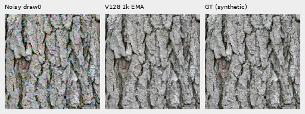
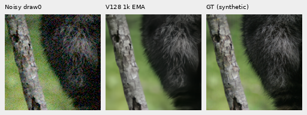

# V128: completed early-feature-loss pilot

**Weight.1 early DINO feature supervision gives no useful quality gain in this
matched1,000-update pilot.** Against V126, mean sRGB PSNR changes by−.00040dB
on the shadow groups and−.00014dB on ordinary materials. All28 native comparison
boards were inspected: fine fur/grass and real green mesh remain soft.
V120 remains the general recommendation; the feature term stays off by default.

[Scores and complete training/audit receipts](results/v128-feature-pilot-quality-v1.json)
· [All material summaries](results/v128-feature-pilot-quality-v1.csv)
· [Image/source/ROI/checkpoint/noise/display metadata](images/v128-feature-pilot-quality-v1/manifest.json)
· [Publication and active-plan verification](results/v128-v129-publication-verification-v1.json)
· [Diagnostic and implementation](dino-feature-supervision.md).

## Matched training and saved-state continuation

V128 adds weight.1 spatial MSE between corresponding first-stage DINO features
of its prediction and detached target. It shares the existing frozen official
ConvNeXt-Small encoder, without a new inference parameter or encoder instance.
Paired RAW and validation retain their existing losses. The V126 control is
already complete and reused.

Both recipes start from V120, use seed70,90,783 sources/23 regions at a.5
reviewed-region quota, native256/B16/BF16, one noise view, zero optical blur,
paired32/native128, LR1e−5 and100-step warmup. All1,000 clean/noisy batch hashes
match V126, including477 Commons,262 native and261 paired batches.
All91 model/EMA tensors and89 Adam states are finite at update1,000.

A memory guard saved all399 original updates; the exact continuation performed
only601 more within the original8h deadline. CPU/CUDA16+2 checks and the prefix
were reused. Totals are1,000 training/optimizer forwards,64 validation forwards,
1,064 full encoder calls and1,478 additional first-stage feature calls.
The original failures/checkpoints/queues remain intact. A null-child ownership
bug stopped the first rebound quality waiter before any inference; the corrected
queue then made its original86 candidate restorations once.

V128 checkpoint SHA256:
`f5fc058bc4236b18895fe489bb1a73d6df6816939bcb5e209a4b6b6c54f7ee32`.
V126 control SHA256:
`04bd122e639f94be65ecec5abdc750810d9df4df7661e3ddb06ed309e32e3294`.
Frozen DINO SHA256:
`691963f0f796aac860d818d59d9d14287a4675612829fbe9467c7f5df8ce5b14`.

## Fixed-input results

The86 restorations cover64 shadow conditions,16 ordinary material observations,
four main-GFX512 contexts and two extra-mesh768 profiles. All V126/V120 controls
are retained outputs. There are no new noise draws or RAW decodes. The shadow
support is four sources ×two camera gains ×two nominal noise priors ×four CFAs,
one draw each, rather than64 independent photographs. Reported means average
four-CFA groups at the same fixed inverse exposure. Native grass/wood references
are binned low-noise estimates, not exact GT. Full427/all-camera quality is unmeasured.

| Mean sRGB PSNR, dB | V120 | V1261k | V1281k | V128−V126 |
| --- | ---: | ---: | ---: | ---: |
| Sixteen shadow target/condition groups |25.90197 |25.89620 |25.89580 |−.00040 |
| Four ordinary material groups |32.30426 |32.30861 |32.30847 |−.00014 |

Shadow camera-RGB mean rises+.00159dB against V126; ordinary camera-RGB mean
falls.00050dB. These tiny mixed changes from one seed establish no useful gain.
On ordinary faint fur, band projection changes.32853→.32801. Grass/wood projection
rises.68082→.68291 and.64341→.64511, while both band error and orthogonal residual
also rise. Projection gain alone does not establish recovered physical detail.

Two native160×160 triplets below show **noisy → V1281k EMA → exact synthetic
GT**. Both use central ROI`[48,48,160,160]`, identical WB/matrix and exposure1,
RGGB, ISO12800-prior shot.00256/read2.62144e−5,16-bit ADC and black.03.
No crop pixels are resized. These are nominal priors, not camera calibration.

Bark: [Derek Ramsey](https://commons.wikimedia.org/wiki/File:Kentucky_Coffee-tree_Gymnocladus_dioicus_3264px.jpg),
[CC BY-SA2.5](https://creativecommons.org/licenses/by-sa/2.5/).
Fur: [Korall](https://commons.wikimedia.org/wiki/File:Racoon_clinging_to_a_tree.JPG),
[CC BY3.0](https://creativecommons.org/licenses/by/3.0/).
These are cropped, binned, camera-transformed and synthetically noised derivatives.
The harder +5EV comparisons retain all methods:
[bark, gain1/32/ISO6400](images/v128-feature-pilot-quality-v1/bark-gain1over32-iso6400-prior-comparison.png)
· [fur, gain1/32/ISO12800](images/v128-feature-pilot-quality-v1/raccoon-fur-gain1over32-iso12800-prior-comparison.png).

## Real captures and independent verification

Columns below are noisy → V120 → V126 → V128 → separate ISO100 reference.
Main foliage stays painterly, and larger fence geometry stays coherent without
useful new recovery. The corrected extra DSCF3842/DSCF3835 mesh is mostly erased
under nominal conditioning and weak/irregular under the fixed nearby-capture
profile. Aperture, exposure and moving subjects differ: these are qualitative
references, **not exact GT**, and receive no reference-based PSNR.

All four extra mesh comparisons, at +4EV with the same native160 ROIs:
[nominal left](images/v128-feature-pilot-quality-v1/mesh-nominal-fine-green-mesh-left-comparison.png)
· [nominal right](images/v128-feature-pilot-quality-v1/mesh-nominal-fine-green-mesh-right-comparison.png)
· [nearby profile left](images/v128-feature-pilot-quality-v1/mesh-profile3879-fine-green-mesh-left-comparison.png)
· [nearby profile right](images/v128-feature-pilot-quality-v1/mesh-profile3879-fine-green-mesh-right-comparison.png).
[Standing-scene/profile details](gfx-green-mesh.md).

The independent audit recomputes240 metric rows,60 four-CFA summaries and3,975
scalar fields with channelwise FP64 rendering and a mirrored FFT DCT. Maximum
PSNR discrepancy is7.11e−15dB. Every17,203,200 channel value across56 PNGs matches
its independently rendered source cell. Seven review sheets preserve all28
comparison boards exactly, and all were actually viewed at native resolution.
Analysis/audit perform no neural, noise, RAW or optimizer work.

This tests one feature objective/weight and a short continuation, not every
possible foundation loss. Better local output gradients did not yield useful
trained quality here. The next [V129 data-only trial](reviewed-detail-training-pilot.md)
tests the newly curated90782/27-region cohort with the feature term off.
