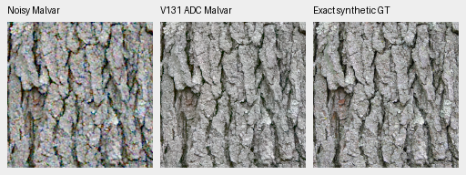
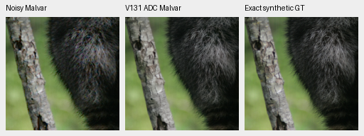

# Fixed ADC projection repairs V131 color and improves ADC photos

**The opt-in `v131-adc-malvar` variant improves ADC-only photo PSNR by0.15074 dB
versus V131 and reduces its worst flat-color mean RGB error from1,816 to19.98
DN16.** The learned weights are unchanged. The existing physical correction
activates only with explicit shot=read=0; positive-noise V131 output is retained.
This supplies a useful ADC operating point while preserving the
[unseen-camera and high-noise weak-detail costs](v131-broad-primary.md) of V131.
V120 remains the general recommendation. The weakest ADC detail band gains
amplitude but has **1.43% more reconstruction error**; this does not resolve
faithful weak-detail recovery.

[Native gallery](images/v131-adc-projection-v1/native-viewer.html) ·
[Receipts and executed sources](results/v131-adc-projection-v1/publication.json) ·
[Export, independent audit and viewing addendum](results/v131-adc-projection-v1/publication-addendum.json).

## Existing measurement consistency, unchanged weights

The operator is the already implemented
[`adc_cfa_projection(mode="malvar")`](../src/demosaic/cfa.py): compute the
observed-minus-predicted CFA residual and add its WB-aware Malvar reconstruction
to the parent's RGB prediction. Only measured samples strictly inside
`1/65535..1−1/65535` contribute. There is no flat detector, fitted threshold,
output clamp, target-dependent parameter, new neural branch or training update.
Earlier [ADC-policy work](v104-adc-color-projection.md) motivates the fixed
choice; no new mode/kernel sweep precedes this result.

The [standard exporter](../scripts/export_adc_cfa_projection.py) retains all91
EMA restoration tensors exactly and preserves the original20k training lineage.
Its serialized learned-tensor digest is
`1b2f6b61d27df2bdefb62b60bdf834db7117316bc343f66d8bd323774d756804`.
The parent is V131 SHA256
`4d78e6302f6e72d68acb03fe58eb7106763b8129ccb059747ef5d2cfbd3ec1e1`;
the exported checkpoint is
`6b1851e85933b56001ee1100e6ef0083173f3949849c1429894534a5caf2708e`.
Only the inference policy changes; these are not newly trained weights.

```python
from demosaic.models import load_model

model, payload = load_model(
    "v131-adc-malvar",
    checkpoint=".cache/experiments/v131-adc-malvar-export-v1/model.pt",
    device="cuda",
)
model.set_noise(0.0, 0.0)  # ADC-only observation
```

Use the appropriate physical shot/read prior for the actual observation.
Every positive shot or read value bypasses this policy. A four-forward real
export integration check verifies byte-exact positive-prior bypass and
byte-exact equality of integrated ADC output with direct GPU projection. On
that saved ADC bark batch, CPU/GPU projection also agrees byte-for-byte.
This smoke test is separate from the zero-neural-forward quality analysis.
No new full-frame102MP export/timing claim is made.

## Complete ADC photo and texture checks

The fixed stage processes saved V131 predictions for all444 ADC photo batches
(1,772 observations:427 photographs plus16 procedural inputs, four CFAs) and56
analytic texture batches (224 observations). All500 outputs close before new
scoring. Missing photo RAW inputs are regenerated using the original frozen
source/observation pipeline, checking **every original input and target
fingerprint exactly**. Texture inputs are deterministically recovered from
retained clean arrays and ADC quantization, again requiring exact original
fingerprints. This recovers historical observations, not new independent noise
or deployment target access. There are zero neural/DINO/RAW/update calls in
this evaluation; completed analysis takes55.15s under concurrent training.

A preliminary shortcut from saved photo targets failed all444 packed-input
hashes and is preserved, never admitted. All56 texture batches matched. The
original frozen pipeline resolves the photo mismatch without relaxing a
fingerprint. A failed prelaunch/import attempt is also retained.

| ADC-only 427-photo metric | V120 | V131 | V131 ADC Malvar |
| --- | ---: | ---: | ---: |
| sRGB PSNR, dB |37.917942 |38.012028 |**38.162770** |
| Linear PSNR, dB |43.887385 |43.971369 |**44.175098** |

Paired projected-minus-V131 sRGB change is **+0.150742 dB**, source-bootstrap
interval `[+.131219,+.170393]`, with382/427 source gains. Versus V120 it is
**+0.244828 dB**, interval `[+.223699,+.266181]`,397/427 gains. Linear PSNR
improves on425/427 sources versus V131. ADC chroma MAE rises `1.79e-5` versus
V131, with an interval spanning zero; gradient MAE falls `2.34e-5`. The score
gain does not improve every source or metric.

The worst source regression versus V131 is **−0.69095 dB** on
[Wraxall bonfire](images/v131-adc-projection-v1/worst-source-comparison.png).
That selection follows the full-source scores; its fixed RGGB/native160 ROI
was not searched for the largest pixel error. Flames retain visible texture
and color differences. All45 non-improving photo sources remain in the paired
rows, rather than being filtered out.

The unchanged other six conditions can be adopted exactly. Replacing only
ADC in the original equally weighted seven-condition photo panel gives a
**derived37.101617 dB** overall mean, +0.061534 dB over V120. This is an
arithmetic composition from closed outputs, not a new all-condition neural
replay. Unseen-camera and positive-noise weak-band costs remain unchanged.

| ADC analytic diagnostic | V131 | V131 ADC Malvar |
| --- | ---: | ---: |
| Carrier projected gain |0.984837 |0.978479 |
| Carrier noncarrier RMS |0.000046792 |0.000050919 |
| Carrier linear sRGB RMSE |0.000192064 |0.000173429 |
| Neutral-flat relative band RMS |0.000034452 |0.000005217 |
| Neutral-flat linear sRGB RMSE |0.000017986 |0.000014357 |

The lower carrier RMSE comes with lower amplitude and more orthogonal
noncarrier energy. These fixed192 carrier/32 flat cases cover artificial
periods/contrasts/levels; repeated ADC draws are deterministic duplicates.
They do not establish faithful recovery of arbitrary weak texture.

The same full427-photo local-detail analysis makes that cost explicit. In the
weakest ADC band, source-balanced projected gain rises **0.944062→0.965353**,
but band-error RMS rises **0.000944459→0.000957977 (+1.43%)** and orthogonal
RMS rises **0.000923813→0.000948115 (+2.63%)**. These are326 contributing
sources in GT-only relative RMS `[0,.02)`, native16 radial DCT `[1/8,1/3)`.
The other four stronger-contrast bins lower band error3.63–5.62%.
The unchanged legacy helper analyzes5,124 paired observations/96,075 unique GT
blocks in58.08s, adopting positive-prior arrays exactly. All positive-prior
stratum summaries are unchanged; explicit cosine versus independent even-FFT
checks remain in the receipt. This restricted band does not measure every mesh
fundamental. Better broad PSNR and color consistency do not imply better weak
detail fidelity.

The separate588-color ADC check reduces maximum absolute mean camera-RGB
error **1,816.37→19.98 DN16**, below V120's55.52. Positive-noise color outputs
are unchanged. All color outputs close before targets are loaded for scoring.

## Native detail, counterexample and both real families

Noisy Malvar → V131 ADC Malvar → **exact synthetic GT**. Native256 RGGB,
ROI `[48,48,160,160]`, explicit zero shot/read, ADC16/black0.03,
exposure1/contrast1 and identical saved WB/matrix/clipped-sRGB display.
Every160×160 cell is unchanged native pixels. The same bark/fur sources and
ROIs were already used in the broad audit; there is no crop search.
[Source credits and full input/calibration/checkpoint bindings](images/v131-adc-projection-v1/manifest.json).





The [bark](images/v131-adc-projection-v1/bark-comparison.png) and
[fur](images/v131-adc-projection-v1/fur-comparison.png) comparisons retain
fine detail without a large visible difference at ordinary display. The
[color outlier triplet](images/v131-adc-projection-v1/adc-color-outlier-triplet.png)
shows the corrected uniform field. All five new boards and the additional
worst-source comparison were actually viewed. Mean PSNR improvement is easier
to detect numerically than in these ordinary ADC crops.

Both protected real families use positive priors and therefore retain the
exact original V131 PNG bytes. Main DSCF3879/3880, nominal
`.00128/6.5536e-6`, exposure4/native512 contexts/native160 crops:
[sky](images/v131-adc-projection-v1/protected/main-overcast-sky-comparison.png),
[building](images/v131-adc-projection-v1/protected/main-building-detail-comparison.png),
[foliage](images/v131-adc-projection-v1/protected/main-foliage-comparison.png),
[coarse fence](images/v131-adc-projection-v1/protected/main-chain-link-fence-comparison.png).
Sky is smooth, building soft, foliage painted and coarse wires retained.

Cab DSCF3842/3835, exposure16/native768 contexts/native160 crops, both SOOC
JPEGs: nominal
[left](images/v131-adc-projection-v1/protected/mesh-nominal-fine-green-mesh-left-comparison.png)/
[right](images/v131-adc-projection-v1/protected/mesh-nominal-fine-green-mesh-right-comparison.png),
nearby DSCF3879 profile `.0014635775921166604/1.0715704128646712e-6`
[left](images/v131-adc-projection-v1/protected/mesh-profile3879-fine-green-mesh-left-comparison.png)/
[right](images/v131-adc-projection-v1/protected/mesh-profile3879-fine-green-mesh-right-comparison.png).
Fine crossings remain missing. These eight boards were viewed in the completed
broad review and adopted byte-exact here. ISO100/AHD/JPEG references differ
in aperture, exposure and motion: **qualitative references, not exact GT**.
There is no pixelwise scoring. Protected caches/siblings remain outside training;
original media were not modified. This ADC-only repair supplies no new real
positive-noise mesh gain.

An independent no-Torch audit recomputes7,088 photo metric fields over all1,772
ADC observations; maximum discrepancy is `5.68e-14`. It checks1,305,600 native
RGB channels exactly in five new boards and exact bytes in eight adopted
protected boards. The worst-source board separately passes encoded-cell hash
checks. No second independent texture/kernel implementation is claimed.
All31 existing ADC-policy/export tests and the package/registry/native-import
test pass. [Final publication/link/hash verification](results/v131-adc-projection-v1/verification.json).
