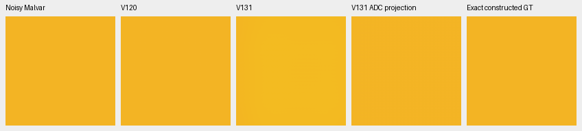
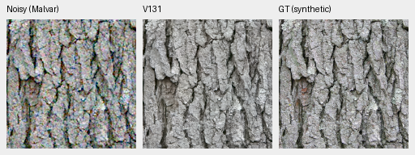
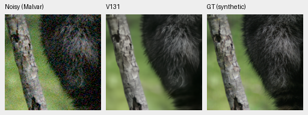

# V131 improves photo scores with camera and ADC-color costs

**The completed V131 continuation improves the 427-photo mean by 0.04000 dB,
with 400/427 source means increasing.** Known-camera measured-CFA performance
is nearly unchanged; unseen-camera performance falls 0.04381 dB. Its worst
ADC-only flat-color mean RGB error rises from V120's **55.5 to 1,816 DN16**.
V131 is a useful experimental photo/faint-detail option with these costs;
**V120 remains the general recommendation**. The score gain does not establish
faithful high-noise weak-detail recovery.

[Native gallery](images/v131-broad-completed-v1/native-viewer.html) ·
[Completed receipts and executed sources](results/v131-broad-completed-v1/publication.json) ·
[Publication source and viewing addendum](results/v131-broad-completed-v1/publication-addendum.json) ·
[Earlier compatibility and live snapshot, preserved](results/v131-broad-primary-v1/publication.json) ·
[Targeted gains and counterexamples](v131-endpoint-quality.md).

The full20k EMA checkpoint is SHA256
`4d78e6302f6e72d68acb03fe58eb7106763b8129ccb059747ef5d2cfbd3ec1e1`;
V120 is `a9d9b6b4f974e24a6b11e5e740aab32314233a7f53c056cf37c7d2aac1c589fb`.
The experimental `v131` preset loads that endpoint. V132's added-attention arm
has since completed the same full20k horizon.
Its [endpoint review](v132-endpoint-quality.md) finds faint ADC −0.40978 dB
versus V131 and near-tied ordinary detail; this is a November 17 status update.
No new 102MP V131 export/timing result is claimed here.

## Complete matched numerical review

The frozen [driver](../scripts/evaluate_v131_broad.py) uses the **original V120
primary observation and metric pipeline**, preserving the collector and
prediction archives. It makes 4,450 panel forwards and checks all original
exact input fingerprints. Existing V120 outputs are reused without inference.

| Panel | New V131 forwards | Observations |
| --- | ---: | ---: |
| Photo + procedural |3,108 |12,404 |
| Known camera |24 |72 |
| Unseen camera |30 |90 |
| Texture |112 |448 |
| Color |1,176 |1,176 |
| Total |4,450 |14,190 |

Photo retains 427 free-image sources plus 16 procedural inputs, seven conditions
and four CFAs, native256 FP32 batches. The 11,956 photographic observations
supply the photo score; procedural observations are retained separately. Both
sides below use independent NumPy64 reductions on their saved predictions.
Original mixed CPU/GPU precision comparisons are preserved, with the canonical
CPU-to-CPU addendum used here.

| Metric | V120 | V131 | Paired change | Source bootstrap 95% interval |
| --- | ---: | ---: | ---: | --- |
| Photo sRGB PSNR, dB |37.040083 |37.080082 |+0.039999 |[+0.035488,+0.044289] |
| Known-camera measured-CFA PSNR, dB |54.312718 |54.319927 |+0.007209 |[−0.001577,+0.014550] |
| Unseen-camera measured-CFA PSNR, dB |54.008722 |53.964912 |−0.043810 |[−0.108925,−0.001113] |

Photo linear PSNR also rises about0.03167 dB; chroma and gradient MAE decrease.
Known-camera source means improve on3/4 scenes, unseen on1/5. Unseen AHD-display
PSNR falls about0.07311 dB with0/5 scene gains; all five chroma errors worsen.
Measured-CFA sensor scores and independently demosaiced AHD reference metrics
have distinct roles; AHD is not exact RGB GT. Bootstrap intervals describe
fixed source variation, not training-seed or general-camera confidence.

Actual427 evaluated photo IDs have **zero exact overlap** with the declared
90,781 training IDs. The manifest also contains2,303 validation and2,255 test
IDs. This checks exact identifiers only, not visual duplicates or foundation
model pretraining. No images were decoded for this check.

## Photo-score gains do not settle weak-detail quality

The unchanged local-detail analysis covers427 photos, **5,124 paired
source/noise/CFA observations** and96,075 unique native16 GT blocks. Strata use
GT-only relative band RMS, block mean in `.02..9`, unsaturated RGB, and radial
DCT frequency `[1/8,1/3)` cycles/pixel. The weakest bin is relative RMS `[0,.02)`
and has326 contributing sources. Means pool four CFAs within source before
source balancing. This band does not cover every low-frequency mesh
fundamental.

| Weakest bin / prior | V120 projected gain | V131 projected gain | V120 band-error RMS | V131 band-error RMS |
| --- | ---: | ---: | ---: | ---: |
| ADC-only |0.946832 |0.944062 |0.000948336 |0.000944459 |
| ISO100 |0.785711 |0.787784 |0.001414642 |0.001413411 |
| ISO12800 |0.364763 |0.367575 |0.003181508 |0.003183420 |

ADC and ISO100 band errors fall0.409%/0.087%. At ISO12800, amplitude rises but
band error rises0.060%; orthogonal band error rises about1.12%. The analysis
transforms2,401,875 blocks in56.16s, with explicit cosine versus independent
FFT maximum discrepancy `1.80e-14`. It performs no new neural/noise/RAW work.
The [targeted four-source review](v131-endpoint-quality.md) retains its larger
faint-ADC gain and bark counterexample; that subset is not the broad mean.

On the independent analytic texture panel, high-noise carrier mean gain rises
`0.34864→0.35383`, noncarrier RMS falls `0.00090860→0.00089238`, and linear
sRGB RMSE falls `0.00141244→0.00139149`. High-noise flat relative band RMS falls
`0.004061→0.003837`, but maximum-bin contrast averaged over cases rises
`0.001023→0.001040`. ADC carrier gain falls `0.99190→0.98484`; neutral-flat band
RMS rises `3.184e-5→3.445e-5`. These are fixed artificial periods/levels/contrasts;
ADC repeats are deterministic duplicates, not independent observations.

## Severe ADC color regression and a fixed physical repair diagnostic

Across588 ADC color cases, the largest absolute mean camera-RGB error is
**55.52 DN16 for V120 versus1,816.37 for V131**. V131's worst case is
`h030-s0.98-l0.90`, BGGR, case1001; its spatially centered RGB RMS is245.03
DN16. The corresponding high-noise maxima improve `78.82→66.55 DN16`.
This ADC failure materially limits the unprojected endpoint.

All panels use native256, ROI `[48,48,160,160]`, exposure1/contrast1, the same
saved WB/matrix, clipped sRGB and unchanged160-pixel cells. ADC shot/read are
both zero. This is a constructed constant-color target and an explicitly
post-score-selected failure, not a representative photograph.

The **existing**, fixed WB-aware Malvar residual projection reduces V131's
588-case maximum to **19.98 DN16**. This diagnostic applies
`adc_cfa_projection(mode="malvar")` to saved predictions and packed RAWs, with
its unchanged valid interval `1/65535..1−1/65535`. All588 outputs close before
loading targets for scoring; no target fit, learned update, kernel/threshold
sweep or neural forward occurs. Positive shot/read profiles bypass this policy.
The [previous ADC-projection report](v104-adc-color-projection.md) records
photographic gains and possible texture costs. The fixed repair now has a
[completed photo/texture follow-up](v131-adc-projection.md): ADC photo
PSNR improves0.15074 dB over V131, with weakest-band error+1.43% and some
carrier-amplitude cost. The opt-in export/preset retains all91 learned tensors
and positive-noise outputs unchanged; this does not resolve real noisy detail.
Original unprojected outputs and receipts remain intact.

## Native detail and both protected real families

Noisy Malvar → V131 → **exact synthetic GT**. Native256 RGGB, ROI
`[48,48,160,160]`, ISO12800 shot/read `.00256/2.62144e-5`, exposure1/contrast1,
identical saved WB/matrix and clipped sRGB; no crop resizing.
[Source credits, input/ROI/calibration and checkpoint bindings](images/v131-broad-completed-v1/manifest.json).

The [bark comparison](images/v131-broad-completed-v1/bark-comparison.png) retains
soft fine cracks; [fur](images/v131-broad-completed-v1/fur-comparison.png)
retains soft irregular strands. The ordinary native differences are small.
Both triplets, both comparisons, the outlier comparison/triplet and all eight
adopted protected-real comparisons were actually viewed.

The same-checkpoint DSCF3879/3880 main boards retain exposure4, native512
contexts/160 crops and nominal `.00128/6.5536e-6` conditioning:
[sky](images/v131-broad-completed-v1/protected/main-overcast-sky-comparison.png),
[building](images/v131-broad-completed-v1/protected/main-building-detail-comparison.png),
[foliage](images/v131-broad-completed-v1/protected/main-foliage-comparison.png),
[coarse fence](images/v131-broad-completed-v1/protected/main-chain-link-fence-comparison.png).
Sky is smooth; foliage stays painted and building detail soft. Coarse fence
geometry survives; there is no clear new fine-detail recovery.

Cab DSCF3842/3835 boards retain exposure16, native768 contexts/native160 ROIs,
both SOOC JPEGs and both profiles: nominal
[left](images/v131-broad-completed-v1/protected/mesh-nominal-fine-green-mesh-left-comparison.png)/
[right](images/v131-broad-completed-v1/protected/mesh-nominal-fine-green-mesh-right-comparison.png),
and nearby DSCF3879 `.0014635775921166604/1.0715704128646712e-6`
[left](images/v131-broad-completed-v1/protected/mesh-profile3879-fine-green-mesh-left-comparison.png)/
[right](images/v131-broad-completed-v1/protected/mesh-profile3879-fine-green-mesh-right-comparison.png).
Fine crossings remain mostly absent. ISO100 AHD/JPEGs differ in aperture,
exposure and motion: **qualitative references, not exact GT**, with no pixelwise
scoring. Cached originals and siblings remain excluded from training and
original media were not modified. Adopted PNGs match original bytes.

## Independent audit and numerical compatibility

The [independent auditor](../scripts/audit_v131_broad.py) covers all14,190
observations using copied original CPU-only audit helpers. Photo maximum
CPU/GPU PSNR differences are `8.25e-6` linear / `1.87e-4` sRGB dB, within
unchanged legacy tolerances. It independently checks listed photometry,
texture and color reductions; SSIM and additional masked metrics retain the
original evaluator implementation. Auditing adds zero neural/RAW/noise calls.

All91 EMA restoration tensors and frozen DINOv3 backbone are checked exactly.
The old parser adapter removes only the two disabled newer RAW flags. A
same-process diagnostic verifies old/current implementations byte-exact on two
saved observations, both convolution policies and repeats:16 model/encoder
calls. Four failed setup attempts remain preserved: omitted explicit noise,
layout mismatch, overly tight cross-session precision bound, then output-cache
write guard. None reached a panel forward. The fifth run completed all panels.

Current compatibility max/RMS differences are `0.039062/0.003808` and
`0.027343/0.001616` DN16, under explicit0.25-max/0.025-RMS numerical bounds;
these are not quality gates. Two such probes precede the4,450 panel forwards.
Original corruption tensors are regenerated and fingerprint-checked; no new
independent observation, original RAW decode or training update occurs.
Timing under concurrent V132 training is not a speed benchmark. The earlier
288/3,108-batch live publication is retained as history, with completed evidence
in the new directory linked above.
