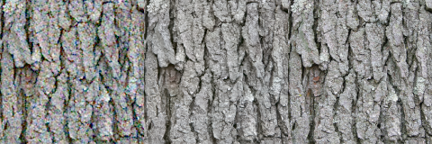
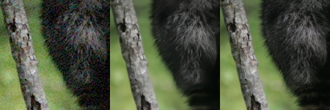
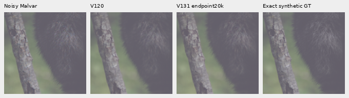
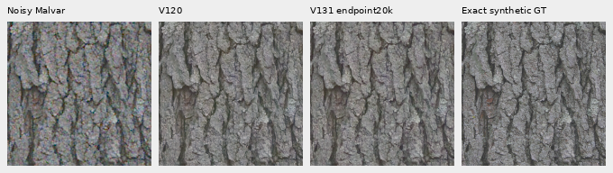

# V131: completed continuation has small, mixed detail gains

**V131 completes all 20,000 updates.** Against the saved V120 outputs, its
four-source retained panel gains **0.01539 dB ordinary**, **0.01673 dB shadow**
and **0.14555 dB faint-ADC** sRGB PSNR. Faint fur, grass and wood improve; bark
regresses. All 64 native boards and eight amplified faint-detail boards were
actually inspected. Outputs remain close to V120, with soft foliage and largely
missing fine cab mesh. V120 remains the general recommendation; `v131` is an
available experimental full-model preset.

This is additional full-trunk training with V120's architecture and a revised
training cohort/recipe, not a controlled architecture comparison against V120.
The matched added-attention arm **V132 is training**. Its comparison with V131
will use the same 20,000 training inputs and saved evaluation arrays.
[Training/state continuity](raw-spatial-continuation.md) ·
[Per-endpoint review](raw-spatial-endpoint-review.md) ·
[Machine evidence and frozen sources](results/v131-endpoint-v1/publication.json).

## What improved and what did not

Each score below averages four CFA patterns per source/condition, with one
retained sensor realization per pattern. Ordinary/faint panels have four
material sources; shadows repeat those sources at two exposures and two noise
priors. These are repeated observations, not independent new photographs.

| Retained panel | Inputs | V120 sRGB PSNR | V131 sRGB PSNR | Difference | Camera-RGB difference |
| --- | ---: | ---: | ---: | ---: | ---: |
| Ordinary | 16 | 32.30426 | 32.31965 | +0.01539 dB | +0.01166 dB |
| Shadows | 64 | 25.90197 | 25.91870 | +0.01673 dB | +0.01404 dB |
| 2.5% contrast, ADC only | 16 | 67.48067 | 67.62622 | +0.14555 dB | +0.25828 dB |

Faint-ADC PSNR is high because target contrast and noise are small; it is not
comparable to ordinary-photo or broad 427-photo scores. Bark/fur use exact
constructed targets from processed/binned Commons photos. The two PIXLS targets
are binned low-noise camera-RGB estimates, **not exact noiseless GT**. Their
reference noise and processing remain limitations of the scores.

| Faint source | sRGB difference | Weakest DCT16-stratum gain, V120 → V131 | Stratum RMS change |
| --- | ---: | ---: | ---: |
| Bark, exact constructed GT | −0.14548 dB | 0.99055 → 0.99771 | +3.187% |
| Raccoon fur, exact constructed GT | +0.19685 dB | 0.95585 → 0.97246 | −7.096% |
| PIXLS5002 fine grass, approximate reference | +0.18763 dB | 0.99786 → 1.00835 | −0.015% |
| PIXLS1951 wood/field, approximate reference | +0.34321 dB | 0.97300 → 0.98381 | −5.986% |

Higher response alone is insufficient: bark's weakest-stratum gain moves closer
to one while its error rises. The worst individual faint result is bark GBRG,
**−0.38267 dB**. Ordinary changes range from −0.00337 to +0.03070 dB; shadow
changes range from −0.11837 to +0.17132 dB. Deep wood shadow also has higher
weak-stratum error despite higher mean PSNR. Preserve these costs alongside
the fur/wood response gains.
[All paired source/condition means](results/v131-endpoint-v1/paired-material-summary.json.gz) ·
[Per-observation metrics](results/v131-endpoint-v1/metrics.csv.gz).

## Native noisy/restored/GT triplets

Each cell below is **160×160 native pixels**, without resampling: noisy Malvar,
V131, exact constructed GT. Both use RGGB/native256 context, ROI
`[48,48,160,160]`, shot `0.00256`, read `2.62144e−5`, 16-bit ADC/black0.03,
exposure1, contrast1 and identical WB/matrix/clipped-sRGB display. Only the
original draw0 is collected; historical `draws:8` metadata describes the source
panel, not eight new or averaged draws.

Checkpoint SHA256:
`4d78e6302f6e72d68acb03fe58eb7106763b8129ccb059747ef5d2cfbd3ec1e1`.
V120 control SHA256:
`a9d9b6b4f974e24a6b11e5e740aab32314233a7f53c056cf37c7d2aac1c589fb`.
[Exact source, ROI, input, checkpoint and display manifest](images/v131-endpoint-v1/small-triplets-manifest.json).





Bark is Derek Ramsey's [Kentucky coffee-tree photograph](https://commons.wikimedia.org/wiki/File:Kentucky_Coffee-tree_Gymnocladus_dioicus_3264px.jpg),
[CC BY-SA 2.5](https://creativecommons.org/licenses/by-sa/2.5/).
Fur is Korall's [raccoon photograph](https://commons.wikimedia.org/wiki/File:Racoon_clinging_to_a_tree.JPG),
[CC BY 3.0](https://creativecommons.org/licenses/by/3.0/).
These exact synthetic targets are transformations of photographs, not claims
of noiseless original camera measurements. Both restored crops retain larger
structures but attenuate finer ridges/strands. Direct four-cell comparisons:
[bark](images/v131-endpoint-v1/bark-comparison.png) and
[fur](images/v131-endpoint-v1/raccoon-fur-comparison.png).

### A common display makes faint changes visible

The faint inputs reduce spatial contrast to 2.5% before ADC quantization, with
shot/read both zero. Ordinary displays are almost uniform. These additional
native160 views use one shared transform for every method and reference:
`sRGB(clip(0.18 + 20*(linear_RGB − reference_ROI_channel_mean), 0, 1))`,
after the same WB/matrix at exposure1. The reference defines a **display anchor
only**; inference never sees it. No noise, predictions or pixel coordinates are
changed. Maximum clipped-channel fraction is 0.0547%. An earlier contrast40
draft is preserved but was not selected because of much greater clipping.
[Display/provenance/clipping manifest](images/v131-endpoint-v1/faint-amplified-manifest.json).





Changes remain subtle even with this display. Fur has a measured gain; bark
retains its regression. The approximate-reference
[grass](images/v131-endpoint-v1/pixls-5002-fine-contrast0p025-adc-contrast20-comparison.png)
and [wood/field](images/v131-endpoint-v1/pixls-1951-field-contrast0p025-adc-contrast20-comparison.png)
views likewise do not demonstrate a large visible recovery of missing structure.

## Protected real scenes retain the central failures

DSCF3879 ISO6400 versus DSCF3880 ISO100/f5.6 uses native512 contexts and native160
cells, exposure4, nominal shot/read `0.00128/6.5536e−6`, shared WB/matrix and
integer input/reference alignment. The panels contain noisy → V120 → V131 →
independent ISO100/AHD reference. The reference differs in aperture, exposure
time and motion; it is **not exact GT** and receives no pixelwise score.

| Main scene | Native comparison | Observation |
| --- | --- | --- |
| Sky | [Overcast sky](images/v131-endpoint-v1/main-overcast-sky-comparison.png) | Both restorations smooth the noise; no clear new V131 advantage |
| Building | [Building detail](images/v131-endpoint-v1/main-building-detail-comparison.png) | Clean but soft edges; near V120 appearance |
| Foliage | [Foliage](images/v131-endpoint-v1/main-foliage-comparison.png) | Painted/soft fine structure remains |
| Coarse fence | [Chain-link fence](images/v131-endpoint-v1/main-chain-link-fence-comparison.png) | Main wire geometry survives; no clear added fine detail |

The difficult cab pair DSCF3842 ISO6400 / DSCF3835 ISO100/f5.6 uses the same
native768 context, both native160 ROIs and exposure16 at both fixed profiles:

| Cab profile | Left ROI | Right ROI |
| --- | --- | --- |
| Nominal `shot=.00128/read=6.5536e−6` | [Left](images/v131-endpoint-v1/mesh-nominal-fine-green-mesh-left-comparison.png) | [Right](images/v131-endpoint-v1/mesh-nominal-fine-green-mesh-right-comparison.png) |
| Nearby DSCF3879 input-Haar profile `.0014635775921166604/1.0715704128646712e−6` | [Left](images/v131-endpoint-v1/mesh-profile3879-fine-green-mesh-left-comparison.png) | [Right](images/v131-endpoint-v1/mesh-profile3879-fine-green-mesh-right-comparison.png) |

Each cab comparison also includes both native straight-out-of-camera JPEGs,
with their original sRGB pixels and no extra RAW display transform. They are
separate qualitative comparisons. Nominal restoration largely removes the fine
mesh; the nearby profile retains weak modulation from one family with incomplete
crossings. V131 supplies no convincing new lattice recovery. Both RAW profiles
are disclosed priors, not dedicated flat/dark camera calibration. Aperture,
exposure and motion differences also prevent treating this ISO100 reference as GT.
All captures, JPEGs and siblings remain excluded from training, and cached arrays
avoid touching the read-only originals. Full sensor ROIs and display bindings
are retained in the manifest and evaluation plan.

## Verification and use

Training finishes with 20,000 Adam clocks/updates, 640 validation forwards,
20,640 encoder calls and 320,000 target contexts. The saved 14,549-step prefix
was restored without replay. The quality collector makes exactly102 root/DINO
calls, with unchanged model/backbone/RNG and no new source/noise construction,
RAW decoding or optimizer updates. Peak CUDA allocation is 9,807,443,456 bytes.
A separate NumPy-only process reproduces192 metric rows/2,850 scalar fields and
**17,817,600 RGB channels** across all64 native PNGs exactly; maximum PSNR
discrepancy is1.42e−14dB. All32 native triplets and the eight additional amplified
boards were viewed. Small README triplets are exact crops of audited panels.
Their [coordinate addendum](results/v131-endpoint-v1/small-triplet-coordinate-addendum.json)
corrects inherited source-board positions in the small strips' metadata;
original image and receipt bytes remain unchanged.
The [publication checks](results/v131-endpoint-v1/publication-checks.json) record
106 passing focused tests, Ruff checks and411 valid local documentation links.

The ordinary registry loader was separately exercised on one retained faint-fur
input. All91 EMA tensors and full-model/backbone hashes match. Its output differs
from the frozen evaluator by at most **0.001954 DN16**; weights are exact, output
bits are not. This single compatibility call is additional to the102 quality
calls, with zero training/noise work.

```python
from demosaic.models.registry import load_model

model, payload = load_model(
    "v131",
    checkpoint=".cache/experiments/raw-spatial-continuation-v2/work/artifacts/train/V131/last.pt",
    device="cuda",
)
```

The preset checks the declared checkpoint hash. Full-frame102MP/speed and
broader standalone-flat validation remain separate. The
[completed broad numerical review](v131-broad-primary.md)
uses the original primary pipeline and independent audits: photo+0.04000 dB,
unseen-camera−0.04381 dB and a severe ADC-color regression. Its native boards
and full-cohort weak-detail analysis retain those gains and costs explicitly.
The small targeted gains are useful findings, with their
counterexamples retained; they do not establish broad superiority or resolve
the weak-detail objective. V132's matched production and endpoint review continue.
