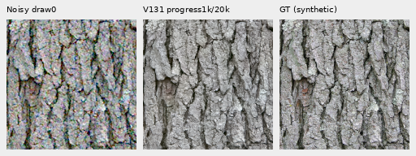
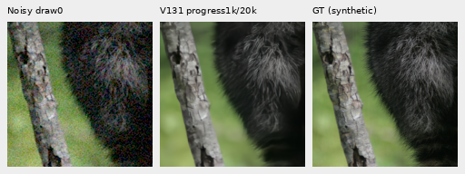
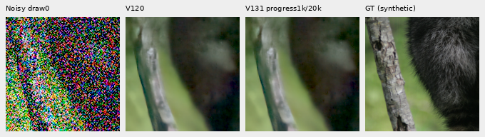
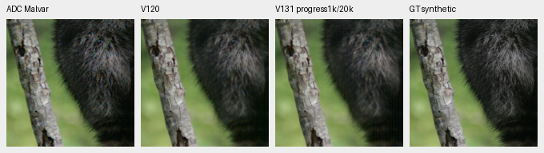
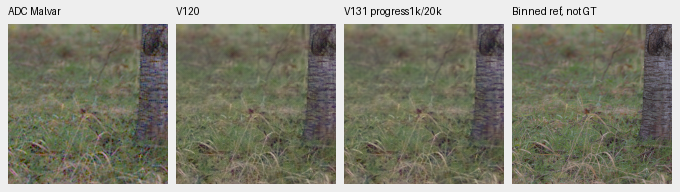
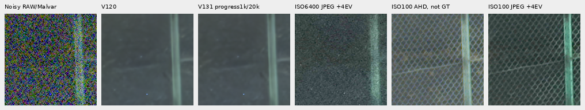
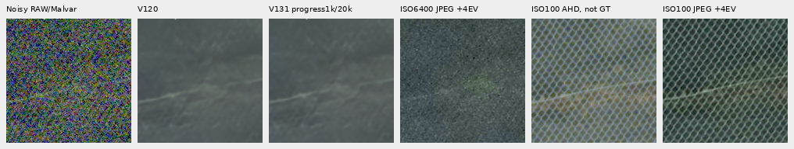

# V131 progress: small ordinary changes, weaker faint detail

**V131 at1,000 updates shows mixed local changes and no clear new recovery of
the fine green mesh.** Ordinary sRGB PSNR rises.00162dB over V120, while the
deepest shadows fall.02368–.03421dB and faint ADC falls.27335dB. V120 Small
remains the general recommendation. V131's original20k worker continues;
this immutable progress snapshot is not its endpoint.

[Measurements and execution](results/v131-progress1000-quality-v2.json) ·
[Per-observation scores](results/v131-progress1000-metrics-v1.csv) ·
[All detail bands](results/v131-progress1000-bands-v1.csv) ·
[Source/ROI/checkpoint/noise/display metadata](images/v131-progress1000-quality-v1/manifest-v2.json) ·
[Publication verification](results/v131-progress1000-publication-v1.json) ·
[Original V131/V132 recipe](raw-spatial-training.md).

## What this comparison measures

V131 retains V120's architecture: the official frozen DINOv3 ConvNeXt-Small
pyramid and pretrained DRUNet restoration family, with the optional spatial
branch **off**. It continues from V120's completed20k EMA on90,781 Commons
photos/29 reviewed regions,50% reviewed quota and seed70. Native256/B16/BF16,
single-view reconstruction, zero optical PSF, LR1e−5 and100-step warmup use
the original20,000-update cosine horizon. Comparisons with V120 combine
continued training, data, quota, seed and schedule; they do not isolate a
data or architectural effect. V132 will add the spatial branch at the same
full budget, and V133 will test the reviewed quota separately.

Checkpoint SHA256: `59bf01ec466183bad7cd1134e47b301cf0189e613154b9853e7691ca04a26378`.
The retained step1,000 state has91 model/EMA tensors and89 finite Adam states
at step1,000. All63 trained source modules match the frozen inference source.
The original prefix contains1,000 training/optimizer calls,16,000 target
contexts,32 validation calls and1,032 encoder calls; domain batches are477
Commons,262 native and261 paired.

Exactly **102 new root/DINO forwards** process retained inputs:64 shadow,
16 ordinary,16 faint ADC, four main-GFX512px contexts and two extra-mesh768px
profiles. All102 V120 predictions are reused after input checks. Collection
leaves weights, backbone and RNG unchanged, with CUDA peak9,807,443,456 bytes
under the original12GiB cap. No new sensor observations, RAW decodes or
optimizer updates are part of this quality review.

Four material source contexts each have four CFAs and one retained observation
per CFA:16 observations per condition, **not16 independent photographs**.
Commons targets are exact processed synthetic GT. Native-camera binned
references and separate real ISO100 exposures are approximate, **not GT**.

## Scores and ordinary weak detail

Equal means of16 central native160×160 sRGB PSNRs. Shadow compensation is8×
or32× before scoring and display; ordinary/faint exposure is1×. Camera-linear
scores are separately available in the CSV and are not mixed with this table.

| Condition | V120 | V131 progress1k/20k | Change, dB |
| --- | ---: | ---: | ---: |
| Ordinary ISO12800 prior |32.304263 |32.305880 |+0.001617 |
| Target gain1/8, ISO6400 |28.561316 |28.562359 |+0.001043 |
| Target gain1/8, ISO12800 |26.777249 |26.776392 |−0.000857 |
| Target gain1/32, ISO6400 |25.008258 |24.984579 |−0.023679 |
| Target gain1/32, ISO12800 |23.261062 |23.226847 |−0.034215 |
| Contrast.025, ADC only |67.480668 |67.207314 |−0.273354 |

Ordinary conditioning: shot`.00256`, read`2.62144e−5`, ADC16, black`.03`,
draw0. Shadow ISO6400 uses shot`.00128`/read`6.5536e−6`; ISO12800 uses the
ordinary profile. Coordinates, observations, WB/matrix and transforms match.

Fine-band measurements use the original DCT16 luminance masks,
1/8≤radial frequency<1/3 cycle/pixel. Eligible blocks have in-gamut reference
RGB, mean.02–.9 and band RMS≥1e−5. Gain1 matches target projection, but error
must also be considered. Counts are physical blocks repeated across CFAs.

| Region / contrast | Blocks | Gain V120 / V131 | Band error RMS V120 / V131 |
| --- | ---: | --- | --- |
| Fur,0–2% |7 |0.324842 / 0.329772 |0.00380475 / 0.00380614 |
| Fur,2–5% |5 |0.594593 / 0.600463 |0.00497084 / 0.00496257 |
| Grass,2–5% |3 |0.691481 / 0.701569 |0.00575641 / 0.00582103 |
| Wood,2–5% |9 |0.657325 / 0.642020 |0.00221148 / 0.00222124 |

Fur2–5% improves in gain and error. Weaker fur and grass gain response with
slightly higher error; wood loses response and has higher error. This is a
mixed change, with no broad recovery established from these four contexts.

## Native noisy/restored/GT triplets

Noisy draw0 → V131 progress1k/20k EMA → exact processed synthetic GT. RGGB,
ROI`[48,48,160,160]` inside256px contexts,+0EV, common WB/matrix/sRGB.
Each cell contains160×160 unchanged pixels; there is no resize.

Matched four-cell comparisons: [bark](images/v131-progress1000-quality-v1/bark-comparison.png),
[fur](images/v131-progress1000-quality-v1/raccoon-fur-comparison.png),
[grass](images/v131-progress1000-quality-v1/pixls-5002-fine-comparison.png),
[wood](images/v131-progress1000-quality-v1/pixls-1951-field-comparison.png).
Columns: noisy → V120 → V131 progress → exact GT or labeled binned reference.
Actual native viewing finds coherent stronger bark edges, with fine fur,
grass and wood still soft; restored-method differences are subtle.

Bark: Derek Ramsey (Ram-Man),
[Kentucky Coffee-tree](https://commons.wikimedia.org/wiki/File:Kentucky_Coffee-tree_Gymnocladus_dioicus_3264px.jpg),
[CC BY-SA2.5](https://creativecommons.org/licenses/by-sa/2.5/).
Fur: Korall, [Racoon clinging to a tree](https://commons.wikimedia.org/wiki/File:Racoon_clinging_to_a_tree.JPG),
[CC BY3.0](https://creativecommons.org/licenses/by/3.0/).
Derivatives use binning, cropping, camera transforms, simulated sensor noise
and restoration. raw.pixls.us5002/1951 binned camera references are CC0.

Deep-shadow fur, target gain1/32, scored/displayed at+5EV:

[ISO6400,+5EV](images/v131-progress1000-quality-v1/raccoon-fur-gain1over32-iso6400-prior-comparison.png) ·
[ISO6400,+3EV](images/v131-progress1000-quality-v1/raccoon-fur-gain1over8-iso6400-prior-comparison.png) ·
[ISO12800,+3EV](images/v131-progress1000-quality-v1/raccoon-fur-gain1over8-iso12800-prior-comparison.png).
Fine texture smears in the deeper cases and colored blotches persist.

## Faint ADC detail

The retained operator scales each camera channel's whole256px deviations by
.025 about its original spatial mean, with no interpolation. Shot=read=0,
ADC16 and black.03 are fixed. The high scores describe deliberately faint
processed targets and are not comparable to the full-photo panel.

A zero-neural supplement was declared before these quality results. It reuses
the original-source DCT16 contrast masks and decomposes total error into
ROI-mean and centered spatial terms, without fitting a correction. All
transformed eligible blocks fall below2% contrast; the original strata separate
previously weak sources from stronger detail made faint by the operator.

| Original region | Blocks | Gain V120 / V131 | Relative band error V120 / V131 |
| --- | ---: | --- | --- |
| Fur,0–2% |7 |0.851840 / 0.809803 |0.286240 / 0.326891 |
| Fur,2–5% |5 |0.833865 / 0.785239 |0.311091 / 0.359667 |
| Grass,2–5% |3 |0.965485 / 0.913562 |0.248960 / 0.252728 |
| Wood,2–5% |9 |0.880826 / 0.845892 |0.182871 / 0.225580 |

All four selected faint strata lose gain and have higher relative error.
[All120 strata](results/v131-progress1000-faint-strata-v1.csv) ·
[All64 camera/sRGB decompositions](results/v131-progress1000-faint-decomposition-v1.csv).

| Method | Mean sRGB MSE | Centered spatial MSE | ROI-mean fraction of pooled MSE |
| --- | ---: | ---: | ---: |
| V120 |1.95171438e−7 |1.84983822e−7 |5.220% |
| V131 progress1k/20k |2.07108894e−7 |1.94402353e−7 |6.135% |

Both mean and spatial errors rise: spatial MSE increases about5.09%, with
ROI-mean MSE about24.7% higher. The regression is not solely a mean-color shift.

Display-only40× contrast uses `original camera DC +40×(value−DC)` for every
method, then common WB/matrix/sRGB,+0EV. It amplifies every error without a
fitted offset or resize. These amplified displays are never scored.

[Bark40×](images/v131-progress1000-quality-v1/bark-contrast0p025-adc-contrast40.png) ·
[Wood40×](images/v131-progress1000-quality-v1/pixls-1951-field-contrast0p025-adc-contrast40.png).
Ordinary8-bit faint displays look nearly identical; amplification exposes
colored residual texture and softening. The unamplified comparisons are
[bark](images/v131-progress1000-quality-v1/bark-contrast0p025-adc-comparison.png),
[fur](images/v131-progress1000-quality-v1/raccoon-fur-contrast0p025-adc-comparison.png),
[grass](images/v131-progress1000-quality-v1/pixls-5002-fine-contrast0p025-adc-comparison.png) and
[wood](images/v131-progress1000-quality-v1/pixls-1951-field-contrast0p025-adc-comparison.png).

## Both real GFX pairs

Main scene: **DSCF3879 ISO6400 / DSCF3880 ISO100 f/5.6**. Columns: noisy
Malvar → V120 → V131 progress → independent ISO100/AHD reference, **not GT**.
Native160px cells share512px contexts,+2EV, WB/matrix and nominal
shot`.00128`/read`6.5536e−6`. This profile differs from the historical fixed-Haar
full-frame gallery; no cross-profile comparison is implied.

[Building](images/v131-progress1000-quality-v1/main-building-detail-comparison.png) ·
[Sky](images/v131-progress1000-quality-v1/main-overcast-sky-comparison.png).
Actually viewed: foliage remains painterly, larger fence/building geometry
coherent and sky quiet. No clear large detail gain is visible.

Extra mesh: **DSCF3842 ISO6400 / corrected DSCF3835 ISO100 f/5.6**, including
both camera JPEGs. DSCF3835 is46 seconds earlier, with2.5s versus1/300s
exposure and different aperture/moving subjects. It is not pixelwise GT.
Native160px cells use the established768px context,+4EV, WB/matrix and fixed
nominal or nearby3879 conditioning; the latter is
shot`.0014635775921166604`/read`1.0715704128646712e−6`.

The following JPEG panels use one fixed+4EV transform for **both** JPEGs:
inverse sRGB →16× linear exposure → sRGB, without fitting to either model.
Camera WB, tone and sharpening remain different from RAW development.
Columns: noisy RAW/Malvar → V120 nominal → V131 progress nominal → ISO6400
camera JPEG → ISO100 AHD → ISO100 camera JPEG. All three separate reference
renderings are qualitative comparators, not GT or scoring targets.

The ISO6400 camera JPEG retains faint mesh amid grain, clearer at this common
exposure. Nominal restoration largely erases it. The nearby-profile predictions
retain weak irregular diagonals, without clear new lattice recovery. The left
blue point persists. Four-cell model comparisons:
[nominal left](images/v131-progress1000-quality-v1/mesh-nominal-fine-green-mesh-left-comparison.png),
[right](images/v131-progress1000-quality-v1/mesh-nominal-fine-green-mesh-right-comparison.png),
[nearby left](images/v131-progress1000-quality-v1/mesh-profile3879-fine-green-mesh-left-comparison.png),
[right](images/v131-progress1000-quality-v1/mesh-profile3879-fine-green-mesh-right-comparison.png).
Original unboosted JPEG panels are preserved
[left](images/v131-progress1000-quality-v1/fine-green-mesh-left-nativeJPEG.png) and
[right](images/v131-progress1000-quality-v1/fine-green-mesh-right-nativeJPEG.png).
The unboosted ISO6400 JPEG is too dark to support a clear visibility judgment;
the corrected viewing receipt supersedes that initial impression.

## Verification and remaining scope

Independent audits reproduce2,850 primary scalar fields and17,203,200 native
RGB channels across64 primary PNGs; maximum score error is1.42e−14dB. The
faint audit independently checks120 strata,64 decompositions and1,228,800
channels. Two JPEG display variants add1,843,200 exact channels, including an
independent scalar256-entry display-LUT check. All42 required/native/JPEG boards
were actually viewed. Thirty public PNGs are byte copies of audited originals.

The initial public manifest retained private image paths through metadata merge
ordering. Manifest-v2 corrects those paths; the original manifest/receipt and
all image bytes are preserved. A prepared memory-admission handoff was aborted
when the original queue began collection. Neither draft controller launched;
the original52GiB admission, owners, source, deadlines and call budgets remain.

The original V131 and V125 workers continue. V132 progress and the complete
427-photo/camera/color/GFX/full-frame endpoint chain remain pending. This
report does not establish convergence, a population gain, full-frame quality,
speed or broad real-camera superiority. The full-primary PSNR history remains
separate from this partial progress comparison.
