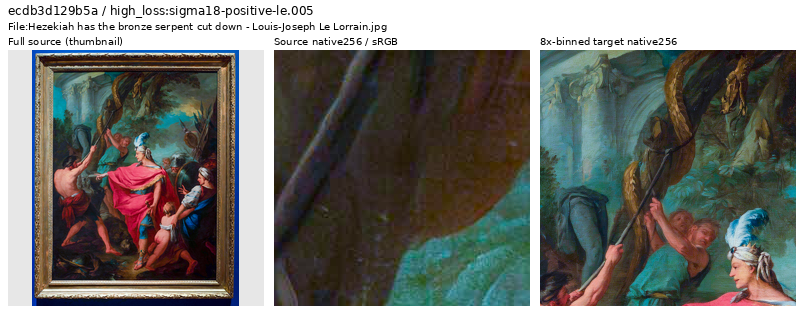
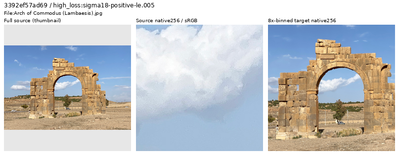
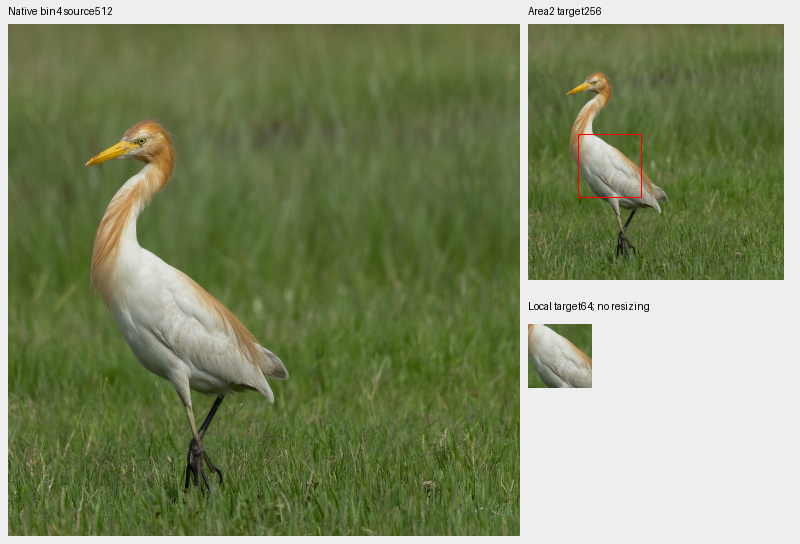
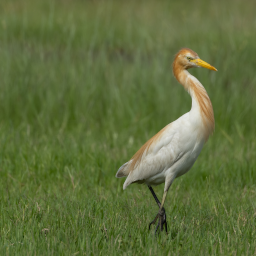

# V131 source review: white plumage and two future exclusions

**Forty previously unreviewed sources were inspected:38 retained, two withheld
from future clean-target training, and one mixed-contrast white-plumage context
added.** The prepared future cohort contains90,774 photos/36 reviewed regions,
with2,003 IDs in the inspection ledger. Existing experiments keep their declared
inputs. These data changes have no measured restoration-quality result.

[All decisions and credits](results/v131-source-decisions-v1.csv) ·
[Descriptive contrast counts](results/v131-source-contrast-v1.csv) ·
[Selection, independent checks and reader evidence](results/v131-source-review-v2.json) ·
[Native metadata](images/v131-source-review-v1/manifest.json) ·
[36-region catalogue](../configs/low-contrast-training-rois-cleaned90774-v1.json) ·
[Publication verification](results/v131-source-publication-v2.json).

## Selection and actual inspection

V131's original20k training continues. The immutable diagnostic prefix through
step1,900 contains160 draws from ten traced Commons batches:114 photographic
draws/82 unique sources. Filtering against the1,963-ID inspection ledger and
the prepared90,776-source cohort leaves46 draws/46 IDs. Up to eight highest
distinct singleton losses per noise group, then remaining highest gradient
losses, nominate40 sources. Changing weights, camera, exposure and noise confound
these scores; they nominate viewing rather than automatic exclusions.

| Eligible noise group | Draws / IDs | Inspected by group loss |
| --- | ---: | ---: |
| ADC only |1 /1 |1 |
| Positive sigma18≤.005 |19 /19 |8 |
| .005<sigma18≤.02 |21 /21 |8 |
| sigma18>.02 |5 /5 |5 |
| Remaining highest gradient | Same pool |18 |

Sigma18 is`sqrt(.18×shot+read)`. This sparse early trace is not every training
example or a random corpus sample. No scored geometry or noise was replayed.
Actually viewed: seven sheets with40 whole-source thumbnails and80 native256
source/target cells; eight native1024 follow-ups; six whole native-bin4 images;
four source512/target256/local64 proposal boards and four further native1024
material views. A saved actual-reader native256 draw was also viewed.
Native crop pixels never resize; only labeled whole-source thumbnails resize.

## Future exclusions

GoldenArtists,
[Hezekiah has the bronze serpent cut down](https://commons.wikimedia.org/wiki/File:Hezekiah_has_the_bronze_serpent_cut_down_-_Louis-Joseph_Le_Lorrain.jpg),
[CC BY4.0](https://creativecommons.org/licenses/by/4.0/).
The framed painting dominates both the source and scored context. It is withheld
from generic photographic clean targets; it is not labeled CGI or fake.

Bernard Gagnon,
[Arch of Commodus](https://commons.wikimedia.org/wiki/File:Arch_of_Commodus_(Lambaesis).jpg),
[CC BY4.0](https://creativecommons.org/licenses/by/4.0/).
The [native1024 follow-up](images/v131-source-review-v1/arch-native1024.png)
shows coarse, posterized-looking cloud/foliage texture and strongly outlined
stone edges. This makes its fine clean-target texture unreliable enough to
withhold from the future cohort. The processing cause is not established;
the scene remains a real architectural photograph. Both strips show resized
whole source → native256 JPEG/ICC source → native256 area8 target.

Originals and caches remain intact. The other38 sources include useful physical
sculptures, plant stamens, butterflies, trains, metalwork, flags, atmospheric
haze and natural background bokeh. Native grain in the gymnast/flower sources
and stronger edge rendering in the coast image are recorded; their binned
photographic structure remains useful. Retention does not certify pristine
microtexture, and high loss alone does not remove a source.

## Mixed white-plumage detail

Tisha Mukherjee,
[Eastern Cattle-Egret](https://commons.wikimedia.org/wiki/File:Eastern_Cattle-Egret_by_Tisha_Mukherjee_07.jpg),
[CC BY-SA4.0](https://creativecommons.org/licenses/by-sa/4.0/).
Coherent pale feather barbs survive binning. The native-bin4 ROI is
`[240,10,512,512]`, with local annotation`[50,110,64,64]` in the area2 target.
The board contains unchanged source512, target256 and local64 pixels at+0EV;
red lines mark the local annotation. This context also includes stronger feather
boundaries, grass and background. It is mixed contrast, not uniformly weak
or exact noiseless scene GT.

| Fixed proposal | Local64 below5% / eligible | Whole256 below5% / eligible | Specialized admission |
| --- | ---: | ---: | --- |
| Rice husks |0 /16 |5 /256 | Declined |
| Brown wing scales/veins |0 /16 |27 /256 | Declined |
| White plumage |3 /16 |105 /256 | Mixed-contrast context |
| Green breast feathers |0 /16 |29 /256 | Declined |

Counts use linear-sRGB Rec709 luminance, orthonormal DCT16 radial frequencies
1/8–1/3 cycle/pixel, band RMS/block mean, with eligible mean.02–.9 and
RMS≥1e−5. These are descriptive statistics rather than an automatic admission
threshold. Fixed coordinates were selected by viewing before measurement and
were not moved to obtain weaker counts. Whole-context quiet/background blocks
do not establish fine-detail coverage inside the annotated material.

[Rice husks](images/v131-source-review-v1/rice-husks-not-admitted.png),
[brown wing](images/v131-source-review-v1/brown-wing-not-admitted.png) and
[green feathers](images/v131-source-review-v1/green-feathers-not-admitted.png)
remain ordinary photos without specialized weak annotations. Source credits,
EXIF/ICC transforms and binning/cropping modifications are in the manifest.

Same Tisha Mukherjee credit/license. The saved native256 draw is index1,599 /
seed1,669, after geometry/final area2 and before camera/Bayer/noise. It was
not contrast-attenuated, with105/256 eligible fine-band blocks below5%,
including grass/background. The25% attenuation policy is unchanged. One draw
does not establish training-wide weak-detail coverage.

## Independent verification and use

An independent heap selector reproduces all40 nominations. Original/cache hashes,
7,864,320 source-cell channels and30,294,720 sheet channels match exactly.
UINT32 area2/FP64 sRGB checks7,864,320 strip-target channels;26 differ from the
primary FP32 display by exactly1 DN8. A further832,560 proposal-target channels
match exactly. Native1024 follow-ups match37,748,736 channels; full-bin4 views
match10,281,732 channels. Mirrored-FFT DCT checks1,344 source/augmented blocks,
with maximum statistic error6.67e−16.

The source-audit wrapper later returned terminal status143 after the complete
passed receipt and final numerical summary were written. Its cause is unknown;
that status, helper and log are preserved alongside the completed evidence,
without claiming a clean shell exit or replaying the audit.

The actual reader visits all36 regions over87 reads and matches8,454,144 common
FP32 values across35 fixed-identity region controls and four ordinary/four
procedural controls. The parent catalogue is rebound to the same future
manifest for this control only. Exclusions/bank expansion can change sampled
identities; global index-by-index equality is not claimed. Python/NumPy/Torch
RNG stays unchanged, CUDA remains uninitialized and neural/noise/RAW/optimizer
calls are zero.

The future manifest drops exactly two train rows from90,776, preserving every
remaining line's bytes/order, all35 earlier region objects and validation/test
at2,303/2,255. The first preparation stopped on one mistyped notes key before
creating the cohort; corrected preparation reuses the preserved actual-view
list. Its original helper/log remain bound in the receipt. V131/V132/V133 keep
90,781/29, V134/V135 keep90,778/33, and V138 keeps90,782/27. Both GFX pairs,
camera JPEGs and siblings stay held out. The [current source guide](current-source-loss-review.md)
tracks prepared data; the [local-time diary](../diary/2026-10-27-17-40-27-v131-source-curation.md)
records this revision. Trained quality under these changes remains unmeasured.
