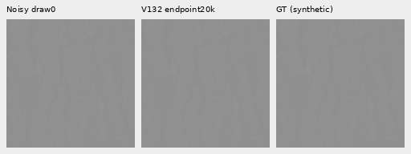
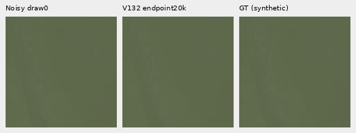
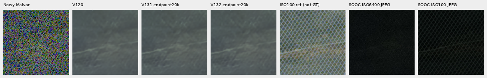

# V13220k attention does not improve targeted weak-detail fidelity

**The completed matched20k attention arm loses0.410dB on faint ADC targets
versus V131**, with only+0.00046dB ordinary-material and−0.00438dB shadow
changes. Fine cab crossings and soft foliage remain unresolved in the native
views. This specific RAW-attention continuation does not improve the targeted
weak-detail operating point. V120 remains the general recommendation; V131's
documented photo/ADC-repair choices remain available.

All102 endpoint predictions, independent audit and actual review of64 native
boards are complete. [Native viewer](images/v132-endpoint-v1/native-viewer.html),
[exact receipts and executed sources](results/v132-endpoint-v1/publication.json).
V132 is available as an explicit experimental `v132` preset for reproduction;
no broad427-photo, general-camera or new100MP timing result is claimed here.
The lightweight catalogue/import check and exact CPU EMA load pass; its
[test addendum](results/v132-endpoint-v1/import-test-addendum.json) retains the
initial misplaced no-Torch assertion and corrected test result.

| Targeted group | Cases / four CFAs each | V120 | V13120k | V13220k | V132−V131 |
| --- | ---: | ---: | ---: | ---: | ---: |
|Ordinary material|4|32.30426|32.31965|32.32011|+0.00046dB|
|Shadow material/reference|16|25.90197|25.91870|25.91432|−0.00438dB|
|Faint ADC material/reference|4|67.48067|67.62622|67.21644|−0.40978dB|

Values are mean sRGB PSNR against the retained target/reference arrays, balanced
over four CFAs within each case. Commons bark/fur have exact synthetic targets;
native-binned independently demosaiced grass/wood references are approximate,
and remain labeled **not GT**. Shadow groups reuse four sources at two gains
and two noise priors; these are targeted development observations, not64
independent scenes or a population-confidence claim. No real GFX reference is
pixelwise scored. The [V131 review](v131-endpoint-quality.md) supplies the exact
same source/input protocol.

All four faint source means decrease versus V131. Weak-band error remains
mixed: bark improves despite its overall score loss, while fur/grass/wood
worsen. Grass's projected band gain rises1.00835→1.01897 while band-error RMS
rises`1.03377e-4→1.07316e-4`; more response again does not imply better
reconstruction. The earlier1k faint advantage over V1311k did not persist at
the declared20k horizon. No checkpoint is selected retrospectively.

Noisy ADC → V13220k → exact synthetic GT. Each native160 crop comes from a
256-native Commons target at ROI`[48,48,160,160]`, exposure1 and common
contrast20, with saved per-case WB/matrix and identical display transforms.
Shot/read are0/0, ADC16, black level`.03`; crop pixels are never resized.
Full source IDs/licensing, input hashes and display recipes remain in the
machine report and publication. These two exact-GT examples remain distinct
from the approximate native-binned and independent real references.

The full V132 checkpoint SHA256 is
`6a0bf916ab4e179dda5dc3349971e93ef4b89a6f9136cd01363090e615ffbc77`;
the portable copy is `/mnt/external/demosaic/models/v132-final20000.pt`.
V131 is`4d78e6302f6e72d68acb03fe58eb7106763b8129ccb059747ef5d2cfbd3ec1e1`;
initial V120 is`a9d9b6b4f974e24a6b11e5e740aab32314233a7f53c056cf37c7d2aac1c589fb`.
Both training arms complete20,000 optimizer updates and320,000 target contexts
under the original source hash
`360c8d1b6256de562cc9cfce36ea9e3d0ff1467afac786ffba6c9b0af2ea9160`.
Every one of20,000 actual clean/prepared-batch hashes matches across arms,
including V131's resumed prefix. Domain counts match exactly:10,046 Commons,
4,965 native and4,989 paired batches, zero selected shadow targets. All Adam
states reach20k and model/EMA/Adam values are finite. V132 has114 EMA tensors
and112 optimizer states versus V131's91/89. The original worker/controller
identities and horizons were preserved without restarting them.

The endpoint collector makes exactly102 fresh root and102 encoder calls,
with all114 EMA tensors loaded and the full model/backbone unchanged before
and after. Official DINO backbone SHA256:
`691963f0f796aac860d818d59d9d14287a4675612829fbe9467c7f5df8ce5b14`.
V120 and V131 predictions are reused without inference. Independent CPU audit
checks4,275 metric fields,288 method/observation rows,72 summaries and20,275,200
native RGB channels across64 boards; maximum score discrepancy`1.42e-14dB`.
Actual viewing uses sixteen contact sheets that copy every source-board RGB
pixel exactly, with no resizing. All source PNGs remain separately available.

Both standing real-photo families remain in the gallery: DSCF3879/3880 sky,
building, foliage and chain-link fence, plus DSCF3842/3835 left/right fine cab
mesh at both noise profiles with both JPEGs. Fine crossings remain missing,
and deep-shadow material views retain mottle/detail loss. Independent ISO100
captures differ in aperture, exposure time and moving subjects; they are
qualitative references, never exact GT. All protected captures, JPEGs and
siblings remain outside training; local caches avoid original-media access.

