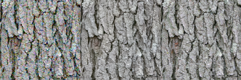
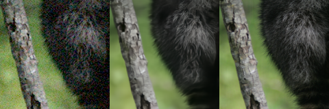
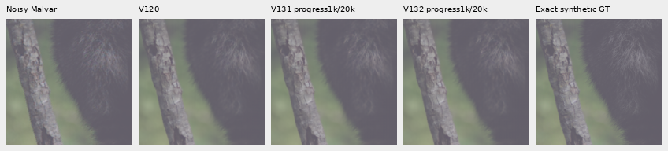
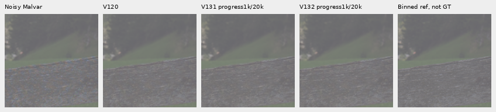

# V132 early matched attention review: small faint gain, no clear mesh recovery

**At 1,000 updates, V132 improves faint-ADC sRGB PSNR by0.03356 dB over the
matched V131 snapshot.** It remains0.23979 dB below V120 on this four-source
panel. Ordinary/shadow differences versus V131 are +0.00041/−0.00124 dB.
All64 native boards/32 triplets and eight amplified faint boards were actually
viewed. Fine cab crossings and foliage remain unresolved. V120 remains the
general recommendation; V132's original20k production run continues.

These are immutable1k snapshots **within their original20k schedules**, not
converged endpoints. Every one of the first1,000 domain/clean/noisy training
hashes matches directly between arms. Both start from V120 EMA on the same
90,781-source/29-region recipe. Only the RAW spatial branch differs: signed CFA
differences and two window-attention blocks feed the existing restoration trunk.
Both train the full restoration path with frozen official DINOv3 Small.
[Matched recipe](raw-spatial-training.md) · [Live continuation](raw-spatial-continuation.md) ·
[Completed V13120k quality, a different budget](v131-endpoint-quality.md) ·
[Exact receipt/source archives](results/v132-progress1000-v1/publication.json).

## The gain is small and conditional

The102 inputs reuse the original four material sources at four CFAs:16 ordinary,
64 shadow,16 faint-ADC, plus four main GFX contexts and two cab contexts/profiles.
Only retained draw0 is evaluated, with no new source/noise/RAW construction.
Saved V120 and V1311k predictions are reused, without another control forward.
Repeated CFA/noise conditions are related observations, not independent photos.
Means below equally weight sources/conditions after averaging the four CFAs.

| Panel | V120 sRGB PSNR | V1311k | V1321k | V132 minus V131 | V132 minus V120 |
| --- | ---: | ---: | ---: | ---: | ---: |
| Ordinary |32.30426 |32.30588 |32.30629 |+0.00041 dB |+0.00203 dB |
| Shadow |25.90197 |25.88754 |25.88631 |−0.00124 dB |−0.01566 dB |
| 2.5% contrast, ADC only |67.48067 |67.20731 |67.24088 |+0.03356 dB |−0.23979 dB |

Camera-RGB changes versus V131 are +0.00022/−0.00190/+0.09544 dB in the same
order. Faint PSNR uses very small signal variation and must not be compared to
ordinary-photo or broad427-photo PSNR.

| Faint material | sRGB change versus V1311k | Change versus V120 | Weakest DCT16-stratum RMS versus V1311k |
| --- | ---: | ---: | ---: |
| Bark, exact constructed target |+0.06202 dB |−0.32953 dB |−1.707% |
| Fur, exact constructed target |+0.12420 dB |−0.44467 dB |−5.562% |
| PIXLS5002 grass, binned approximate reference |+0.02966 dB |−0.21255 dB |−0.465% |
| PIXLS1951 wood/field, binned approximate reference |−0.08164 dB |+0.02758 dB |−1.730% |

All four weakest-stratum errors improve versus V1311k, while all remain above
V120. Fur gain moves0.94072→0.94644, still below V120's0.95585. Grass moves
0.97963→0.99264, closer to V120's0.99786. Bark's gain falls slightly despite
lower error. Wood is the global-PSNR counterexample to the small mean gain.
[All source/condition means and strata](results/v132-progress1000-v1/paired-material-summary.json.gz) ·
[Every per-observation score](results/v132-progress1000-v1/metrics.csv.gz).

## Native triplets and common faint-detail displays

Noisy Malvar → V1321k → exact constructed GT. Each cell is **160×160 unchanged
pixels**, RGGB/native256, ROI `[48,48,160,160]`, shot/read
`0.00256/2.62144e−5`,16-bit ADC/black0.03, exposure1/contrast1 and shared
WB/matrix/clipped-sRGB display. The historical ordinary source panel has
`draws:8` metadata; this collection uses its saved draw0, never an eight-draw mean.

V1321k checkpoint SHA256:
`68b820640a67fa3c1391ea79471ca4562787fca626f386e265c1d3fd14b763ed`.
V1311k control:
`59bf01ec466183bad7cd1134e47b301cf0189e613154b9853e7691ca04a26378`.
V120 control:
`a9d9b6b4f974e24a6b11e5e740aab32314233a7f53c056cf37c7d2aac1c589fb`.
[Complete source/ROI/checkpoint/noise/display manifest](images/v132-progress1000-v1/manifest.json).
Bark/fur source credits and CC BY-SA2.5/CC BY3.0 licenses are retained in the
manifest and [source-credit note](v131-endpoint-quality.md#native-noisyrestoredgt-triplets).
PIXLS binned references are explicitly **not exact noiseless GT**.

For the faint ADC-only inputs, common contrast20 reveals small changes without
resizing: `sRGB(clip(.18 + 20*(linear_RGB − reference_ROI_channel_mean),0,1))`,
with identical WB/matrix/exposure1. The reference only defines a shared display
anchor and never enters inference. Maximum clipped-channel fraction is0.0547%.
Columns are noisy → V120 → V1311k → V1321k → reference.

[Bark](images/v132-progress1000-v1/bark-contrast0p025-adc-contrast20-comparison.png) ·
[Grass](images/v132-progress1000-v1/pixls-5002-fine-contrast0p025-adc-contrast20-comparison.png) ·
[Amplified-display provenance/clipping](images/v132-progress1000-v1/faint-amplified-manifest.json).
Differences are subtle; these views do not establish large recovered structure.

## Both protected real-photo families remain difficult

Main DSCF3879 ISO6400 / DSCF3880 ISO100/f5.6 uses native512 contexts/native160
cells, exposure4 and nominal shot/read `.00128/6.5536e−6`. The columns are noisy,
V120, V1311k, V1321k and independent ISO100/AHD reference:
[sky](images/v132-progress1000-v1/main-overcast-sky-comparison.png),
[building](images/v132-progress1000-v1/main-building-detail-comparison.png),
[foliage](images/v132-progress1000-v1/main-foliage-comparison.png),
[chain-link fence](images/v132-progress1000-v1/main-chain-link-fence-comparison.png).
Sky is smooth, building edges clean but soft, foliage painted and the coarse
fence geometry retained. No convincing new V132 fine-detail recovery appears.

Cab DSCF3842 ISO6400 / DSCF3835 ISO100/f5.6 uses the same native768 context,
both native160 ROIs, exposure16 and both unchanged fixed profiles:

| Profile | Left | Right |
| --- | --- | --- |
| Nominal shot/read `.00128/6.5536e−6` | [Left](images/v132-progress1000-v1/mesh-nominal-fine-green-mesh-left-comparison.png) | [Right](images/v132-progress1000-v1/mesh-nominal-fine-green-mesh-right-comparison.png) |
| Nearby DSCF3879 input-Haar `.0014635775921166604/1.0715704128646712e−6` | [Left](images/v132-progress1000-v1/mesh-profile3879-fine-green-mesh-left-comparison.png) | [Right](images/v132-progress1000-v1/mesh-profile3879-fine-green-mesh-right-comparison.png) |

Each includes both original-pixel camera JPEGs as separate qualitative
comparators, without an additional RAW display transform. Their dark unboosted
appearance does not prove absence of mesh. Nominal restoration largely removes
the lattice; the nearby profile retains grainy, incomplete modulation, without
convincing new crossings. The blue point near the pole persists. Noise profiles
are disclosed priors, not dedicated flat/dark calibration.

Both ISO100 references differ in aperture/exposure/moving subjects. They and
the camera JPEGs are **not exact GT** and receive no pixelwise score. Inputs
come from retained cached arrays; originals remain read-only. Both families,
their JPEGs and siblings remain excluded from training. Sensor/context ROIs,
integer reference alignment and common transforms are recorded in the manifest.

## Executed checks and remaining work

CPU admission verifies the exact live controller/worker, immutable snapshot,
original source SHA, seed70,1k/20k schedule,114 finite model/EMA tensors each,
112 finite Adam states at1,000 and23 branch tensors. All1,000 domain/clean/noisy
hashes match the retained V131 prefix. Saved V131 predictions attach only after
every observation/input/target/noise/ROI/display binding matches. The failed old
queue and its completed control collection remain unchanged; this is an explicit
new review of the now-available branch snapshot.

The new collector makes exactly102 IEEE FP32 root/DINO calls. Full model,
backbone and RNG remain unchanged, with no new noise/source/RAW/optimizer work.
Peak CUDA allocation is9,356,452,864 bytes. A separate NumPy-only process checks
288 metric rows/4,275 fields and **20,275,200 native RGB channels** across64
PNGs; maximum PSNR discrepancy is1.42e−14dB. All64 native and eight amplified
boards were viewed. Small triplet-strip pixels/coordinates and all74 public PNG
copies were verified, and all22 receipt/source archives preserve original bytes.

The numerical collector/reporter/auditor are unchanged from the completed
control review. This is a separate102-call progress budget; no old model is
rerun and training is not signalled. V132 production and its completed-endpoint
review continue. Convergence, broad427-photo/camera/standalone-flat/full-frame
quality and speed remain unmeasured for this snapshot.
[Publication-time controller/worker observation](results/v132-progress1000-v1/continuation-observation.json).
