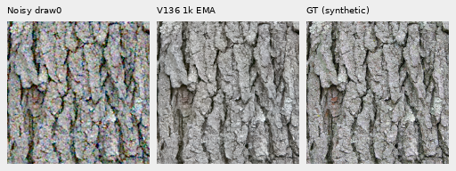
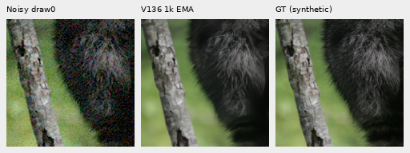
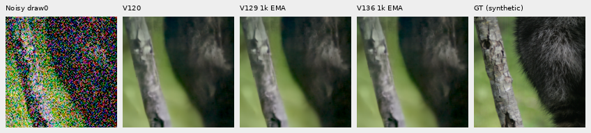
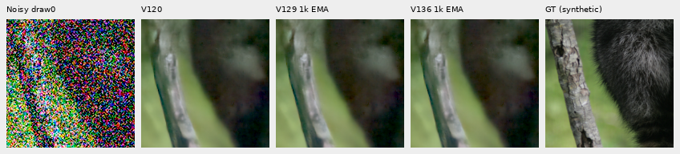
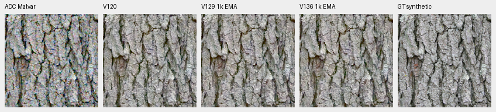
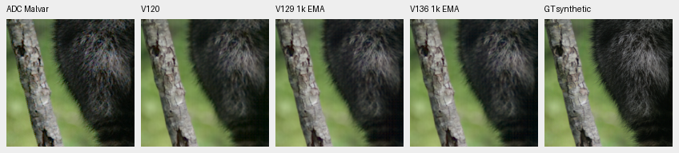
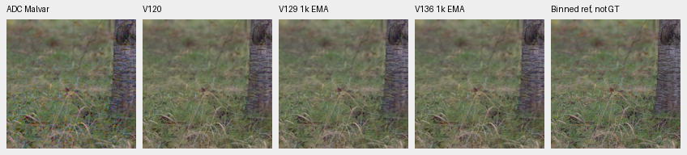
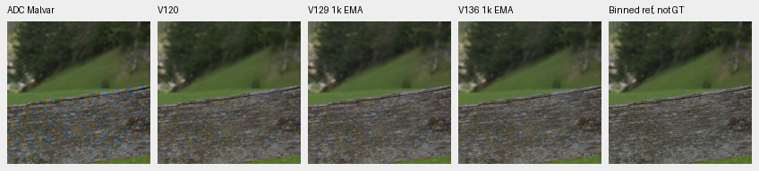

# V136 global RAW attention: tiny score gains over V129; fine mesh still missing

**The matched 1,000-step V136 pilot gives tiny panel-mean gains over V129,
without a clear large recovery of weak photographic detail.** V120 Small
remains the general recommendation. This is V136's complete original pilot,
compared with saved V1291k and V120. Versus V120, ordinary and gain1/8 means
rise slightly, while both gain1/32 means and faint ADC fall. These finite gains
are documented without treating the pilot as a broad quality ranking.

[Execution and measurements](results/v136-global-attention-quality-v1.json) ·
[Per-CFA scores](results/v136-global-attention-metrics-v1.csv) ·
[All detail bands](results/v136-global-attention-bands-v1.csv) ·
[Source/ROI/checkpoint/noise/display metadata](images/v136-global-attention-quality-v1/manifest.json) ·
[Publication verification](results/v136-global-attention-publication-v2.json) ·
[Architecture and recipe](raw-global-attention.md).

## Matched comparison and support

The optional 18,272-parameter branch uses 64 learned queries to aggregate
image-specific RAW detail, followed by pixel-to-memory attention. The existing
official frozen DINOv3 Small pyramid and DRUNet trunk remain in place.
V136 starts from V120's completed20k EMA, using the same90,782 photos/27 reviewed
regions, seed70,50% reviewed quota, B16/native256/BF16, zero optical PSF,
single-view losses and original1k learning-rate horizon as V129.
**All1,000 clean and noisy training-batch hashes match V129 before candidate
forwards.** V129's training and predictions were reused. The new branch is
the only recipe difference between these two1k methods; comparison with V120
also includes continued training.

Checkpoint SHA256: `71e2db399ad951b3f1d7f303e3d2dfc5e8b8e42e5c7bb5096c1aceaa102410c6`.
The endpoint has109 model/EMA tensors and107 finite Adam states at step1,000.
All18 branch tensors received nonzero gradients. Inference uses the exact
65-module trained source and pinned official encoder; weights, backbone and RNG
remain unchanged during collection.

Exactly **102 new root/DINO forwards** use64 retained shadow inputs,16 ordinary
material inputs,16 faint-ADC inputs, four main-GFX512px contexts and two
extra-mesh768px fixed-profile contexts. All old predictions are reused after
five-tensor input checks. Peak CUDA allocation is9,356,368,384 bytes under a12GiB
cap. There is no new noise, RAW decoding, reference inference or optimizer
update in this review.

Material support is **four source contexts**, each with four Bayer patterns and
one observation per CFA. These are not independent photograph replicates.
Commons targets are exact synthetic GT after processing; binned native-camera
and independent real ISO100 references are **approximate, not GT**.

## Scores and ordinary weak detail

Equal means of16 per-observation sRGB PSNRs in central native160×160 crops.
Shadows receive8×/32× exposure compensation before scoring and display;
ordinary/faint cases receive1×. The40× contrast display below is never scored.

| Condition | V120 | V1291k | V1361k | V136−V129, dB |
| --- | ---: | ---: | ---: | ---: |
| Ordinary ISO12800 prior |32.304263 |32.309544 |32.309836 |+0.000292 |
| Target gain1/8, ISO6400 |28.561316 |28.566961 |28.568426 |+0.001465 |
| Target gain1/8, ISO12800 |26.777249 |26.780392 |26.781089 |+0.000697 |
| Target gain1/32, ISO6400 |25.008258 |25.004354 |25.007002 |+0.002648 |
| Target gain1/32, ISO12800 |23.261062 |23.234792 |23.236692 |+0.001900 |
| Contrast.025, ADC only |67.480668 |67.417249 |67.430314 |+0.013065 |

Ordinary conditioning: shot`.00256`, read`2.62144e−5`,16-bit ADC, black`.03`,
draw0. Shadow ISO6400 uses shot`.00128`/read`6.5536e−6`; ISO12800 uses the
ordinary profile. ROI, observations, WB/matrix and transforms are shared.

The DCT16 fine band is1/8≤radial frequency<1/3 cycle/pixel in linear-sRGB
luminance. Eligible reference blocks use in-gamut RGB, mean.02–.9 and band
RMS≥1e−5. Gain1 matches the target projection; error also matters.

| Region / contrast | Blocks | Gain V120 / V129 / V136 | Band error RMS V120 / V129 / V136 |
| --- | ---: | --- | --- |
| Fur,0–2% |7 |0.324842 / 0.329905 / 0.330706 |0.00380475 / 0.00380412 / 0.00380491 |
| Fur,2–5% |5 |0.594593 / 0.605435 / 0.605485 |0.00497084 / 0.00496481 / 0.00496834 |
| Grass,2–5% |3 |0.691481 / 0.684490 / 0.683511 |0.00575641 / 0.00571029 / 0.00570931 |
| Wood,2–5% |9 |0.657325 / 0.645635 / 0.648056 |0.00221148 / 0.00221458 / 0.00221495 |

Against V129, the selected fur/wood gains rise but their errors also rise;
grass loses a little projected response while its error falls. The branch does
not uniformly recover weak detail. Counts are physical16px blocks, repeated across CFAs;
one observation per CFA does not isolate conditional bias from noise variation.

## Native noisy/restored/GT triplets

Noisy draw0 → V1361k EMA → exact processed synthetic GT. RGGB,
ROI`[48,48,160,160]`,+0EV, common WB/matrix/sRGB. Each cell is160×160 pixels,
without resizing.

Three-method comparisons: [bark](images/v136-global-attention-quality-v1/bark-comparison.png),
[fur](images/v136-global-attention-quality-v1/raccoon-fur-comparison.png),
[grass](images/v136-global-attention-quality-v1/pixls-5002-fine-comparison.png) and
[wood](images/v136-global-attention-quality-v1/pixls-1951-field-comparison.png).
Columns: noisy → V120 → V1291k → V1361k → exact GT or labeled binned reference.
Actual viewing finds coherent larger bark structure but attenuated fine hairs,
grass and wood grain. Differences between V129 and V136 are subtle.

Bark: Derek Ramsey (Ram-Man),
[Kentucky Coffee-tree](https://commons.wikimedia.org/wiki/File:Kentucky_Coffee-tree_Gymnocladus_dioicus_3264px.jpg),
[CC BY-SA2.5](https://creativecommons.org/licenses/by-sa/2.5/).
Fur: Korall, [Racoon clinging to a tree](https://commons.wikimedia.org/wiki/File:Racoon_clinging_to_a_tree.JPG),
[CC BY3.0](https://creativecommons.org/licenses/by/3.0/).
Derivatives use binning, cropping, camera transforms, sensor simulation and
restoration. The raw.pixls.us5002/1951 binned camera references are CC0.
The manifest binds source IDs, target hashes and supervision indices.

Deep-shadow fur at gain1/32, scored/displayed at+5EV:

Fine hairs remain smeared, and the deepest crops lose substantial texture and retain color blotches. There is no clear large visible recovery over either control. Gain1/8 uses+3EV:
[ISO6400](images/v136-global-attention-quality-v1/raccoon-fur-gain1over8-iso6400-prior-comparison.png) ·
[ISO12800](images/v136-global-attention-quality-v1/raccoon-fur-gain1over8-iso12800-prior-comparison.png).

## Faint ADC detail

The retained operator scales each camera channel's whole256px deviations by
.025 around its original spatial mean, without interpolation. Shot=read=0,
ADC16 and black.03 are fixed. These high PSNRs describe deliberately faint
processed targets and cannot be compared with the full-photo panel.

| Source | V120 | V1291k | V1361k | V136−V129, dB |
| --- | ---: | ---: | ---: | ---: |
| Bark, exact processed GT |65.425934 |65.239819 |65.214073 |-0.025746 |
| Fur, exact processed GT |70.640781 |70.640999 |70.695873 |+0.054873 |
| Grass, approximate reference |66.543675 |66.535478 |66.504199 |-0.031280 |
| Wood, approximate reference |67.312283 |67.252699 |67.307112 |+0.054412 |

The [supplement was frozen prospectively](results/v136-faint-detail-predeclaration-v1.json)
at training step650, before V136 completed training or produced its quality
predictions. It reuses the earlier original-source masks and shared40× display,
and decomposes mean/spatial error without fitting or applying a correction.
All eligible transformed blocks fall below2% contrast; original-source strata
distinguish previously weak detail from detail made faint by the operator.

| Original region | Blocks | Gain V120 / V129 / V136 | Relative band error V120 / V129 / V136 |
| --- | ---: | --- | --- |
| Fur,0–2% |7 |0.851840 / 0.870033 / 0.874932 |0.286240 / 0.287116 / 0.288287 |
| Fur,2–5% |5 |0.833865 / 0.855928 / 0.858888 |0.311091 / 0.297697 / 0.298086 |
| Grass,2–5% |3 |0.965485 / 0.940392 / 0.941638 |0.248960 / 0.248653 / 0.247652 |
| Wood,2–5% |9 |0.880826 / 0.880793 / 0.887624 |0.182871 / 0.183788 / 0.184534 |

Relative to V129, selected fur/wood gains increase alongside higher relative errors; grass improves slightly in both gain and error. The arithmetic mean of per-observation PSNR rises, but pooled MSE barely changes and centered spatial MSE increases. The ROI-mean error component decreases. Thus the mean PSNR gain does not establish improved spatial detail.
[All original-source strata](results/v136-global-attention-faint-strata-v1.csv) ·
[Camera/sRGB error decompositions](results/v136-global-attention-faint-decomposition-v1.csv).

| Method | Mean sRGB MSE | Centered spatial MSE | ROI-mean fraction of pooled MSE |
| --- | ---: | ---: | ---: |
| V120 |1.95171438e-07 |1.84983822e-07 |5.220% |
| V129 1k EMA |1.99070374e-07 |1.88438478e-07 |5.341% |
| V136 1k EMA |1.99048824e-07 |1.89603011e-07 |4.745% |

The following **display-only40× contrast** uses
`original camera DC +40×(value−DC)` for every method, followed by the same
WB/matrix/sRGB,+0EV. It uses a common original-target DC, with no fitted model
offset or resize, and amplifies every error. Scores above use unamplified
faint targets. Columns: ADC Malvar → V120 → V1291k → V1361k → GT/reference.

Normal8-bit faint panels look almost identical. The enhanced boards reveal residual colored texture and softened fine detail, with no clear broad recovery by V136.

## Main GFX and corrected extra mesh pair

The standing main test uses DSCF3879 ISO6400 / DSCF3880 ISO100 f/5.6.
Columns: noisy → V120 → V1291k → V1361k → independent ISO100/AHD reference,
**not GT**. Native160px cells share512px contexts,+2EV and nominal
shot`.00128`/read`6.5536e−6`. This differs from the fixed-Haar full-frame
profile in the [main gallery](gfx-qualitative.md).

Foliage remains soft/painterly; the larger fence and building geometry stay coherent and the sky quiet. No clear large new detail recovery is visible. All four contexts were viewed, including
[sky](images/v136-global-attention-quality-v1/main-overcast-sky-comparison.png) and
[building](images/v136-global-attention-quality-v1/main-building-detail-comparison.png).

The additional mesh uses **DSCF3842 ISO6400 / corrected DSCF3835 ISO100 f/5.6**,
taken46 seconds apart. Native160px cells share768px contexts,+4EV and
WB/matrix. The main pair remains in use. Aperture, exposure time and moving
subjects differ; neither independent ISO100/AHD nor camera JPEG is exact GT.
Both camera JPEGs remain in the [standing mesh comparison](gfx-green-mesh.md).

The nominal profile uses shot`.00128`/read`6.5536e−6`; fixed nearby3879 uses
shot`.0014635775921166604`/read`1.0715704128646712e−6`.
Nominal conditioning still largely erases the lattice. The nearby profile retains weak irregular diagonal texture in all three models, without a clear new correct-lattice recovery. The left blue point persists. Left regions:
[nominal](images/v136-global-attention-quality-v1/mesh-nominal-fine-green-mesh-left-comparison.png) ·
[nearby](images/v136-global-attention-quality-v1/mesh-profile3879-fine-green-mesh-left-comparison.png).
Both captures, JPEGs and siblings remain held out; no reference-based noise
fitting or conditioning sweep is performed.

## Verification and limits

Independent channelwise FP64 rendering and mirrored-FFT DCT recompute the
primary metrics and verify all64 native PNGs, 19,660,800 RGB channels.
The separately frozen supplement audit checks180 original-source strata,
96 decompositions and1,536,000 exact PNG channels, using long-double error
reductions. Four analytic tests pass; prior-control reductions also match before
candidate predictions exist. All32 primary comparison boards, two exact-GT
triplets and four enhanced boards were actually viewed; the other primary
triplets are audited pixel subsets, without a separate viewing claim.

This is a full original1k pilot endpoint, not a20k convergence result or a new
427-source/camera/color/full-frame benchmark. Global memory depends on the tile;
seams, complete-frame quality and speed remain unmeasured for this branch.
No20k global run is queued from this result. Although all18 tensors have nonzero gradients, the retained memory-path maxima are very small: latents1.07e−11 and memory gain2.46e−14, versus1.89e−3 at the output projection. This is an optimization concern, not a measured causal explanation or evidence that global attention cannot help. The primary PSNR history remains56 completed comparable
endpoints. V124/V125 and the other original trials retain their inputs, budgets
and owners. Broad RawNIND superiority, state of the art and100MP/10s remain open.
