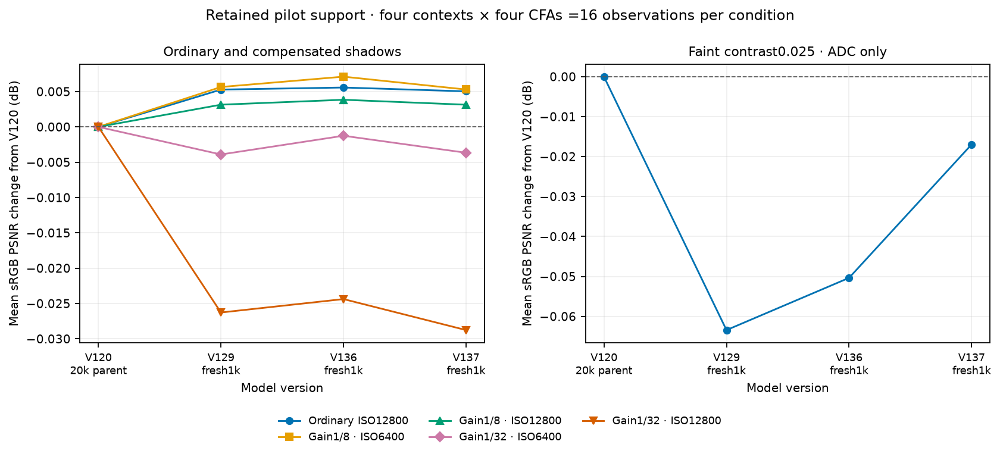
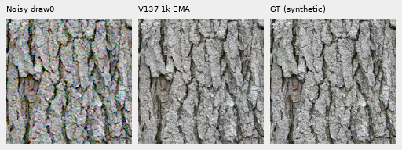
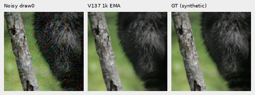
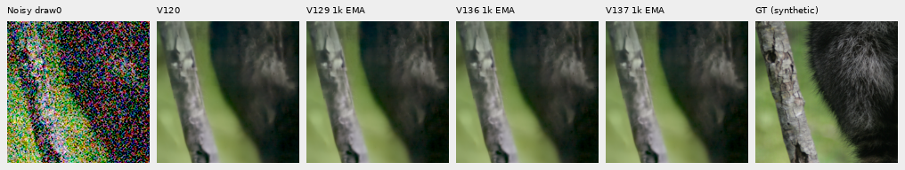
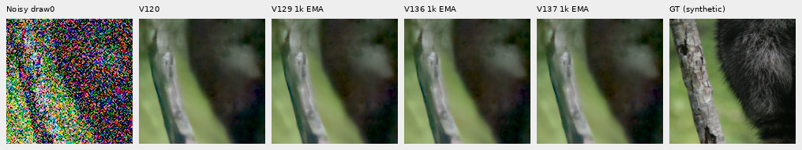
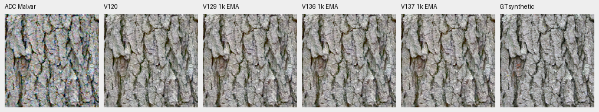
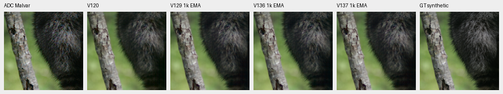
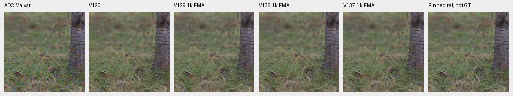
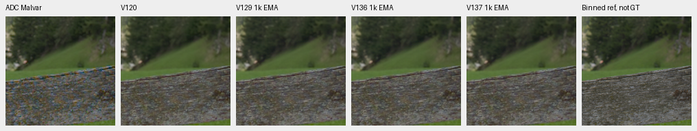

# V137 global RAW attention: stronger memory adaptation, mixed quality

**Normalized matching improves faint-ADC scores over V136, without a clear large
recovery of weak photographic detail or real fine mesh.** V120 Small remains
the general recommendation.
This is V137's complete original1,000-update architecture pilot, compared with
saved V1361k, V1291k and V120. Against matched V136, ordinary/shadow means fall
about.0005–.0044dB while faint ADC rises.03339dB. The faint mean remains.01696dB
below V120. These finite gains and regressions are shown directly.

[Execution and measurements](results/v137-global-conditioned-quality-v1.json) ·
[Per-CFA scores](results/v137-global-conditioned-metrics-v1.csv) ·
[All detail bands](results/v137-global-conditioned-bands-v1.csv) ·
[Source/ROI/checkpoint/noise/display metadata](images/v137-global-conditioned-quality-v1/manifest.json) ·
[Publication verification](results/v137-global-conditioned-publication-v1.json) ·
[Architecture, mechanism and recipe](raw-global-conditioning.md).

## Matched comparison and support

The18,272-parameter branch keeps V136's18 tensors and deterministic initial
values; only query/key and value-scale normalization change. It uses64 queries to aggregate
image-specific RAW detail, followed by pixel-to-memory attention. The existing
official frozen DINOv3 Small pyramid and DRUNet trunk remain in place.
V137 starts from V120's completed20k EMA, using the same90,782 photos/27 reviewed
regions, seed70,50% reviewed quota, B16/native256/BF16, zero optical PSF,
single-view losses and original1k learning-rate horizon as V136.
**All1,000 clean and noisy training-batch hashes match V136 before candidate
forwards.** V136's training and predictions were reused. The new operator is
the only recipe difference between these two1k methods; comparison with V120
also includes continued training.

Checkpoint SHA256: `5f7473dbd040326cdfb1a9cd326571388863024d789651cdc5194cb9d33229dd`.
The endpoint has109 model/EMA tensors and107 finite Adam states at step1,000.
All18 branch tensors received nonzero gradients. Inference uses the exact
66-module trained source and pinned official encoder; weights, backbone and RNG
remain unchanged during collection.

Exactly **102 new root/DINO forwards** use64 retained shadow inputs,16 ordinary
material inputs,16 faint-ADC inputs, four main-GFX512px contexts and two
extra-mesh768px fixed-profile contexts. All old predictions are reused after
five-tensor input checks. Peak CUDA allocation is9,356,368,384 bytes under a12GiB
cap. There is no new noise, RAW decoding, reference inference or optimizer
update in this review.

Material support is **four source contexts**, each with four Bayer patterns and
one observation per CFA. These are not independent photograph replicates.
Commons targets are exact synthetic GT after processing; binned native-camera
and independent real ISO100 references are **approximate, not GT**.

## Scores and ordinary weak detail

Equal means of16 per-observation sRGB PSNRs in central native160×160 crops.
Shadows receive8×/32× exposure compensation before scoring and display;
ordinary/faint cases receive1×. The40× contrast display below is never scored.

[Vector plot](images/v137-global-conditioned-quality-v1/pilot-score-deltas-v3.svg) ·
[Plotted values and scope](results/v137-global-conditioned-plot-v3.json).
Each1k pilot starts independently from V120; the parent has20k training.
The lines describe these available models on four contexts/all four CFAs,
not cumulative training or a population trend. The full427-photo history
remains separate.

| Condition | V120 | V1291k | V1361k | V1371k | V137−V136, dB |
| --- | ---: | ---: | ---: | ---: | ---: |
| Ordinary ISO12800 prior |32.304263 |32.309544 |32.309836 |32.309294 |-0.000541 |
| Target gain1/8, ISO6400 |28.561316 |28.566961 |28.568426 |28.566605 |-0.001821 |
| Target gain1/8, ISO12800 |26.777249 |26.780392 |26.781089 |26.780387 |-0.000702 |
| Target gain1/32, ISO6400 |25.008258 |25.004354 |25.007002 |25.004597 |-0.002405 |
| Target gain1/32, ISO12800 |23.261062 |23.234792 |23.236692 |23.232306 |-0.004387 |
| Contrast.025, ADC only |67.480668 |67.417249 |67.430314 |67.463704 |+0.033390 |

Ordinary conditioning: shot`.00256`, read`2.62144e−5`,16-bit ADC, black`.03`,
draw0. Shadow ISO6400 uses shot`.00128`/read`6.5536e−6`; ISO12800 uses the
ordinary profile. ROI, observations, WB/matrix and transforms are shared.

The DCT16 fine band is1/8≤radial frequency<1/3 cycle/pixel in linear-sRGB
luminance. Eligible reference blocks use in-gamut RGB, mean.02–.9 and band
RMS≥1e−5. Gain1 matches the target projection; error also matters.

| Region / contrast | Blocks | Gain V120 / V129 / V136 / V137 | Band error RMS V120 / V129 / V136 / V137 |
| --- | ---: | --- | --- |
| Fur,0–2% |7 |0.324842 / 0.329905 / 0.330706 / 0.329123 |0.00380475 / 0.00380412 / 0.00380491 / 0.00380300 |
| Fur,2–5% |5 |0.594593 / 0.605435 / 0.605485 / 0.604991 |0.00497084 / 0.00496481 / 0.00496834 / 0.00496254 |
| Grass,2–5% |3 |0.691481 / 0.684490 / 0.683511 / 0.683591 |0.00575641 / 0.00571029 / 0.00570931 / 0.00570692 |
| Wood,2–5% |9 |0.657325 / 0.645635 / 0.648056 / 0.645594 |0.00221148 / 0.00221458 / 0.00221495 / 0.00221426 |

Compared with V136, all four selected band errors fall, while fur/wood projected gains fall; grass response rises only slightly. Lower band error does not establish uniformly better detail response. Counts are physical16px blocks, repeated across CFAs;
one observation per CFA does not isolate conditional bias from noise variation.

## Native noisy/restored/GT triplets

Noisy draw0 → V1371k EMA → exact processed synthetic GT. RGGB,
ROI`[48,48,160,160]`,+0EV, common WB/matrix/sRGB. Each cell is160×160 pixels,
without resizing.

Four-method comparisons: [bark](images/v137-global-conditioned-quality-v1/bark-comparison.png),
[fur](images/v137-global-conditioned-quality-v1/raccoon-fur-comparison.png),
[grass](images/v137-global-conditioned-quality-v1/pixls-5002-fine-comparison.png) and
[wood](images/v137-global-conditioned-quality-v1/pixls-1951-field-comparison.png).
Columns: noisy → V120 → V1291k → V1361k → V1371k → exact GT or labeled binned reference.
Actual viewing finds coherent larger bark structure but attenuated fine hairs, grass and wood grain. Differences among the four restored methods are subtle.

Bark: Derek Ramsey (Ram-Man),
[Kentucky Coffee-tree](https://commons.wikimedia.org/wiki/File:Kentucky_Coffee-tree_Gymnocladus_dioicus_3264px.jpg),
[CC BY-SA2.5](https://creativecommons.org/licenses/by-sa/2.5/).
Fur: Korall, [Racoon clinging to a tree](https://commons.wikimedia.org/wiki/File:Racoon_clinging_to_a_tree.JPG),
[CC BY3.0](https://creativecommons.org/licenses/by/3.0/).
Derivatives use binning, cropping, camera transforms, sensor simulation and
restoration. The raw.pixls.us5002/1951 binned camera references are CC0.
The manifest binds source IDs, target hashes and supervision indices.

Deep-shadow fur at gain1/32, scored/displayed at+5EV:

Fine hairs and grass/wood texture remain smeared, especially in the deepest cases; colored blotches persist. No clear large new recovery is visible. Gain1/8 uses+3EV:
[ISO6400](images/v137-global-conditioned-quality-v1/raccoon-fur-gain1over8-iso6400-prior-comparison.png) ·
[ISO12800](images/v137-global-conditioned-quality-v1/raccoon-fur-gain1over8-iso12800-prior-comparison.png).

## Faint ADC detail

The retained operator scales each camera channel's whole256px deviations by
.025 around its original spatial mean, without interpolation. Shot=read=0,
ADC16 and black.03 are fixed. These high PSNRs describe deliberately faint
processed targets and cannot be compared with the full-photo panel.

| Source | V120 | V1291k | V1361k | V1371k | V137−V136, dB |
| --- | ---: | ---: | ---: | ---: | ---: |
| Bark, exact processed GT |65.425934 |65.239819 |65.214073 |65.309886 |+0.095813 |
| Fur, exact processed GT |70.640781 |70.640999 |70.695873 |70.660659 |-0.035213 |
| Grass, approximate reference |66.543675 |66.535478 |66.504199 |66.569275 |+0.065076 |
| Wood, approximate reference |67.312283 |67.252699 |67.307112 |67.314994 |+0.007883 |

The [supplement was frozen prospectively](results/raw-global-conditioning-v1.json)
before V137 production began or produced quality
predictions. It reuses the earlier original-source masks and shared40× display,
and decomposes mean/spatial error without fitting or applying a correction.
All eligible transformed blocks fall below2% contrast; original-source strata
distinguish previously weak detail from detail made faint by the operator.

| Original region | Blocks | Gain V120 / V129 / V136 / V137 | Relative band error V120 / V129 / V136 / V137 |
| --- | ---: | --- | --- |
| Fur,0–2% |7 |0.851840 / 0.870033 / 0.874932 / 0.871548 |0.286240 / 0.287116 / 0.288287 / 0.286574 |
| Fur,2–5% |5 |0.833865 / 0.855928 / 0.858888 / 0.859983 |0.311091 / 0.297697 / 0.298086 / 0.294849 |
| Grass,2–5% |3 |0.965485 / 0.940392 / 0.941638 / 0.939894 |0.248960 / 0.248653 / 0.247652 / 0.248714 |
| Wood,2–5% |9 |0.880826 / 0.880793 / 0.887624 / 0.882262 |0.182871 / 0.183788 / 0.184534 / 0.182498 |

Relative to V136, fur2–5% improves in projected gain and error. Weaker fur0–2% and wood lose some gain while errors fall; grass worsens in both. Pooled sRGB MSE and centered spatial MSE decrease, while the ROI-mean error component grows. V120 still has slightly lower pooled total/spatial errors overall.
[All original-source strata](results/v137-global-conditioned-faint-strata-v1.csv) ·
[Camera/sRGB error decompositions](results/v137-global-conditioned-faint-decomposition-v1.csv).

| Method | Mean sRGB MSE | Centered spatial MSE | ROI-mean fraction of pooled MSE |
| --- | ---: | ---: | ---: |
| V120 |1.95171438e-07 |1.84983822e-07 |5.220% |
| V129 1k EMA |1.99070374e-07 |1.88438478e-07 |5.341% |
| V136 1k EMA |1.99048824e-07 |1.89603011e-07 |4.745% |
| V137 1k EMA |1.96682133e-07 |1.85689562e-07 |5.589% |

The following **display-only40× contrast** uses
`original camera DC +40×(value−DC)` for every method, followed by the same
WB/matrix/sRGB,+0EV. It uses a common original-target DC, with no fitted model
offset or resize, and amplifies every error. Scores above use unamplified
faint targets. Columns: ADC Malvar → V120 → V1291k → V1361k → V1371k → GT/reference.

Normal8-bit faint panels look almost identical. The shared40× boards reveal residual colored texture and softened fine detail, without a clear broad new recovery by V137.

## Memory adaptation at1,000 updates

The old V136 production gradient maxima cover updates1–16. V137 records the
explicit56 updates1–16 and every25 through1,000, including the final update.
The saved-state analysis uses deterministic initialization and CPU FP32
zero-gradient weight-decay/EMA references, with independent FP64 reductions.
These are numerical references, not a bitwise GPU optimizer replay or a causal
image-quality explanation. No neural forward or optimizer update is added.

| Parameter | V136 EMA drift | V137 EMA drift | V137 final gradient max | V137 sampled gradient max |
| --- | ---: | ---: | ---: | ---: |
| latents |2.615157e-07 |7.786807e-05 |4.138420e-09 |1.248565e-07 |
| to_keys.weight |4.548669e-08 |3.873350e-05 |1.835243e-09 |4.249593e-08 |
| read_query.weight |5.969446e-08 |3.446062e-05 |1.996416e-09 |4.246316e-08 |
| write_query.weight |4.207276e-10 |4.887940e-05 |3.986904e-10 |6.001524e-08 |
| write_key.weight |5.165600e-10 |5.105881e-05 |1.180340e-09 |1.088776e-07 |
| down.weight |2.222783e-04 |2.176725e-04 |1.353302e-08 |7.116832e-07 |

V137's write-query/key EMA drifts are4.89e−5/5.11e−5, versus V136's4.21e−10/5.17e−10 against the same CPU decay reference. Adaptation is therefore measurably stronger. This does not establish its causal contribution to restoration quality. The independent audit checks720 state/Adam norm fields and1,008 snapshot-metadata entries; raw gradient arrays are not independently recomputed.

[Full saved-state table](results/v137-global-conditioned-learning-state-v1.csv).

## Main GFX and corrected extra mesh pair

The standing main test uses DSCF3879 ISO6400 / DSCF3880 ISO100 f/5.6.
Columns: noisy → V120 → V1291k → V1361k → V1371k → independent ISO100/AHD reference,
**not GT**. Native160px cells share512px contexts,+2EV and nominal
shot`.00128`/read`6.5536e−6`. This differs from the fixed-Haar full-frame
profile in the [main gallery](gfx-qualitative.md).

Foliage remains soft/painterly, larger fence/building geometry coherent and sky quiet. No clear large new detail recovery is visible. All four contexts were viewed, including
[sky](images/v137-global-conditioned-quality-v1/main-overcast-sky-comparison.png) and
[building](images/v137-global-conditioned-quality-v1/main-building-detail-comparison.png).

The additional mesh uses **DSCF3842 ISO6400 / corrected DSCF3835 ISO100 f/5.6**,
taken46 seconds apart. Native160px cells share768px contexts,+4EV and
WB/matrix. The main pair remains in use. Aperture, exposure time and moving
subjects differ; neither independent ISO100/AHD nor camera JPEG is exact GT.
Both camera JPEGs remain in the [standing mesh comparison](gfx-green-mesh.md).

The nominal profile uses shot`.00128`/read`6.5536e−6`; fixed nearby3879 uses
shot`.0014635775921166604`/read`1.0715704128646712e−6`.
The nominal profile still largely erases the fine lattice. The nearby profile retains weak irregular diagonal texture in all four models, without a clear new correct-lattice recovery. The left blue point persists. Left regions:
[nominal](images/v137-global-conditioned-quality-v1/mesh-nominal-fine-green-mesh-left-comparison.png) ·
[nearby](images/v137-global-conditioned-quality-v1/mesh-profile3879-fine-green-mesh-left-comparison.png).
Both captures, JPEGs and siblings remain held out; no reference-based noise
fitting or conditioning sweep is performed.

## Verification and limits

Independent channelwise FP64 rendering and mirrored-FFT DCT recompute the
primary metrics and verify all64 native PNGs, 22,118,400 RGB channels.
The separately frozen supplement audit checks240 original-source strata,
128 decompositions and1,843,200 exact PNG channels, using long-double error
reductions. Four analytic tests pass; the original definitions remain fixed before
candidate predictions exist. All32 primary comparison boards, two exact-GT
triplets and four enhanced boards were actually viewed; the other primary
triplets are audited pixel subsets, without a separate viewing claim.

This is a full original1k pilot endpoint, not a20k convergence result or a new
427-source/camera/color/full-frame benchmark. Global memory depends on the tile;
seams, complete-frame quality and speed remain unmeasured for this branch.
No20k conditioned-global run is queued from this result. Keep normalized matching as an explicit experimental operator and retain its narrow faint-detail strengths, without presenting this pilot as a general quality improvement. Stronger memory adaptation alone has not resolved the missing photographic detail. The primary PSNR history remains56 completed comparable
endpoints. V124/V125 and the other original trials retain their inputs, budgets
and owners. Broad RawNIND superiority, state of the art and100MP/10s remain open.
