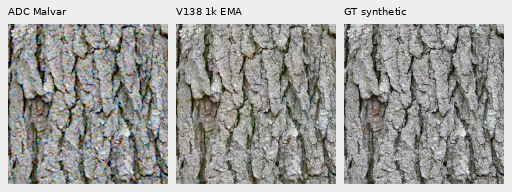
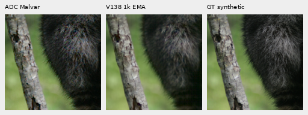
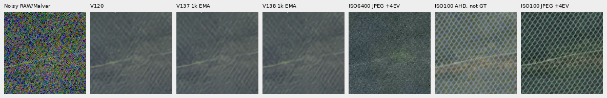

# V138: tiny faint/flat gains, no new mesh recovery

**Freezing the V120 parent while training the global RAW branch gives tiny
faint and flat improvements, with near-parent native output.** Faint ADC PSNR
rises .00406 dB over V120 and .02103 dB over the matched V137 continuation.
Noisy-flat spatial RMS falls .15% against V120. Fine mesh remains weak, natural
texture remains soft, and V143 remains the stronger faint-detail study parent.
V120 stays the general recommendation.

[Completed results](results/v138-quality-summary-v1.json) ·
[Independent aggregation](results/v138-quality-summary-audit-v1.json) ·
[Training and recovery](raw-global-only-training.md) ·
[16 native figures and full metadata](images/v138-quality-v1/manifest.json).

## Original production completed

The original V138 queue failed on an unrelated V125 admission dependency after
its genuine CPU/CUDA 16+2 checks had passed. Production had no claim, run directory
or result. Recovery verified all old owners exited, adopted the checks without
replay and executed the original frozen worker/configuration once. The original
failed plans, status and evidence remain unchanged.

The completed 1,000 updates use 16,000 training targets, seed 70, native256/B16/
BF16, 90,782 photos/27 reviewed regions, zero optical PSF and the same data/loss
recipe as V137. V138 trains 18 tensors/18,272 parameters at LR1e−3; V137 jointly
trained the common restoration path at LR1e−5. This combines scope and rate
changes and does not isolate either effect. It does not use V143's later
crossed-line/small-gradient recipe.

All 91 parent tensors remain exact in model and EMA, official DINOv3 stays
frozen, and all 1,000 clean/noisy training batches match V137. Final 109 model/
EMA tensors and 18 Adam states are finite; every Adam counter is 1,000. The
strict endpoint verifier also checks all 67 trained neural source files before
inference. Checkpoint SHA256:
`9e82ed9b8571be33218229b19f40cf3e2ebe1303a6e2e13932ddbcf2b0ba8be5`.

## Fixed panel and useful limits

Each row below averages 16 observations from four source scenes and four CFAs,
with identical retained noise, coordinates and display. The panel preserves
exact constructed targets and explicitly approximate binned references. It is
not a full427-photo or independent-camera evaluation.

| Mean sRGB PSNR, dB | V120 parent | V137 joint | V138 frozen parent |
| --- | ---: | ---: | ---: |
| Ordinary | 32.30426 | 32.30929 | 32.30440 |
| Gain 1/8, ISO6400 | 28.56132 | 28.56661 | 28.56216 |
| Gain 1/8, ISO12800 | 26.77725 | 26.78039 | 26.77756 |
| Gain 1/32, ISO6400 | 25.00826 | 25.00460 | 25.00831 |
| Gain 1/32, ISO12800 | 23.26106 | 23.23231 | 23.26083 |
| Faint ADC, contrast .025 | 67.48067 | 67.46370 | 67.48473 |

V138 recovers the deeper-shadow/faint regressions of the joint continuation,
but loses its small ordinary/shallow-shadow gains. Its faint advantage against
V120 is much smaller than V143's: the [V143 5k result](v143-final5000-quality.md)
is 67.74560 dB on these same faint observations. All 102 array hashes and all
96 shared V120 metric rows match that report exactly. A better continuation
comparison therefore does not establish a better current faint-detail model.

Noisy ADC Malvar → V138 → **exact constructed synthetic GT**, two native
160-pixel triplets at ROI [48,48,160,160] in 256 contexts. Input contrast .025,
shot/read 0, ADC16/black .03. All columns share 40× camera-linear contrast about
the same original target channel means, then common WB/matrix/sRGB, exposure 1.
No pixels are resized. Source/checkpoint/noise/display metadata is in the manifest.

## Flat and sky costs

Same 48 analytic fields, six colors/levels, four CFAs and ADC-only/ISO12800
priors. Spatial RMS removes DC; block32 measures coarser error. Units are
camera-linear DN16. Full rows preserve tiny nonzero ADC differences.

| Flat summary | V120 | V138 |
| --- | ---: | ---: |
| ADC spatial RMS | 1.237517 | 1.237518 |
| ADC block32 RMS | .198065 | .198065 |
| ADC maximum absolute DC | 7.309713 | 7.309726 |
| Noisy spatial RMS | 20.947780 | 20.916494 |
| Noisy block32 RMS | 13.224399 | 13.221041 |
| Noisy maximum absolute DC | 36.569035 | 35.606803 |

Noisy spatial RMS falls .15%, block32 RMS .025%, and maximum DC 2.63%.
Selected sky block32 variation is 3.09048→3.08424 DN16 against V120, versus
2.87130 for V137. Sky variation is descriptive and is not error against ISO100.
Native flats/sky look quiet at shared display; this small panel does not prove
general rejection of nonexistent detail in mixed scenes.

## Both standing real-photo tests

Main DSCF3879 ISO6400 and independently demosaiced DSCF3880 ISO100 f/5.6 use
native160 crops in 512 contexts and common +2EV. Foliage stays painterly and
the larger fence remains soft; no clear new recovery is visible. ISO100 is
**not exact GT**. [Sky](images/v138-quality-v1/main-main-overcast-sky-comparison.png) ·
[Building](images/v138-quality-v1/main-main-building-detail-comparison.png) ·
[Foliage](images/v138-quality-v1/main-main-foliage-comparison.png) ·
[Fence](images/v138-quality-v1/main-main-chain-link-fence-comparison.png).

Fine green mesh retains DSCF3842 ISO6400 / DSCF3835 ISO100 f/5.6, both established
noise priors and both native160 windows in 768 contexts. Nominal shot/read are
.00128/6.5536e−6; nearby-prior values are .0014635775921166604/1.0715704128646712e−6.
RAW and camera-JPEG comparison panels share +4EV; JPEG lifting uses
inverse-sRGB → exposure ×16 → sRGB, without resizing. Aperture, exposure time
and moving subjects differ; ISO100/AHD/JPEG references are not exact GT and
receive no pixelwise scores.

All four mesh/JPEG comparisons are published. Nominal output erases most mesh;
nearby-prior output retains weak traces with no clear new lattice recovery.
The periodic stage is disabled in these neural comparisons; V143's useful
optional [supported-amplitude correction](supported-wave-amplitude.md) remains
separate. Both protected families, JPEGs and siblings stay outside training.

## Verification and implication

Actual recovery work is 1,214 root/DINO calls: 1,000 training, 64 validation,
102 primary and 48 flat inference. The 36 earlier smoke calls are adopted,
and 408 primary controls plus flat controls are reused. Review adds no noise
draws, RAW decodes or original-drive/`/mnt/dataz` access. Cached training inputs
were checked before launch. All model/backbone/input/RNG checks pass.

Independent primary, faint, flat and JPEG checks cover 30,720,000 PNG channels.
Independent summary reductions agree within 1.43e−14. All 46 comparison boards
were viewed through 12 unresized sheets; corresponding triplet exports repeat
those audited pixels. Two new triplets copy 460,800 channels exactly and were
also viewed. [Preserved execution evidence](results/v138-quality-publication-v1.json).

The result supports frozen-parent adaptation as a way to avoid common-weight
drift in this recipe, with small measured benefits. It supplies no useful new
fine-mesh recovery. Full427, camera/color, full-frame, speed and broad superiority
claims remain unproven; the original fine-detail goal remains open.
