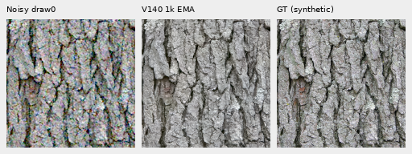
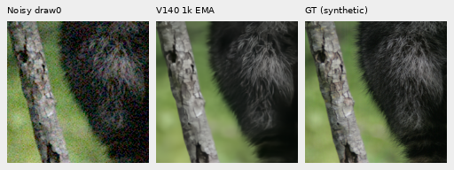
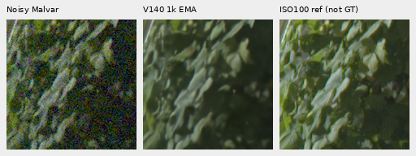
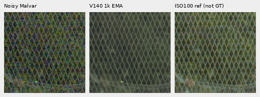
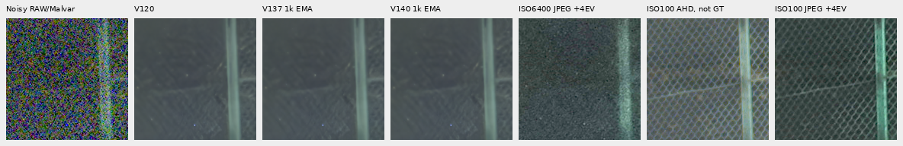
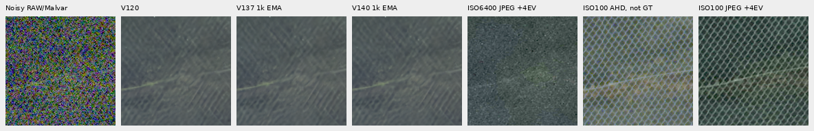
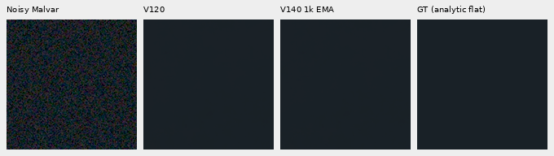

# V140 patch-memory endpoint: stable flats, no new mesh recovery

**The complete1,000-update V140 pilot stays essentially at V120 image quality.**
It does not visibly recover the difficult fine green lattice, and the flat/sky
checks show no obvious new splotches. V120 Small remains the general recommendation.
The RAW-memory path needs a more effective contribution; this recipe provides
no useful restored-quality gain.

[Measurements and execution](results/v140-standalone-quality-v1.json) ·
[Per-CFA scores](results/v140-standalone-metrics-v1.csv) ·
[Native source/ROI/checkpoint/noise/display metadata](images/v140-standalone-v1/manifest.json) ·
[Architecture](raw-patch-memory.md).

## What was actually trained

V140 starts freshly from V120's20k EMA, using the original frozen69-module
training source,90,782 photos/27 reviewed regions,seed70,50% reviewed-region
quota,native256/B16/BF16,zero optical PSF,LR.001 and100 warmup updates.
Only16 RAW-memory tensors/16,192 parameters train. All91 parent tensors remain
exact in model and EMA after1,000 updates. Each of1,000 clean and noisy batches
matches the saved V137 training witnesses. There are1,000 optimizer/root calls,
64 validation and1,064 encoder calls over16,000 target slots. All107 model/EMA
tensors and16 Adam states are finite at1,000; the official encoder is unchanged.
Peak allocated CUDA memory is7,998,901,760 bytes.

Checkpoint SHA256:
`882a6ebaeb048679ec62cd8160cd146b631172eb913a08efcfca208908131b49`.

The operator adds neighboring gradient descriptors before memory matching and
removes V137's direct local/MLP shortcut. Against V137, operator, training scope
and branch learning rate differ. This is not an isolated descriptor comparison
with V139, whose production remains unstarted. Implementation checks alone did
not establish quality; the actual trained numeric/native results below do.

The earlier V125/V131 workers stopped at the32GB memory reserve, preserving
steps8,799/14,549 of20k; their dependent October controllers exited. This new
standalone run executes the previously unstarted checked V140 recipe without
changing their budgets, sources or receipts. Existing CPU/CUDA16+2 checks are
adopted without replay. Dependency/license packaging fixes occurred before learned
execution. [Historical setup receipt](results/v140-standalone-setup-v1.json) ·
[November2 diary](../diary/2026-11-02-09-07-11-v140-standalone-pilot.md).

## Matched material results

Exactly102 candidate IEEE-FP32 root/DINO calls use64 retained shadow,16 ordinary,
16 faint-ADC,four main-GFX512 and two mesh768 inputs. All408 old predictions from
V120/V129/V136/V137 are reused. No new noise, RAW decoding or reference-model
inference is used. Each row below averages16 observations: four material contexts,
four Bayer layouts, one draw per CFA. These are four contexts, not16 independent
photographs. Camera RGB is rendered and scored using the shared original transforms.

| Condition | V120 | V1371k | V1401k | V140−V120,dB |
| --- | ---: | ---: | ---: | ---: |
| Ordinary ISO12800 |32.304263|32.309294|32.304297|+0.000034|
| Target gain1/8,ISO6400 |28.561316|28.566605|28.561479|+0.000162|
| Target gain1/8,ISO12800 |26.777249|26.780387|26.777484|+0.000235|
| Target gain1/32,ISO6400 |25.008258|25.004597|25.008099|-0.000159|
| Target gain1/32,ISO12800 |23.261062|23.232306|23.261517|+0.000455|
| Contrast.025,ADC only |67.480668|67.463704|67.480521|-0.000147|

The largest absolute condition-mean change from V120 is.00046dB. V140 avoids
V137's larger deepest-shadow/faint regressions on this support while adding
virtually no benefit over its frozen parent. Such tiny changes do not establish
useful recovery or a broad quality advantage.

Ordinary ISO12800 conditioning is shot`.00256`,read variance`2.62144e−5`;
shadow ISO6400 is`.00128`/`6.5536e−6`. Faint ADC has shot/read0 with the retained
16-bit quantization. All use draw0 and unchanged WB/matrix. Shadows receive
8×/32× display/scoring compensation; ordinary and faint inputs receive1×.

Native160×160 exact-GT triplets below use ROI`[48,48,160,160]` at the processed
8×-binned evaluation resolution, shared+0EV: noisy Malvar → V140 → exact
synthetic target. Pixels are never resized. Bark remains coherent; individual
raccoon hairs remain softer than GT.

Sources: [Derek Ramsey](https://commons.wikimedia.org/wiki/File:Kentucky_Coffee-tree_Gymnocladus_dioicus_3264px.jpg),
[CC BY-SA2.5](https://creativecommons.org/licenses/by-sa/2.5/), and
[Korall](https://commons.wikimedia.org/wiki/File:Racoon_clinging_to_a_tree.JPG),
[CC BY3.0](https://creativecommons.org/licenses/by/3.0/), modified by processing,
noise simulation and restoration. Native-camera grass/wood references are
binned approximate references, **not exact GT**.

The faint supplement retains the same original-source DCT16 masks and camera/
sRGB DC/spatial decomposition. All four common40× contrast boards were viewed;
V140 remains visually close to V120. Enhancement is never used for scoring.
[Faint metadata and all160 decompositions](images/v140-standalone-v1/faint/manifest.json).

## Both protected real GFX scenes

The main DSCF3879 ISO6400/DSCF3880 ISO100 f/5.6 crops stay native160 sensor
pixels at+2EV. Separate ISO100 exposures are qualitative references, **not GT**.
Main fence geometry remains coherent, foliage painterly, building detail soft
and sky quiet. No clear new V140 detail recovery is visible.

The extra DSCF3842 ISO6400/DSCF3835 ISO100 f/5.6 mesh uses the unchanged768px
context and both fixed priors: nominal shot`.00128`/read`6.5536e−6`, nearby3879
shot`.0014635775921166604`/read`1.0715704128646712e−6`. The nominal prior largely
erases the lattice; the nearby profile retains weak diagonal texture. V140 shows
no clear new lattice recovery on either side under either prior. Across the
entire768px nearby-profile context, V140 differs from V120 by only.04281DN16
camera-RGB RMS. That is output change, not a GT error or signal-transfer gain.

Left/right noisy RAW ROIs are`[806,6489,160,160]`/`[1026,6449,160,160]`, with
independent RAW-reference origins one pixel left. Camera JPEG crops keep their
separately recorded native coordinates. The boards below contain noisy Malvar,
V120,V137,V140,ISO6400 camera JPEG,independent ISO100 AHD,ISO100 camera JPEG.
All cells are native160px with shared+4EV display. JPEG tone processing, capture
exposure and aperture differ; neither ISO100 comparator is exact GT.

[All four nominal/nearby mesh boards and source metadata](images/v140-standalone-v1/camera-JPEG/manifest.json) ·
[All primary regions, source ROIs, conditioning and display](images/v140-standalone-v1/manifest.json).
Both pairs, JPEGs and siblings remain held out. Only cached media/arrays were
used; `/mnt/dataz` and read-only originals were not accessed.

## Actual flat-region safety

A separate48 candidate IEEE-FP32 calls reuse48 V120 outputs on six predeclared
analytic uniform colors: neutral levels.02/.18/.90,dark/mid blue and dark green;
ADC-only/ISO12800,all four CFAs,one existing draw each. These have **exact analytic
GT**, permitting DC/spatial error measurements that an independent sky capture
cannot support. All use native160 ROI`[48,48,160,160]`,shared+0EV and no resizing.

| Condition / statistic | V120 | V1401k |
| --- | ---: | ---: |
| ADC-only mean centered spatial RMS,DN16 |1.237517|1.237518|
| ADC-only mean32px-block RMS,DN16 |.198065|.198065|
| ISO12800 mean centered spatial RMS,DN16 |20.947780|20.951916|
| ISO12800 mean32px-block RMS,DN16 |13.224399|13.223424|
| ISO12800 worst absolute channel DC,DN16 |36.569035|36.346196|

The noisy spatial RMS rises.0197%,while32px block RMS falls.0074%; neither is
a meaningful visible change. No obvious new splotches appear in the six viewed
flat boards. This is limited support, not proof of flat-region safety for all
images, cameras, noise levels or observations.

The real main sky is affine-detrended per camera channel before measuring
spatial variation. V120/V14032px-block RMS is3.090480/3.091549DN16,about+.035%.
The sky appears quiet in both. These are descriptive variations, **not false-detail
error against an exact photographic GT**.
[All96 flat metric rows, source conditioning and sky values](images/v140-standalone-v1/flat/manifest.json).

## Verification and remaining work

The independent primary audit checks480 metric rows,120 groups,all64 native
PNGs/24,576,000 RGB channels. The faint audit checks300 strata,160 decompositions
and2,150,400 PNG channels. The flat audit independently recomputes96 metric rows,
five sky methods and1,843,200 PNG channels; maximum metric difference is6.64e−17.
Both camera-JPEG boards per profile have another2,150,400 exact native channels.
All32 primary comparison boards,two exact-GT triplets,four faint40× boards,
four JPEG boards and six flat boards were actually viewed without pixel resizing.

[Native audit](results/v140-standalone-native-audit-v1.json) ·
[Faint audit](results/v140-standalone-faint-audit-v1.json) ·
[Flat audit](results/v140-standalone-flat-audit-v1.json).
The targeted feature/scope/analytic-metric suite passes38 tests. A missing-file
test invocation and an overly tight FP64 fixture tolerance were corrected before
that run; the measured reductions did not change.

This is a complete1k pilot on limited support. Full427-photo/known-unseen-camera/
color panels,full-frame seams,speed and a matched V139 descriptor ablation remain
unmeasured. Fine-mesh recovery and broad superiority remain unresolved. The
result argues against treating this weak memory-only contribution as a finished
solution; it does not rule out stronger RAW matching,joint adaptation or further
loss/data changes evaluated against the same detail and flat controls.
