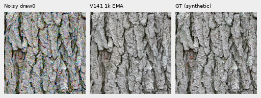
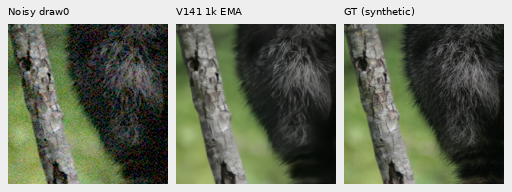
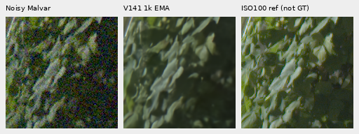
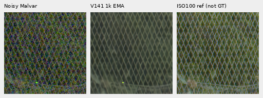
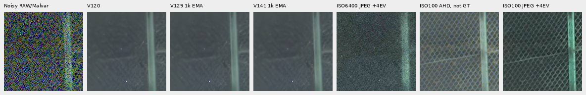
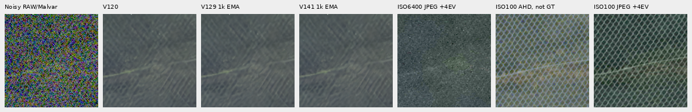
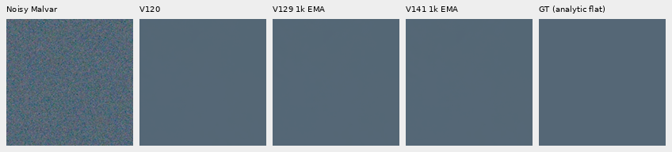

# V141: modest faint-score recovery, no new mesh recovery

**Reducing only the gradient-error smoothing scale gains.01528dB on faint ADC
versus matched V129, with mixed fine-band changes and no clear real-mesh gain.**
It remains.04814dB below V120 on that support. Noisy uniform-field coarse error
stays near V129 and about5.8% above V120. V120 Small remains the general choice;
this is not the combined detail/flat-region improvement being sought.

[Measurements and bound execution](results/v141-gradient-epsilon-quality-v1.json) ·
[Per-CFA scores](results/v141-gradient-epsilon-metrics-v1.csv) ·
[Source/ROI/checkpoint/noise/display metadata](images/v141-gradient-epsilon-v1/manifest.json).

## The isolated change

V141 keeps V129's architecture, V12020k EMA parent,90,782 photos/27 reviewed
regions,seed70,50% reviewed-region quota,native256/B16/BF16,zero optical PSF,
LR1e−5,100 warmup updates and1,000-step cosine horizon. All1,000 clean/noisy
training batches must match the saved actual V129 control. The official DINOv3
Small encoder stays frozen;89 restoration parameter tensors train normally.
Existing V129 training and predictions are reused.

Only the Charbonnier smoothing scale for the existing horizontal/vertical
**rendered-gradient error** changes from.0003 to.00003. Its coefficient stays.1.
Camera-linear, rendered-pixel and auxiliary epsilons remain.0003; highlight,
validity masks, noise simulation and every other loss coefficient stay fixed.
The real-paired measured-CFA/coarse-rendered objective stays unchanged.

The scalar derivative is`e/sqrt(e²+epsilon²)`. Reducing epsilon strengthens
small residual gradients while keeping the same bounded large-error influence.
It weights gradient **errors**, rather than selecting weak clean-target edges.
On a uniform target the correct gradient is zero, so invented variation receives
the same matching penalty. This is a rationale to test, not proof against
hallucinations after training.

```yaml
reconstruction_charbonnier_epsilon: 0.0003
gradient_charbonnier_epsilon: 0.00003
```

Missing/None gradient epsilon inherits the pixel epsilon exactly, including
legacy checkpoints. Positive finite values with safe FP32 squares are required.
Checkpoints store the effective value; changed pixel or gradient epsilon rejects
before model construction on resume. Direct, grouped and conditional-mean loss
paths and source diagnostics receive the same setting. Inference has no new
option, transform or learned architecture.

## Actual endpoint and matched results

The fresh run completed all1,000 updates,16,000 target slots and64 validation
forwards. Every clean/noisy training batch matches saved V129. All91 model/EMA
tensors and89 Adam states are finite at1,000, with the official frozen DINOv3
Small encoder unchanged. Peak CUDA allocation was7,046,391,296 bytes.

Checkpoint SHA256:
`2a4092dde697ba68d0fadefb73bfe5ac577e3759590e8535791273c008a87a8d`.

The102-input IEEE-FP32 review reuses408 saved V120/V129/V136/V137 predictions.
Its material means cover four contexts,all four CFAs,one draw per pattern;
these are four contexts, not16 independent photographs. Shadow gain1/8 or1/32
is compensated8×/32× before scoring/display. Ordinary/faint inputs use1×.

| Condition | V120 | V1291k control | V1411k | V141−V129,dB |
| --- | ---: | ---: | ---: | ---: |
|Ordinary ISO12800|32.304263|32.309544|32.309552|+0.000008|
|Target gain1/8,ISO6400|28.561316|28.566961|28.567944|+0.000982|
|Target gain1/8,ISO12800|26.777249|26.780392|26.780989|+0.000597|
|Target gain1/32,ISO6400|25.008258|25.004354|25.004788|+0.000434|
|Target gain1/32,ISO12800|23.261062|23.234792|23.233649|-0.001143|
|Contrast.025,ADC only|67.480668|67.417249|67.432524|+0.015275|

Ordinary conditioning is shot`.00256`/read variance`2.62144e−5`; shadow ISO6400
uses`.00128`/`6.5536e−6`. Faint ADC has shot/read0 with the same retained16-bit
quantization. Draw0,WB/matrix,inputs and transforms stay unchanged.

Against V129, faint sRGB mean total/DC/spatial MSE falls.389%/2.432%/.274%.
Its spatial MSE remains1.588% above V120. Fine-band changes are mixed; higher
projected gain does not always reduce error. The table below uses original-source
DCT16 masks before contrast attenuation, averaged over the same four CFAs.

| Faint stratum | Blocks | Gain V129→V141 | Relative band error V129→V141 |
| --- | ---: | --- | --- |
| Fur,0–2% |7|.870033→.871375|.287116→.289096|
| Fur,2–5% |5|.855928→.857735|.297697→.297675|
| Grass,2–5% |3|.940392→.939353|.248653→.247392|
| Wood,2–5% |9|.880793→.882085|.183788→.184212|

[Faint strata, decompositions and common40× displays](images/v141-gradient-epsilon-v1/faint/manifest.json).
All four40× boards were viewed; enhancement is display-only and never scored.

Two native160×160 triplets below show noisy → V141 → exact synthetic GT,
ROI`[48,48,160,160]`,shared+0EV,ISO12800 prior,at the8×-binned evaluation
resolution. No crop pixels are resized. Bark stays coherent and fine fur soft;
there is no clear large recovery of individual hairs.





Sources: [Derek Ramsey](https://commons.wikimedia.org/wiki/File:Kentucky_Coffee-tree_Gymnocladus_dioicus_3264px.jpg),
[CC BY-SA2.5](https://creativecommons.org/licenses/by-sa/2.5/), and
[Korall](https://commons.wikimedia.org/wiki/File:Racoon_clinging_to_a_tree.JPG),
[CC BY3.0](https://creativecommons.org/licenses/by/3.0/), modified by processing,
simulated noise and restoration. Binned native-camera grass/wood references are
approximate, **not exact GT**.

## Standing real-photo comparisons

Main DSCF3879 ISO6400 → V141 → independent DSCF3880 ISO100 f/5.6, **not GT**.
These retained512-context crops are native160 sensor pixels,shared+2EV.
Foliage remains painterly, fence geometry coherent, building detail soft and
sky quiet. No clear new fine-structure recovery over V129 is visible.





Both extra DSCF3842/DSCF3835 mesh regions and both fixed priors were reviewed.
Nominal shot`.00128`/read`6.5536e−6` still largely erases the fine lattice.
Nearby3879 shot`.0014635775921166604`/read`1.0715704128646712e−6` retains weak
diagonals, without clear new V141 lattice recovery. Sources,ROI coordinates,
conditioning and render exposure are unchanged from the standing test.

Below: noisy Malvar → V120 → V129 → V141 → ISO6400 camera JPEG → independent
ISO100 AHD → ISO100 camera JPEG. Each cell is native160px with shared+4EV.
Camera processing,aperture and exposure differ; neither ISO100 comparator is
exact GT. Original files and protected captures/JPEGs/siblings remain untouched
and out of training; only cached arrays/media are used.





[All four nominal/nearby-profile mesh boards and metadata](images/v141-gradient-epsilon-v1/camera-JPEG/manifest.json).

## Exact uniform fields and descriptive sky variation

The original48-field check adds48 candidate calls and reuses V120 outputs:
six fixed neutral/blue/green colors,ADC-only/ISO12800,all four CFAs,one existing
draw each. All use ROI`[48,48,160,160]`,shared+0EV and exact analytic uniform GT.
Coarse noisy-field residuals exceeded V120, so a separate supplement collected
V129 on **all the same48 fields**, using its exact62-module trained source.
No source,profile,ROI or draw changed. Those controls are retained for reuse;
the original candidate plans, observations and receipts remain intact.

| Statistic,DN16 | V120 | V1291k | V1411k |
| --- | ---: | ---: | ---: |
| ADC mean spatial RMS |1.237517|1.152886|1.173097|
| ADC mean32px-block RMS |.198065|.176301|.169960|
| ADC worst channel DC |7.309713|13.868860|13.691182|
| ISO12800 mean spatial RMS |20.947780|21.509397|21.542176|
| ISO12800 mean32px-block RMS |13.224399|13.987608|13.985133|
| ISO12800 worst channel DC |36.569035|42.893511|40.794436|

The noisy coarse error is essentially unchanged from V129 (−.0177%),and remains
5.752% above V120. Noisy spatial RMS rises.1524% over V129 while worst DC falls.
Thus the common continuation accounts for most of this flat-field tradeoff;
the epsilon change does not solve it. No clear large new pattern appears in
the viewed native boards, but the numerical regression versus V120 remains.



[All144 independently checked three-method reductions and six boards](images/v141-gradient-epsilon-v1/flat-control/manifest.json).
This small palette/one-draw support is not universal evidence against hallucinations.

Real-sky affine-detrended32px-block RMS is3.090480/2.831549/2.878711DN16 for
V120/V129/V141. V141 is6.85% below V120 and1.67% above V129; all look quiet.
These are descriptive spatial variations, **not false-detail error against exact
photographic GT**.

## Verification and next work

The primary independent audit checks480 metric rows,120 groups,all64 PNGs/
24,576,000 native RGB channels. The faint audit checks300 strata,160 decompositions
and2,150,400 PNG channels. Original flat checking covers96 rows,five sky methods
and1,843,200 channels; the three-method supplement checks144 rows and2,304,000
native channels with separate reductions/display arithmetic. Four camera-JPEG
boards add2,150,400 exact native channels.

All32 primary comparisons,two exact-GT triplets,four faint40× boards,four JPEG
boards and six three-method flat boards were actually viewed without resizing.
There are150 new candidate root/DINO calls,48 explicitly additional V129 flat
control calls and456 reused control predictions; no new noise or RAW decoding.

[Native audit](results/v141-gradient-epsilon-native-audit-v1.json) ·
[Faint audit](results/v141-gradient-epsilon-faint-audit-v1.json) ·
[Original flat audit](results/v141-gradient-epsilon-flat-audit-v1.json).
The104 loss/noise-pair/faint-path tests and genuine CPU/CUDA16+2 checks pass.

The loss option remains available with unchanged defaults. The independently
implemented [crossed-line/empty training source](crossed-line-training-data.md)
now addresses procedural structure and explicit absence, with44 data/regression
checks and data-only V142 production after CPU/CUDA16+2. It was not used by V141; its trained
quality remains unmeasured. Full427-photo/camera/color panels,full-frame seams,
speed,broad superiority and useful real fine-mesh recovery remain unresolved.
