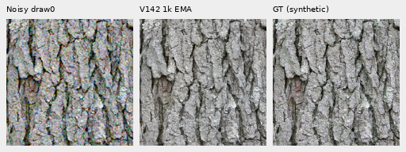
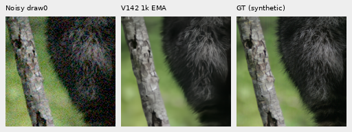
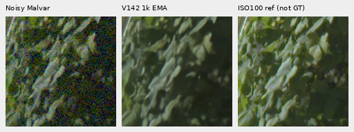
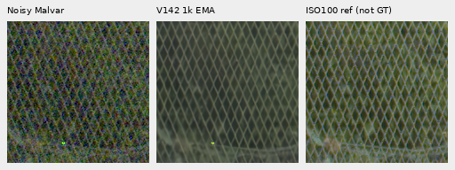
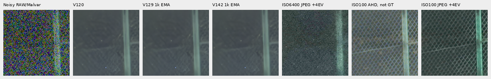
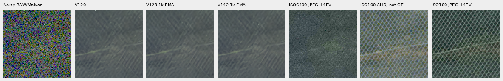
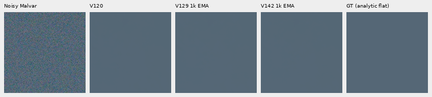

# V142: faint recovery and quieter noisy flats, fine mesh still weak

**Crossed-line/empty training data recovers .05212dB faint ADC PSNR over matched
V129 and lowers noisy-flat spatial RMS4.55%.** It gives small gains on selected
weak grass/wood bands, but no clear new real green-mesh recovery. Coarse noisy-flat
error remains5.08% above V120, and selected ADC-only color bias worsens.
Keep this useful data source for further quality trials; **V120 remains the
general inference recommendation**.

[Measurements and execution](results/v142-crossed-line-quality-v1.json) ·
[Per-CFA metrics](results/v142-crossed-line-metrics-v1.csv) ·
[Source/ROI/checkpoint/noise/display metadata](images/v142-crossed-line-v1/manifest.json).

## What changed

The fresh1k comparison keeps V129's V12020k EMA parent,90,782 photos/27 reviewed
regions,seed70,50% reviewed quota,native256/B16/BF16,zero optical PSF,LR1e−5,
100-step warmup and1k cosine horizon. Pixel and gradient Charbonnier epsilon
both stay.0003. The architecture and official frozen DINOv3 Small encoder stay
unchanged. This does not combine the V141 loss change with new data.

Only.10 of the existing.15 weak procedural quota becomes crossed-line/empty
sources; half are absent. Geometry, color, polarity, wire width/period, brightness
and contrast vary broadly, with exact empty regions inside present examples.
No test capture or geometry is used. The [actual reader audit](crossed-line-training-data.md)
finds397 present and376 absent examples among16,000 scheduled target slots;
median present detail RMS is.526% of sampled brightness, with61.59% empty area.
All30 crossed-line recipes in the final actual training trace match that replay.

All1,000 production updates complete with91 model/EMA tensors and89 Adam states
finite at step1,000. All262 native and261 paired clean/noisy batches match V129;
383/477 Commons batches change, as expected for this data intervention. Peak
CUDA allocation is7,046,391,296 bytes. Genuine CPU128/B1 and CUDA256/B16
16+2 resumed checks pass; changed fractions reject before model construction.

Checkpoint SHA256:
`01b39e46602983455c362619fa93378dc7e366e5c9ab3fc67e73120aa045fc18`.

## Matched material results

Four material contexts,all four CFAs and one draw per pattern share fixed
observations. They are four contexts, not16 independent photos. Shadow target
gain1/8 or1/32 receives matching8×/32× scoring/display exposure. Ordinary and
faint inputs use1×. The faint stress case adds.025 mean-preserving contrast and
ADC quantization only; its40× diagnostic display does not change scoring.
Binned camera references are approximate, with their roles retained in the CSV.

| Condition | V120 | V1291k control | V1421k | V142−V129,dB |
| --- | ---: | ---: | ---: | ---: |
| Ordinary ISO12800 |32.304263|32.309544|32.308638|−.000906|
| Gain1/8,ISO6400 |28.561316|28.566961|28.567847|+.000885|
| Gain1/8,ISO12800 |26.777249|26.780392|26.782067|+.001675|
| Gain1/32,ISO6400 |25.008258|25.004354|25.005582|+.001228|
| Gain1/32,ISO12800 |23.261062|23.234792|23.237041|+.002249|
| Faint ADC |67.480668|67.417249|67.469371|+.052122|

Faint PSNR remains.01130dB below V120. Mean faint sRGB spatial MSE falls.842%
versus V129, remaining1.010% above V120; total/DC changes are recorded separately.
For original-source DCT strata, the four-CFA means are:

| Original stratum | Blocks | Gain V129→V142 | Relative band error V129→V142 |
| --- | ---: | ---: | ---: |
| Fur0–2% |7|.87003→.88109|.28712→.28781|
| Fur2–5% |5|.85593→.86375|.29770→.29691|
| Grass2–5% |3|.94039→.94365|.24865→.23785|
| Wood2–5% |9|.88079→.89094|.18379→.18193|

Grass/wood improve slightly in gain/error; the weakest fur gain rises with
slightly worse error. This is mixed local progress, not broad detail recovery.
[All strata, decomposition and common40× displays](images/v142-crossed-line-v1/faint/manifest.json).

These native160×160 triplets show noisy → V142 → **exact synthetic GT** at the
8×-binned photo evaluation resolution. Each shares ROI[48,48,160,160],+0EV,
ISO12800-prior shot.00256/read variance.0000262144,draw0. Pixels are never resized.
Bark is coherent; raccoon fur remains soft. Source credits and transforms are
in the [manifest](images/v142-crossed-line-v1/manifest.json).

## Both heldout GFX scenes

Main DSCF3879 ISO6400 → V142 → independent DSCF3880 ISO100 f/5.6, **not GT**.
These native160 sensor-pixel cells use retained512px contexts, local
ROI[176,176,160,160] and shared+2EV. Sky remains visually quiet, fence geometry
coherent and foliage painterly, without clear new small-detail recovery.

The extra DSCF3842 ISO6400 / DSCF3835 ISO100 f/5.6 mesh remains largely erased
under nominal shot.00128/read variance.0000065536. The unchanged nearby3879
prior,shot.0014635775921166604/read variance.0000010715704128646712, retains weak
diagonals without clear new lattice recovery.

Below: noisy Malvar → V120 → V129 → V142 → ISO6400 camera JPEG → independent
ISO100 AHD → ISO100 camera JPEG. Native160px cells share+4EV; RAW ROIs are
[806,6489,160,160] left and[1026,6449,160,160] right, with the recorded one-pixel
reference offset. Both ISO100 comparators are **not exact GT**: aperture,
exposure time, moving subjects and processing differ.

[All four boards, both priors, JPEG ROIs and display metadata](images/v142-crossed-line-v1/camera-JPEG/manifest.json).
Both protected scenes,their JPEGs and siblings remain outside training.

A separate [fixed-frequency check](results/v142-mesh-peaks-v1.json) reuses the
two256px windows and all ten noisy-input-only selections from the earlier
[measured-green diagnostic](green-phase-spectrum.md). At its first two peaks:

| Window / selection | V120 power | V129 power | V141 power | V142 power |
| --- | ---: | ---: | ---: | ---: |
| Left1 |3.406%|2.911%|2.990%|3.045%|
| Left2 |6.110%|5.212%|5.373%|4.582%|
| Right1 |17.361%|17.194%|17.548%|18.168%|
| Right2 |13.469%|13.160%|13.171%|12.714%|

These are saved green-power/noisy green-power ratios, **not transfer gains,
correct-detail measurements or quality scores**. Changes are mixed across the
frequency families. No new selection, window, profile or inference was used.
Independent explicit Fourier rows check720 coefficients across all40 rows,
maximum absolute normalized-power difference3.02e−14.

## Flat-region strengths and remaining costs

The same48 exact analytic fields cover six colors,ADC-only/ISO12800 and all
four CFAs,one draw each. V120 and V129 predictions are reused; V129's48 controls
were collected once for V141, with no further control inference for V142.
Native ROI[48,48,160,160] and display exposure1 are fixed. Mean centered spatial
RMS and32px block-average error distinguish fine residuals from coarse blotches;
maximum absolute channel DC is a separate color-bias measurement. All use
linear camera-RGB error units.

| Statistic,DN16 | V120 | V1291k | V1421k |
| --- | ---: | ---: | ---: |
| ADC spatial RMS |1.2375|1.1529|1.1527|
| ADC block32 RMS |.1981|.1763|.1489|
| ADC maximum absolute DC |7.3097|13.8689|19.9783|
| Noisy spatial RMS |20.9478|21.5094|20.5303|
| Noisy block32 RMS |13.2244|13.9876|13.8967|
| Noisy maximum absolute DC |36.5690|42.8935|37.3735|

Noisy spatial RMS improves4.55% over V129 and1.99% over V120. Coarse noisy error
improves.65% versus V129 but remains5.08% above V120. ADC coarse variation falls,
while its worst selected DC bias rises44.05% over V129 and173.31% over V120.
This is a useful spatial-noise improvement with a color-bias cost, not uniform
flat safety or a full color-tail result.

[All144 three-method reductions and six native boards](images/v142-crossed-line-v1/flat-control/manifest.json).
The real-sky affine-detrended block32 RMS is3.0905/2.8315/2.7126DN16 for
V120/V129/V142. Its lower variation is descriptive; the independent capture
cannot establish exact sky error or absence of artifacts in all photographs.

## Verification and next work

All32 primary comparisons,two exact-GT triplets,four faint40× boards,four JPEG
boards and six three-method flat boards were actually viewed without resizing.
There are150 new candidate root/DINO calls,504 reused control predictions and
no new noise or RAW decoding. Original48-flat audit plus the three-method
supplement verify96/144 rows and1,843,200/2,304,000 PNG channels. Primary audit
checks480 rows,120 groups and24,576,000 channels; faint checking covers300
strata,160 decompositions and2,150,400 channels. JPEG boards add2,150,400 channels.

[Native audit](results/v142-crossed-line-native-audit-v1.json) ·
[Faint audit](results/v142-crossed-line-faint-audit-v1.json) ·
[Flat audit](results/v142-crossed-line-flat-audit-v1.json) ·
[Completed actual-reader trace](results/v142-completed-reader-trace-v1.json).
The44-test reader/regression suite,10 batch-binding tests and actual CPU/CUDA
checks pass. A launcher audit-path correction happened before any inference;
original/replacement launch records and all machine evidence remain preserved.

Retain the new data option for further quality work, with explicit empty
examples. Its1k gains justify testing more learning on this distribution;
selected ADC bias and coarse noisy error need continued monitoring. This result
does not establish the requested fine-mesh recovery. Full427-photo,camera/color,
full-frame seams,speed and broad superiority remain unmeasured for V142.
