# V143 completes5,000: useful faint and noisy-flat gains

The later [local complex phase fit](complex-phase-envelope.md) now compares
amplitude-only and locally varying phase correction on these same V143 parents,
with complete-frame mesh gains and measured nonuniform blank/texture tradeoffs.
The trained endpoint, original review and machine receipts below are unchanged.

**V143 gains0.26493dB faint ADC PSNR over V120 on the fixed panel and lowers
noisy-flat spatial RMS4.64%.** Ordinary/shadow means also improve slightly.
Coarse noisy-flat error remains2.63% higher and ADC-only spatial RMS12.85%
higher than V120. Real fine mesh still lacks clear new recovery from training
alone. This is a useful trained faint-detail result; V120 remains the general
recommendation with its completed full-photo/camera evaluations.

[Quality receipt](results/v143-final5000-quality-v2.json) ·
[Original worker and canonical checkpoint](results/v143-final5000-boundary-v1.json) ·
[Native source/ROI/noise/display metadata](images/v143-progress5000-v1/manifest.json) ·
[Training setup](v143-crossed-gradient5000.md).

The original worker completed all5,000 updates from V12020k, keeping V142
crossed-line/empty data and gradient epsilon0.00003 with pixel epsilon0.0003.
The encoder stayed frozen. The data, loss and longer learning-rate horizon
are combined versus V1421k; this does not isolate their individual effects.

## Fixed numerical support

These are the same retained observations, CFA layouts, noise draws and ROIs
as the earlier progress reviews. Source roles include exact synthetic targets
and separately labeled approximate binned references; this is not the full
427-photo or measured-camera suite. Repeated CFA/noise observations do not
represent independent training seeds or a broad superiority test.

| Mean sRGB PSNR,dB | V120 | V1421k | V1435k | Change versus V120 |
| --- | ---: | ---: | ---: | ---: |
| Ordinary | 32.30426 | 32.30864 | 32.31211 | +0.00785 |
| Gain1/8, ISO6400 prior | 28.56132 | 28.56785 | 28.56486 | +0.00354 |
| Gain1/8, ISO12800 prior | 26.77725 | 26.78207 | 26.78203 | +0.00478 |
| Gain1/32, ISO6400 prior | 25.00826 | 25.00558 | 25.02171 | +0.01345 |
| Gain1/32, ISO12800 prior | 23.26106 | 23.23704 | 23.28170 | +0.02064 |
| Faint ADC, contrast0.025 | 67.48067 | 67.46937 | 67.74560 | +0.26493 |

Faint sRGB spatial MSE decreases1.84984×10⁻⁷→1.75499×10⁻⁷, or5.13%, and
DC MSE decreases1.01876×10⁻⁸→8.40535×10⁻⁹. Total MSE decreases
1.95171×10⁻⁷→1.83904×10⁻⁷. The improvement is not solely an overall offset.
Faint PSNR progressed67.30124→67.47304→67.74560 at1k/2.5k/5k; do not treat
the early regression as the final result. The [initial loss diagnostic](crossed-line-loss-gradients.md)
does not attribute these trained changes.

## Native exact-synthetic-GT triplets

First, faint ADC Malvar → V1435k → exact synthetic GT. Each cell is an unchanged
160×160 crop at8×-binned evaluation resolution, ROI`[48,48,160,160]`.
Input contrast is0.025; the display multiplies camera-linear deviations from
the **same original target channel means** by40 before common WB/matrix/sRGB
rendering. Exposure remains1/+0 EV. This is contrast display, not pixel resizing
or a per-method fitted adjustment. ADC16/black0.03, shot/read0.

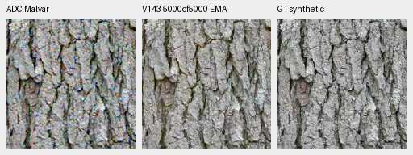

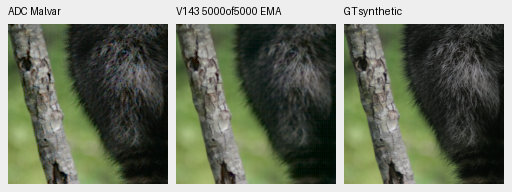

[Exact display/column-extraction metadata](images/v143-progress5000-v1/faint-triplet-manifest.json).
The noisy material checks below retain normal contrast, the same native ROI,
ISO12800-prior shot0.00256/read variance2.62144×10⁻⁵ and +0 EV. Bark is coherent;
fine fur remains soft. Changes are modest under high noise.

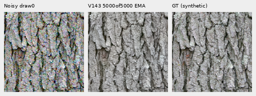

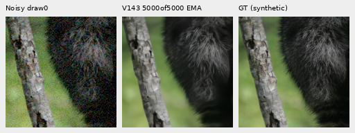

Canonical read-only checkpoint:
`/mnt/external/demosaic/models/v143-final5000.pt`, SHA256
`96d146d017c54196288c585f8b7eddcf030e8a235061049c31e985b9380b7ce4`.
Its bytes match the genuine worker endpoint and inference snapshot.

## Both standing GFX scenes

Main scene: DSCF3879 ISO6400 → V143 → independently demosaiced DSCF3880 ISO100
f/5.6, **not exact GT**. Aperture and moving subjects differ. Native160 cells
use local ROI`[176,176,160,160]` in512 contexts and shared +2 EV display.
Foliage remains painterly, larger fence/building edges coherent and sky quiet.

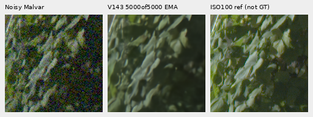

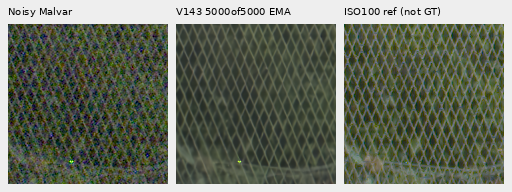

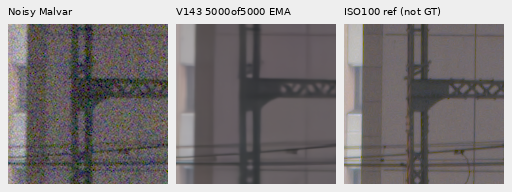

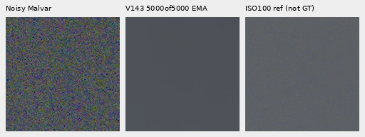

Extra mesh retains DSCF3842/3835, both JPEGs, native160 ROIs beginning
`[806,6489]` / `[1026,6449]`,768 contexts, shared +4 EV and the existing reference
x shift. DSCF3835 ISO100 f/5.6 and both JPEGs are independent qualitative
comparators, **not exact GT**; aperture, exposure time and moving subjects differ.

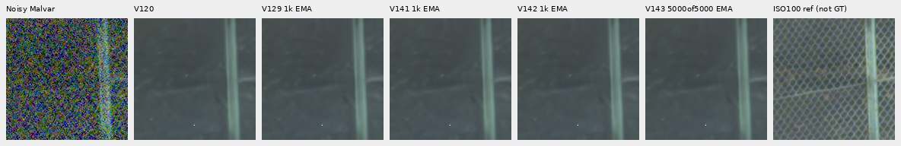

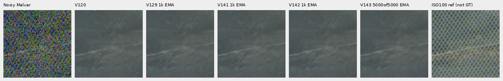

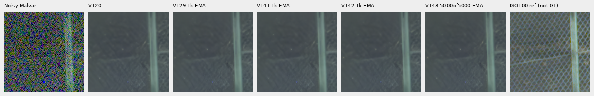

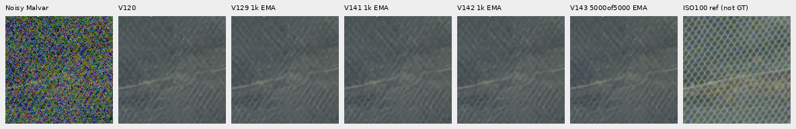

Nominal prior is shot0.00128/read variance6.5536×10⁻⁶; nearby prior is
shot0.0014635775921166604/read variance1.0715704128646712×10⁻⁶, not fitted to
this capture. Nominal outputs still erase most of the lattice; nearby outputs
retain weak traces without clear new recovery. [Both camera-JPEG comparators](images/v143-progress5000-v1/camera-JPEG/manifest.json)
and [fixed input-only peak results](results/v143-progress5000-mesh-peaks-v1.json)
remain included. Power ratios alone are not reconstruction quality.

The separate [local phase-aware correction](local-phase-harmonic-patch.md) now
tests V143 plus both harmonic variants. It gives stronger mesh with reduced but
remaining spill, and preserves the tested96-photo/48-flat parent values. This
postprocessing is not part of the trained checkpoint or this training comparison.

## Flat and sky tradeoffs

Same48 exact analytic fields, six colors/levels, four CFAs and ADC/noisy
conditions. Units are linear camera-RGB DN16. Spatial RMS removes each DC
offset; block32 measures coarser remaining error.

| Flat summary | V120 | V1435k |
| --- | ---: | ---: |
| ADC-only mean spatial RMS | 1.23752 | 1.39658 |
| ADC-only mean block32 RMS | 0.19806 | 0.18904 |
| ADC-only maximum absolute DC | 7.30971 | 9.00696 |
| ISO12800-prior mean spatial RMS | 20.94778 | 19.97560 |
| ISO12800-prior mean block32 RMS | 13.22440 | 13.57286 |
| ISO12800-prior maximum absolute DC | 36.56904 | 34.47081 |

Noisy spatial RMS improves4.64%, while coarse error is2.63% higher. ADC-only
spatial RMS worsens12.85%; its maximum DC is9.01 versus7.31 DN16. These costs
remain distinct from the useful faint score. Selected real-sky detrended
block32 variation falls3.09048→2.62621 DN16; without exact real GT, this measures
variation rather than reconstruction error. Native flat boards show no obvious
new repeated texture at shared display, which does not prove broad safety.

## Actual completion and checks

The same original worker completed5,000 training/optimizer updates and80,000
target contexts, plus320 validation and5,320 encoder forwards. All91 model/EMA
tensors and89 Adam states are finite; every Adam step is5,000. All69 trained
source modules match review, and the first1,000 input hashes match V142. The
original controller disappeared; the separate supervisor adopted the exact
still-live worker and original deadline, without restart or budget reset.
The genuine result and dead owner were verified before endpoint inference.
Original status/failure receipts remain preserved.

Endpoint review uses102 primary+48 flat=150 root/DINO calls, unchanged complete
model/backbone/input/RNG checks and504 cached control predictions. Independent
primary/faint/flat audits pass. Forty-eight boards and two faint triplet
extractions were actually viewed;19 representative PNGs are published with
unresized crop pixels. Across all three reviews, actual cost is499 calls,
including the explicitly documented49 first-point recovery calls. No new
review noise, RAW decodes or control-model inference is added.

The subsequent [full-frame report](phase-harmonic-inference.md) now runs V143 on
the complete main GFX scene and both fine-mesh priors, with optional local
correction, actual timing and verified RGB16 exports. Full427-photo, camera/color
quality and a dedicated speed benchmark remain open.
Its measured faint/shadow gains are useful for further quality work; they do
not establish a general replacement for V120's completed broader evaluations.
