# V143 at 1,000 of 5,000 updates

**No clear green-mesh recovery; faint-detail scores regress.** V120 remains the
general inference recommendation. The [later2.5k review](v143-progress2500-quality.md)
recovers faint scores near V120, with mesh still weak. The original V143 worker continues toward
5,000 updates. This checkpoint combines crossed-line/empty data, smaller
gradient smoothing and a longer learning-rate horizon; comparison with V142's
completed 1k run does not isolate a loss change.

[Training recipe and remaining reviews](v143-crossed-gradient5000.md) ·
[Quality receipt](results/v143-progress1000-quality-v2.json) ·
[Native image metadata](images/v143-progress1000-v1/manifest.json) ·
[Flat recovery evidence](results/v143-progress1000-flat-recovery-v1.json).

## Fixed numerical comparison

Each column uses identical retained inputs, coordinates and display transforms.
Means are over the small fixed panel and four CFA layouts, with two retained
noise draws where applicable; they are not full 427-photo results.

| sRGB PSNR, dB | V120 | V142 1k | V143 1000of5000 | Change versus V142 |
| --- | ---: | ---: | ---: | ---: |
| Ordinary | 32.30426 | 32.30864 | 32.30605 | −0.00259 |
| Gain 1/8, ISO6400 prior | 28.56132 | 28.56785 | 28.56246 | −0.00538 |
| Gain 1/8, ISO12800 prior | 26.77725 | 26.78207 | 26.77554 | −0.00653 |
| Gain 1/32, ISO6400 prior | 25.00826 | 25.00558 | 24.99387 | −0.01171 |
| Gain 1/32, ISO12800 prior | 23.26106 | 23.23704 | 23.22994 | −0.00710 |
| Faint ADC, contrast 0.025 | 67.48067 | 67.46937 | 67.30124 | −0.16813 |

Faint sRGB spatial MSE rises from 1.86852×10⁻⁷ to 1.92459×10⁻⁷ versus V142;
DC MSE decreases slightly, 1.03087×10⁻⁸ to 1.02237×10⁻⁸. The regression is
primarily spatial rather than an overall color offset. The independent faint
audit checks 300 strata and 160 DC/spatial decompositions, including V129/V141
controls. The [loss-only diagnostic](crossed-line-loss-gradients.md) measures
the initial objective's derivatives; it does not attribute this regression.

## Native synthetic-GT triplets

Each cell is an unchanged 160×160 crop at the 8×-binned evaluation resolution:
noisy draw 0 → V143 progress EMA → exact synthetic GT. Both use ROI
`[48,48,160,160]`, ISO12800-prior shot 0.00256, read variance 2.62144×10⁻⁵,
16-bit ADC and +0 EV display. CFA, black level, source attribution and retained
arrays are in the manifest. Bark remains coherent; fine fur remains soft.

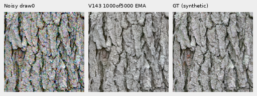

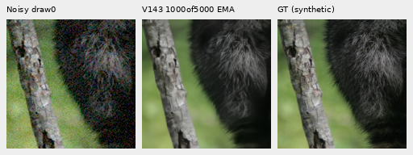

Checkpoint SHA256:
`9b09a9e7728735358ceadebf515e61a4634fd8f2385dc4c1528ff82cd73354f9`.
This is the retained 1,000-update EMA within the original 5k horizon, not its
endpoint. All first 1,000 clean/noisy inputs match V142, all 69 trained source
modules match, and 91 model/EMA tensors plus 89 Adam states are finite.

## Both protected real GFX scenes

Main scene: DSCF3879 ISO6400 → V143 → independently demosaiced DSCF3880 ISO100
f/5.6. Cells are native 160×160 at local ROI `[176,176,160,160]` in their retained
512 contexts, with shared +2 EV display. Aperture and moving subjects differ;
the ISO100 image is a qualitative reference, **not exact GT**. Foliage remains
painterly and the larger fence coherent; building edges remain coherent and
the overcast sky looks quiet at this display.

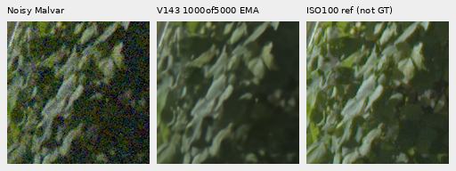

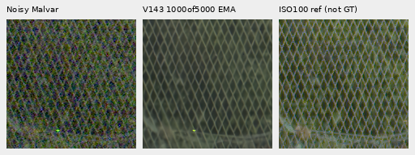

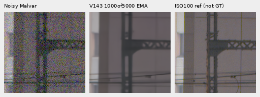

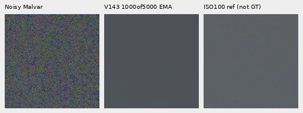

Extra fine mesh: DSCF3842 ISO6400 → retained controls/V143 → independently
demosaiced DSCF3835 ISO100 f/5.6, **not exact GT**. The left/right ROIs start at
`[806,6489]` / `[1026,6449]`, are native 160×160 in 768 contexts, and share
+4 EV display. The qualitative reference uses the existing one-pixel x shift;
no alignment or exposure is fitted to V143. Exposure time, aperture and moving
subjects differ. Camera JPEGs remain independent appearance comparators.

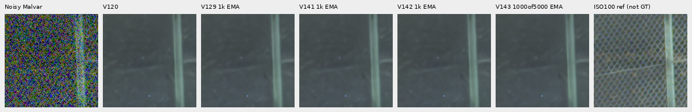

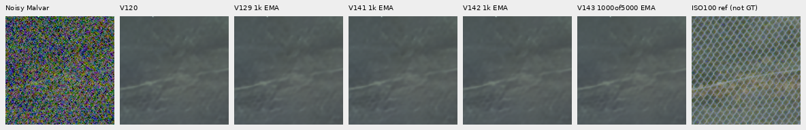

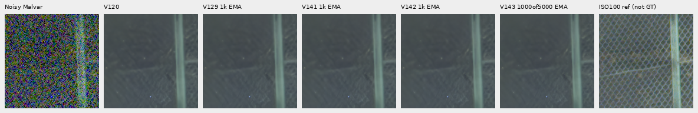

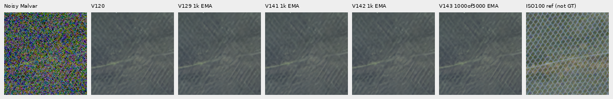

Nominal conditioning is shot 0.00128/read variance 6.5536×10⁻⁶. The nearby
DSCF3879 prior is shot 0.0014635775921166604/read variance
1.0715704128646712×10⁻⁶; it is not fitted to DSCF3842. Nominal outputs still
erase most of the mesh; weak nearby-prior diagonals do not establish new
lattice recovery. [Four camera-JPEG boards](images/v143-progress1000-v1/camera-JPEG/manifest.json)
and the [fixed input-only mesh peaks](results/v143-progress1000-mesh-peaks-v1.json)
are retained. The 40 peak-power rows agree with 720 independently evaluated
DFT coefficients within 3.02×10⁻¹⁴ power units; power alone is not correct
detail or a transfer gain.

## Exact flat fields and real sky

All 48 analytic uniform fields use the same six colors/levels, four CFAs and
ADC-only/noisy conditioning as V142. Units below are linear camera-RGB DN16.
Mean spatial RMS removes each output's DC error; 32×32 block RMS measures
coarser error. DC bias remains separate.

| Flat summary | V120 | V142 1k | V143 1000of5000 |
| --- | ---: | ---: | ---: |
| ADC-only mean spatial RMS | 1.23752 | 1.15271 | 1.09549 |
| ADC-only mean block-32 RMS | 0.19806 | 0.14894 | 0.19490 |
| ADC-only maximum absolute DC | 7.30971 | 19.97826 | 20.74030 |
| ISO12800-prior mean spatial RMS | 20.94778 | 20.53033 | 20.71751 |
| ISO12800-prior mean block-32 RMS | 13.22440 | 13.89668 | 14.16113 |
| ISO12800-prior maximum absolute DC | 36.56904 | 37.37353 | 40.01600 |

Noisy-flat spatial RMS is 1.10% below V120, while block-32 error is 7.08%
higher. ADC-only spatial RMS improves, but selected color bias is 20.74 DN16
versus V120's 7.31. These are distinct costs. The selected real sky's detrended
block-32 RMS decreases from 3.09048 / 2.71261 to 2.42774 DN16 for
V120 / V142 / V143. With no exact clean real sky, this is variation rather
than reconstruction error. It does not establish broad hallucination safety.

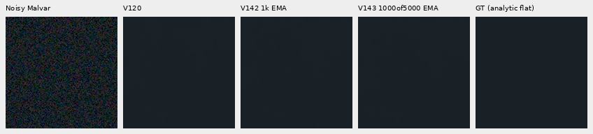

## Verification and the preserved collection failure

Primary collection completed 102 model/DINO calls with unchanged model,
encoder and RNG, followed by independent numeric/pixel audits. The original
flat collector saved all 48 predictions, then timed out at its original
30-minute limit before its final integrity checks. Its outputs, process
observations, journal, failure and frozen operator remain preserved. Its
post-collection state check is **unverified**.

A separately recorded one-frame diagnostic with one CPU thread passed all
checks. An explicitly additional 48-input recollection then passed the complete
model/encoder/RNG checks; every flat result here uses those verified outputs.
All original input observations and the loaded full model/backbone hashes
match. Comparing the saved old/new outputs checks 9,437,184 values: maximum
absolute difference 5.96×10⁻⁷, RMS 2.75×10⁻⁸. They are not bitwise equal.
The successful one-thread workaround does not establish the timeout's cause.

Actual cost is **199 root/DINO calls**: 102 primary + 48 original unverified
flat + 1 diagnostic + 48 verified flat. This is 49 beyond the planned 150.
There are no new noise observations, RAW decodes or control-model calls;
504 retained control predictions are reused. Independent audits pass before
actual native viewing of 48 boards and publication of 84 PNGs. All crop pixels
remain unresized. A separate one-thread watcher completed the2.5k audits, then stopped on the
original training controller’s disappearance. The [current endpoint supervisor](v143-progress2500-quality.md)
follows the same still-live worker and original deadline; neither failed watcher
is restarted.

Full 427-photo, camera/color, full-frame and speed evaluations remain unmeasured
for V143. The current checkpoint gives no reason to change the recommendation.
