# V143 at 2,500 of 5,000 updates

The [completed5k endpoint](v143-final5000-quality.md) supersedes this historical
progress state: faint ADC+.26493dB and noisy-flat spatial RMS−4.64% versusV120,
with explicit coarse/ADC costs and real mesh still weak.

**Faint scores recover to near V120; fine green mesh still lacks clear new
recovery.** Noisy-flat spatial error decreases, while coarse error and selected
ADC-only bias remain worse than V120. V120 stays the general recommendation.
The original training worker continues toward its declared 5,000 updates.

[Quality receipt](results/v143-progress2500-quality-v1.json) ·
[Selected native image metadata](images/v143-progress2500-v1/manifest.json) ·
[Previous 1k review](v143-progress1000-quality.md) ·
[Recipe and supervision](v143-crossed-gradient5000.md).

## Fixed numerical results

The observations, CFA layouts, noise draws, coordinates and display transforms
are identical across the retained reviews. These small-panel means are
descriptive, not full 427-photo results or an equal-budget loss ablation.

| sRGB PSNR, dB | V120 | V143 1000of5000 | V143 2500of5000 |
| --- | ---: | ---: | ---: |
| Ordinary | 32.30426 | 32.30605 | 32.31183 |
| Gain 1/8, ISO6400 prior | 28.56132 | 28.56246 | 28.56054 |
| Gain 1/8, ISO12800 prior | 26.77725 | 26.77554 | 26.77157 |
| Gain 1/32, ISO6400 prior | 25.00826 | 24.99387 | 24.99441 |
| Gain 1/32, ISO12800 prior | 23.26106 | 23.22994 | 23.24043 |
| Faint ADC, contrast 0.025 | 67.48067 | 67.30124 | 67.47304 |

Faint PSNR rises 0.17180dB from the first progress checkpoint, reaching
0.00763dB below V120 and 0.00366dB above V142's completed 1k result. Faint
spatial MSE is 1.86205×10⁻⁷ versus V120's 1.84984×10⁻⁷; DC MSE is
1.30252×10⁻⁸ versus 1.01876×10⁻⁸. Mean PSNR averages logarithms, whereas mean MSE
averages errors; the summaries need not rank methods identically. Ordinary gain remains small;
the deepest shadows remain weaker than V120.

## Native synthetic-GT triplets

Noisy draw 0 → V143 progress EMA → exact synthetic GT. Each cell retains its
160×160 crop at the 8×-binned evaluation resolution, ROI `[48,48,160,160]`,
ISO12800-prior shot 0.00256/read variance 2.62144×10⁻⁵, 16-bit ADC and +0 EV
display. Source attribution and complete array/noise metadata accompany each
image. Bark remains coherent and fine fur soft.

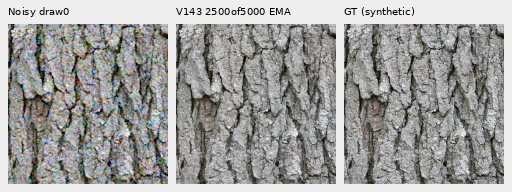

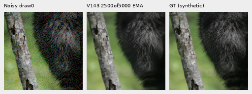

Checkpoint SHA256:
`6b3aec97ae9c6e210017f45da2bbf3c729ad311d3b703969617e4e71db771b57`.
All 69 source modules match training, 91 model/EMA tensors and 89 Adam states
are finite, and all first 1,000 clean/noisy hashes match V142. V142 has no later
training inputs to match. This is the retained 2,500-update checkpoint within
the original 5k horizon, not its endpoint.

## Protected real-photo scenes

Main scene: DSCF3879 ISO6400 → V143 → independently demosaiced DSCF3880 ISO100
f/5.6, **not exact GT**. The aperture and moving subjects differ. All four
native 160×160 cells use local ROI `[176,176,160,160]` in their retained 512
contexts and shared +2 EV display. Foliage remains painterly; larger fence
geometry and building edges remain coherent. Sky looks quiet at this exposure.

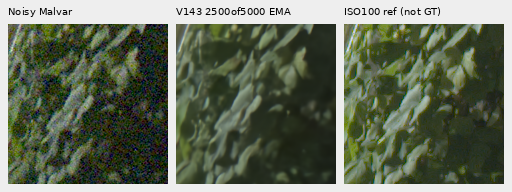

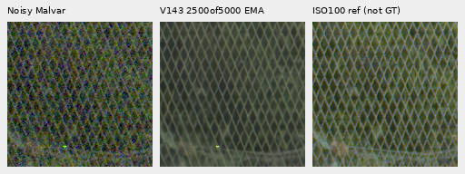

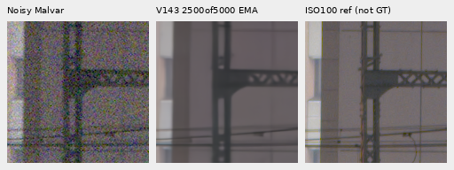

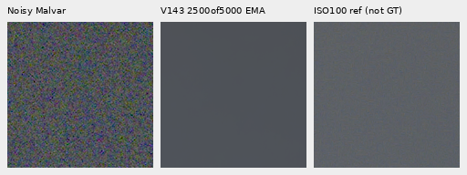

Extra mesh: DSCF3842 ISO6400 versus independently demosaiced DSCF3835 ISO100
f/5.6, **not exact GT**. Native 160×160 left/right cells start at
`[806,6489]` / `[1026,6449]` within the retained 768 contexts, sharing +4 EV
display and the existing one-pixel reference x shift. Aperture, exposure time
and moving subjects differ. No alignment or exposure is fitted to the model.

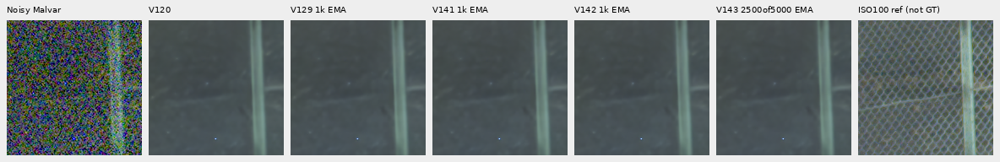

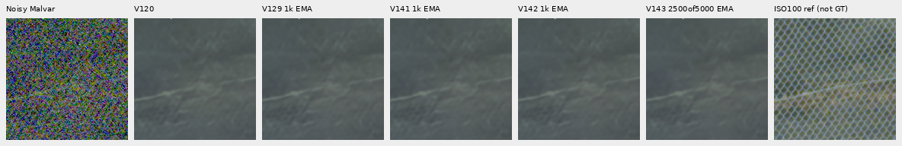

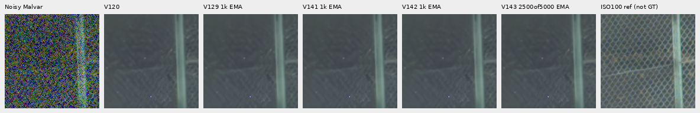

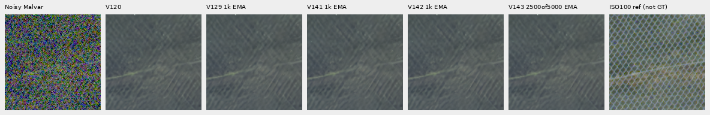

Nominal prior: shot 0.00128/read variance 6.5536×10⁻⁶. Nearby DSCF3879 prior:
shot 0.0014635775921166604/read variance 1.0715704128646712×10⁻⁶, not fitted
to this capture. Nominal outputs still erase most of the fine mesh. Nearby
outputs retain weak diagonal traces without clear new lattice recovery.
[Both camera JPEGs under both priors](images/v143-progress2500-v1/camera-JPEG/manifest.json)
remain appearance comparators. The [fixed input-only peak analysis](results/v143-progress2500-mesh-peaks-v1.json)
adds no inference; power alone does not establish correct detail.

## Flat-field tradeoffs

The same 48 analytic uniform fields retain six colors/levels, four CFAs and
ADC-only/noisy conditions. Values are linear camera-RGB DN16; spatial RMS
removes DC, while block-32 RMS measures coarser error.

| Flat summary | V120 | V143 2500of5000 |
| --- | ---: | ---: |
| ADC-only mean spatial RMS | 1.23752 | 1.63837 |
| ADC-only mean block-32 RMS | 0.19806 | 0.17013 |
| ADC-only maximum absolute DC | 7.30971 | 16.45584 |
| ISO12800-prior mean spatial RMS | 20.94778 | 20.50292 |
| ISO12800-prior mean block-32 RMS | 13.22440 | 14.00288 |
| ISO12800-prior maximum absolute DC | 36.56904 | 37.31765 |

Noisy spatial RMS is 2.12% below V120, but coarse error is 5.89% higher.
ADC-only spatial RMS is 32.39% higher, despite lower block-32 error. The selected
real sky's detrended block-32 variation is 2.60682 versus V120's 3.09048 DN16;
it is variation, not reconstruction error without exact real GT. Six native
flat boards show no obvious new texture at shared exposure; those displays
do not replace the numerical costs or prove broad hallucination safety.

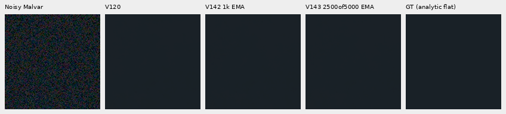

## Verification and continuing the original worker

Both collections pass unchanged complete model/backbone and RNG checks:
102 primary + 48 flat = **150 root/DINO calls**, with 504 cached control
predictions. Independent primary, faint and flat audits pass before actual
viewing of 48 native boards. Seventeen representative boards are published;
all complete reports, arrays and operator bytes remain retained. No noise,
RAW or control-model calls are added. Including the earlier documented flat
recovery, actual review cost so far is 349 calls; endpoint review plans 150.

After completing these audits, the watcher stopped while waiting for the
endpoint because the original training controller had disappeared. The tool
session reported exit 143; its cause is unestablished. The same original
worker remained alive and progressing. A separate [supervisor](results/v143-original-worker-adoption-v1.json)
now binds that exact PID/creation time, frozen command/plan and original
eight-hour deadline. It does not restart training, resume a checkpoint, reset
the budget or rewrite the original status. The original memory checks and
12GiB CUDA cap remain in the worker. Endpoint review waits for that worker's
genuine complete result and termination, then verifies its state and lineage.
Seventy-eight targeted progress/retained tests pass, including identity and
deadline rejection cases.

The endpoint, full 427-photo panel, camera/color, full-frame quality and speed
remain unmeasured. V120 stays recommended.

A separate [64-input procedural response test](crossed-line-response.md) reproduces
near-total ISO6400-prior mesh erasure in V120/V142/V1432.5k. It is a new192-call
diagnostic, outside this fixed-photo review ledger; its oracle RAW fit is not
an inference calibration or blind-recoverability guarantee.
