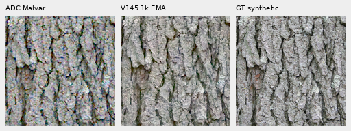
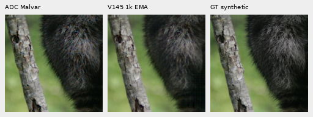
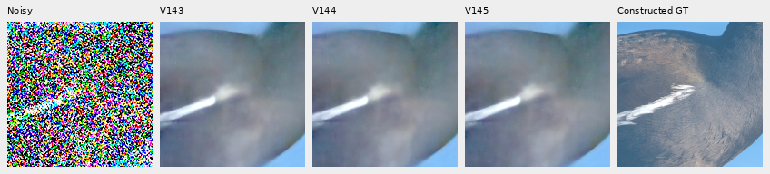
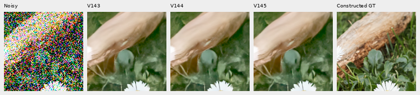
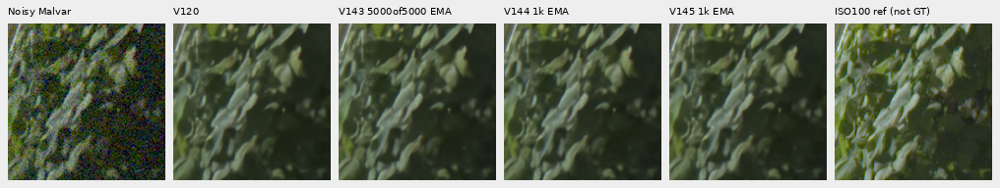
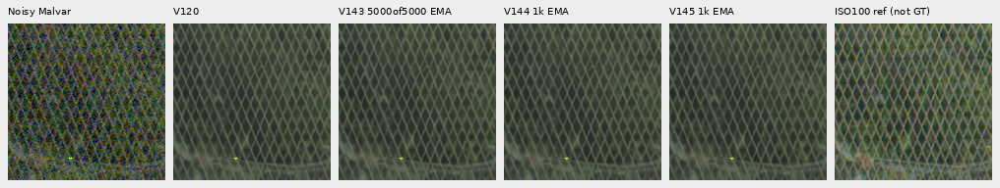
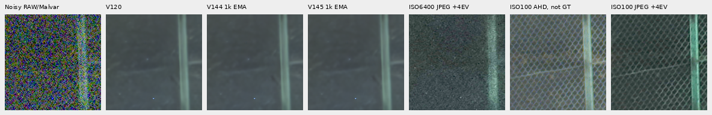
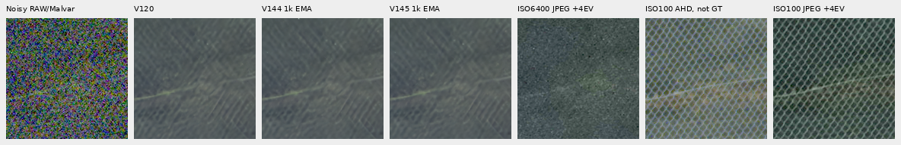

# V144/V145: no useful fine-detail gain at 1,000 updates

**Local RAW attention adds no useful fine-detail recovery over the matched
continuation at this budget.** V145 gains .00036 dB ordinary PSNR but loses
.00813 dB faint ADC PSNR against V144. Noisy-flat spatial RMS rises 1.11%.
Organic-photo full-context error changes by less than .02%, with no clear new
feather, moth-scale or green-mesh detail in native views. V143 remains the
faint-detail study parent; V120 remains the general recommendation.

There are small benefits: ADC-only spatial RMS falls 2.73% against V144 and
selected sky block32 variation falls 4.69%. ADC maximum DC error rises 10.55%,
and the sky remains 17.25% more variable than V143. These are mixed outcomes,
not a useful replacement for the existing parent.

[Aligned results](results/v144-v145-quality-summary-v1.json) ·
[Independent final-state/aggregation audit](results/v144-v145-quality-independent-audit-v1.json) ·
[24 native figures and complete metadata](images/v144-v145-quality-v1/manifest.json) ·
[Training and recovery history](v143-spatial-attention-trial.md).

## Matched endpoints

Both runs start from the V143 5k EMA, with seed 144, 1,000 updates, native 256/B16/
BF16, 50% reviewed quota, zero optical PSF and the same V143 data/loss/noise recipe.
All 1,000 clean/noisy training batches match. V144 retains the architecture;
V145 adds the 23-tensor/22,664-parameter local attention branch at 100× the trunk
learning rate. Trunk LR peaks at 1e−5; branch LR at 1e−3. Both official DINOv3
encoders stay frozen. Architecture and branch rate change together; this is
one matched training seed, not an isolated LR experiment or full 20k result.

| Endpoint EMA | SHA256 |
| --- | --- |
| V144 control | `b39976396d90c096cb52157d208b172c86148f84dfa044d908f0899d08973e85` |
| V145 attention | `0631176e11278fdaa9a11e4ae47db2cacc78cf4829a17bb9170fccfeef4cd2b9` |

Both complete 1,000 optimizer updates, 16,000 training targets and 64 validation
forwards. An independent state-only check reopens finite 91/114 model/EMA
tensors and 89/112 Adam states, all at step 1,000. All 81 neural source files
match between training and review. Initial paired outputs match and genuine
CPU/CUDA 16+2 checks passed before production.

## Fixed primary panel

Means use the same retained inputs, CFA layouts, noise draws and native ROIs.
Each row has 16 observations from four source scenes and four CFAs. The panel
contains exact constructed targets and explicitly labeled approximate binned
references; these are not 16 independent source photos per row. It does not
cover the full 427-photo/camera suite.

| Mean sRGB PSNR, dB | V120 | V143 5k | V144 | V145 | V145−V144 |
| --- | ---: | ---: | ---: | ---: | ---: |
| Ordinary | 32.30426 | 32.31211 | 32.31046 | 32.31082 | +.00036 |
| Gain 1/8, ISO6400 | 28.56132 | 28.56486 | 28.56651 | 28.56727 | +.00076 |
| Gain 1/8, ISO12800 | 26.77725 | 26.78203 | 26.77764 | 26.77860 | +.00097 |
| Gain 1/32, ISO6400 | 25.00826 | 25.02171 | 25.00881 | 25.00660 | −.00220 |
| Gain 1/32, ISO12800 | 23.26106 | 23.28170 | 23.25346 | 23.24486 | −.00860 |
| Faint ADC, contrast .025 | 67.48067 | 67.74560 | 67.51654 | 67.50842 | −.00813 |

V144 itself loses .22906 dB faint PSNR versus V143; V145 loses .23719 dB. Merely
beating this continuation would therefore not establish a better parent.
Faint sRGB spatial MSE is 1.82784e−7/1.84737e−7 for V144/V145, versus 1.75499e−7
for V143. V145's lower DC MSE than V144 does not repair the spatial regression.

Noisy ADC Malvar → V145 → **exact constructed synthetic GT**, native 160 cells,
ROI [48,48,160,160]. Input contrast .025, shot/read 0, ADC16/black .03. All columns
share 40× camera-linear contrast about the same original target means before
WB/matrix/sRGB; display exposure 1. Crop pixels are not resized. These two
triplets copy 460,800 channels exactly from independently audited boards.

## Photographic supplement

The [separate supplement](spatial-photo-supplement.md) compares 128 observations
from 16 validation photos: 64 retained 512 contexts and 64 organic384 contexts,
each with faint/dark variants and four CFAs. Source IDs are absent from both
photographic training sets. All methods share exact inputs, native 160 ROIs,
noise conditioning and display. Targets are exact for construction from bin8
linear-sRGB16 caches, not exact physical-scene GT.

| Mean full-context error, DN16 | V143 | V144 | V145 |
| --- | ---: | ---: | ---: |
| Retained512, faint | 33.96375 | 33.97969 | 33.98033 |
| Retained512, dark | 29.09772 | 29.09824 | 29.09761 |
| Organic384, faint | 37.46906 | 37.45194 | 37.44719 |
| Organic384, dark | 33.68580 | 33.67879 | 33.67591 |

Organic band response, ideal 1, is .15070/.14983/.14996 for faint
V143/V144/V145 and .39895/.40192/.40222 for dark. Relative band error grows
slightly against V144 in both organic conditions. A response increase alone
is not correct detail recovery. All 56 supplementary boards were viewed;
fine feathers, grass and moth texture remain missing, with blurred islands
and false color. Below, faint feathers use shared 8× display contrast; dark
grass uses contrast 1. Exact exposure/source/ROI metadata is in the manifest.

## Both standing real GFX tests

Main scene uses DSCF3879 ISO6400 and independently demosaiced DSCF3880 ISO100
f/5.6, **not exact GT**. Native160 cells in 512 contexts share +2EV. Foliage
remains painterly; larger fence/building edges survive and the sky stays quiet
at this display. There is no clear new recovery versus the control or parent.

[Building](images/v144-v145-quality-v1/main-main-building-detail-comparison.png) ·
[Sky](images/v144-v145-quality-v1/main-main-overcast-sky-comparison.png).

Fine green mesh retains DSCF3842/3835, both camera JPEGs and native 160 crops in
768 contexts. RAW panels share +4EV; camera JPEGs also receive +4EV through
inverse-sRGB → exposure ×16 → sRGB, without resizing the crops.
Nominal shot/read are .00128/6.5536e−6; nearby-prior
values are .0014635775921166604/1.0715704128646712e−6. Aperture, exposure time
and moving subjects differ. ISO100/AHD/JPEG comparisons are **not exact GT**.
Nominal outputs erase most mesh; nearby outputs retain weak traces without
clear new lattice recovery.

Both windows under both priors remain in the figure manifest. These neural
outputs have the periodic stage disabled; V143's useful optional
[supported-amplitude correction](supported-wave-amplitude.md) remains separate.

## Flat and sky costs

Same 48 analytic fields, six colors/levels, four CFAs, ADC-only/ISO12800 priors.
Units are linear camera-RGB DN16; spatial RMS removes DC and block32 measures
coarser error. Lower ADC spatial RMS comes with larger maximum DC bias.

| Flat summary | V120 | V143 | V144 | V145 |
| --- | ---: | ---: | ---: | ---: |
| ADC spatial RMS | 1.23752 | 1.39658 | 1.19522 | 1.16262 |
| ADC block32 RMS | .19806 | .18904 | .15840 | .16248 |
| ADC maximum absolute DC | 7.30971 | 9.00696 | 12.06292 | 13.33511 |
| Noisy spatial RMS | 20.94778 | 19.97560 | 20.92356 | 21.15525 |
| Noisy block32 RMS | 13.22440 | 13.57286 | 13.95659 | 13.96722 |
| Noisy maximum absolute DC | 36.56904 | 34.47081 | 32.04861 | 32.43999 |

V145 noisy spatial error is 1.11% above V144 and 5.91% above V143. Selected
real-sky detrended block32 variation is 3.09048/2.62621/3.23073/3.07924 DN16
for V120/V143/V144/V145. This is descriptive variation, not error against
independent ISO100. Native flat views show no obvious new repeated texture
at shared display, which does not establish broader safety or erase the
numerical noise/DC costs.

## Execution, preservation and next direction

Both original 1k training runs and all primary/faint/flat/JPEG/supplementary
reviews are complete. The original review stopped after successful V144 work
on a flat-audit filename mismatch. Separate recovery adopted its 150 completed
outputs and the 64 parent supplement outputs without replay. Original failures,
plans, logs, checkpoint bytes and receipts remain preserved.

Actual totals are 2,820 root/encoder forwards: 72 discarded smoke, 2,128 training/
validation and 620 inference. There are 2,072 optimizer updates including checks;
production contributes 2,000. Only 64 new review noise observations were added.
All model/backbone/input/RNG checks and independent primary/faint/flat/photo
audits pass. Independent aggregation agrees within 1.43e−14. Actual viewing
covers 154 original native boards through 39 unresized sheets, plus the two
triplet extractions above. Twenty-four representative PNGs are published.
No RAW decoding or original-photo-drive access was added; `/mnt/dataz` remains
unused. Both protected GFX families and siblings stay outside training.

The result is specific to this 1k recipe. It does not rule out other attention
architectures or schedules. The source already keeps the native head and final
skip/tail in FP32, so a precision-loss explanation cannot be assumed. A subsequent
[fixed whole-patch probe](cross-phase-patch-return.md) also fails: photographic
band error and noisy-flat error increase without clear new mesh detail. It
adds no model calls and stays outside inference. Full 427-photo, camera/color,
full-frame and speed qualification are not claimed for V144/V145.
