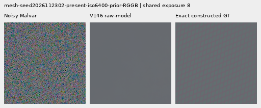
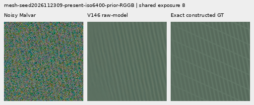
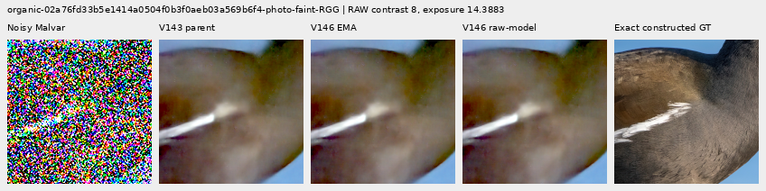
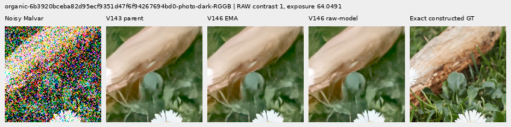
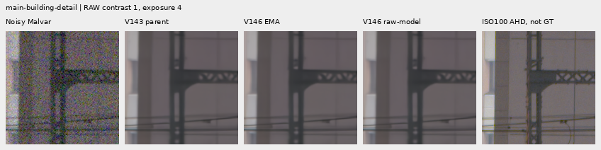
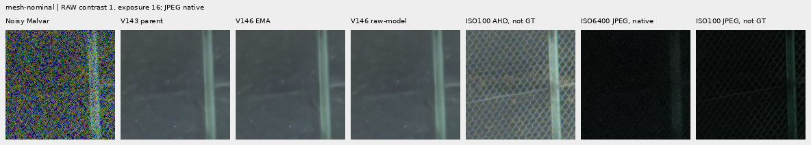
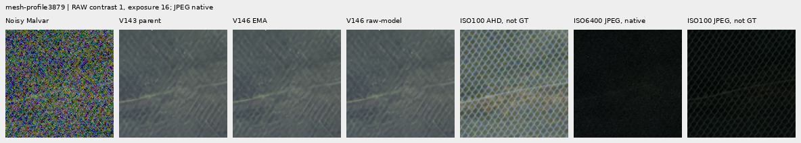

# V146: larger Fourier context and more mesh supervision

**This 500-update pilot does not improve useful fine detail.** Mesh template
response rises .44% with EMA and .62% with raw weights, but image error increases
.059%/.051%. All four photographic groups regress slightly. Native views show
no clear new green lattice, feathers or moth scales. V120 remains the general
recommendation; V143 with optional `detail` remains the useful periodic option.

There are small benefits: raw-weight noisy-flat full-field spatial RMS falls
.074%, and selected sky variation falls .32%. These changes accompany worse
mesh/photographic error and do not establish cleaner reconstruction generally.
All 22 native figures were inspected, including both standing real GFX tests.

[Complete matched scores](results/v146-coherent-frequency-result-v1.json) ·
[Independent state/metric audit](results/v146-coherent-frequency-independent-audit-v1.json) ·
[22 native figures, source/ROI/noise/checkpoint/display metadata](images/v146-coherent-frequency-v1/manifest.json) ·
[Execution and publication](results/v146-coherent-frequency-publication-v2.json).

## Intervention and actual exposure

Start from V1435k EMA and train only the existing five-tensor/3,264-parameter
frequency adapter. All 91 common model **and EMA** tensors remain exactly equal
to the parent; official DINOv3 ConvNeXt-Small remains frozen. The maximum Fourier
frame grows from 64 to 128 packed pixels, or 128 to 256 native pixels. Frame
overlap, signed complex mixing and zero output initialization retain their roles.

Native256/B16/BF16, seed146, 500 updates, LR .001, warmup100, reconstruction/
gradient epsilon .0003/.00003 and zero optical PSF. Inside Commons, mesh/weak/
synthetic fractions become .60/.65/.70; flat fraction stays .10. Paired/native
domain probabilities remain .25 each. This combines parent, context, data and
LR changes against historical V122; it does not isolate any one of them.

Actual production visits 252 Commons, 107 paired and 141 native batches: 8,000
targets. The deterministic Commons schedule contains **1,246 present meshes,
1,183 empty meshes**, 418 smooth fields, 209 other weak textures, 189 strong
synthetics and 787 photographs. Present meshes also contain exactly empty areas
outside compact masks. Independent replay agrees with all 240 sampled Commons
source records. Photographs retain bin4 → geometry → area2, effective bin8.
The existing 90,782-photo/27-region cohort and real-capture exclusions remain.

CPU128/B1 and CUDA256/B16 each complete discarded 16+2 updates. Changed training
scope and changed Fourier window both reject on resume without a neural call.
Production starts fresh and matches the CUDA check's first 18 input hashes and
initial outputs. All 500 batch hashes are retained. All five Adam states reach
500 and remain finite. Peak allocated CUDA memory is 8,752,963,584 bytes.

| Saved endpoint | SHA256 |
| --- | --- |
| Training checkpoint | `ceb55cc938ad7950d61b3904c34a8cddc0b2ed299d61e3d210bb93cc592867e0` |
| EMA inference export | `97b5ba47505d3b6318bcc14d0035a80a171bbcdc118cbf2f5971c2e40988e9a7` |
| Raw-model inference export | `1db735ad849e4a2413a11bc4aff86e1d22c2f2597ce36fb56aaf7cc44e977662` |

Both exports are declared before completion and independently compared tensor
by tensor with the corresponding saved training weights. The raw export names
its actual weight source explicitly. Neither is an optimizer restart or new run.
All 82 training/review modules match the actual saved source snapshot.

## Matched mesh and empty controls

Both endpoints receive the same 694 retained inputs in IEEE FP32, single view,
without a periodic stage: 512 mesh/empty observations, 128 photos, 48 flats and
six real contexts. The mesh panel has 64 recipes × four CFAs × presence/absence;
these are not 512 independent scenes. Existing V143 and periodic-detail arrays
are reused. This is reused development/transfer evidence, not a fresh holdout.

| Mean over 256 present observations | V143 | V146 EMA | V146 raw | Existing periodic detail |
| --- | ---: | ---: | ---: | ---: |
| Template response, ideal 1 | .022021 | .022118 | .022156 | .070898 |
| Full512 image RMS, DN16 | 9.111243 | 9.116588 | 9.115914 | 8.586126 |
| Central160 spatial RMS, DN16 | 13.258681 | 13.265429 | 13.264905 | 12.187164 |
| Mean added blank-region RMS, DN16 | 0 | .327252 | .316831 | .000636 |
| Worst added blank-region RMS, DN16 | 0 | .352519 | .340267 | .135258 |

Both V146 endpoints change all 256 present and all 256 absent inputs. On absent
fields, mean full error is 5.237910/5.246031/5.244881 DN16 for parent/EMA/raw.
Mean added change is .326715/.316308 DN16 and worst .353753/.338265. The existing
periodic option retains all absent parents. Added RMS includes bias as well as
spatial change; it is not alone evidence of invented texture. The error increases
and missing native detail are sufficient to reject V146 as an improvement.

Noisy Malvar → V146 raw → **exact constructed procedural GT**, native160 cells,
fixed RGGB seeds2026112302/2309, ROI [176,176,160,160]. Common +3EV, contrast1;
shot/read .00128/6.5536e−6, ADC16/black .03. No crop pixels are resized. Each
source's complete comparison also shows EMA and the existing periodic option.

[Shared40× contrast, weak mesh](images/v146-coherent-frequency-v1/mesh-seed2026112302-present-iso6400-prior-RGGB-crop-contrast40.png) ·
[Shared40× contrast, crossed mesh](images/v146-coherent-frequency-v1/mesh-seed2026112309-present-iso6400-prior-RGGB-crop-contrast40.png).
The weak lattice remains erased; the stronger example retains its parent's
dominant orientation but misses the other. EMA has two additional native GT
triplets in the manifest. These repeated exports are not new observations.

## Photographs

Same 16 held-out photos, four CFAs and faint/dark conditions. Each row contains
32 observations from eight sources. Targets are exact for construction from
native bin8 linear-sRGB16 caches, not exact physical-scene GT.

| Mean full-context RMS, DN16 | V143 | EMA | Raw |
| --- | ---: | ---: | ---: |
| Retained512 faint | 33.963754 | 33.967833 | 33.969999 |
| Retained512 dark | 29.097715 | 29.101179 | 29.102377 |
| Organic384 faint | 37.469061 | 37.475533 | 37.478255 |
| Organic384 dark | 33.685796 | 33.689879 | 33.691217 |

All four mean errors and relative band errors grow. Organic faint band response
falls .150701→.150559/.150378; ideal is 1. Tiny response changes elsewhere do not
recover missing feather, moth or grass texture in native views.

## Standing real tests and quiet regions

Main scene: cached DSCF3879 ISO6400 / independently demosaiced DSCF3880 ISO100
f/5.6, **not exact GT**, native160 cells in 512 contexts, common +2EV. Building
walls and sky show no obvious new colored blocks at this display; the larger
chain-link survives, while foliage remains painterly. There is no clear useful
new recovery. References are unscored.

[Sky](images/v146-coherent-frequency-v1/main-overcast-sky-crop-contrast1.png) ·
[Foliage](images/v146-coherent-frequency-v1/main-foliage-crop-contrast1.png) ·
[Chain-link](images/v146-coherent-frequency-v1/main-chain-link-fence-crop-contrast1.png).

Extra fine green mesh: cached DSCF3842 ISO6400 / DSCF3835 ISO100 f/5.6, both SOOC
JPEGs, both fixed noise priors and both native160 windows in 768 contexts.
RAW panels share +4EV; **JPEG panels retain native sRGB8 without an exposure
boost**. Aperture, shutter, motion and processing differ; ISO100/AHD/JPEG views
are qualitative references, not GT. Nominal shot/read are .00128/6.5536e−6;
nearby-prior values are .0014635775921166604/1.0715704128646712e−6.
Nominal mesh stays mostly erased; nearby conditioning retains the parent's weak
partial traces. Neither V146 weight set adds a clear new lattice.

| Flat/sky measurement, DN16 | V143 | EMA | Raw |
| --- | ---: | ---: | ---: |
| ADC central160 spatial RMS | 1.396576 | 1.396578 | 1.396577 |
| Noisy central160 spatial RMS | 19.975596 | 19.987188 | 19.970472 |
| Noisy full256 spatial RMS | 26.017191 | 26.014801 | 25.998034 |
| Noisy full256 block32 RMS | 19.539875 | 19.527363 | 19.521649 |
| Noisy worst full256 absolute DC | 32.546885 | 32.420962 | 32.454587 |
| Real sky full512 detrended block32 variation | 9.972641 | 9.949930 | 9.940642 |

Flat means use 24 fields per noise regime. Full256/block32/DC and full512 sky
measurements include the context borders; do not substitute these for earlier
central160 measurements. Sky variation is descriptive, not reference error.
The noisy-flat40× views retain existing colored mottling. Exact per-phase
constants give zero branch features after learning, but archived ADC outputs
have tiny nonzero execution differences; they are not bit-identical to V143.

## Evidence and remaining work

Independent checks cover 2,658 method rows, 16,910 scalars (maximum difference
4.55e−13), 149 Decimal reductions and **8,832,000 native RGB channels**. All 22
figures were viewed via six unscaled sheets. 82 focused tests pass, including
15 new window checks. There are 1,956 actual new root/DINO calls: 36 discarded
implementation checks, 500 training, 32 validation and 1,388 review. Reviews draw
no new noise and decode no RAWs. Training generates its normal declared noise.
All owned jobs have exited; `/mnt/dataz` and original captures were not accessed.

The first review launcher used system Python and failed before inference; a
corrected waiter was then stopped before binding to repair its snapshot-schema
check. Original logs/owners remain preserved. The completed collector uses the
same predeclared observations/endpoints, with no training restart or replay.

This is one 500-update feasibility seed, not a full-budget architecture verdict.
The larger window, faster branch LR and sixfold nominal mesh quota do not solve
the detail loss here. The subsequent [window-only inference transfer](v146-window-transfer.md)
now completes both saved weight sets at native512 support, also without useful
new recovery. It adds no training. Native512 training with unchanged
bin4→geometry→area2 would shrink this photographic pool from 90,782 to 1,759 and
leave zero of the current 27 reviewed ROIs eligible; it needs an explicit new
cohort/ROI plan. [Metadata-only eligibility evidence](results/v146-coherent-frequency-larger-context-eligibility-v1.json).
