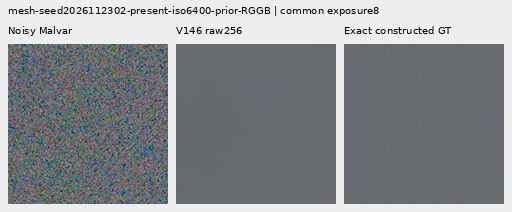
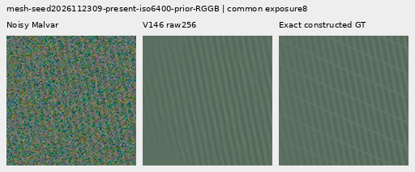
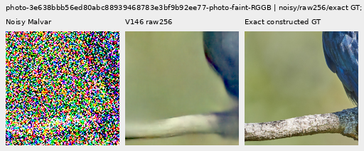
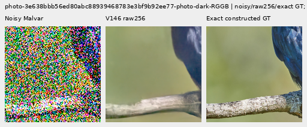
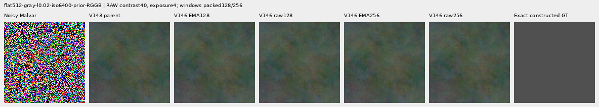
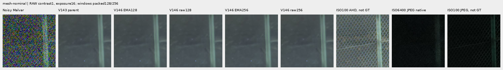
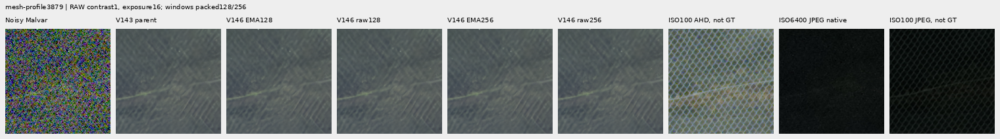

# V146: doubling Fourier support does not restore the missing mesh

**Larger inference windows do not improve useful fine detail with these weights.**
The test isolates packed128→256 Fourier frames, or native256→512 support, while
keeping every learned tensor fixed. Both raw and EMA mesh errors rise slightly;
template response falls slightly. Native views show the same missing lattice
and blurred fine photographic detail. V120 remains the general recommendation;
V143 plus optional `detail` remains the useful periodic option.

The change is very small: mean geometry-only output RMS on present meshes is
.02559 DN16 for EMA and .02407 for raw weights. Selected sky variation decreases
slightly, but fresh noisy-flat error grows against each matching smaller window.
These measurements do not support advancing either wider-window export.

[Complete scores](results/v146-window-transfer-result-v1.json) ·
[Independent numerical audit](results/v146-window-transfer-independent-audit-v1.json) ·
[32 native figures and complete metadata](images/v146-window-transfer-v1/manifest-v2.json) ·
[Execution evidence](results/v146-window-transfer-publication-v2.json).

## An inference experiment, not another training run

Use the completed [V146 at 500 updates, raw/EMA weights](v146-coherent-frequency.md), trained
with native256 support. Each wider export changes only `raw_frequency_window`
from 128 to 256 in inference model metadata. All 96 model/EMA tensors are checked
exactly against their corresponding original export. Training config, parent,
official frozen DINOv3 and all weights remain unchanged; there are no optimizer
updates, new parameters or training restarts. This is untrained context transfer.

| Inference export | SHA256 |
| --- | --- |
| EMA, packed256/native512 support | `354ae900611624846c884aed77f37e67bfd58b7097ec94fec4f3ffe9a879866d` |
| Raw weights, packed256/native512 support | `b134d37bc93a3ac2eaef243fef258a47c026efdbb972898a2e7e7caa5b45b1fd` |

Each wider endpoint executes 582 fitting retained contexts: 512 mesh/empty,
64 photographic512 and six real GFX contexts. The 64 organic384 and 48 old256
flats are too small to exercise the larger frame. Their 112 predictions per
endpoint are explicitly reused and labeled **bypass** in figures. Their identity
is not evidence that the larger window is safe on a 512 flat.

Add **72 fresh native512 analytic fields**: six existing palettes/levels × four
CFAs × ADC-only/ISO6400-prior/ISO12800-prior. Generate each once, then give the
same arrays to V143 and both V146 weight sets at both windows. This adds72 new
observations, including 48 with nonzero noise; it does not add independent photos.
Independent checks verify camera-linear constant targets, ADC16/black .03,
variance conditioning, unclipped noise moments and unchanged weights.
The noisy priors use shot/read .00128/6.5536e−6 and .00256/2.62144e−5;
these are declared sensor priors, not measured camera calibrations.

There are **1,524 actual new root/DINO calls**:2×654 wider-window forwards and
3×72 fresh-flat controls. The 766 aligned inputs yield 4,406 method rows, including
retained periodic controls and 224 exact short-context bypass rows. All 2,658 old
prediction bindings are exact; checked common metrics agree exactly with the
previous report.
Inference uses single-view IEEE FP32 with no added periodic correction. Peak
allocated CUDA memory is 5,244,229,120 bytes, below the 12 GiB cap. Inputs and RNG
remain unchanged; collectors create no noise or RAW decodes.

## Mesh and empty regions

Same 64 procedural recipes, four CFAs and matched presence/absence. These are
64 source recipes, not 512 independent scenes. Each present row below averages
256 observations. Template response has ideal 1; error units are camera-RGB DN16.

| Present mesh measurement | EMA128 | EMA256 | Raw128 | Raw256 |
| --- | ---: | ---: | ---: | ---: |
| Full512 image RMS | 9.116588 | 9.116743 | 9.115914 | 9.116168 |
| Template response | .02211809 | .02211668 | .02215646 | .02215547 |
| Central160 spatial RMS | 13.265429 | 13.265513 | 13.264905 | 13.265069 |
| Mean added blank RMS versus V143 | .327252 | .328267 | .316831 | .318183 |
| Geometry-only output RMS versus matching128 | — | .025593 | — | .024069 |

Image error increases .0017%/.0028% for EMA/raw against matching128. The existing
V143 parent is 9.111243 DN16; its optional periodic detail option is 8.586126 with
response .07089755. The larger neural frame does not close that gap.

On 256 absent observations, mean image error changes 5.246031→5.246258 EMA and
5.244881→5.245223 raw. Mean geometry-only changes are .025430/.023975 DN16.
These changes are mostly spatial rather than DC, but added RMS is not alone
proof of invented texture. Native40× views retain the prior colored mottling.

Noisy Malvar → wider-window raw weights → **exact constructed procedural GT**.
Native160 cells, RGGB seeds2026112302/2309, fixed ROI [176,176,160,160], common
+3EV/contrast1. Shot/read .00128/6.5536e−6, ADC16/black .03. No pixels resized.

[Shared40× contrast, weak mesh](images/v146-window-transfer-v1/mesh-seed2026112302-present-iso6400-prior-RGGB-crop-contrast40.png) ·
[Shared40× contrast, crossed mesh](images/v146-window-transfer-v1/mesh-seed2026112309-present-iso6400-prior-RGGB-crop-contrast40.png).
The first lattice stays erased. The second retains the inherited dominant
orientation but misses the other. The manifest also includes two EMA GT triplets.

## Photographic support and its limits

The actual512 cohort contains eight retained sources, mostly architecture/devices
and one bird/branch scene. Both faint and dark full-context mean errors increase
slightly at the larger window; the 32 observations per row are not 32 independent
photos. Tiny central error improvements in some groups do not establish useful
recovery. The eight organic384 sources are unchanged bypasses, not evidence about
larger-window organic reconstruction.

| Full512 photo RMS, DN16 | EMA128 | EMA256 | Raw128 | Raw256 |
| --- | ---: | ---: | ---: | ---: |
| Faint | 33.967833 | 33.967906 | 33.969999 | 33.970160 |
| Dark | 29.101179 | 29.101203 | 29.102377 | 29.102426 |

Actual512 bird/branch crops below exercise the larger window. The two native160
triplets share their source's WB/matrix and exposure 12.1494×/80.9959× respectively;
faint display contrast8, dark contrast1. Exact constructed targets derive from a
native bin8 linear-sRGB16 cache, not exact physical-scene GT. Full source/ROI and
unrounded display values are in the manifest. Fine bark and feathers stay blurred.

## Fresh512 flats and standing real scenes

Each noise regime has 24 actual512 fields. Full512 and central160 measurements
have different borders and must not be mixed with old256 statistics.

| Fresh flat measurement, DN16 | EMA128 | EMA256 | Raw128 | Raw256 |
| --- | ---: | ---: | ---: | ---: |
| ADC full512 image RMS | 3.322910 | 3.322910 | 3.322899 | 3.322899 |
| ISO6400 full512 image RMS | 18.549420 | 18.549808 | 18.540862 | 18.541355 |
| ISO12800 full512 image RMS | 24.083440 | 24.084122 | 24.074235 | 24.075192 |
| ISO6400 central160 spatial RMS | 14.921393 | 14.921829 | 14.911201 | 14.911623 |
| ISO12800 central160 spatial RMS | 18.690048 | 18.690661 | 18.678665 | 18.679516 |
| ISO12800 full512 block32 RMS | 17.928363 | 17.928930 | 17.925308 | 17.926221 |

The larger window does not clean the noisy flats. Existing colored mottling
persists in the native40× views. ADC-only branch features preserve spatial
constants mathematically; complete GPU outputs still have tiny nonzero execution
differences, so do not claim bit identity. The mean ADC geometry change is about
.00051/.00052 DN16 EMA/raw. The 48 old256 flat comparisons per endpoint are
separately labeled bypass; only the fresh512 fields exercise the larger window.

Main standing scene retains DSCF3879 ISO6400 / independently demosaiced DSCF3880
ISO100 f/5.6, **not exact GT**. Native160 cells in512 contexts share +2EV. Sky and
the quiet building wall show no obvious new blocks at this display, while
foliage stays painterly and the larger chain-link remains inherited. Whole512
sky block32 variation changes 9.949930→9.946912 EMA and 9.940642→9.938221 raw.
This is descriptive variation, not error against the independent ISO100.

[Sky](images/v146-window-transfer-v1/main-overcast-sky-crop-contrast1.png) ·
[Building wall beside steel structure](images/v146-window-transfer-v1/main-building-detail-crop-contrast1.png) ·
[Foliage](images/v146-window-transfer-v1/main-foliage-crop-contrast1.png) ·
[Chain-link fence](images/v146-window-transfer-v1/main-chain-link-fence-crop-contrast1.png).

Extra mesh retains DSCF3842 ISO6400 / DSCF3835 ISO100 f/5.6, both SOOC JPEGs,
both noise priors and both native160 windows in768 contexts. RAW columns share
+4EV; JPEGs retain native sRGB8 without exposure boost. Aperture, shutter, motion
and processing differ; ISO100/AHD/JPEG views are not GT and are unscored.
The geometry-only output change is about .04 DN16 under either prior. No clear
new fine lattice appears.

## Verification and next direction

Independent checks cover 4,406 rows, 34,534 scalar values, 401 Decimal reductions
and **16,358,400 native RGB channels**. All 32 figures were actually viewed on
eight unscaled sheets: 26 comparisons and six repeated GT triplets. There are 23
focused passing tests, including 256-window constants/checkpoint coverage and
execution of the relocated runner with a quoted repository path. All 82 model
source modules remain exact to the V146 snapshot. No training, source-drive or
`/mnt/dataz` access occurred. All owned jobs are terminal.

Two implementation failures remain preserved: the first controller relocation
failed before any neural call; the first renderer stopped after 13 figures at
the real mesh's per-window ROI schema. Corrected source versions reuse every
prepared input and completed inference. Those 13 partial PNGs match the completed
render byte for byte. No inference or noise draw was replayed for either fix.

This is one trained checkpoint's inference geometry test, not a full-budget
architecture verdict. It argues against further window-only scaling with these
weights. Whether spectral conditioning is weak or the RGB trunk suppresses its
offsets remains untested. A change in how fine detail reaches the output is a
more useful next question than another frame-size increase alone.

Complete 100MP tiling, seams and runtime are unmeasured here. A default 256 tile
would fall back to the smaller frame and would not exercise 512 support. There
is no new recommended checkpoint or ordinary-inference default from this study.
