# V43 architecture on curated Commons: 20k review

Current architecture and recommendations: [current model guide](current-model.md).
The versioned study below retains its measured results and original protocol.

V95 improves photographic PSNR and the tested weak-detail response. The six GFX regions show modest extra detail, while high-noise saturated-color tails worsen and unseen-camera uncertainty remains. **V95 is a promising candidate; V43 was the reference for this experiment while those quality tradeoffs are addressed.**

All new arms start from original V43 step 2000 with a fresh optimizer/EMA, the same seed and 20,000 additional updates. The final stage EMA is primary. These are unequal training budgets versus V43; the two matched contrasts isolate larger membership and the augmentation package. See the [recipe and curation](quality-first-training.md).

| Arm | Curated Commons sources | Optical PSF probability | Additional low-contrast examples |
| --- | ---: | ---: | --- |
| V93 | 39,983 | 0.25 | Original mix |
| V94 | 88,484 | 0.25 | Original mix |
| V95 | 88,484 | 0 | Weak procedural detail plus contrast-attenuated photos |

## Complete primary panels

Fresh IEEE FP32, with shared observations and fixed model bytes. Photo = 427 source-balanced photographs, seven noise/exposure conditions/four CFAs. Known/unseen = 4/5 scene-balanced measured-CFA panels, 72/90 crops. Sixteen procedural sources remain separate from photo means. Both RawNIND input-only gain adapters and three classical methods are in the complete underlying reports.

| Model | Photo sRGB PSNR | Known CFA PSNR | Unseen CFA PSNR |
| --- | ---: | ---: | ---: |
| V43 | 34.89933 | 54.23334 | 53.80629 |
| V93 | 35.24714 | 54.28970 | 53.70392 |
| V94 | 35.25352 | 54.30619 | 53.62349 |
| V95 | 35.29553 | 54.33307 | 53.76990 |

| Matched contrast | Photo delta, 95% interval | Known delta, 95% interval | Unseen delta, 95% interval |
| --- | ---: | ---: | ---: |
| V94 minus V93 | +0.00637 [-0.00955, +0.02475] | +0.01649 [+0.00715, +0.02711] | -0.08043 [-0.20615, +0.01790] |
| V95 minus V94 | +0.04202 [+0.02328, +0.05885] | +0.02687 [-0.00860, +0.05485] | +0.14641 [+0.05065, +0.30178] |
| V95 minus V43 | +0.39620 [+0.32633, +0.45182] | +0.09973 [+0.02450, +0.17496] | -0.03639 [-0.23642, +0.14168] |

Intervals resample paired sources/scenes (1,000 resamples, seed 42), not training runs. This is one training seed; the small camera panels have broad scene uncertainty. More corpus images alone have not produced a clear photographic gain in this study. The augmentation package helps sRGB PSNR, while its photo linear-PSNR contrast is slightly negative and uncertain.

Full records and audits: [primary statistics](results/v43-curated-original20k-primary-statistics-v1.json). Original reports: [photo](/mnt/external/demosaic/v43-curated-evaluation-20261021-v1/photo/report.md), [known cameras](/mnt/external/demosaic/v43-curated-evaluation-20261021-v1/known/report.md), [unseen cameras](/mnt/external/demosaic/v43-curated-evaluation-20261021-v1/unseen/report.md). The 111,636/648/810 score records pass independent coverage/arithmetic checks; maximum summary discrepancy is below 1e-14. DINO/model/configuration/RNG checks pass, as do sampled physical-input hashes and common crop-pixel checks.

## Native photographic crops

Each panel is an unchanged native 160×160 crop within a 256×256 evaluation tile at ROI [48,48,160,160]. The two sources were fixed before viewing model output. All methods share RGGB, ISO12800-prior conditioning and display exposure 1; the JSON beside each PNG records the checkpoint SHA, source, complete noise parameters, seed, ROI and display transform. These are exact synthetic clean targets derived from photographic sources. Camera/GFX references elsewhere are independently demosaiced or separately captured, not exact GT.

V43

[Source/ROI/checkpoint/noise/display receipt](images/v43-curated-original20k/crop-09daca8a7d6943a8.json).

[Source/ROI/checkpoint/noise/display receipt](images/v43-curated-original20k/crop-085432538346e7c9.json).

V93

[Source/ROI/checkpoint/noise/display receipt](images/v43-curated-original20k/crop-f80a946d703e4f49.json).

[Source/ROI/checkpoint/noise/display receipt](images/v43-curated-original20k/crop-fc25d26183812975.json).

V94

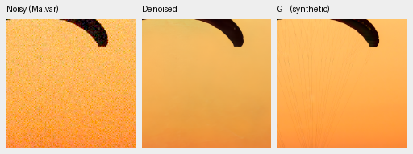

[Source/ROI/checkpoint/noise/display receipt](images/v43-curated-original20k/crop-b5923be28a52040e.json).

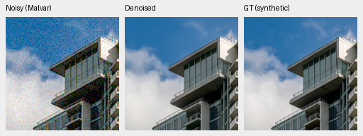

[Source/ROI/checkpoint/noise/display receipt](images/v43-curated-original20k/crop-fb130288cf928cbf.json).

V95

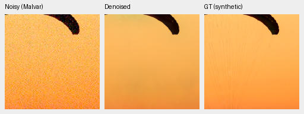

[Source/ROI/checkpoint/noise/display receipt](images/v43-curated-original20k/crop-aaa6479aedab664e.json).

[Source/ROI/checkpoint/noise/display receipt](images/v43-curated-original20k/crop-d9c5840dc4738ce1.json).

Source: [File:CH.VD.Villeneuve 2007-08-25 Vertigo-Swiss-Riviera 2392 3x2-R 4K.jpg](https://commons.wikimedia.org/wiki/File:CH.VD.Villeneuve_2007-08-25_Vertigo-Swiss-Riviera_2392_3x2-R_4K.jpg), Roy Egloff, [CC BY-SA 4.0](https://creativecommons.org/licenses/by-sa/4.0). Modified by binning, cropping, synthetic sensor noise and restoration.

Source: [File:Vancouver (BC, Canada), Coal Harbour Seaside Park, Blick in den Himmel -- 2022 -- 2158.jpg](https://commons.wikimedia.org/wiki/File:Vancouver_(BC,_Canada),_Coal_Harbour_Seaside_Park,_Blick_in_den_Himmel_--_2022_--_2158.jpg), Dietmar Rabich, [CC BY-SA 4.0](https://creativecommons.org/licenses/by-sa/4.0). Modified by binning, cropping, synthetic sensor noise and restoration.

The paraglider suspension lines remain weak at this noise level in every method. Building geometry is clearer in the joint models than RawNIND, and differences among joint endpoints on that building are modest. The fabric has a substantial V95 color regression that the earlier wording understated: its ISO12800/RGGB sRGB PSNR is 32.38894 dB versus V43's 40.57026, with chroma MAE 0.012539 versus 0.003802. These scores cover the 240×240 evaluation area after border trimming; the displayed crops are 160×160. The [fixed-example score audit](results/v95-palette-fixed-example-scores-v1.json) verifies the same V43/V95 case values against this completed study. The photographic mean gain does not remove this failure. [Actual viewing record](results/v43-quality-photo-first-native-review-v1.json).

## Weak detail and remaining quality review

The completed analytic grid has 448 observations per model across backgrounds 0.01/0.18, contrast 2%/10%, periods 4/8/16 pixels, ADC-only/high-noise conditions, four CFAs and four draws. Its 2,240 model/control scalar rows pass independent coverage/summary arithmetic (maximum difference 2.23e-16). The three preselected native texture/flat cases have been viewed.

For the 2% four-pixel ADC-only carrier, V43/V95 in-phase gains are 0.489/1.052 at background 0.01 and 0.350/1.027 at background 0.18 (ideal = 1). On the brighter 2% 16-pixel high-noise carrier, gain rises from 0.241 to 0.615. High-noise flat-field spatial RMS falls at both tested backgrounds. This is a fixed synthetic diagnostic, not proof of all natural low-contrast detail or absence of hallucinations.

The two preselected native camera cases per panel have also been viewed. Their references retain grain/AHD artifacts; small restored flecks cannot automatically be treated as recovered truth. All seven evaluation stages are complete, and all 96 saved triplets are represented in actual native views (132 distinct panels after sharing identical noisy/reference cells). No speed experiment or new full-frame benchmark was launched.

[Native weak-detail/flat board](images/v43-curated-original20k/texture-native.png) · [Pixel/source/conditioning/checkpoint receipt](images/v43-curated-original20k/texture-native.json).

## Saturated colors: remaining tradeoff

The complete grid covers 1,176 frozen observations and 4,704 saved float predictions. Independent Torch64 reconstruction checks 28,224 scalar fields and rerenders all 12 native triplets exactly; independent summary arithmetic checks all 72 groups. These are fixed-grid descriptors with one WB/matrix and one draw per case, not real-scene confidence intervals. ADC repetitions do not add independent evidence.

| Fixed-grid descriptor | V43 | V95 |
| --- | ---: | ---: |
| ADC-only p95 maximum absolute channel-mean error | 0.004885 | 0.002967 |
| ISO12800 p95 maximum absolute channel-mean error | 0.002569 | 0.005206 |
| ISO12800 p95 centered camera-RGB RMS | 0.001916 | 0.001841 |
| ISO12800 worst centered camera-RGB RMS | 0.002559 | 0.004058 |

V95 improves the ADC-only tails and typical high-noise spatial RMS, but its high-noise bias tail and worst spatial error are worse. The selected magenta field retains extra nonuniformity compared with V43; V93/V94 are visibly cloudier still. This is a concrete issue to address before changing the working reference.

[Native gray/orange/magenta board](images/v43-curated-original20k/color-native.png) · [Pixel/source/conditioning/checkpoint receipt](images/v43-curated-original20k/color-native.json).

## GFX100S real capture

DSCF3879 (ISO6400) and DSCF3880 (ISO100, f/5.6) are locally cached and excluded from training with their scene siblings. Each panel below is native 160×160, with common display exposure 4, WB and camera matrix. Sidecar receipts retain sensor coordinates, 512-pixel context, exact checkpoint SHA and shot/read conditioning. The ISO100 image is a separately captured qualitative reference with a different aperture and possible subject/LED motion; **it is not exact GT and receives no pixelwise score**.

V95 fence wires and some foliage edges look a little crisper than V43, with a smooth sky and readable building/platform structure. All four joint models give cleaner geometry than the RawNIND variants here. The neon's extra fine variation cannot all be identified as true detail from the separate exposure. These are modest real-scene differences, alongside the saturated-flat warning above.

Overcast sky

V43

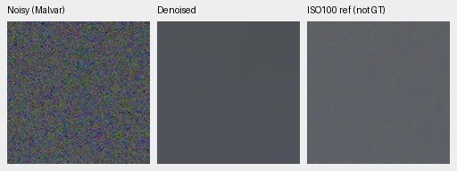

[Source/ROI/checkpoint/noise/display receipt](images/v43-curated-original20k/crop-7695cb844cf53615.json).

V95

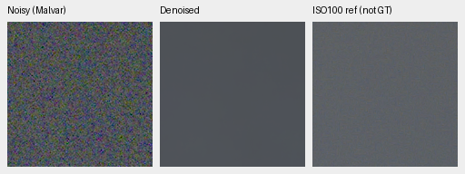

[Source/ROI/checkpoint/noise/display receipt](images/v43-curated-original20k/crop-73628411330713aa.json).

Building detail

V43

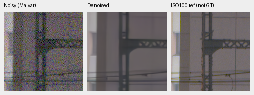

[Source/ROI/checkpoint/noise/display receipt](images/v43-curated-original20k/crop-d862a19f3f5860b0.json).

V95

[Source/ROI/checkpoint/noise/display receipt](images/v43-curated-original20k/crop-61feb82c7bab9a06.json).

Foliage

V43

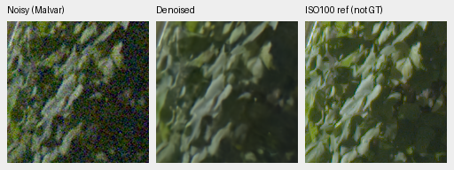

[Source/ROI/checkpoint/noise/display receipt](images/v43-curated-original20k/crop-a7415758dd5136b2.json).

V95

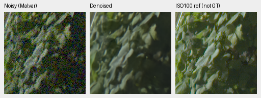

[Source/ROI/checkpoint/noise/display receipt](images/v43-curated-original20k/crop-5faf71482c3b174c.json).

Chain link fence

V43

[Source/ROI/checkpoint/noise/display receipt](images/v43-curated-original20k/crop-4919d32109aa8e9b.json).

V95

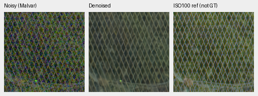

[Source/ROI/checkpoint/noise/display receipt](images/v43-curated-original20k/crop-2abaade7948fb7d2.json).

Colored neon sign

V43

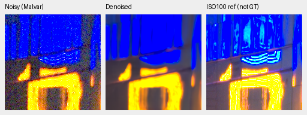

[Source/ROI/checkpoint/noise/display receipt](images/v43-curated-original20k/crop-80d178288023809f.json).

V95

[Source/ROI/checkpoint/noise/display receipt](images/v43-curated-original20k/crop-ecfa6d963735c26d.json).

Illuminated platform boundary

V43

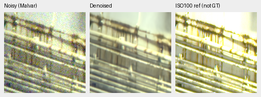

[Source/ROI/checkpoint/noise/display receipt](images/v43-curated-original20k/crop-c56df452804a8cfa.json).

V95

[Source/ROI/checkpoint/noise/display receipt](images/v43-curated-original20k/crop-1e36037b98e864c2.json).

## Decision and reproducibility

Use V43 as the comparator for this experiment and V95 as the next quality candidate. The larger corpus alone has not shown a clear photographic gain at this matched budget; less blur and added low-contrast examples help the measured detail response. The next quality target is saturated high-noise color bias/nonuniformity while preserving that detail. Speed work remains deferred.

[Complete seven-stage review record](results/v43-curated-original20k-complete-review-v1.json) binds the fixed plan, all result/report hashes, actual native views and independent audits. Four joint checkpoints complete 17,824 actual forwards/DINO calls across the panels; their model/DINO/configuration/RNG checks pass and sampled physical inputs match. All stage owners and the controller exit. This development study does not establish SOTA, broad unknown-scene superiority or full 100 MP/10 s qualification of V95.
