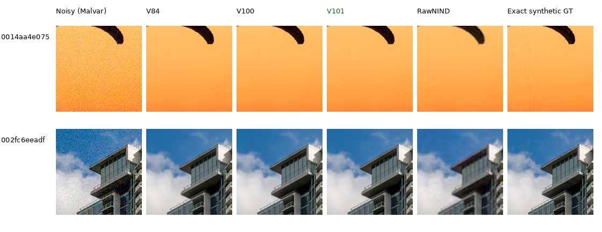
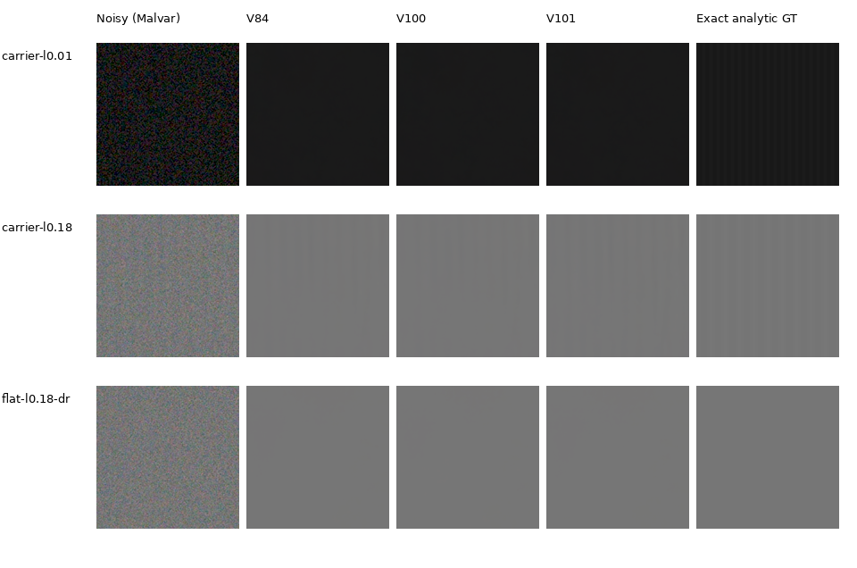
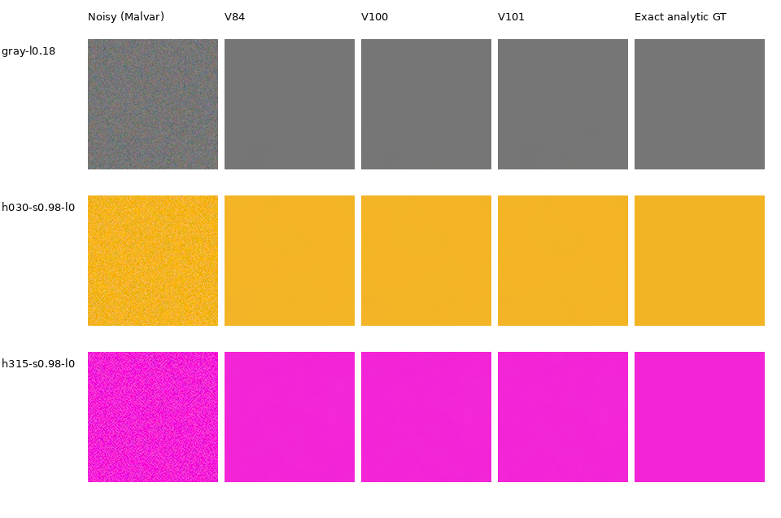

# Curated-data and fine-detail continuations

**V101 is the recommended checkpoint for further quality work.** Its full-photo
PSNR is **36.50347 dB**, versus V100's 36.47264 and V84's 36.43996. SSIM, linear
PSNR, chroma error and gradient error also improve on the photographic mean.
The camera results remain close to V84; native high-noise texture loss remains.
These useful gains justify updating the baseline and comparisons.

Both continuations start from V84's final20k EMA, keeping its pretrained DRUNet
RGB trunk and frozen official DINOv3 ConvNeXt-Tiny pyramid. They train for
10,000 additional updates with fresh AdamW/EMA, seed59, B16/native256, BF16 and
LR3e-6/warmup100. Both use the same frozen 88,484-source curated Commons pool,
128 native and 32 paired targets. V100 retains the control augmentation; V101
removes optical PSFs and adds weak synthetic textures, photographic contrast
attenuation and six reviewed fine-detail ROIs. This tests a combined recipe,
with no isolated attribution to cleaning, blurring or ROI sampling.
[Recipes, source exposure and execution](quality-first-training.md).

## Completed primary results

| Final EMA | Photo sRGB PSNR | Photo SSIM | Known4 CFA PSNR | Unseen5 CFA PSNR |
| --- | ---: | ---: | ---: | ---: |
| V84 / original20k | 36.43996 | .965209 | 54.17122 | **53.92823** |
| V100 / continuation10k | 36.47264 | .965398 | **54.17846** | 53.89614 |
| **V101 / continuation10k** | **36.50347** | **.965485** | 54.17404 | 53.92334 |

The photographic panel contains 427 fixed photos × seven conditions × four
CFAs: 11,956 cases per method. Sixteen procedural sources are scored separately.
All eight methods form a complete 99,232-row rectangle with no duplicates.
Evaluation uses the same IEEE FP32 CUDA observations and metrics, native256
contexts and original checkpoint policies. Optional ADC site projection is
absent. V84 reproduces its prior photographic score to numerical precision.

| Paired photo change | Mean PSNR, dB | Source-bootstrap 95% interval | Improved sources | Improved cases |
| --- | ---: | --- | ---: | ---: |
| V100−V84 | +.03268 | [+.02552,+.03763] | 417 / 427 | 11,496 / 11,956 |
| V101−V84 | **+.06351** | **[+.05647,+.07263]** | **418 / 427** | **11,668 / 11,956** |
| V101−V100 | +.03083 | [+.02280,+.04493] | 399 / 427 | 10,686 / 11,956 |

Nine source averages and 287 individual cases regress for V101 versus V84;
one case ties. Source-average changes range from −.23790 to +1.41583 dB.
SSIM improves on 413 sources, chroma MAE on 412 and gradient MAE on 418.
Intervals resample sources, rather than treating 28 observations of one photo
as independent. They describe this fixed panel's source variation.

| Condition | V101 photo PSNR | V101−V84, dB |
| --- | ---: | ---: |
| ADC-only | 36.75531 | +.10499 |
| ISO100 prior | 38.39904 | +.06700 |
| ISO1600 prior | 37.03428 | +.05038 |
| ISO12800 prior | 33.62563 | +.02540 |
| Shadows | 39.99513 | +.01756 |
| Highlights | 34.09629 | +.14379 |
| Legacy noise | 35.61862 | +.03548 |

V101−V84 measured-CFA change is +.00282 dB on known4, interval
[−.01878,+.02491], and −.00488 dB on unseen5, [−.05601,+.04220]. Two of four
known scenes and three of five unseen scenes improve. V101 recovers most of
V100's unseen-camera loss. Auxiliary AHD RGB still falls on the unseen mean;
it is not exact RGB GT. These small camera panels do not establish a broad
real-photo gain. [Camera means, scene changes and native views](real-camera-quality.md).

Independent aggregation rebuilds every reported source-balanced metric from
the per-image/per-crop rows within 1e-10, checks the complete method rectangles,
and resamples 10,000 paired source/scene means with seed20261022.
[Full values, checkpoint identities, per-source changes and audit](results/v84-curated-quality-primary-statistics-v1.json).

## Native photographic comparisons

Columns: noisy Malvar, V84, V100, **V101**, RawNIND with input-only CFA-channel
gain, exact synthetic GT. Every cell is an unchanged 160×160 crop at the
8×-binned evaluation resolution. Sources, coordinates, ISO12800 conditioning,
display exposure ×1 and all noisy/reference pixels match across methods.

V84/V100/V101 look close at this noise level. The fabric's fine cords remain
missing; architectural boundaries are more coherent than RawNIND, with residual
smoothing relative to the target. Small numerical gains do not imply restored
fine detail throughout these images.

V101's native triplets: [fabric](images/current-quality-v101/photo/V101-0014aa4e075b.png)
([metadata](images/current-quality-v101/photo/V101-0014aa4e075b.json)) and
[building](images/current-quality-v101/photo/V101-002fc6eeadf6.png)
([metadata](images/current-quality-v101/photo/V101-002fc6eeadf6.json)).
[All source/ROI/noise/display and full checkpoint records](images/current-quality-v101/photo/manifest.json).
Sources: [Roy Egloff](https://commons.wikimedia.org/wiki/File:CH.VD.Villeneuve_2007-08-25_Vertigo-Swiss-Riviera_2392_3x2-R_4K.jpg)
and [Dietmar Rabich](https://commons.wikimedia.org/wiki/File:Vancouver_(BC,_Canada),_Coal_Harbour_Seaside_Park,_Blick_in_den_Himmel_--_2022_--_2158.jpg),
[CC BY-SA 4.0](https://creativecommons.org/licenses/by-sa/4.0/), modified through
binning, cropping, noise simulation and restoration.

The [four-source natural-detail gallery](heldout-detail.md) shows slightly
stronger low-noise bark grain and canopy contrast, with all 12 PSNR/SSIM cases
improving against both checkpoints. The [standing GFX comparison](gfx-qualitative.md)
contains sky, building, foliage, fence and two illuminated regions. Those real
capture outputs remain close; their independently captured ISO100 reference
is not GT. The complete 102MP FP32 exports are now verified; V101 inference/blending
took 168.05s with tile512/overlap64/B4. These timings exclude loading/export.

## Weak texture and color

On the level.18, 2%-contrast period16 carrier at ISO12800, mean in-phase gain
is .24679 for V84, .21431 for V100 and **.31925 for V101**. It remains
far below the true contrast. The finer period8 carrier is nearly erased by all
three: gains .00262/.00224/.00374. With ADC-only input, period16 changes from
1.01467 to .98572 for V101, while period8 changes from .99565 to 1.00057.
This is a frequency/noise tradeoff rather than complete weak-detail recovery.

[Exact analytic sources, ROIs, weights, noise and exposure](images/current-quality-v101/texture/manifest.json).
The three preselected ISO12800 crops show the dark period8 carrier, mid-gray
period16 carrier and a flat control. Period16 is stronger in V101; the dark
fine pattern remains largely absent. Flat controls look uniform at normal
RGB8 display. Each cell is native 160, exposure ×1, with exact shared GT.

The flat-color grid contains 588 cases per condition/model, covering gray and
saturated colors, three levels, both conditions and all four CFAs. Bias below
is the largest absolute camera-RGB channel mean error per case, multiplied by
65535 to express normalized 16-bit DN. Lower is better.

| Condition | Model | Mean bias, DN | 95th percentile, DN | Maximum, DN |
| --- | --- | ---: | ---: | ---: |
| ADC-only | V84 | 44.28 | 115.52 | 1835.04 |
| ADC-only | V100 | 27.46 | 55.30 | 1537.71 |
| ADC-only | **V101** | **16.98** | **48.74** | **756.24** |
| ISO12800 | V84 | 28.19 | 106.11 | 197.79 |
| ISO12800 | V100 | 26.54 | 91.62 | 175.82 |
| ISO12800 | **V101** | **23.96** | **76.16** | **161.09** |

These preselected high-noise examples remain visually close, despite the
numerical bias gains. All 15 cells per board were inspected at native resolution.
[Color input/ROI/noise/display metadata](images/current-quality-v101/color/manifest.json).
Independent arithmetic reproduces all group summary statistics from 3,528
raw cases within 1e-10, with no duplicate model/case pairs.
[Completed diagnostic reports, calculations and viewing record](results/v84-curated-quality-diagnostics-v1.json).

## Checkpoints and next work

| Version | Full checkpoint SHA256 |
| --- | --- |
| V84 | `134887e12357aabf420cceee3ee53fc8832cf02a8f81ff883b829a9e51e16f10` |
| V100 | `4b689fb187b13df72fbf79ebd46f98cf7361c3ca8a97fb1f7afee940b249ad3e` |
| V101 | `6f691c653a618bdde0d7db501f3efc557a9699e2dbba73cf94c7440b364ef3e3` |

Use `/mnt/external/demosaic/models/v101-final10000.pt`; the canonical copy is
byte-identical to the final training artifact. Inference selects its EMA and
loads the frozen official DINO separately. V101 remains in the V84 architectural
family. The [88,477-source cohort and 32-region catalogue](corpus-source-review.md)
now support the running V102/V103 comparison. They were not used in the
completed V100/V101 continuations.
More real fine-detail coverage and a sufficient source-exposure budget remain
quality priorities. Speed optimization follows quality work.
