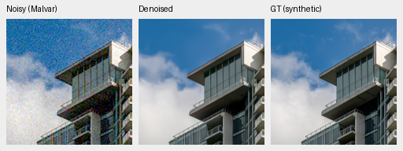
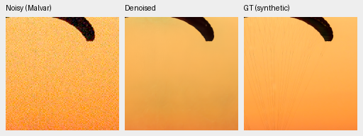
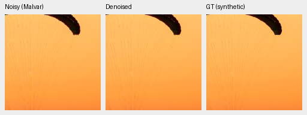
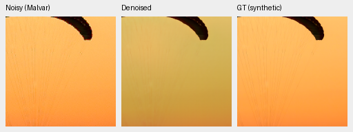
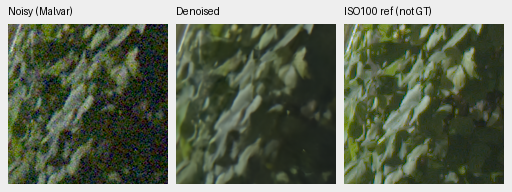
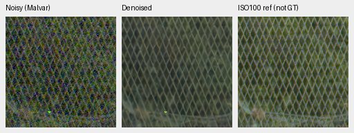

# ADC training: better ADC color, failed overall quality

V43 remains the working reference. The completed full photo panel finds a
positive V99−projected-V98 PSNR gain of **.02880 dB**, below the fixed .03 dB
requirement, with lower ADC photographic SSIM. The photo promotion criteria
therefore fail. Both endpoints also lose fine fabric cords and shift its color
in the fixed high-noise examples below. The completed camera panels show lower
V99 means than V98. All seven panels and the lower-noise native review are now
complete. No model is promoted and this
final4k recipe will not be extended to chase a passing result.

V98 and V99 keep V43's learned architecture and continue from final V95 EMA
for 4,000 updates, with the same larger curated corpus, zero-PSF/weak-detail
recipe, seed 58 and shared LR 2e-6. V99 trains through the existing ADC sample
projection; V98 does not. Both use projected inference in the primary
comparison. Positive-noise priors, including these ISO12800 examples, bypass
that projection. Final 4k EMAs remain primary; validation-best states remain
diagnostic. See the [prospective plan](v95-adc-training-plan.md) and
[completed training audits/actual launches](results/v95-adc-training-complete-and-evaluation-launch-v1.json).

## Completed photo panel

All427 photographic and16 procedural sources completed seven conditions and
four CFAs across nine methods:111,636 score rows. The exact original photo
worker exited before CPU auditing. Means balance sources after averaging their
condition/CFA cells; photographic and procedural scores stay separate.

| Final endpoint / inference policy | All photo PSNR | ADC-only photo PSNR | Positive-noise photo PSNR |
| --- | ---: | ---: | ---: |
| V43 / original | 34.89933 | 34.35261 | 34.99046 |
| V95 / original | 35.29553 | 35.02325 | 35.34091 |
| V98 / projected control | 35.37252 | 35.58769 | 35.33666 |
| V99 / projected | 35.40133 | 35.74541 | 35.34398 |

The matched training contrast uses projected inference for **both** new models.
Comparisons with V43/V95 also change training budget and inference policy;
their means do not isolate the training flag.

| V99−projected-V98 photographic contrast | PSNR, dB [95% interval] | SSIM [95% interval] |
| --- | ---: | ---: |
| All conditions | +.02880 [.02448, .03285] | −.0002916 [−.0005274, −.0000889] |
| ADC-only | +.15772 [.14316, .17141] | −.0020322 [−.0036595, −.0006565] |
| Positive noise | +.00732 [.00354, .01105] | −.0000015 [−.0000135, .0000121] |

Intervals use1,000 paired-source resamples, seed42; they do not quantify
training-seed or blind-test uncertainty. The all-condition PSNR interval is
positive, but its mean misses the prospectively fixed .03 dB threshold.
Positive-noise PSNR passes its nonnegative-mean check. ADC procedural SSIM
also rises by .0005208, while ADC photographic SSIM fails its nonnegative-mean
requirement. Most sources improve in full-photo PSNR (391/427); adverse tails
remain material. Even ADC photo SSIM improves on367/427 sources, yet a few
large losses pull its mean below the control. Full vectors and worst-source
tails remain in the saved contrast audit.

The [completed photo receipt](results/v95-adc-completed-photo-review-v1.json)
records the failed criteria, exact final checkpoint policies and audit inputs.
Independent Decimal50 source sums and a scalar bootstrap replay check10,632
source-metric means and16,428 result fields; maximum discrepancy is7.33e-15.
All86,828 shared V43/V95, RawNIND and classical cases match the preceding
completed evaluation exactly across694,624 metric fields, including nulls.
These checks reuse saved metric values; they do not recompute metrics from
pixels. Both projected endpoints pass all1,772 ADC sample-fidelity observations,
with maximum measured-channel error2.98e-8 sensor units. That establishes
sample consistency, not unmeasured-color quality or RGB16 output qualification.

The first CPU audit stopped at its output-path check before reading scores;
a fresh permitted external destination completed it. A separate reference
comparison initially used descriptive classical titles instead of score keys;
the corrected version checks the complete actual-key grid. Failed operators
and logs remain preserved. Neither correction reran model inference or noise.

## Completed camera panels

The [independent primary-panel receipt](results/v95-adc-primary-statistics-v1.json)
also closes known/unseen numeric coverage and arithmetic:648/810 rows across
nine methods,72/90 crops and4/5 scenes. Means balance captures within scenes,
then scenes. The targets are measured CFA samples; independently demosaiced RGB
views are not exact GT. All shared V43/V95 primary cases and metrics remain
exact to the original reviewed reference panel.

| Final endpoint | Known CFA PSNR | Unseen CFA PSNR |
| --- | ---: | ---: |
| V43 | 54.23334 | 53.80629 |
| V95 | 54.33307 | 53.76990 |
| V98 projected control | 54.33003 | 53.73025 |
| V99 projected | 54.31940 | 53.72165 |

V99−V98 is−.01063 dB on known cameras, paired-scene95% interval
[−.02367,.00270], and−.00860 dB on unseen cameras,[−.01744,−.00120]. Camera
priors are positive, so neither endpoint applies its ADC-only projection here.
These are small development panels, with no training-seed uncertainty estimate.
The [PSNR history](performance-history.md) now includes both completed final4k
primary endpoints and labels their projected inference policy. Their plotted
means do not establish overall quality promotion.

## Complete quality decision

The [complete review](results/v95-adc-complete-quality-review-v1.json) retains all
seven closed stages, 17,824 actual joint/DINO forwards and the separate native
diagnostic's 12 forwards. All 96 primary and 36 secondary triplets were actually
inspected through 180 unchanged native160 cells. All 108 secondary score rows
match the corresponding full-suite values exactly across 864 metric fields.
The independent analytic audit checks all 2,240 scalar cases. The color audit
rebuilds all 4,704 saved predictions/28,224 metric fields in float64, maximum
discrepancy 4.44e-16, and separately checks 864 summary fields. No model or noise
was rerun for these CPU audits.

V99's brighter .18-level/2%-contrast/16px noisy-carrier gain is **.59553**, below
V95's .61471; V98 gives .58654 and V43 .24105. The required retention of V95's
response fails. Individual ADC carrier gain losses stay within .05 (worst
V99−V98 −.01107), and every flat-case spatial RMS stays within 1.25×V95 (largest
ratio 1.02344). Passing those checks does not repair the failed photo criteria.

| Endpoint | ADC p95 channel bias | ADC worst centered RMS | High-noise p95 channel bias | High-noise worst centered RMS |
| --- | ---: | ---: | ---: | ---: |
| V43 | .004885 | .001657 | .002569 | .002559 |
| V95 | .002967 | .000874 | .005206 | .004058 |
| V98 projected | .000204 | .000398 | .005326 | .007383 |
| V99 projected | .000182 | .000285 | .005225 | .007655 |

These are fixed-grid descriptors in camera RGB, not confidence intervals.
V99 improves both ADC descriptors versus V95 and projected V98. High-noise
worst centered RMS exceeds both references, while high-noise p95 bias remains
above V95. Those declared color safeguards fail. Visible magenta-field mottling
and positive-noise fabric color errors remain consistent with these limitations.

Stop both final4k endpoints without extension or promotion. Retain the ADC
improvement as a limited result; it does not establish a replacement for V43.
The full project quality, broad real-photo RawNIND superiority and 100MP/10s
goals remain unmet. Further work stays on quality and V43's learned architecture.

## Individual fixed examples

These are single-tile sRGB scores, without pooled means or confidence intervals.
RGGB, ISO12800-prior shot .00256/read .0000262144, exposure1. Scoring uses the
native 240×240 area after an 8-pixel border on the 256×256 tile; the displayed
native 160×160 crop is the smaller ROI [48,48,160,160]. Sources were fixed before
viewing the endpoints. Full-panel source/condition statistics are above.

| Model | Fabric PSNR, dB | Fabric chroma MAE | Building PSNR, dB |
| --- | ---: | ---: | ---: |
| V43 | 40.57026 | .003802 | 35.39359 |
| V95 | 32.38894 | .012539 | 35.84219 |
| V98 projected control | 30.43732 | .016694 | 35.84770 |
| V99 projected | 29.84932 | .017957 | 35.85223 |

V99 is 0.58800 dB below the projected control on this fabric tile, while the
building changes by only +0.00453 dB. The fabric issue already affects V95 and
becomes worse here. V43 is closer in broad fabric color, although it also loses
fine cords. RawNIND retains broad fabric color better than the later endpoints
in these views, but substantially softens the building's edges and windows.
Neither selected scene determines a broad winner.

The [fixed-example observation](results/v95-adc-fixed-native-photo-observation-v1.json)
freezes the first 1,008 case rows: four predeclared sources, nine methods, seven
conditions and four CFAs. All 784 shared reference cases, 6,272 metric fields
including nulls and eight shared preview triplets match the earlier completed
evaluation exactly. All 12 preselected triplets were represented in 16 actually
viewed native cells. That earlier saved-data snapshot preceded panel closure;
the completed photo audit now checks the complete grid and worker invariants.
The remaining quality panels and native review remain separate.

## Native 100% triplets

Noisy Malvar → restored → exact synthetic GT. Each panel is an unchanged native
160×160 crop at the 8×-binned evaluation resolution, with shared coordinates,
noise draws, WB [2,1,1.5], original matrix, 16-bit ADC with black level .03 and
sRGB display exposure 1. Crop pixels are never resized. Adjacent JSONs record full source,
checkpoint SHA256, ROI, conditioning and display metadata. PNGs are 8-bit sRGB
previews; scores use unquantized FP32 output. These are synthetic
observations of binned photographs; the standing real GFX scene remains a
separate qualitative test with a nonexact low-ISO reference.

### V98 projected control

[Fabric source/ROI/checkpoint/noise/display metadata](images/v95-adc-training/crop-0f452518b631009f.json).

[Building source/ROI/checkpoint/noise/display metadata](images/v95-adc-training/crop-f6c5338a17f027ff.json).

### V99 projected

[Fabric source/ROI/checkpoint/noise/display metadata](images/v95-adc-training/crop-f1ffca5ecb599f55.json).

[Building source/ROI/checkpoint/noise/display metadata](images/v95-adc-training/crop-c35a0135145fdcdb.json).

## Lower-noise fabric and real GFX

In the fixed fabric tile, ADC-only PSNR rises from 39.65199 dB in projected V98
to 40.26683 in V99. Both recover its orange color and cords much better than
the unprojected references. At ISO100 the projection bypasses both models:
V98/V99 score 21.31429/21.12916 dB and retain a yellow/olive color shift.
These are individual cases, not the full-photo means above.

[ADC metadata](images/v95-adc-training/adc-only/crop-f1ffca5ecb599f55.json) ·
[Matching V98 control](images/v95-adc-training/adc-only/crop-0f452518b631009f.png).

[ISO100 metadata](images/v95-adc-training/iso100-prior/crop-f1ffca5ecb599f55.json) ·
[Matching V98 control](images/v95-adc-training/iso100-prior/crop-0f452518b631009f.png).

The standing DSCF3879/DSCF3880 GFX scene includes sky, building, foliage, fence
and two illuminated-boundary crops. Learned fence strands and building rails
remain more coherent than RawNIND, but V99 supplies no convincing new improvement
over V95/V98; foliage texture is still smooth. Saturated sign boundaries remain
imperfect. The ISO100 f/5.6 reference differs in aperture, time and LED scan;
it is not exact GT and has no pixelwise quality score. Display exposure4 (+2EV)
and coordinates are shared across methods; crop pixels are never resized.

[Foliage metadata](images/v95-adc-training/crop-ee4acb76b1400b6d.json) ·
[Matching V98 control](images/v95-adc-training/crop-b739547edef22611.png).

[Fence metadata](images/v95-adc-training/crop-a0c8f5216d7d89e7.json) ·
[Matching V98 control](images/v95-adc-training/crop-9ad5fbed46a17739.png).

The [exact-copy publication receipt](results/v95-adc-complete-quality-publication-v1.json)
retains both new models' six GFX regions and ADC/ISO100 fabric images, including
checkpoint, source/ROI, conditioning and display sidecars. Condition subdirectories
preserve distinct images whose original generated filenames repeat. The
[previous review](v95-flat-palette-quality-review.md) retains matching V43/V95
crops and RawNIND context. Speed work remains deferred.

Photographic sources: [Roy Egloff](https://commons.wikimedia.org/wiki/File:CH.VD.Villeneuve_2007-08-25_Vertigo-Swiss-Riviera_2392_3x2-R_4K.jpg)
and [Dietmar Rabich](https://commons.wikimedia.org/wiki/File:Vancouver_(BC,_Canada),_Coal_Harbour_Seaside_Park,_Blick_in_den_Himmel_--_2022_--_2158.jpg),
[CC BY-SA 4.0](https://creativecommons.org/licenses/by-sa/4.0/), modified by binning,
crop, simulated noise, restoration and rendering. These previews retain that license.
