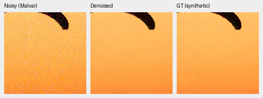
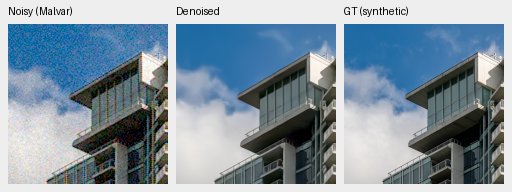
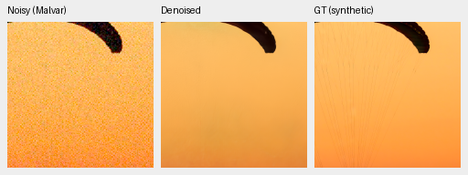
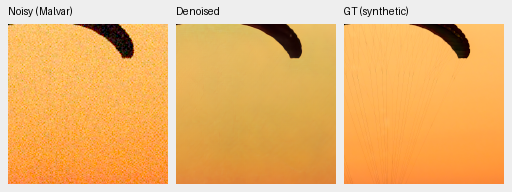
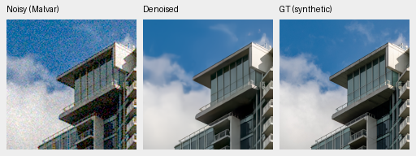
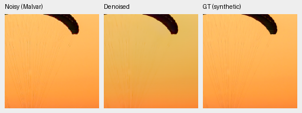
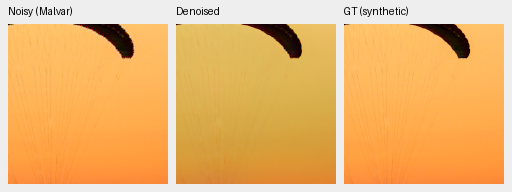
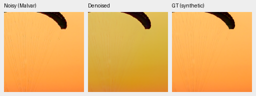
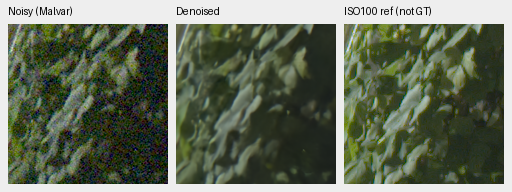
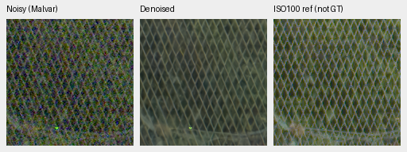

# Wider flat colors from V95: completed quality review

Current architecture and recommendations: [current model guide](current-model.md).
The versioned study below retains its measured results and original protocol.

Stop both follow-up arms at their declared final 4k endpoints. Neither establishes a photographic PSNR gain over V95, both worsen tested color tails, and neither establishes a new native detail advantage. Most sources improve slightly, but substantial regressions on a few offset those gains. **V43 was the reference for this experiment.** All seven panels, independent numeric audits and all 96 preselected native triplets have been reviewed.

V96 and V97 completed 4,000 matched updates from final V95 EMA, preserving the original V43 architecture, curated 88,484-source corpus and the recipe with zero optical blur and more weak detail. Only colored smooth-field palette span differs: 0 versus 8 stops. Final 4k EMAs are primary; validation-best checkpoints remain diagnostic. See the [training plan and audits](v95-flat-palette-quality-plan.md).

## Complete primary panels

Fresh IEEE FP32, identical observations and fixed checkpoint bytes. Photo means
balance 427 sources across seven conditions and four CFAs. Known/unseen camera
means balance 4/5 scenes over 72/90 crops and compare measured CFA samples.
The 16 procedural sources remain separate from photographic means.

| Model | Photo sRGB PSNR | Known CFA PSNR | Unseen CFA PSNR |
| --- | ---: | ---: | ---: |
| V43 | 34.89933 | 54.23334 | 53.80629 |
| V95 | 35.29553 | 54.33307 | 53.76990 |
| V96 | 35.27828 | 54.32564 | 53.76643 |
| V97 | 35.28321 | 54.32529 | 53.76365 |

| Contrast | Photo delta, 95% interval | Known delta, 95% interval | Unseen delta, 95% interval |
| --- | ---: | ---: | ---: |
| V96 minus V95 | −0.01725 [−0.05519, +0.01372] | −0.00743 [−0.02260, +0.00774] | −0.00347 [−0.03997, +0.03219] |
| V97 minus V95 | −0.01232 [−0.04718, +0.01788] | −0.00778 [−0.02797, +0.01241] | −0.00626 [−0.04127, +0.04183] |
| V97 minus V96 | +0.00492 [−0.01276, +0.02189] | −0.00035 [−0.00798, +0.01090] | −0.00279 [−0.02342, +0.01716] |

Intervals use 1,000 paired source/scene resamples, seed 42, and do not measure
training-seed uncertainty. The matched wider-palette contrast is uncertain.
V96's extra training alone also gives no established PSNR gain over V95.
Photographic SSIM rises slightly, from 0.960148 to 0.960290/0.960312, while
chroma MAE worsens from 0.007596 to 0.007649/0.007631 for V96/V97.

A [separate CPU replay of the same scores](results/v95-adc-photo-contrast-preparation-v1.json)
splits V97 minus V96 by explicit noise priors: ADC-only photo PSNR gains
+0.06118 dB [0.03333, 0.09551], while the six positive-noise conditions give
−0.00445 dB [−0.02518, +0.01460]. Each contrast balances the same 427 sources
and uses the paired-source procedure above. The combined +0.00492 dB does
not establish a gain on noisy photographs. This adds no inference and does
not change the stop decision.

Source-level changes reveal the failure tail. These values average all 28
condition/CFA combinations within each photograph before taking deltas:

| Contrast | Sources with higher PSNR | Median delta | Worst delta |
| --- | ---: | ---: | ---: |
| V95 minus V43 | 400/427 | +0.47461 | −6.35319 |
| V96 minus V95 | 330/427 | +0.04068 | −3.98915 |
| V97 minus V95 | 336/427 | +0.04166 | −3.38332 |
| V97 minus V96 | 225/427 | +0.00091 | −1.82180 |

The [primary statistics and independent replay](results/v95-palette-primary-statistics-v1.json)
check all 111,636 photo/procedural records and 648/810 camera records.
All 25,132 shared V43/V95 cases match the earlier completed study exactly,
including 200,408 metric fields with nullable support. The maximum independent
summary discrepancy is below 1.5e-14. The receipt retains per-noise means,
all primary contrasts and source-delta quantiles.

All 24 saved camera triplets were represented in 32 actually viewed native
cells. The joint models look close in these four fixed ROIs, without a
convincing palette-specific detail gain. The [camera viewing record](results/v95-palette-native-camera-review-v1.json)
records the source boards and observations. AHD references retain grain and
interpolation artifacts and are not exact RGB GT.

## Fixed example scores

These are individual evaluation tiles, without a pooled mean or confidence
interval. Values are sRGB PSNR in dB for RGGB, exposure 1, over the native
240×240 area after the 8-pixel evaluation border. The displayed native crops
below use the smaller ROI [48,48,160,160]. The complete panel and its final
state/input/reference checks have passed; these two examples illustrate
behavior that an aggregate mean can obscure.

| Source | Condition | V43 | V95 | V96 | V97 |
| --- | --- | ---: | ---: | ---: | ---: |
| Fabric | ADC-only | 28.673 | 23.300 | 21.280 | 21.420 |
| Fabric | ISO100 prior | 26.873 | 21.719 | 20.982 | 19.522 |
| Fabric | ISO12800 prior | 40.570 | 32.389 | 31.267 | 24.354 |
| Building | ADC-only | 37.392 | 38.673 | 38.666 | 38.717 |
| Building | ISO100 prior | 39.267 | 40.404 | 40.518 | 40.535 |
| Building | ISO12800 prior | 35.394 | 35.842 | 35.865 | 35.869 |

The fabric regression also affects V95 and V96. At ISO12800, its chroma MAE is
0.003802 / 0.012539 / 0.013466 / 0.036038 for V43/V95/V96/V97. The building
instead improves modestly. Lower-noise fabric scores also worsen; the completed
native views below confirm color and detail failures. These two fixed sources do not
determine the result over all 427 photographs.

The [fixed-score audit](results/v95-palette-fixed-example-scores-v1.json)
freezes the complete first processing batch: 1,008 rows covering four sources,
nine methods, seven conditions and four CFAs. Its 224 shared V43/V95 cases
match all recorded metrics from the earlier completed FP32 study exactly.
No extra inference or partial-panel average is used here.

## Native photographic triplets

Noisy → restored → exact synthetic GT. Each panel is an unchanged native 160×160 crop from a fixed 256×256 evaluation tile at ROI [48,48,160,160], at the 8×-binned photographic evaluation resolution. Both sources were fixed before viewing the endpoints. All methods share RGGB, ISO12800-prior conditioning (shot 0.00256/read 2.62144e-5, exposure 1), white balance/matrix/seed and sRGB display exposure 1. PNG pixels are never resized. Each adjacent JSON records full source, checkpoint SHA256, conditioning and display metadata.

### V43

[Source/ROI/checkpoint/noise/display receipt](images/v95-flat-palette/crop-09daca8a7d6943a8.json).

[Source/ROI/checkpoint/noise/display receipt](images/v95-flat-palette/crop-085432538346e7c9.json).

### V95

[Source/ROI/checkpoint/noise/display receipt](images/v95-flat-palette/crop-8f7bc348ce081939.json).

[Source/ROI/checkpoint/noise/display receipt](images/v95-flat-palette/crop-00dd92d39a9244e1.json).

### V96

[Source/ROI/checkpoint/noise/display receipt](images/v95-flat-palette/crop-c746f497532b5cb4.json).

[Source/ROI/checkpoint/noise/display receipt](images/v95-flat-palette/crop-f6b71053a64780db.json).

### V97

[Source/ROI/checkpoint/noise/display receipt](images/v95-flat-palette/crop-7b24445a5eb68506.json).

[Source/ROI/checkpoint/noise/display receipt](images/v95-flat-palette/crop-b728114ba3debcb1.json).

Source: [File:CH.VD.Villeneuve 2007-08-25 Vertigo-Swiss-Riviera 2392 3x2-R 4K.jpg](https://commons.wikimedia.org/wiki/File:CH.VD.Villeneuve_2007-08-25_Vertigo-Swiss-Riviera_2392_3x2-R_4K.jpg), Roy Egloff, [CC BY-SA 4.0](https://creativecommons.org/licenses/by-sa/4.0). Modified through binning, crop, simulated noise and restoration.

Source: [File:Vancouver (BC, Canada), Coal Harbour Seaside Park, Blick in den Himmel -- 2022 -- 2158.jpg](https://commons.wikimedia.org/wiki/File:Vancouver_(BC,_Canada),_Coal_Harbour_Seaside_Park,_Blick_in_den_Himmel_--_2022_--_2158.jpg), Dietmar Rabich, [CC BY-SA 4.0](https://creativecommons.org/licenses/by-sa/4.0). Modified through binning, crop, simulated noise and restoration.

## Weak detail and flat fields

The fixed grid has 448 observations per joint model: two backgrounds, 2%/10%
contrast, 4/8/16-pixel periods, two noise conditions, four CFAs and four draws,
including zero-texture flat controls. In-phase carrier gain has ideal value 1:

| Condition / background / contrast / period | V43 | V95 | V96 | V97 |
| --- | ---: | ---: | ---: | ---: |
| ADC / .01 / 2% / 4 px | .489 | 1.052 | 1.017 | 1.051 |
| ADC / .18 / 2% / 4 px | .350 | 1.027 | .984 | .996 |
| ISO12800 / .18 / 2% / 16 px | .241 | .615 | .521 | .577 |

The new endpoints retain most of V95's noiseless improvement, but lose some
of its brighter noisy 16-pixel response. The dark 10% eight-pixel noisy carrier
remains almost absent in all four models. Native views agree. Flat-field
spatial luma RMS stays close to V95; smooth flats alone do not prove useful
detail recovery or absence of color bias.

Independent scalar arithmetic checks all 2,240 rows, 140 groups and 3,760
summary fields, with maximum discrepancy 2.23e-16. Unlike the exact photo/camera
replay, shared learned analytic metrics differ slightly from the earlier run:
maximum scalar difference 2.21e-6, with every difference retained. The six
shared native restored previews differ in at most two RGB8 values per crop,
by one code; noisy/GT pixels agree exactly. This is not a DN16 qualification.
Weights and sampled inputs pass their exact witnesses. The frozen evaluator
enables cuDNN benchmarking, but the old/new selected kernels were not logged;
the cause of the small drift is not established.

## Color accuracy

The complete fixed grid has 1,176 observations and 4,704 saved floating-point
predictions. Values below describe 588 fields per condition, in normalized
camera RGB. Bias is the largest absolute channel-mean error in each field;
centered RMS measures spatial unevenness after removing that mean error.

| Model / condition | p95 bias | p95 centered RMS | Maximum centered RMS |
| --- | ---: | ---: | ---: |
| V43 / ADC | .004885 | .000500 | .001657 |
| V95 / ADC | .002967 | .000293 | .000874 |
| V96 / ADC | .030137 | .000543 | .001347 |
| V97 / ADC | .028681 | .000663 | .001883 |
| V43 / ISO12800 | .002569 | .001916 | .002559 |
| V95 / ISO12800 | .005206 | .001841 | .004058 |
| V96 / ISO12800 | .041627 | .004388 | .008703 |
| V97 / ISO12800 | .008703 | .002512 | .009549 |

The wider palette mitigates the control's high-noise bias regression, but
does not repair V95 overall. Both continuations worsen ADC bias and worst
high-noise unevenness. V96's preselected bright-magenta preview visibly mottles;
V97 reduces that appearance in this one field. The finite grid, one WB/matrix
and one draw per field limit generalization; these are descriptive quantiles,
not confidence intervals.

The independent Torch64 array audit rebuilds 28,224 metric fields and every
saved native panel from the unchanged observations/predictions. Maximum metric
discrepancy is 4.45e-16. Separate scalar/percentile arithmetic checks all 864
group descriptors, with discrepancy below 3.5e-18. No new inference is used.

## Lower-noise native photos

ADC-only and ISO100 views confirm the fabric's yellow/olive shift and lost
fine cords even when the input is nearly clean. The issue already affects
V43 and worsens in later models. The building retains clean geometry, while
RawNIND preserves fabric color better in these selected views but blurs its
lines. Neither example establishes a broad winner.

Below: ADC-only, shot=read=0, ADC16/black .03; same source, RGGB, ROI
[48,48,160,160], WB/matrix and display exposure 1 as above. Native pixels are
unchanged. Eight ADC triplets, including the building and V96, are published
in the [lower-noise viewing record](results/v95-palette-native-photo-conditions-complete-review-v1.json).

[Source/ROI/checkpoint/noise/display receipt](images/v95-flat-palette/adc-only/crop-09daca8a7d6943a8.json).

[Source/ROI/checkpoint/noise/display receipt](images/v95-flat-palette/adc-only/crop-8f7bc348ce081939.json).

[Source/ROI/checkpoint/noise/display receipt](images/v95-flat-palette/adc-only/crop-7b24445a5eb68506.json).

The first operator attempt failed before inference on a tuple/list metadata
comparison. The corrected fresh run rendered all three conditions, then
failed its final image-only check because a copied helper was missing.
Both failed statuses remain preserved. CPU-only postprocessing validates all
108 saved scores exactly against the main suite and all 12 repeated high-noise
triplets pixel-for-pixel. No inference was repeated for recovery. The receipt
distinguishes executed-prefix assertion evidence from an independently
persisted runtime counter table, which this run did not save. Configuration
comparison and helper packaging are fixed, 21 tests pass, and actual isolated
archive execution passes. Future runs also persist each condition's checks
before optional preview comparisons.

## Standing GFX capture

All six regions and six methods were viewed: sky, building, foliage, fence,
blue/yellow sign and illuminated platform boundary. Joint models retain smooth
sky and cleaner geometry than the RawNIND adapters in these selected crops;
fine leaf structure remains softened. The new endpoints do not establish an
advantage over V95. Faint new variation in the blue sign cannot be called true
LED detail because timing/scan behavior differs between exposures.

Noisy DSCF3879 ISO6400 → V97 → separate DSCF3880 ISO100 f/5.6 reference,
**not exact GT**. Shared input-only shot .0014635775921/read .0000010715704,
display exposure 4 (+2 EV). Foliage ROI [8890,5570,160,160]; fence
[2240,6000,160,160], reference x2241. Integer reference offsets only, with no
resampling or output-dependent selection. Source originals remain read-only
and the scene/siblings remain excluded from training.

[Source/ROI/checkpoint/noise/display receipt](images/v95-flat-palette/crop-136b6294bd154620.json).

[Source/ROI/checkpoint/noise/display receipt](images/v95-flat-palette/crop-3babfb1a94d774d2.json).

## Decision and limits

The [complete seven-stage review](results/v95-palette-complete-quality-review-v1.json)
binds all 17,824 joint/DINO forwards, independent audits and actual viewing of
all 96 native triplets as 132 displayed cells. All main workers and controller
exited. No checkpoint selection, output correction or schedule extension is
used. Keep V43 as reference and address valid-source color/low-noise failures
while retaining V95's recovered weak-detail response. Difficult evaluation
sources remain in the panel and outside training. Speed work stays deferred.

These results do not establish SOTA, broad unknown-scene superiority over
RawNIND, full 100MP qualification of the new endpoints or 100MP in ten seconds.

[Native viewing and publication receipt](results/v95-palette-first-native-photo-review-v1.json) · [Completed training and full evaluation launch](results/v95-palette-completed-training-and-evaluation-launch-v1.json).
