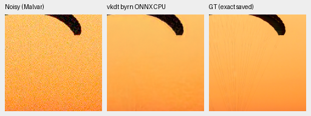
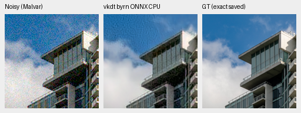
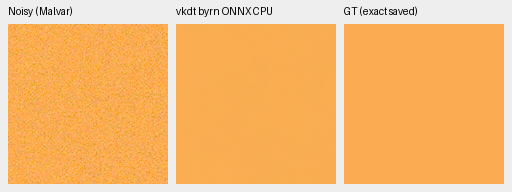
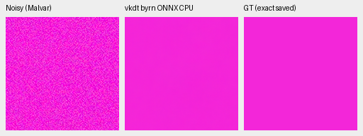
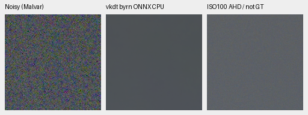
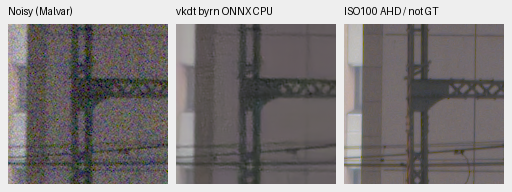
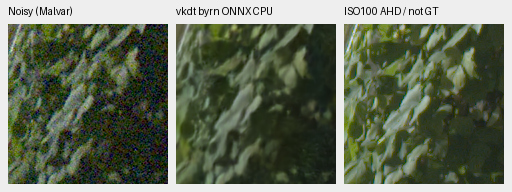
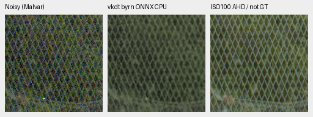

# vkdt JDD ONNX CPU probe and its precision limitation

The released noisy-Bayer vkdt export now has an executed eight-context CPU
probe. Its selected flat colors have much less bias than our control 20k, while
the two photo results are mixed and native fine detail remains weak. However,
**CPU FP16 execution differs materially from the exact-weight FP32 check**.
These results describe this ONNX CPU execution, not native vkdt Vulkan quality.
No model is promoted or added to the production pipeline.

[Execution, exact tensors, numerical diagnosis, independent metrics and eight actual native views](results/vkdt-jddcnn-native-CPU-v1.json).
[Matched control 20k CPU observations](long-commons-v63-control-original20k-CPU-review.md).

The [publisher module](https://github.com/hanatos/vkdt/blob/ec070207e8fb22cc9d01cb7293ce382ef06c53c1/src/pipe/modules/jddcnn/readme.md)
uses an OIDN-derived U-Net with Bayer phase shuffles and clean/noisy variants.
Its recent deployment references the 2026 Vulkan dispatch-scheduling work;
the compact architecture has older origins. This is a useful reference
availability check, not a new architecture or a reproduction of published speed.
The noisy Bayer artifact was selected before inference.

Pinned weight repository revision:
`9fdc2a02003e48dc791699b2b585aac25dbb1c55`.
Artifact SHA256:
`f1685e5f385bdab99b91cbc5adb514a3445b805b1794a2ec3ac7863e85cbf89b`.
The original ONNX has 21 convolutions/21 leaky-ReLUs and dynamic spatial sizes.
All 42 learned FP16 tensors/2,154,204 parameters match the pinned upstream native
architecture strictly. The OIDN source fork carries Apache-2.0; separate
weight-license terms and exact training membership remain unverified. Source,
weights and isolated runtime dependencies stay on the SSD; weights are not
redistributed or integrated into the product.

## Executed operator and numerical checks

The [publisher's zero-strength preprocessing](https://github.com/hanatos/vkdt/blob/ec070207e8fb22cc9d01cb7293ce382ef06c53c1/src/pipe/modules/denoise/noop.comp)
floors black-normalized samples at zero. Its node stores FP16 before the JDD
input shader applies PU and writes the four packed FP16 phases. The CPU probe
follows those stages, runs the original ONNX with optimization disabled, applies
the publisher's inverse PU/exact phase shuffle, and expands FP16 linear output
to FP32 for saved arrays. There is no upper clamp, output gain fit, gain map,
alternate weight selection or new noise draw. It only covers RGGB here.

The first draft omitted the upstream black-floor/FP16 stage. Its independent
scalar check failed before any neural prediction or output directory existed.
The actual zero-strength shader and node format established the correction;
no GT or outputs selected it. Failed source/log remain archived. The original
2e-7 forward and 2e-6 inverse bounds are retained. After the prescribed stages,
maximum scalar errors are 1.59e-8 forward and 4.10e-7 inverse relative to
`max(1,|expected|)`. Independent phase-index markers match exactly.

ONNX 1.23.2 / ONNX Runtime 1.31.0 use only CPUExecutionProvider, two intra-op threads,
one inter-op thread and sequential execution. The repository's training
environment/lockfile are unchanged. Original FP16 ONNX repeat and a later
independent replay are bitwise exact. All neural work is CPU-only:
nine original ONNX forwards plus one upstream Torch check, followed by three
numerical-diagnosis forwards. Model state/RNG remain unchanged during inference.

On the first saved photograph, the original ONNX versus exact-weight native
Torch FP16 maximum differences are .002625 PU/.014503 linear camera units.
A derived FP32 graph expands the same 42 FP16 tensors exactly and changes only
floating types. It agrees with native Torch FP32 within 7.72e-7 PU/3.58e-6 linear
units, passing fixed 5e-6/5e-5 bounds. Original ONNX FP16 versus that FP32 graph
differs by up to .004030 PU/.027829 linear units. This shows substantial CPU
precision/runtime sensitivity despite the strict tensor and FP32 operator match.
It does not identify which native Vulkan accumulation path would reproduce it.
The diagnostic graph has no quality scores or replacement images; all crops
below remain the original FP16 ONNX outputs.

Independent NumPy64 saved-array arithmetic checks 16 camera-error scalars and
eight PSNR values: maximum discrepancies 1.74e-18 and .0000244 dB. SSIM is not
independently recomputed. All eight noisy/reference native panels match the
control's panels bitwise, with the same source/ROI/WB/matrix/exposure. The blind
reference takes no noise-profile input; reported shot/read values describe the
observations. Different training data/history and CPU precision limit ranking.

## Fixed exact-target observations

PSNR uses the native 256×256 observation with eight pixels trimmed per edge.
Camera-RGB RMSE uses the separate displayed native 160×160 ROI without clipping.
No broad average or confidence interval is inferred from two selected photos.

| Saved case | V63 control 20k CPU sRGB PSNR | vkdt original ONNX CPU sRGB PSNR | Camera RMSE control →reference |
| --- | ---: | ---: | --- |
| Fabric photograph |33.69030|35.38792|.021254→.012312|
| Building photograph |35.76606|29.99017|.009318→.020119|
| Uniform orange |38.79340|44.99855|.007153→.004889|
| Uniform magenta |29.27794|45.89425|.029131→.003949|

The reference's fabric mean color is closer, but fine cords remain erased and
residual grain replaces some smooth structure. The building photo retains
substantial grain/coarse structure. The two selected flat fields are much closer
to their targets; this does not establish unbiasedness across colors or noise.

Every photographic triplet below is noisy WB-aware Malvar →method →exact saved
simulated GT, with 160×160 native panels and no resizing. Photo ROI
`[48,48,160,160]` is inside its saved native 256×256 observation. RGGB,
WB `[2,1,1.5]`, fixed protocol matrix, shot=.00256/read variance=.0000262144,
16-bit ADC/black=.03 and display ×1/0 EV match. PNGs are 8-bit sRGB previews.

Sources: [Roy Egloff](https://commons.wikimedia.org/wiki/File:CH.VD.Villeneuve_2007-08-25_Vertigo-Swiss-Riviera_2392_3x2-R_4K.jpg)
and [Dietmar Rabich](https://commons.wikimedia.org/wiki/File:Vancouver_(BC,_Canada),_Coal_Harbour_Seaside_Park,_Blick_in_den_Himmel_--_2022_--_2158.jpg),
[CC BY-SA4.0](https://creativecommons.org/licenses/by-sa/4.0/), modified by 8×
binning, crop, simulated noise and restoration. Source IDs/cache hashes,
validation seed 42/indices 0–1 and saved observation hashes are in the receipt.
The constant fields derive from the fabric mean and a channel permutation,
with the same recorded noise/display and exact saved constant targets.

Fabric, control 20k then reference:

Building photograph, control 20k then reference:

Orange, control 20k then reference:

Magenta, control 20k then reference:

## Standing GFX qualitative observations

DSCF3879 ISO6400/f1.7 →model →DSCF3880 ISO100/f5.6 independent AHD reference,
**not exact GT and never scored as one**. The captures are 3m38s apart; aperture,
exposure and moving subjects differ. Standing scene/siblings stay out of
training. Existing local F32 contexts avoid source-drive reads or RAW decoding.
Full RAF hashes and selected context/reference records are in the receipt.

Each native 512×512 model context displays ROI `[176,176,160,160]`; reference arrays
are already native 160×160. Shared WB `[1.51324503,1,2.21523179]`, camera matrix,
shot=.0014635775921166604/read variance=1.0715704128646712e-6 and display ×4/+2 EV
match across methods. The blind reference receives no shot/read profile.

| Region | Noisy sensor ROI(x,y,w,h) | Separate ISO100 reference ROI |
| --- | --- | --- |
| Sky |5800,1400,160,160|5800,1400,160,160|
| Building |5790,2690,160,160|5791,2690,160,160|
| Foliage |8890,5570,160,160|8890,5570,160,160|
| Fence |2240,6000,160,160|2241,6000,160,160|

Input/reference integer registration predates these outputs; no resampling or
output-dependent alignment occurs. Both CPU methods smooth sky. The reference
building stays soft/grainy, foliage remains smeared and fence has strong coarse
structure. Aperture differences prevent assigning every reference discrepancy
to denoising, and CPU precision sensitivity further limits interpretation.

Sky, control 20k then reference:

Building, control 20k then reference:

Foliage, control 20k then reference:

Fence, control 20k then reference:

Working-reference and production defaults stay unchanged. This probe is not a
native Vulkan benchmark, a matched training ablation, full 427-photo result or SOTA
evidence. Existing original V63/V64 training and queued reviews continue with
their frozen source/data/schedules; this turn adds no GPU inference or training.
