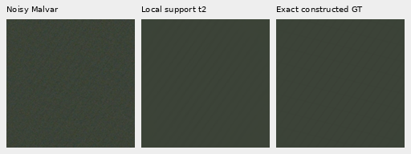
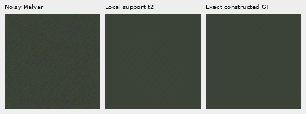

# Weak detail, whole-image context, and a production path

Review dated **2026-11-16, America/Los_Angeles**. Evidence cutoff: the completed
local conditional-wave pilot, V131 20k endpoint, and V132 1k review; V132 training
and the 1,152-image local-wave panel were still running. Starting repository
HEAD was `5f4faf6c`; the concurrent local-wave work was subsequently recorded
as `c06ed5ac` while this review was being written.
This document records findings and proposed experiments only. No models,
training jobs, inference settings, or experiment artifacts were changed.

Subsequent matched training adds spatial whole-image conditioning
and tests it on 24,000 identical scene visits per arm. The aligned guide
adds 0.081 percentage points of weak response over neutral at ISO400,
loses response at ISO6400 and leaves the fine cab crossings incomplete.
An adjacent-donor RAW path recovers visible crossings in the right cab
while the overcast sky stays smooth. Refining its local foreground model
reduces some false wire response in synthetic edge controls.
[Scene implementation](whole-scene-context-next-test.md) ·
[Matched 12k result](expanded-scene-spatial12k.md) ·
[Matched full-epoch continuation](scene-full-epoch.md) ·
[Adjacent donors](donor-phase-transport.md) ·
[Refined edge check](mesh-refined-edge.md).

Off-grid refinement of the RAW footprint cuts less intact wire on
fresh ISO400 gap scenes. The fixed audit still admits one of six
fresh ISO6400 gaps with averaged footprints. The standing sky
stays smooth, and the fine cab crossings remain incomplete.
[Reserved Bayer footprint refinement](mesh-refined-footprint.md).

A separate [phase and gap diagnostic](green-gap-validation.md) uses exterior
RAW to estimate weak-carrier phase and disjoint local samples to check support.
On planted aliases it adds 2.62 percentage points over a local fit while
reducing flat variation and increasing coherent gap leakage. The automatic
standing replay misses the cab's fine frequencies. Previously measured RAW
peaks make both directions visible on more of the right cab crop, with
incomplete crossings and overly regular spacing in places.

The [local support replay](query-phase-support.md) uses new held-out photos
with genuine gaps and continuous changes in contrast. Tightening the
RAW aperture loses intact ISO6400 detail, while checking a local amplitude
deficit gives the same gap leakage as uniformly reducing weak correction.

The [matched ordinary-data controls](scene-local-contrast-2400.md#plain-spatial-control)
compare whole-image features against the local-only arm after training
on byte-identical observations from 4,800 photos. Their eight-photo
replay shows almost identical ISO6400 coupled increment error, with
more flat-core variation in the spatial model. Within that model,
the matching preview slightly reduces flat variation compared with
masking the preview. Both GFX families retain incomplete fine detail.

**Start production optimization of V120 now. For the next quality architecture,
test whole-image context once per photograph, coupled to a smaller native-detail
path that still requires RAW evidence.** The strongest recent result is improved
discrimination after fitting the nuisance edge properly, not simply increasing
texture gain. Full-image semantics could improve that discrimination and reduce
repeated encoder work, but neither benefit has yet been demonstrated here.

## What worked, what did not, and what is still open

The [November 15 research note](weak-detail-literature-2026-11.md) proposed
shared-edge training, withheld-sample evidence, better edge/local support,
constrained aggregation, separate coarse/fine objectives, noise/domain checks,
and a better backbone/context role. The follow-ups support a narrower conclusion
than “weak detail is solved.” Percentages below are response relative to GT,
not PSNR; differences between percentages are percentage points. Different
parents, procedural families, and noise levels must not be ranked together.

| Idea / experiment | Evidence now available | Assessment |
| --- | --- | --- |
| Shared-edge paired training | [Matched V200 comparison](shared-edge-comparison.md): 900 updates plus 100 ADC skips. EMA mesh response **11.102% → 10.874%**; quiet RMS improves only about **0.051–0.076%**. | Slightly cleaner quiet regions, weaker mesh. This recipe did not improve the desired tradeoff. Scene, pairing, and noise change together; it does not disprove all paired training. |
| Independent CFA evidence alone | [First diagnostic](withheld-cfa-evidence.md): threshold 2 rejects flats and represented edges, but **113/128** off-grid edge-only patches still activate after the coarse step fit. | Independence rejects noise overfitting, not systematic edge-model error that predicts both subsets. A repeatable spectral peak can still be an edge residual. |
| Refine the nuisance edge before testing texture | [Refinement](withheld-cfa-edge-refinement.md): at separately calibrated thresholds, both arms have **0/384 observed test-null activations**; off-grid weak response **2.39% → 56.99%**, increment RMS **65.01 → 27.71 DN16**. | Clear success within the restricted straight-edge/two-sine diagnostic. Zero observed errors is not a population guarantee or a camera result. Represented-edge response slightly declines. |
| Make room for the second orientation | [Competing bank](competing-orientation-comparison.md): one fixed mesh's weak sector **28.41% → 33.55%**, but aggregate mesh response **11.102% → 10.607%**. [Fresh-noise panel](competing-edge-response.md) has selective weak gains with strong-direction losses. | Directional competition matters, but replacing carriers trades one problem for another. No general improvement. |
| Add complementary carriers without replacing the original branch | [Complementary panel](complementary-edge-response.md): far-edge/400-prior weak response **8.140% → 9.434%**, strong **86.741% → 86.882%**, quiet RMS **5.99346 → 5.97884 DN16**. Standard mesh response is almost unchanged and quiet/flat errors there are slightly worse. | Small, useful conditional gain; extra capacity and extra training are confounded. Most weak detail remains missing. |
| Better gain estimation on the existing bank | [GT oracle](measured-wave-oracle.md): complementary learned **9.434% → 19.385%** under global GT-fitted gains. Yet quiet error worsens in **56/64** views and weak-increment error in **46/64**. Unbounded gains add essentially nothing; phase freedom reaches only **19.819%**. | Diagnostic headroom, not an inference improvement. Relaxing clamps or adding phase freedom is a low-priority next step. This is not a bound on spatially varying heads. |
| Local, direction/color-conditional validation | [Newest pilot](local-validated-waves.md): above **V143**, far weak response **0.958% → 2.801%** with local support, versus **2.315%** with whole-window support. Quiet RMS rises **0.434%**, versus **1.887%** globally. Near-edge weak response barely changes. | Localization improves the restricted tradeoff, with residual cost versus the parent. One of two geometries drives the gain. Real cab crossings remain missing; global support makes visible broad ripples. Full-panel results remain pending. |
| Continue training the full model | [V131 final](v131-endpoint-quality.md): faint-ADC mean **+0.14555 dB** versus V120 over four materials; ordinary **+0.01539**, shadow **+0.01673**. Faint bark regresses **−0.14548 dB** while fur/grass/wood improve. | Useful training gains, with a material-specific weakness. No convincing new real mesh or foliage recovery; the targeted 102-input review is not the full 427-photo suite. |
| Add local RAW attention | [V132 at 1k](v132-progress1000-quality.md): faint-ADC **+0.03356 dB** versus matched V131 1k, still **−0.23979 dB** versus mature V120. | Early incremental evidence, not a failed or successful final model. Wait for the existing endpoint review. |
| Full-image semantics; separate coarse/fine training; context-constrained nonlocal aggregation | No completed matched experiment establishing these proposals in the reviewed follow-ups. | Still open. Larger crops, crop-global attention, and low-contrast augmentation do not constitute these tests. |

The [noise ladder](edge-snr-ladder.md) also changes the diagnosis: V200's
far-edge weak response is only **8.140%** at the cleanest tested 400 prior while
strong response reaches **86.741%**. This is not solely an extreme-noise or
adjacent-edge problem. [Carrier coverage](complementary-coverage-quality.md)
finds only **10.704%** weak response even among the 48/64 far/400 views with a
carrier within one native DFT bin. Correct discovery is necessary but insufficient;
support, amplitude estimation, and learned attenuation remain important.

### Native evidence retained from the newest pilot

These existing images were inspected for this review. Each triplet is noisy
Malvar → local support threshold 2 above **V143** → exact constructed GT.
Each cell is **160×160 original pixels**, native 512 RGGB, far placement,
two-direction role, repeat 0, ROI `[176,176,160,160]`; shot/read
`0.00008/2.56e-8`, ADC16, black 0.03, exposure ×2, contrast 1, shared WB/matrix
and clipped-sRGB transform. No crop pixels are resized or transforms retuned.

Source 0's weak response is essentially unchanged, **1.014% → 1.011%**;
source 1 changes **0.902% → 4.592%**. The small gain does not visually restore
the complete second family. Parent SHA256:
`96d146d017c54196288c585f8b7eddcf030e8a235061049c31e985b9380b7ce4`.
Analytic configuration SHA256:
`91a729a605b8312fc332726443cf92027576f66e0d9ce0038f4c5fcbe3c549bd`.
There are no newly trained correction weights. The
[manifest](images/local-validated-wave-pilot-v1/manifest.json) binds sources,
coordinates and transforms. The initial procedural-parent label was corrected
from V120 to V143; numerical outputs are unchanged and the
[lineage addendum](results/local-validated-wave-pilot-v1/parent-lineage-addendum.json.gz)
preserves the history.

The [real cab comparison](images/local-validated-wave-pilot-v1/mesh-nominal-fine-green-mesh-left-comparison.png)
was also inspected: broad diagonal modulation is stronger with global support;
local support reduces it, without recovering the reference's lattice. Its parent
is V120, SHA256
`a9d9b6b4f974e24a6b11e5e740aab32314233a7f53c056cf37c7d2aac1c589fb`.
It uses native 768 context/native 160 cells, exposure ×16 and nominal
shot/read `.00128/6.5536e-6`; complete coordinates are in the same manifest.
DSCF3835 ISO100 and camera JPEGs are qualitative references, **not exact GT**.
Different aperture, exposure and moving subjects prevent pixelwise scoring.

## Whole-image context is a real missing input

The user's intuition is plausible: a small gray patch is ambiguous, while the
whole photograph can identify a sky region and its relation to buildings and
trees. Likewise, the location beside the train supplies useful evidence about
likely structures. This is a **prior**, however: sky can contain cloud structure,
wires or birds; a fenced area can include smooth paint, gaps and defocused objects.
Semantic category should change the strength of regularization and the search
for evidence, not authorize drawing a fence.

The current implementation does not actually give DINO the whole photograph:

- [Tiled inference](../src/demosaic/inference.py) constructs batches of native
  tiles and calls the model without a full-frame preview or absolute tile box.
- [The RGB path](../src/demosaic/pretrained_rgb.py) renders the tile's RGB for
  `context(preview_rgb, context_size)`; normalization is also tile-dependent.
- [DINO pyramid extraction](../src/demosaic/dino_pyramid.py) produces multi-scale
  features from that input. A pretrained semantic encoder can recognize things
  inside a crop, but cannot inspect pixels it was never given.

Earlier [global RAW conditioning](raw-global-conditioning.md) aggregates the
current input crop. [V137](v137-global-conditioned-quality.md) gives a small
faint improvement over V136, remains below V120 there, and has weak measured
memory-write influence on its branch. Neither demonstrates effective whole-photo
semantics. [256 versus 512 inference](mature-context-window.md) and the
[matched 256/320 training comparison](training-context-original4k-review.md)
also do not answer the proposed question. Simply making training crops larger
has coverage/memory costs and has not produced a broad gain.

### Proposed architecture and discriminating experiments

**One scene pass, spatial context for every tile, local measurement-based detail.**
Construct a CFA-aware, color-managed low-resolution preview from the noisy RAW,
with exposure/noise metadata. Run DINO once on an aspect-preserving whole-image
view, initially testing a long side around 1024–1536 pixels. These sizes are
starting hypotheses, not measured optima. Retain a spatial feature pyramid plus
a pooled descriptor; sample aligned features using each tile's actual coordinates.
A single global class/vector would poorly distinguish sky from fence within
the same image. Native CFA features retain the fine spatial phase that the
preview necessarily loses.

Use context for coarse intensity/chroma corrections, smoothness strength,
regional structure priors, and allocation of refinement work. Let local RAW
measurements determine fine orientation, phase, amplitude and finite support.
Keep an uncertainty-sensitive fallback to the conservative base. Predicting
explicit sky labels is optional; forcing a hard sky/non-sky mask is unnecessary.

Two separate ablations would make the result interpretable:

1. **Quality:** retain V120's existing local encoder and add the whole-image
   branch. Compare no scene context, a pooled descriptor, and aligned spatial
   features under matched training/data. This tests whether the missing input
   helps, without simultaneously removing local capacity.
2. **Efficiency:** after that, replace repeated tile-DINO work with the shared
   scene features and a lightweight local encoder/student. This requires
   training or distillation; swapping downsampled features into existing V120
   is not an equivalent inference optimization.

Train using complete-scene previews paired with native crops from the **same
noisy observation**, retaining crop coordinates, CFA phase, camera transform,
exposure and noise. Inspect which existing binned sources retain suitable
whole-scene/crop lineage before scheduling a run. Do not feed clean targets into
the context encoder. Hold the two protected GFX families and their siblings out
of training, including JPEGs. Several crops per scene and shared coarse losses
can teach consistency across a large sky without full-resolution end-to-end
100MP training.

Evaluate scene-context use explicitly: correct context versus shuffled context,
masked context, and shuffled spatial positions, alongside flat regions embedded
in textured scenes and weak wires/clouds embedded in sky. These interventions
diagnose reliance; they are not natural-image quality scores. Test crop-grid,
batch-size and overlap changes because tile-dependent normalization and context
can create seams or field-to-field color changes. Measure the final RGB effect,
not just attention weights or a nonzero internal gate.

**Preserve holdout independence when claiming validation evidence.** A global
preview made from all RAW samples contains the withheld subset. Conditioning an
A→B predictor or its null on that preview leaks validation information, even if
the preview is called “semantic.” A genuinely withheld diagnostic needs an
A-only scene preview/features and A-only normalization/noise estimates, reversed
for the other fold. Otherwise treat the result as ordinary learned conditioning
and assess false detail on independent examples; do not call the scores calibrated
probabilities. The final delivered reconstruction may use all observations.

## Other weak-detail work worth doing

**Extend localization before increasing spectral strength.** Let the running
local-wave panel finish. If the gain survives across noise/CFAs/geometries, test
finite-support atoms or a learned local synthesis head, including truncated
wires, crossings, curves, depth blur and nonperiodic foliage. Model nuisance
edges with blur, multiple boundaries and saturation, and validate each proposed
direction/color conditionally on the other structures. Richer nuisance fitting
can also absorb real detail, so retain explicit response and null controls.
The current CPU pilot took 126.68 seconds for 24 mixed inputs; it is useful as a
diagnostic/teacher candidate, not a demonstrated fast production component.

**Separate coarse mottle from fine reconstruction in the objective.** Evaluate
coarse luminance/chroma residuals over large regions separately from
phase-correct fine increments. Penalize low-frequency error on genuinely flat
targets and learn low-frequency corrections with scene context. Use paired
present/absent weak structures on identical backgrounds, including both near
and far from edges, and retain independent-noise tests. Avoid a broad
high-frequency reward: it pays for ripples and wrong-phase detail too. This is
more specific than adding still more faint examples or increasing flat penalties.

**Keep domain/noise calibration in the diagnosis.** The two real mesh profiles
already show that noise conditioning can alter appearance. Check robustness to
shot/read mismatch, mild correlated noise, optical blur and ADC clipping on
development data. Full-image smoothness cannot substitute for a correct sensor
noise model. Do not tune thresholds against the ISO100 qualitative reference.

**Use local evidence when sharing repeated structure.** Similar fence patches
elsewhere in the frame may help estimate orientation or period. Transfer a
candidate model, then estimate phase/amplitude from the query measurements;
do not copy a donor patch into an unsupported query. This keeps constrained
nonlocal aggregation open without repeating the previous unsafe patch-transfer
idea described in the [research history](research.md).

The useful result would be more correct weak response **at comparable quiet
error**, retaining phase and finite support, across sources. Report weak and
strong directions separately, increment RMS, off-target/quadrature energy,
coarse chroma/luma mottle, means and adverse tails. A larger spectral peak alone
is insufficient. Continue both protected GFX scenes with sky, building, foliage,
coarse chain-link and fine green mesh, with native triplets and honest reference
labels. These are proposed comparisons, not new fixed promotion rules.

## Literature that changes the next decision

The [earlier review](weak-detail-literature-2026-11.md) covers 2026 denoising
challenge leaders, RAW nonlocal filtering, self-supervised separation and
structural JDD. This follow-up concentrates on global context and efficiency.
Benchmark-specific SOTA claims in these sources do not establish superiority
on our physical-noise, native Bayer, 16-bit task.

| Primary source / reading scope | Useful contribution and limits |
| --- | --- |
| [DVANet, June 2026 preprint](https://arxiv.org/html/2606.19097v1), method and experiments | Combines degradation-aware observation consistency with hierarchical frozen DINOv3 visual priors and lightweight alignment adapters. Supports testing explicit roles for measurement consistency and semantic features. Its restoration benchmarks do not validate full-frame Bayer weak-detail safety. |
| [DehazeXL, CVPR 2025](https://arxiv.org/html/2504.09621v1), method and large-image evaluation | Encodes patches as tokens, exchanges global information, then decodes local patches. Demonstrates a practical distinction between independent tiling and global communication for very large images. This is dehazing, not denoising; use the global/local architecture principle, not its quality or speed numbers as predictions here. |
| [UHD-Processor, CVPR 2025](https://openaccess.thecvf.com/content/CVPR2025/html/Liu_UHD-processer_Unified_UHD_Image_Restoration_with_Progressive_Frequency_Learning_and_CVPR_2025_paper.html), proceedings abstract/indexed paper abstract | Progressive learning separates frequency bands using specialized smaller subnetworks. Relevant to allocating inexpensive coarse processing and native-detail computation. Full paper retrieval was blocked during this review; no detailed implementation or benchmark advantage is asserted here. |
| [JDD-LI, September 2026](https://www.sciencedirect.com/science/article/pii/S1047320326002191), publisher abstract/highlights only | Proposes RAW denoising → pretrained demosaicing → RGB denoising, with staged training, targeting a better quality/compute tradeoff. Directly relevant as a modular efficiency comparator, but full text was unavailable; code readiness, numerical fidelity and claimed speed need independent checking. It does not establish that stagewise denoising preserves our mesh. |
| [Improving Image Restoration by Revisiting Global Information Aggregation, ECCV 2022](https://www.ecva.net/papers/eccv_2022/papers_ECCV/papers/136670053.pdf), paper | Shows that global aggregation can have a train-crop/test-image distribution mismatch and proposes a local conversion. A useful caution: more context is not automatically better. Train and evaluate the intended scene/crop relationship rather than changing pooling extent at deployment. |

My inference from these papers and our experiments is to combine scene context
with an efficient supervised measurement path. A generative texture prior or
diffusion sampling is a poor first production direction for this particular
fidelity and latency objective. The literature supports design choices, not a
guarantee that identifying sky will recover the green fence.

## Why V120 Small is slow

“Small” describes the DINOv3 ConvNeXt variant. The restoration trunk is still
a substantial [RGB DRUNet](../src/demosaic/pretrained_rgb.py): widths
64/128/256/512, four residual blocks at each of three down/up levels plus the
bottleneck, or **56 dense 3×3 convolutions inside residual blocks**. At native
scale, each corresponding convolution costs approximately
`9 × 64² = 36,864 MAC/native pixel`, since channel doubling offsets area
reduction. Those blocks alone cost about **2.06 million MAC/pixel**, or
**206 trillion MAC for 100MP**, excluding other layers and DINO. This is a static
architecture estimate, not a GPU profile; a MAC is not being counted as one FLOP.

The saved [V120 full-frame receipts](results/v120-v121-fixed-Haar-GFX-v1.json)
contain **329.42 seconds** for the fixed-Haar run and **363.95 seconds** for the
nominal-profile run, both 101.996MP, FP32, channels-last, 512 tiles, overlap 64,
B4. These are archival instrumented runs on a shared machine, with different
conditioning, not a controlled noise-profile speed comparison or a clean cold
CLI latency benchmark. Restore scope excludes separate loading/decode/export.
For provenance, the timing nodes are
`comparisons/V115-V120-fixed-Haar/boards/0/sources/0/candidate/prediction/timing`
and `comparisons/V120-profile-only/boards/0/sources/0/control/prediction/timing`.

There are **520 tiles / 130 batches**, processing 136.315MP including overlap:
about **1.34×** the original image area. The residual-block estimate becomes
roughly **281 trillion MAC**. Even eliminating all duplicate pixels would save
only about 25% of that computation, before boundary/context constraints.
Those receipts put **over 99%** of tile-loop time in the combined compute/transfer
section; CPU blending accounts for about 0.59–1.44 seconds. They do **not** isolate
DINO, DRUNet, casts, synchronization or transfers. Reducing blending alone cannot
explain a major speedup, and total peak allocator values from a comparison worker
should not be interpreted as isolated V120 memory requirements.

The [inference loop](../src/demosaic/inference.py) already uses inference mode
and channels-last. It transfers packed tiles and brings predictions back to CPU
for blending. Unified physical memory does not make those tensor copies,
allocations and synchronizations disappear. Conversely, transfer optimization
should follow a profile rather than an assumption that it dominates.

### Earlier speed experiments: retain successes and failures

| Work | Actual evidence | Implication for V120 |
| --- | --- | --- |
| [cuDNN autotuning](mature-cudnn-fullframe.md) | V43/V63 warmed 102MP restores **206.88 → 118.22 s**, **209.35 → 120.48 s**, about **1.75×**, with very small numerical differences. Cold search adds substantial time. | Existing opt-in worth qualifying on V120; reuse a loaded/warmed model. Do not multiply this older ratio into V120 as a promise. |
| [Hidden FP16](mature-mixed-precision-pilot-review.md) | V43/V63 resident B4/512 forwards about **4.25×/4.06×** faster; finite visual/analytic screen passes. | Strongest existing lead for compute speed. These are older models and resident forwards, not current full-image results. |
| [Broader FP16 qualification](mature-hidden-FP16-full-quality.md) | Stopped before the full suite because matching-policy cross-process replay exceeded the fixed 1 DN16 limit on three crops, up to **15.75 DN16**. Within-process repeats were exact; cause unresolved. | Investigate reproducibility and qualify current V120 directly. This neither validates production FP16 nor proves FP16 inherently unusable. Preserve the failed receipt. |
| [Custom TF32x3 kernels](mature-tf32x3-cuda-review.md) | Accurate on the fixed cases but **10.1% / 8.9% slower** than autotuned FP32. | Deprioritize bespoke precision kernels. |
| [Eight-view inference](dihedral-fullframe.md) | V104 full restore **885.93 s**, with modest and uneven quality gains. | Single-view should remain the latency target. |

The [FP32-training comparison](faint-adc-precision.md) also has mixed material
results, not a universal weak-detail rescue. Numerical precision is worth
engineering carefully, but it is not the complete explanation for attenuation.

## A practical speed and production sequence

**1. Establish an explicit V120 reference and instrument the real path.** On a
later idle-machine run, separate cold model load, RAW decode, preview/DINO,
DRUNet, physical transforms, tile packing/copies, blend and RGB16 write. Report
cold end-to-end, warmed end-to-end and resident forward separately, with repeated
measurements and memory peaks. Keep checkpoint/noise/tile/precision fixed and
compare saved outputs. This review launched no profiler or benchmark alongside
the active experiments. NVIDIA's [DGX Spark guide](https://docs.nvidia.com/dgx/dgx-spark-porting-guide/1.0.0/optimization.html)
likewise recommends profiling and reproducible hotspot benchmarks.

**2. Qualify reduced precision in neural hidden layers first.** Compare DINO-only,
DRUNet-only and combined FP16 policies to identify both the speed contribution
and the quality-sensitive part. Retain appropriate FP32 arithmetic for input
normalization, physical variance/VST/inverse transforms, native residual/skip,
head/tail, color conversion and accumulation. Diagnose cross-process replay
with recorded backend/kernel/shape histories; don't silently relax an old
study's gate. A new production policy can use prospectively chosen quality
criteria without requiring bit identity to FP32. Test weak increments, dark
ramps, color/ADC tails, clipping and real native crops. A 16-bit output file alone
does not establish 16-bit numerical accuracy. NVIDIA documents the need for
[precision-sensitive operations and mixed precision](https://docs.nvidia.com/deeplearning/tensorrt/latest/inference-library/accuracy-considerations.html).
INT8/FP8 are later candidates for selected hidden layers, not the first step.

**3. Reduce framework overhead where the profile supports it.** Compile the
pure tensor DRUNet and DINO regions with bounded shape/batch buckets; keep
physical FP32 regions explicit. The current `compile_restoration_blocks` helper
accepts only `packed-isotropic`, so it is not already a V120 solution. Evaluate
fusion and CUDA graphs after checking graph breaks and memory use. PyTorch's
[compile documentation](https://docs.pytorch.org/docs/2.15/generated/torch.compile.html)
describes `reduce-overhead` and `max-autotune`, including applicability and
workspace caveats. This checkout locks Torch **2.14.1+cu130**; the web reference
is 2.15, so check the installed version before choosing APIs. TensorRT is a
later export option after confirming ARM64/GB10 support, operator coverage and
precision behavior; an engine alone is not evidence of a speed gain.

**4. Reduce computation structurally.** Train/distill a narrower local model
operating primarily on losslessly packed CFA planes, with a small native RGB
refinement/skip and shared whole-image DINO features. Explore narrower dense
blocks or efficient depthwise/gated blocks based on actual GB10 latency. The
existing quarter-scale/packed experiments in the
[architecture history](architecture.md) are comparators, not reasons to assume
any downsampled network preserves detail. Packing preserves four measured CFA
values; blurring/downsampling away weak phase does not. Supervise from clean
targets as well as V120 so the student does not simply inherit the teacher's
mesh attenuation or mottle. A scene encoder once per image may amortize repeated
DINO computation, but its share of V120 runtime is currently unknown.

**5. Consider adaptive refinement only after a good fixed-cost student.** Run a
cheap base everywhere; spend extra work on uncertain measurements, complex
edges and supported weak structures. Use soft transitions/halos and a conservative
fallback. A sky label alone cannot justify skipping reconstruction. Measure both
typical images and the worst-case all-textured scene; routing overhead and seams
can erase savings. Overlap reduction, asynchronous buffers, reusable allocations
and larger batches are supporting optimizations with measured memory limits.

Reaching 10 seconds from the archived 329–364-second scope requires roughly
**33–36×** overall improvement, and end-to-end IO adds work. Precision plus a
substantially cheaper network is more plausible than relying on overlap or
Python tuning. None of the old speed ratios should be multiplied together as
an achieved forecast. Set intermediate measured milestones, such as a qualified
faster V120 mode followed by a quality-matched compact student; keep the 10-second
target explicit.

### Production can proceed while detail research continues

V120 is already a useful baseline: [37.04008 dB over 427 photos and verified
102MP RGB16 exports](v120-v121-primary.md). The large selected synthetic-material
advantage over RawNIND supports investing in deployment. The stronger
[pre-upsampled RawNIND comparator](rawnind-variants.md) is closer on real-camera
scores: subtracting its published means from V120 gives **+0.05204 dB known /
+0.14344 dB unseen**, descriptive differences without a new paired uncertainty
analysis. That is not evidence of a universal large real-camera margin. There
is no need to delay production engineering until every scene beats RawNIND or
the fence is solved.

Prepare a reproducible quality mode and a separately qualified fast mode with
explicit precision, checkpoint/DINO hashes, backend, noise policy, tile geometry
and color-output contract. Use a persistent loaded model for repeated photos;
handle warmup once and bound shape specialization. Preserve the current
non-overwrite behavior and plan atomic output completion, useful progress,
cancellation and recovery from memory pressure. Verify CFA patterns, odd and
rectangular dimensions, black/white levels, clipping, hot pixels, camera
metadata, tile seams and valid uint16 exports. Include both protected GFX
families and adverse development-camera fields in release review; use cached
media and do not wake the source disks unnecessarily.

Document known quality limits and model/data licenses with the artifact. Existing
study-specific numerical gates retain their historical meaning; they do not
freeze the architecture or prevent adopting a useful faster model with clearly
reported strengths and regressions. For the next work cycle, my priority order
is **V120 profiling/precision qualification, the matched whole-image-context
ablation, and a context-conditioned compact student**, while the already-running
local-wave and V132 experiments finish unchanged.
