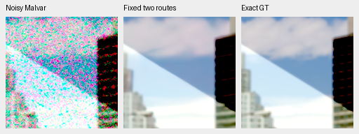
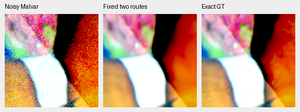

# Training weak detail with an independent-exposure teacher

The [parent-feedback replay](paired-feedback-paths.md) found
that a correction from an independent simulated exposure
reduces covariance with the query parent's errors. This study
tests whether that information can supervise a single-frame
head. It also tests the existing quiet-region and detail
composition on weaker textures beside strong edges.

## Weak texture beside a common edge

The validation panel contains 48 photos separate from the
earlier 96-photo paired panel. Each 256×256 native crop uses
the same Bayer layout and camera transform in both scene
conditions. The base contains the source's low-pass image.
The second condition adds a sharp colored step with a varying
angle and subpixel position. The weak detail uses either
0.065 or 0.115 of the same source high-pass residual. Present
and absent targets in the second condition share the strong
step. The exact-flat role has a constant 96×96 core.

Each scene has independent ISO1600 and ISO6400 measurements
with two separate physical draws per role. After camera
conversion, the largest difference between the clean weak
increments in the two scene conditions is `1.49e-7`
in normalized camera RGB. Clean targets are exactly identical
across redraws. The score reproduces the native 1/8 to 1/3
cycles/pixel band and adds separate near-edge and far errors,
absent-detail residuals, and error orthogonal to the exact
increment. The near region covers native pixels within 12
pixels of the step and the far region starts at 24 pixels.

## Matched training

All three heads start from the same paired EMA above frozen
Corpus 100k. Each head sees the Bayer innovation smoothed by
the same fixed window and uses the previous quiet correction
with strength 0.15. All arms receive exact absolute, paired
and flat supervision. The two teacher arms also match the
frozen original paired head's fine correction, with loss
weight 0.35. The same-draw teacher sees the student's physical
capture. The independent teacher sees the other separately
noised observation of the same scene and role. The inference
composition takes a single sensor observation.

The schedule contains 384 updates and 768 additional training
photos, disjoint from the earlier paired, repeat and projected
training schedules. The four Bayer layouts, two ISO families
and two scene conditions each have 48 source examples per
joint cell. Every source has two independent redraws with
present, absent and flat roles. Four qualification updates
verified the initial equivalence of the students, distinct
teacher observations, finite gradients and frozen upstream
weights. Training is active.
[Frozen training and panel receipts](results/weak-edge-distill-v1/qualification.json) ·
[Source and input archive](results/weak-edge-distill-v1/qualification.tar.xz).

## Fixed-policy transfer to the weak-edge panel

The completed fixed-policy replay uses the original paired
EMA `02f8d5e6664bd580bafe2abeb3b8584b070b60bfadfefaff587cadd8bd643d7f`
over Corpus 100k EMA
`87b96f3c487b9edaf1c477742b6c38f2a82cc6b20a94716d51cc8cf46a17a760`.
It compares the previous quiet and uniform-detail policy at
its original strength on all 48 photos. The four conditions
each have two independent repetitions. Differences below
are relative to the same Corpus 100k parent.

| Fixed two-route condition | Aligned response (percentage points) | Increment RMS (DN16) | Exact-flat RMS (DN16) | Near-region increment RMS (DN16) | Near-region absent-detail RMS (DN16) |
| --- | ---: | ---: | ---: | ---: | ---: |
| ISO1600 photographic base | +0.418 | +0.335 | −0.058 | +0.660 | −0.023 |
| ISO1600 shared step | +0.436 | +0.413 | −0.062 | +1.192 | +0.184 |
| ISO6400 photographic base | +0.218 | +0.198 | −0.158 | +0.404 | +0.037 |
| ISO6400 shared step | +0.178 | +0.248 | −0.200 | +0.695 | +0.179 |

Adding the step increases the correction's ISO6400 near-region
increment penalty by 0.291 DN16 [0.180, 0.419] and its
absent-detail penalty by 0.141 DN16 [0.079, 0.215]. The
far-region increment penalty falls by 0.130 DN16. The
measured increase concentrates around the added step.
The quiet-only path changes
near-step error by less than rounding precision at both
priors. It lowers ISO6400 shared-step flat RMS by 0.201 DN16
and whole-core increment RMS by 0.004 DN16.
[Scores, intervals and viewing evidence](results/weak-edge-distill-v1/fixed-publication.json) ·
[Source-level fixed replay](results/weak-edge-distill-v1/fixed-archive.tar.xz).

### Fixed-policy native examples

The triplets show noisy Malvar, the fixed two-route policy
and the exact target for ISO6400 redraw zero. Each uses a
native 160×160 crop at `[48,48,160,160]` inside its 256×256
query, with shot/read `0.00128/6.5536e-6`, ADC16 black
level 0.03, capture exposure 0.33, display exposure ×3.0303
and contrast ×2.

The largest measured near-edge improvement keeps the
strong added diagonal coherent. Fine cloud and facade
texture stays soft. Query origin `[246,258]`, GRBG.
King of Hearts, CC BY-SA 4.0.
[Source photo](https://commons.wikimedia.org/wiki/File:Downtown_Brooklyn_New_York_August_2013.jpg) ·
[Comparison](images/weak-edge-distill-v1/fixed/002-same-edge-iso6400-r0-role0-comparison.png).

The largest measured near-edge regression preserves the
strong diagonal and coarse markings. Fine orange texture
and the edges of the white band remain soft. Query origin
`[100,258]`, BGGR. Esquilo, CC BY-SA 3.0.
[Source photo](https://commons.wikimedia.org/wiki/File:Clownfisk.jpg) ·
[Comparison](images/weak-edge-distill-v1/fixed/009-same-edge-iso6400-r0-role0-comparison.png) ·
[Matched absent-detail comparison](images/weak-edge-distill-v1/fixed/009-same-edge-iso6400-r0-role1-comparison.png).

The earlier [standing GFX boards](paired-flat-companion.md#standing-gfx100s-comparisons)
cover the originating quiet-region composition. The 48-photo
transfer uses exact synthetic targets.
