# V173 amplitude-balanced gradients: completed quality

Amplitude-balanced gradient training gives a **small quiet/spatial-error gain with weaker detail response**. V173 EMA quiet spatial RMS is **3.417869/5.540053 DN16** under the ISO6400/12800 priors, **−0.679/−0.319% versus V172 EMA**, with all 32 inputs improving. Quiet total RMS is **4.012548/6.278894**, **−0.521/−0.267% versus V172** (28 improve, four worsen), and **−0.830/−1.032% versus V169**. Quiet DC RMS is 1.991098/2.778718, only −0.015/−0.071% versus V172. The added V171 purple/blue cast remains largely absent, but the gain over V172 is small and quiet error remains above the V143 parent.

**Mesh response falls 3.954% versus V172**, to **0.03723868 or 3.723868% of exact constructed GT amplitude** (−2.938% versus V169). Response decreases on 237 of 256 present cases versus V172. Present-image RMS nevertheless falls 0.076% to8.948849 DN16. Absent-image RMS falls **0.328% to5.291708**, improving253 of256 cases versus V172. Lower image error therefore does not establish better fine-detail preservation. Natural faint/dark band response also falls **2.625–2.882% on all128 inputs versus V172**. Photographic total RMS rises0.004–0.045%; band-error changes are mixed. This is not the requested recovery of weak crossings. Keep V172 as the balanced matching baseline for further detail work, V161 as the stronger learned-response option and V120 as the general recommendation.

EMA native512 standalone-flat RMS is **18.561545/24.125142 DN16**, **−0.249/−0.303% versus V172**, improving46 of48 inputs. Coarse32 RMS is **13.434259/17.925292**, changing **−0.010/+0.020% versus V172**, with21 of48 inputs improving. Relative to V169, full means fall0.308/0.388% and coarse means0.031/0.029%. V171 remains the stronger standalone-flat option: V173 full means are0.908/1.151% higher and coarse means1.729/1.736% higher. Both raw and EMA results are reported; raw has somewhat larger full-flat gains but weaker mean quiet/color behavior.

All60 figures were actually viewed at original detail. Quiet and standalone-flat changes from V172 are subtle; broad green/purple mottle remains obvious under the common40× display. Seed2302 still loses most of the crossed lattice; seed2309 retains mainly one diagonal family. Main sky/building/foliage/coarse fence look near V172, without an obvious new sky pattern in these views. Both nominal/profile cab windows still miss much of the fine crossing family. Organic fine texture remains over-smoothed. ADC-only bark/fur/planes retain V169 exactly. These native views do not establish noisy-flat safety or a substantial real-photo detail improvement. ISO100/AHD/JPEG references differ in capture/processing and are qualitative, not exact GT.

The [local 100% comparison viewer](images/v173-weak-gradient-matching-v1/native-viewer.html) provides side-by-side panels and click/F-key flipping without resampling. It supplements the twelve native triplets and full PNG boards. The [V172 viewer](images/v172-local-noise-matching-v1/native-viewer.html) is also retained. Actual browser screenshots are compared pixelwise with the PNGs: [V173 viewer verification](results/v173-native-viewer-verification-v1.json) · [V172 viewer verification](results/v172-native-viewer-verification-v1.json).

The [actual initial-batch check](results/v173-actual-initial-loss-isolation-v1.json) reproduces all six unchanged V172 loss terms and the target mask exactly; only the gradient term changes, from0.00968166 to0.28686818. Later model trajectories differ. The [focused-test scope clarification](results/v173-focused-test-scope-v1.json) records162 passing checks as161 CPU tests plus one CUDA stream rejection using a stub network. That guard launches no matching core or native sampler. Earlier broad CPU-check labels remain preserved; versioned report/accounting helpers state the precise scope. This accounting correction changes no training or quality result. The original preparation import-order rejection, source/work/logs and two unlaunched follow-ups are preserved; no scientific phase or successful prefix repeats.

[Final evidence and exact sources](results/v173-weak-gradient-matching-final-v1.json) · [Native pixels, source ROIs, checkpoint, noise and display metadata](images/v173-weak-gradient-matching-v1/manifest-v1.json).

## Mesh response and actual blank error

| Metric | V143 parent | V169 EMA | V171 EMA | V172 EMA | V173 raw | V173 EMA |
| --- | ---: | ---: | ---: | ---: | ---: | ---: |
| Present full RMS | 9.111243 | 8.956287 | 8.909846 | 8.955686 | 8.948925 | 8.948849 |
| Present signed template gain | 0.02202090 | 0.03836594 | 0.03884819 | 0.03877185 | 0.03720068 | 0.03723868 |
| Present actual blank RMS | 5.523323 | 5.609300 | 5.544439 | 5.610812 | 5.591300 | 5.590872 |
| Present blank spatial RMS | 5.343113 | 5.431940 | 5.361961 | 5.429880 | 5.411221 | 5.410955 |
| Present blank DC RMS | 1.289621 | 1.289568 | 1.300170 | 1.299983 | 1.296644 | 1.294365 |
| Absent full RMS | 5.237910 | 5.305929 | 5.248144 | 5.309113 | 5.291867 | 5.291708 |
| Absent signed template gain | 0.00003236 | -0.00000719 | 0.00001071 | 0.00000519 | -0.00003722 | -0.00003993 |
| Absent actual blank RMS | 5.237910 | 5.305929 | 5.248144 | 5.309113 | 5.291867 | 5.291708 |
| Absent blank spatial RMS | 5.099652 | 5.169538 | 5.102240 | 5.167332 | 5.152102 | 5.151649 |
| Absent blank DC RMS | 1.098115 | 1.098120 | 1.135453 | 1.122982 | 1.113553 | 1.113479 |

## Quiet fields beside detail

| Metric | V143 parent | V169 EMA | V171 EMA | V172 EMA | V173 raw | V173 EMA |
| --- | ---: | ---: | ---: | ---: | ---: | ---: |
| iso6400-prior whole RMS | 27.105631 | 26.806949 | 27.302897 | 26.801695 | 26.869850 | 26.860185 |
| iso6400-prior quiet RMS | 3.898845 | 4.046127 | 5.289473 | 4.033561 | 4.017789 | 4.012548 |
| iso6400-prior quiet spatial RMS | 3.268502 | 3.439626 | 3.429768 | 3.441249 | 3.417900 | 3.417869 |
| iso6400-prior quiet DC RMS | 2.016074 | 2.018205 | 3.855646 | 1.991393 | 2.000097 | 1.991098 |
| iso12800-prior whole RMS | 36.747466 | 35.462223 | 36.176612 | 35.435967 | 35.614497 | 35.609092 |
| iso12800-prior quiet RMS | 6.152652 | 6.344343 | 7.979617 | 6.295703 | 6.287696 | 6.278894 |
| iso12800-prior quiet spatial RMS | 5.341833 | 5.559786 | 5.525857 | 5.557772 | 5.541469 | 5.540053 |
| iso12800-prior quiet DC RMS | 2.849060 | 2.853327 | 5.513166 | 2.780697 | 2.790311 | 2.778718 |

## Native 512-pixel standalone flats

| Metric | V143 parent | V169 EMA | V171 EMA | V172 EMA | V173 raw | V173 EMA |
| --- | ---: | ---: | ---: | ---: | ---: | ---: |
| iso6400-prior full RMS | 18.546808 | 18.618871 | 18.394478 | 18.607969 | 18.555162 | 18.561545 |
| iso6400-prior spatial RMS | 18.235130 | 18.308796 | 18.067235 | 18.308685 | 18.251452 | 18.249657 |
| iso6400-prior coarse32 RMS | 13.440561 | 13.438463 | 13.205937 | 13.435593 | 13.434722 | 13.434259 |
| iso12800-prior full RMS | 24.071890 | 24.219097 | 23.850667 | 24.198471 | 24.106219 | 24.125142 |
| iso12800-prior spatial RMS | 23.596861 | 23.747288 | 23.431650 | 23.747758 | 23.677628 | 23.675332 |
| iso12800-prior coarse32 RMS | 17.932544 | 17.930574 | 17.619500 | 17.921661 | 17.925978 | 17.925292 |

## Natural photographic detail

| Metric | V143 parent | V169 EMA | V171 EMA | V172 EMA | V173 raw | V173 EMA |
| --- | ---: | ---: | ---: | ---: | ---: | ---: |
| retained512/photo-faint full RMS | 33.963754 | 33.966492 | 33.965750 | 33.965651 | 33.972138 | 33.972592 |
| retained512/photo-faint band response | 0.298560 | 0.298025 | 0.298141 | 0.298194 | 0.290263 | 0.290365 |
| retained512/photo-faint band error | 0.824639 | 0.824693 | 0.824595 | 0.824629 | 0.824765 | 0.824737 |
| retained512/photo-dark full RMS | 29.097715 | 29.094009 | 29.115518 | 29.095378 | 29.108539 | 29.108366 |
| retained512/photo-dark band response | 0.531446 | 0.530900 | 0.531020 | 0.530919 | 0.516285 | 0.516410 |
| retained512/photo-dark band error | 0.661447 | 0.661251 | 0.661223 | 0.661241 | 0.661897 | 0.661891 |
| organic384/photo-faint full RMS | 37.469061 | 37.483612 | 37.498859 | 37.482240 | 37.489912 | 37.489719 |
| organic384/photo-faint band response | 0.150701 | 0.149160 | 0.149403 | 0.149407 | 0.144971 | 0.145102 |
| organic384/photo-faint band error | 0.924117 | 0.925058 | 0.924904 | 0.924935 | 0.925241 | 0.925212 |
| organic384/photo-dark full RMS | 33.685796 | 33.685928 | 33.717351 | 33.687728 | 33.689056 | 33.688935 |
| organic384/photo-dark band response | 0.398945 | 0.397799 | 0.398053 | 0.397914 | 0.386299 | 0.386519 |
| organic384/photo-dark band error | 0.781612 | 0.781691 | 0.781667 | 0.781679 | 0.781557 | 0.781560 |

## ADC-only controls

| Metric | V143 parent | V169 EMA | V171 EMA | V172 EMA | V173 raw | V173 EMA |
| --- | ---: | ---: | ---: | ---: | ---: | ---: |
| Photo full RMS | 18.149871 | 18.142182 | 18.142182 | 18.142182 | 18.142182 | 18.142182 |
| Photo band error | 0.101855 | 0.101800 | 0.101800 | 0.101800 | 0.101800 | 0.101800 |
| fresh-flat512 full RMS | 3.322910 | 3.322910 | 3.322910 | 3.322910 | 3.322910 | 3.322910 |
| fresh-flat512 coarse32 RMS | 0.538587 | 0.538587 | 0.538587 | 0.538587 | 0.538587 | 0.538587 |
| adc-sloped512 full RMS | 3.771369 | 3.776943 | 3.776943 | 3.776943 | 3.776943 | 3.776943 |
| adc-sloped512 coarse32 RMS | 0.574652 | 0.573442 | 0.573442 | 0.573442 | 0.573442 | 0.573442 |

RMS values are camera-RGB DN16. Template gain 1 means exact constructed mesh amplitude. A small signed absent mean does not prove absence of false structure. Coarse32 is spatially centered block-mean error. All paired values and increase/decrease counts are retained. The adaptively reused cohort does not establish blind generalization or seed uncertainty.

## Changed gradient loss and matched training

For each horizontal/vertical native edge, let g be the clean target RGB gradient and d the gradient of output-minus-target. The new unit is sqrt(mean_RGB(g²)+(2/65535)²). The gradient loss averages rho(d/unit), with rho(z)=sqrt(1+z²)−1 evaluated by rationalization. Its coefficient remains 0.25. Weak and zero target gradients receive the largest weights. The old term used one image-wide noise unit and a 0.003 Charbonnier transition. Amplitude units and smoothing transition change jointly; their individual effects are not isolated. Derivatives precede normalization, so changing units do not introduce a gradient of constant RGB error.

Pixel, local/DC regret, clean-flat anchoring, pair difference and pair common losses retain their exact definitions, coefficients and masks. AST checks and controlled tests prove this six-term isolation. Clean gradients/weights enter training only. The inference graph, all 96 neural files, 2,088,906 trainable parameters/141 tensors, seeded initial state, frozen V169 EMA/V143-DINO parent, V168 cache/pair units and AdamW/LR/clipping/EMA match V172. The training loop differs only in its criterion import and formatter ordering. There are no released V170 weights. [Original protocol](results/v173-weak-gradient-matching-v1/original-protocol-v1.md) · [Prepared sources](results/v173-weak-gradient-matching-preparation-v1.json).

The selected training-only inspection covers the first two positive-shot rows in each of five domains, ten batches/40 images. In the two mesh batches 69/97% of nonzero clean gradient components lie below the old transition. These are target amplitudes, not actual residual gradients or a causal diagnosis. [Units](results/v173-training-unit-inspection-v1.json) · [Gradient distributions](results/v173-training-gradient-inspection-v1.json).

The fixed cache has 341 mesh, 243 photo, 156 mixed, 153 flat and 107 weak-detail rows, including the V168 fine-wire/contrast ladder. No new source/noise draws, original/dataz reads or parent/DINO calls occur. Both protected capture families, siblings and JPEGs stay out of training; originals remain read-only. The new inference stage uses the same local conditioning as V172, with exact zero-local-variance routing and whole-image ADC bypass. This is not a noisy-flat guarantee.

All 162 focused checks pass (161 CPU tests and one CUDA stream rejection with a stub network), including 13 new independent NumPy value/analytic-derivative, weak/flat descent, constant-error and six-term/mask-isolation checks. New native admission uses three batch-4 512-pixel backwards and one 768-pixel inference, four CUDA matching calls/13 images/three discarded updates. Three actual CUDA criterion values match independent NumPy calculations. Unchanged core/sampler parity and adjoints inherit V172 evidence by source/library hash; old calls are not repeated or counted as new. Atomic CUDA sampler gradients remain warn-only nondeterministic.

The schedule completes 900 updates, 100 ADC-only skips and 3,600 images. A genuine step-8 checkpoint restores model, Adam, EMA and CPU/CUDA RNG state exactly and continues at step 9 without prefix replay. All 1,000 cached input/parent/unit bindings, 900 independently summed NumPy FP32 loss totals, 900 inherited target-mask fingerprints, 141 final Adam states and both strictly loaded raw/EMA states pass. All trainable tensors receive nonzero gradients during training. Exact state restoration does not imply bit-exact retraining.

The first preparation rejected only a formatter-induced import-order difference before writing a plan or launching a worker. Original source/work/log and empty output directories remain preserved; work-v2 is the successful freeze. Two unlaunched follow-ups found no plan. The metric frontend and actual endpoint/renderer labels are checked before training. [Preserved failure](results/v173-preparation-failure-v1.json) · [Readiness](results/v173-runtime-readiness-v1.json).

Quality completes 1,644 composed calls/1,500 new matching calls/7,500 nested samplers. All 1,644 V169 outputs replay exactly and all 144 ADC final outputs retain V169. All 6,576 actual input fingerprints and durable event/row bindings pass. Independent in-process FP32 residual addition covers 1,186,725,888 channels. V172/V171 comparisons reuse their previously audited scores on identical cached inputs, not new inference.

Full new arrays cover 36 preselected native cases: 72 RGB plus 72 residuals, 430,196,736 bytes. Independent posthoc metrics/addition check those arrays, 582 scalar values and 53,772,288 channels. Other outputs were scored/fingerprinted and independently norm/decomposition/addition checked in process but not retained. No complete new-array archive or full all-822 posthoc array audit is claimed. Decimal arithmetic checks 800 grouped means.

New matching work totals 2,404 CUDA calls and no CPU matching-core calls; frozen-component CUDA calls total 2,548. These frozen calls are nested components, not DINO-parent calls. All three scientific owners are terminal, without a failed scientific phase or repeated prefix. Training/quality CUDA peaks are 6.278757/2.786150 GiB. No new full-frame/100MP or ten-second claim is made.

Declared reserves are 50/112 GiB local/external plus a 0.5 GiB projection margin, 32 GiB runtime RAM, 52 GiB launch RAM and 24 GiB CUDA. Older guards and receipt bytes remain unchanged. Existing MIT and embedded Caffe sampler notices remain in provenance.

## Fixed native comparisons

All 60 figures were actually viewed in 15 original-detail sheets: 48 boards and 12 noisy/restored/exact constructed GT triplets. Each cell retains 160×160 native pixels without resizing. The manifest records source/ROI, checkpoint hash, noise conditioning, exposure, camera transform, contrast and anchor. Mesh uses RGGB 512, ROI [176,176,160,160], shot 0.00128/read variance 6.5536e-6, exposure 8, contrast 1/40. Quiet uses ROI [80,176,160,160], exposure 8 and contrast 40; flats use ROI [176,176,160,160], exposure 4 and contrast 40. ISO12800 uses shot 0.00256/read variance 2.62144e-5. [Photographic source credits](fine-mesh-training.md#photographic-credits).

Main DSCF3879 ISO6400/DSCF3880 ISO100 includes sky, building, foliage and coarse fence at exposure 4. Cab DSCF3842/3835 includes both priors, windows [206,229,160,160]/[426,189,160,160] in 768-pixel contexts, exposure 16 and both camera JPEGs. ISO100/AHD/JPEG references differ in aperture, shutter, motion and processing; they are qualitative, not exact GT and not pixelwise scored. [Main scene](../configs/gfx-qualitative-20231231.json) · [Fine cab mesh](../configs/gfx-green-mesh-20231231.json).

### All native comparison boards

mesh-seed2026112302-present-iso6400-prior-RGGB; ROI `[176, 176, 160, 160]`, exposure 8, contrast 1.

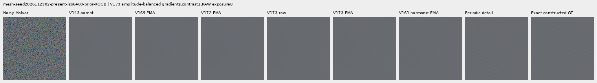

mesh-seed2026112302-present-iso6400-prior-RGGB; ROI `[176, 176, 160, 160]`, exposure 8, contrast 40.

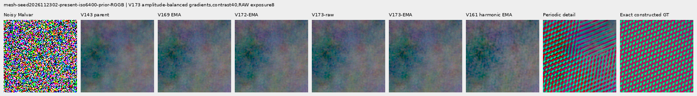

mesh-seed2026112309-present-iso6400-prior-RGGB; ROI `[176, 176, 160, 160]`, exposure 8, contrast 1.

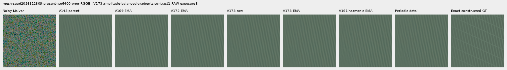

mesh-seed2026112309-present-iso6400-prior-RGGB; ROI `[176, 176, 160, 160]`, exposure 8, contrast 40.

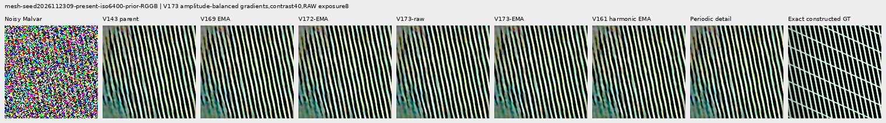

mesh-seed2026112304-absent-iso6400-prior-RGGB; ROI `[165, 0, 160, 160]`, exposure 8, contrast 40.

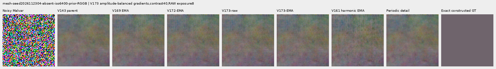

main-overcast-sky; ROI `[176, 176, 160, 160]`, exposure 4, contrast 1.

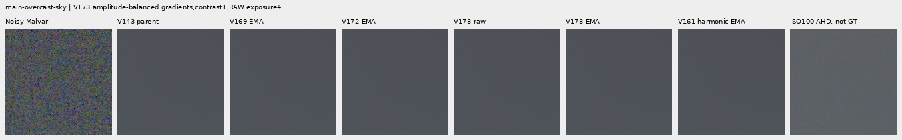

main-building-detail; ROI `[176, 176, 160, 160]`, exposure 4, contrast 1.

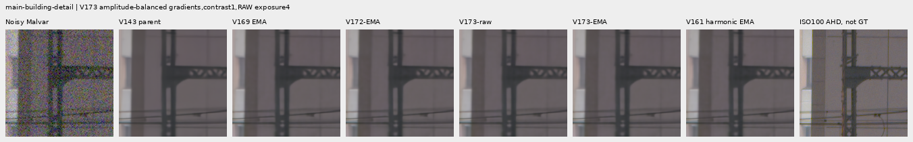

main-foliage; ROI `[176, 176, 160, 160]`, exposure 4, contrast 1.

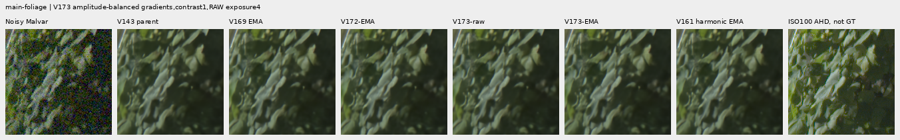

main-chain-link-fence; ROI `[176, 176, 160, 160]`, exposure 4, contrast 1.

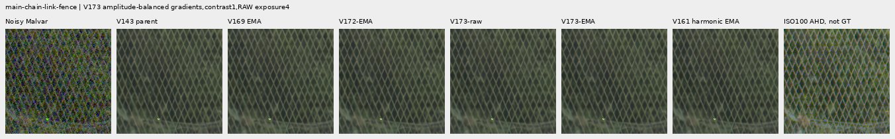

mesh-nominal; ROI `[206, 229, 160, 160]`, exposure 16, contrast 1.

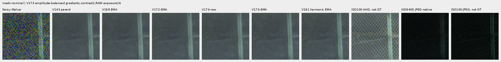

mesh-nominal; ROI `[426, 189, 160, 160]`, exposure 16, contrast 1.

mesh-profile3879; ROI `[206, 229, 160, 160]`, exposure 16, contrast 1.

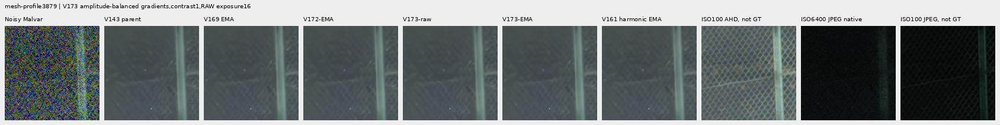

mesh-profile3879; ROI `[426, 189, 160, 160]`, exposure 16, contrast 1.

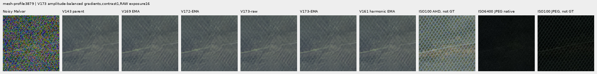

organic-02a76fd33b5e1414a0504f0b3f0aeb03a569b6f4-photo-faint-RGGB; ROI `[112, 112, 160, 160]`, exposure 14.3883, contrast 8.

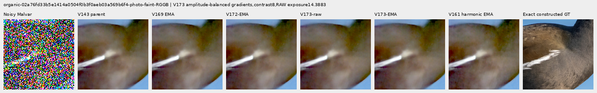

organic-dabacecd4780a1c230f8e9fce6ca1a604bdeab4c-photo-dark-RGGB; ROI `[112, 112, 160, 160]`, exposure 102.758, contrast 1.

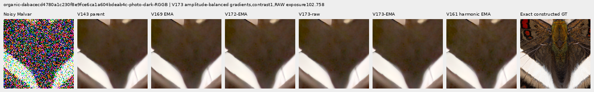

organic-6b3920bceba82d95ecf9351d47f6f94267694bd0-photo-dark-RGGB; ROI `[112, 112, 160, 160]`, exposure 64.0491, contrast 1.

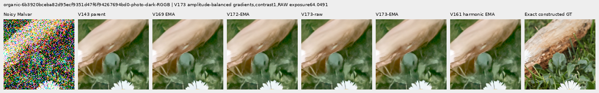

gray-l0.02-adc-only-RGGB; ROI `[48, 48, 160, 160]`, exposure 4, contrast 40.

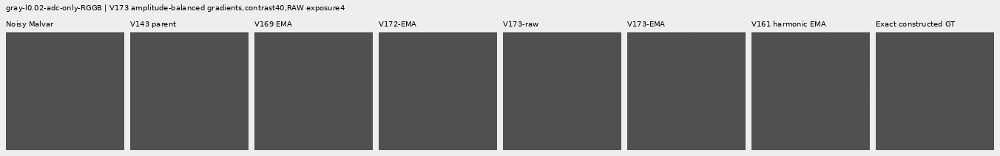

gray-l0.02-iso12800-prior-RGGB; ROI `[48, 48, 160, 160]`, exposure 4, contrast 40.

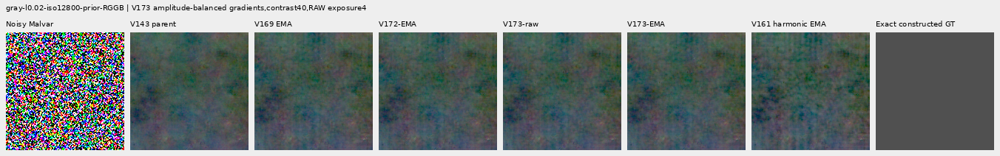

flat512-gray-l0.02-adc-only-RGGB; ROI `[176, 176, 160, 160]`, exposure 4, contrast 40.

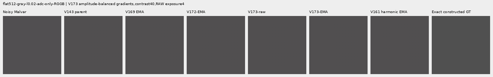

flat512-gray-l0.02-iso6400-prior-RGGB; ROI `[176, 176, 160, 160]`, exposure 4, contrast 40.

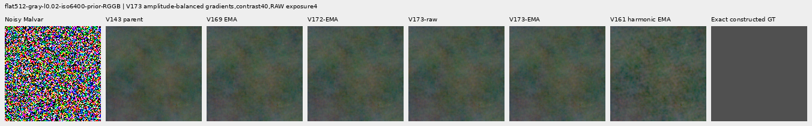

flat512-gray-l0.02-iso12800-prior-RGGB; ROI `[176, 176, 160, 160]`, exposure 4, contrast 40.

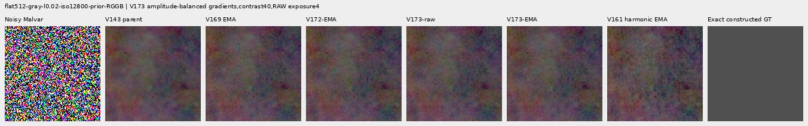

flat512-h210-s0.50-l0.02-iso6400-prior-RGGB; ROI `[176, 176, 160, 160]`, exposure 4, contrast 40.

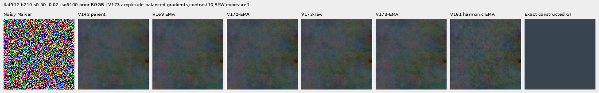

flat512-gray-l0.18-iso12800-prior-RGGB; ROI `[176, 176, 160, 160]`, exposure 1, contrast 8.

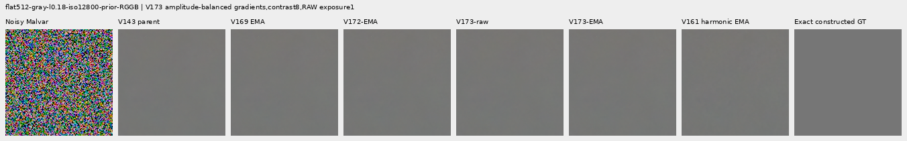

flat512-gray-l0.90-iso12800-prior-RGGB; ROI `[176, 176, 160, 160]`, exposure 1, contrast 4.

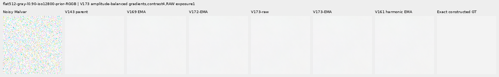

photo-3e638bbb56ed80abc88939468783e3bf9b92ee77-photo-faint-RGGB; ROI `[176, 176, 160, 160]`, exposure 12.1494, contrast 8.

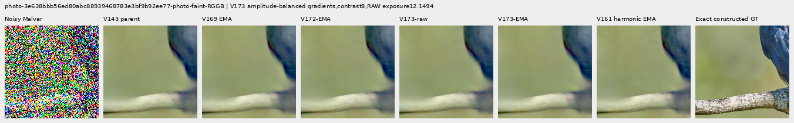

photo-3e638bbb56ed80abc88939468783e3bf9b92ee77-photo-dark-RGGB; ROI `[176, 176, 160, 160]`, exposure 80.9959, contrast 1.

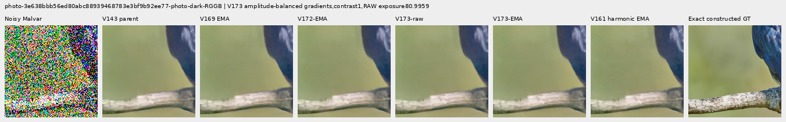

mixed-vertical-step-iso6400-prior-RGGB; ROI `[80, 176, 160, 160]`, exposure 8, contrast 40.

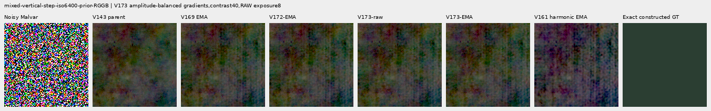

mixed-vertical-step-iso6400-prior-RGGB; ROI `[240, 176, 160, 160]`, exposure 8, contrast 1.

mixed-vertical-step-iso12800-prior-RGGB; ROI `[80, 176, 160, 160]`, exposure 8, contrast 40.

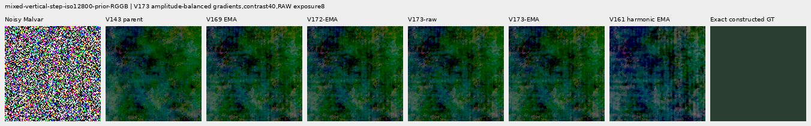

mixed-vertical-step-iso12800-prior-RGGB; ROI `[240, 176, 160, 160]`, exposure 8, contrast 1.

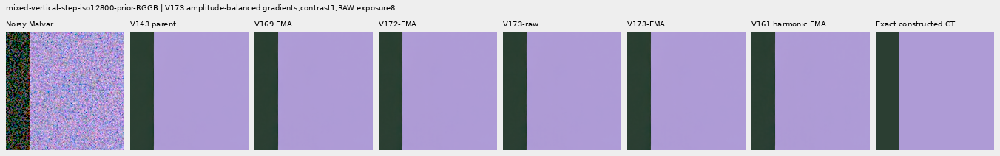

mixed-narrow-bar-iso6400-prior-RGGB; ROI `[80, 176, 160, 160]`, exposure 8, contrast 40.

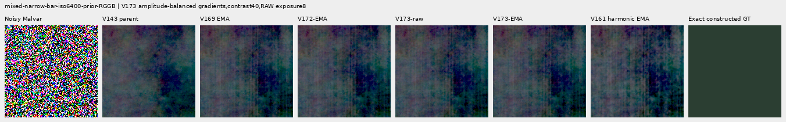

mixed-narrow-bar-iso6400-prior-RGGB; ROI `[240, 176, 160, 160]`, exposure 8, contrast 1.

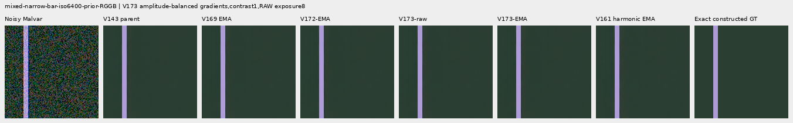

mixed-narrow-bar-iso12800-prior-RGGB; ROI `[80, 176, 160, 160]`, exposure 8, contrast 40.

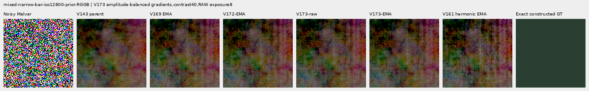

mixed-narrow-bar-iso12800-prior-RGGB; ROI `[240, 176, 160, 160]`, exposure 8, contrast 1.

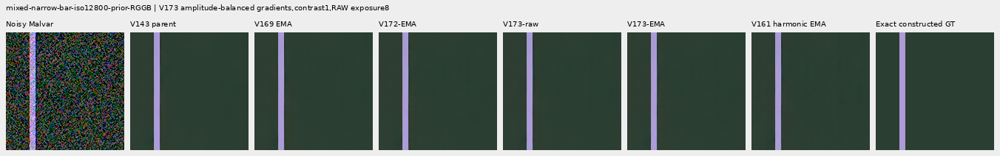

mixed-slanted-step-iso6400-prior-RGGB; ROI `[80, 176, 160, 160]`, exposure 8, contrast 40.

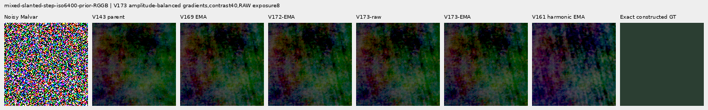

mixed-slanted-step-iso6400-prior-RGGB; ROI `[240, 176, 160, 160]`, exposure 8, contrast 1.

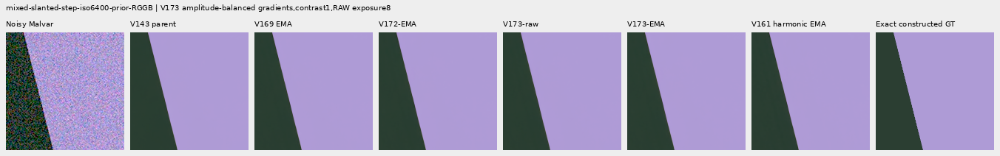

mixed-slanted-step-iso12800-prior-RGGB; ROI `[80, 176, 160, 160]`, exposure 8, contrast 40.

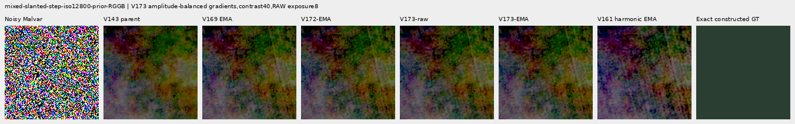

mixed-slanted-step-iso12800-prior-RGGB; ROI `[240, 176, 160, 160]`, exposure 8, contrast 1.

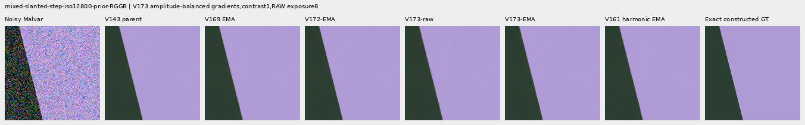

mixed-striped-patch-iso6400-prior-RGGB; ROI `[80, 176, 160, 160]`, exposure 8, contrast 40.

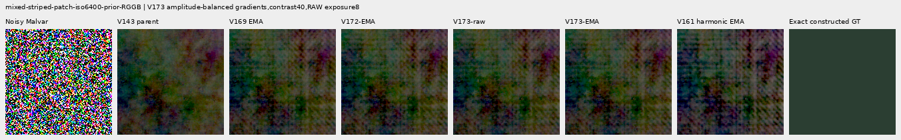

mixed-striped-patch-iso6400-prior-RGGB; ROI `[240, 176, 160, 160]`, exposure 8, contrast 1.

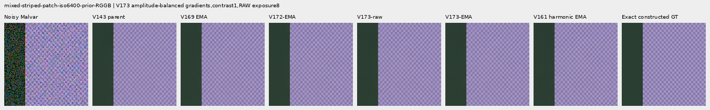

mixed-striped-patch-iso12800-prior-RGGB; ROI `[80, 176, 160, 160]`, exposure 8, contrast 40.

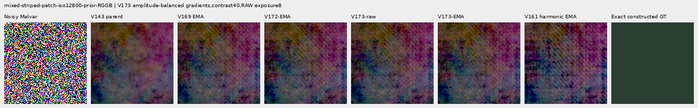

mixed-striped-patch-iso12800-prior-RGGB; ROI `[240, 176, 160, 160]`, exposure 8, contrast 1.

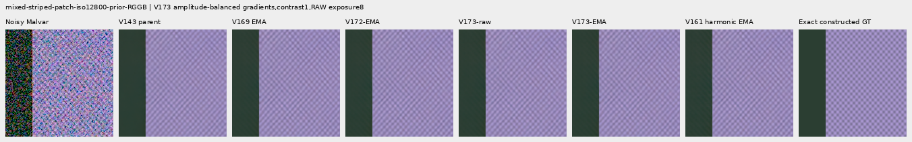

V150-control-bark-contrast0p025-adc-RGGB; ROI `[48, 48, 160, 160]`, exposure 1, contrast 40.

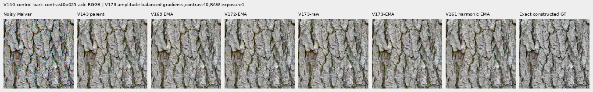

V150-control-raccoon-fur-contrast0p025-adc-RGGB; ROI `[48, 48, 160, 160]`, exposure 1, contrast 40.

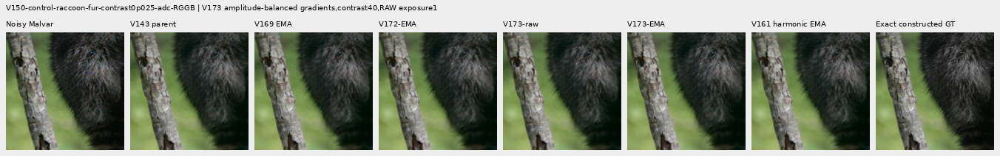

V150-control-ADC-plane0-RGGB; ROI `[176, 176, 160, 160]`, exposure 45, contrast 8.

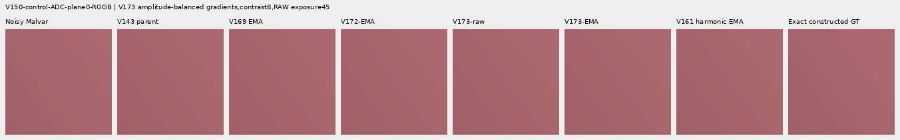

V150-control-ADC-plane1-RGGB; ROI `[176, 176, 160, 160]`, exposure 9, contrast 8.

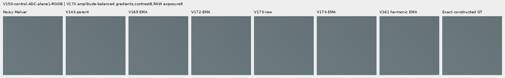

V150-control-ADC-plane2-RGGB; ROI `[176, 176, 160, 160]`, exposure 1, contrast 8.

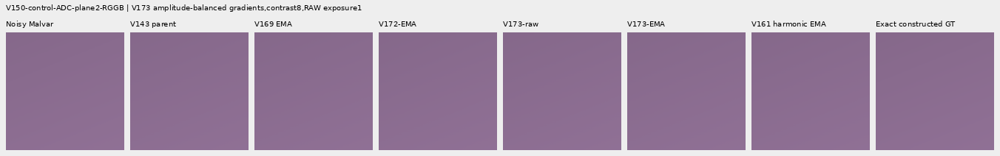

V150-control-ADC-plane3-RGGB; ROI `[176, 176, 160, 160]`, exposure 0.24, contrast 8.

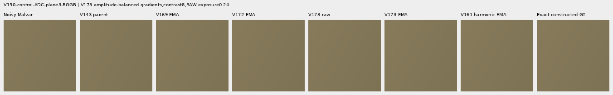

### Noisy, restored and exact constructed GT triplets

mesh-seed2026112302-present-iso6400-prior-RGGB; ROI `[176, 176, 160, 160]`, exposure 8, contrast 1.

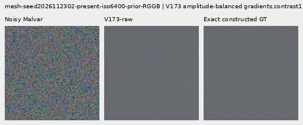

mesh-seed2026112302-present-iso6400-prior-RGGB; ROI `[176, 176, 160, 160]`, exposure 8, contrast 1.

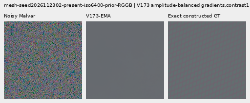

mesh-seed2026112309-present-iso6400-prior-RGGB; ROI `[176, 176, 160, 160]`, exposure 8, contrast 1.

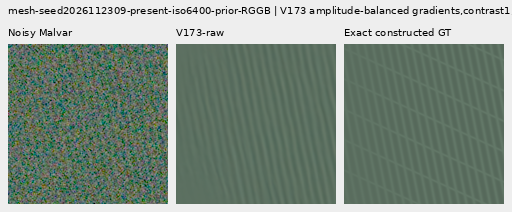

mesh-seed2026112309-present-iso6400-prior-RGGB; ROI `[176, 176, 160, 160]`, exposure 8, contrast 1.

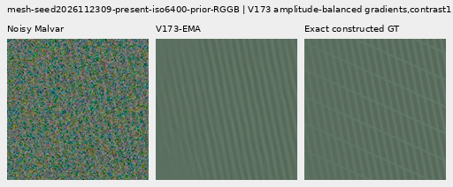

flat512-gray-l0.02-iso6400-prior-RGGB; ROI `[176, 176, 160, 160]`, exposure 4, contrast 40.

flat512-gray-l0.02-iso6400-prior-RGGB; ROI `[176, 176, 160, 160]`, exposure 4, contrast 40.

flat512-gray-l0.02-iso12800-prior-RGGB; ROI `[176, 176, 160, 160]`, exposure 4, contrast 40.

flat512-gray-l0.02-iso12800-prior-RGGB; ROI `[176, 176, 160, 160]`, exposure 4, contrast 40.

mixed-vertical-step-iso6400-prior-RGGB; ROI `[80, 176, 160, 160]`, exposure 8, contrast 40.

mixed-vertical-step-iso6400-prior-RGGB; ROI `[80, 176, 160, 160]`, exposure 8, contrast 40.

mixed-vertical-step-iso12800-prior-RGGB; ROI `[80, 176, 160, 160]`, exposure 8, contrast 40.

mixed-vertical-step-iso12800-prior-RGGB; ROI `[80, 176, 160, 160]`, exposure 8, contrast 40.

[Independent publication verification](results/v173-weak-gradient-matching-publication-verification-v1.json).
