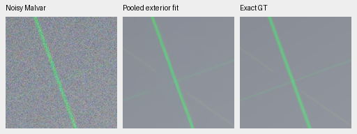
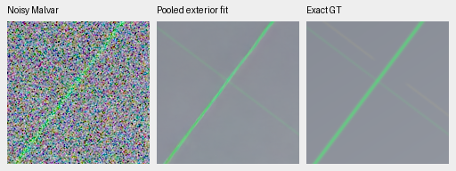

# Pooling local Bayer evidence along a weak line

Longer fits recover part of a continuous ISO6400 wire using guides found in
the noisy surround. On the synthetic parallel panel, the recovered response
rises from 6.3% to 36.6%. The weaker interrupted wire rises only from 7.8%
to 9.1%. At ISO400, pooling across a fitted gap recovers more signal and
can extend into part of the actual gap. Both standing GFX fences still
have missing fine detail.
[Executed cases and native comparisons](results/weak-line-pooled-evidence-v1/publication.json).

## Separate shape selection from local confirmation

The test uses 72 new exact-reference pairs from six geometries, two noise
priors and two independent repeats across parallel, crossing and edge-aligned
layouts. Both roles in each pair share coupled noise. One has both weak
lines, the other lacks both. A stronger crossing line appears in both, and
an additional exterior guide can align near a step rather than a true wire.
The [short exterior fit](multiple-raw-line-guides.md) uses the same query,
checkpoint and exterior line proposals for comparison.

The longer fit assigns independent per-color affine backgrounds along the
line and pools a shared amplitude. A continuous fit uses the full query.
The gap fit searches a fixed library of positions and widths, and the
edge fit adds competing step terms. One Bayer checkerboard half fits the
null, estimates per-color noise scales and chooses the line amplitude and
envelope. Its fixed prediction has to reduce weighted error on the other
half. Both directions must pass signed thresholds. Only their shared
support is rendered. The neural parent enters after this decision. A
targeted replay changed the held-out measurements and verified the
training choice and fit remained identical. These are empirical tests
under the simulated noise. Real RAW can carry correlated artifacts.
[Fit and perturbation receipts](results/weak-line-pooled-evidence-v1/publication.json).

The exact-geometry diagnostics supply true angle, offset and color. An
additional diagnostic supplies the normalized target line shape and gap
envelope to both the present and absent roles. Its amplitude still comes
from RAW, with and without the confirmation gate. Those two arms quantify
what that information buys and use target knowledge unavailable on a
real input. None of the pooled exterior fits reads those templates.

## Continuous and interrupted wires

The first two signal columns report paired response as a percentage of
the exact signed RGB increment, away from competing structures. Gap RMS
measures added correction inside the explicitly absent part of the second
wire. Each row here averages 12 pairs.

| Layout and method | Continuous response | Interrupted response | Added gap RMS, DN16 |
| --- | ---: | ---: | ---: |
| ISO400 crossing, local trunk | 13.0% | 13.4% | 0 |
| ISO400 crossing, short exterior fit | 100.3% | 32.5% | 0.25 |
| ISO400 crossing, pooled continuous exterior | 92.6% | 71.8% | 51.99 |
| ISO400 crossing, pooled gap exterior | 85.7% | 68.8% | 12.49 |
| ISO6400 crossing, local trunk | 5.6% | 6.8% | 0 |
| ISO6400 crossing, pooled continuous exterior | 17.1% | 6.8% | 0 |
| ISO6400 parallel, local trunk | 6.3% | 7.8% | 0 |
| ISO6400 parallel, pooled continuous exterior | 36.6% | 9.1% | 1.18 |
| ISO6400 edge-aligned, local trunk | 6.5% | 7.2% | 0 |
| ISO6400 edge-aligned, pooled continuous exterior | 28.4% | 8.4% | 1.07 |

At ISO400 crossing, the pooled gap fit lowers the interrupted wire's
increment error from 62.74 to 41.35 DN16 against the short exterior
fit. Mean added gap RMS rises from 0.25 to 12.49 DN16, with a 51.49 DN16
worst example. In the fresh edge-aligned cases, adding the fixed step
terms weakens real wire response and adds small no-wire corrections.
The full-query continuous exterior fit leaves the displayed no-wire
role identical to the parent in all 72 pairs.

At ISO6400, continuous pooling with exterior estimates achieves within
one percentage point of the response with exact line geometry in all
three layouts. Geometry accuracy is therefore a limited explanation for
the missed continuous signal in this panel, which has strong outer
guides. With the exact template and gate opened, the interrupted wire
reaches 84.6–91.8% across layouts, and the no-wire roles acquire a
mean added RMS of 3.64–5.61 DN16, with a 16.40 DN16 maximum. The same
template with confirmation enabled achieves only 7.8–7.9% on these
interrupted wires. The difference exposes the cost of confirming short
and weak local measurements at this noise level.

## Native comparisons

Case 64 is a crossing at ISO400. Case 67 is parallel at ISO6400 and
shows an admitted pooled fit on the continuous wire, with the interrupted
wire still faint. Both are draw 0, ADC16 with black fraction 0.03, identity
WB and color matrix, native query at `[256,256,256,256]`, displayed ROI
`[48,48,160,160]`, exposure ×1 and shared contrast ×8. Shot/read are
`8e-5/2.56e-8` and `0.00128/6.5536e-6`, respectively. The synthetic
parent is the spatial 2k EMA with context disabled, SHA256
`97fd551bd0ae0b7aa97c67e1f6e8b513b722f70d5ad8b8814a96586b934eafac`.
[Crop bindings and CFA patterns](results/weak-line-pooled-evidence-v1/publication.json).

[ISO400 edge-aligned comparison](images/weak-line-pooled-evidence-v1/iso400-edge-aligned-g67-r0-comparison.png) ·
[ISO6400 edge-aligned comparison](images/weak-line-pooled-evidence-v1/iso6400-edge-aligned-g67-r0-comparison.png) ·
[ISO6400 parallel comparison](images/weak-line-pooled-evidence-v1/iso6400-parallel-g67-r0-comparison.png).

## Standing GFX100S checks

All eight native boards use cached Bayer inputs and the same local-only 2k
EMA from the earlier standing replay, SHA256
`ceb5ddaf23fce47806a01045bd86d34bb48d1f64031e382b0d5cfbabf0716880`.
V120 and the independently demosaiced ISO100 AHD reference remain in
each board. The cab boards include both camera JPEGs. The reference
captures differ in aperture and moving subjects, so the comparison is
qualitative. All eight boards were viewed at native resolution.

The main ISO6400 sky, foliage and coarse fence remain exact relative to
the local parent. The pooled building fits add 1.51–2.77 DN16 RMS and
show no clear improvement in the small hardware or cord. Main displays
use exposure ×4 and shot/read `0.00128/6.5536e-6`.
[Sky](images/weak-line-pooled-evidence-v1/standing/main-overcast-sky-main-overcast-sky.png) ·
[Building](images/weak-line-pooled-evidence-v1/standing/main-building-detail-main-building-detail.png) ·
[Foliage](images/weak-line-pooled-evidence-v1/standing/main-foliage-main-foliage.png) ·
[Coarse fence](images/weak-line-pooled-evidence-v1/standing/main-chain-link-fence-main-chain-link-fence.png).

The tested exterior detector proposes no cab guide after its shoulder
check. Both cab regions return their original local parent for both
priors. Transferred conditioning retains the parent's soft modulation
and missing fine crossings. Cab displays use exposure ×16.

| Cab prior, shot/read | Native boards |
| --- | --- |
| Nominal, `0.00128/6.5536e-6` | [Left](images/weak-line-pooled-evidence-v1/standing/mesh-nominal-fine-green-mesh-left.png) · [Right](images/weak-line-pooled-evidence-v1/standing/mesh-nominal-fine-green-mesh-right.png) |
| Transferred, `0.0014635775921166604/1.0715704128646712e-6` | [Left](images/weak-line-pooled-evidence-v1/standing/mesh-profile3879-fine-green-mesh-left.png) · [Right](images/weak-line-pooled-evidence-v1/standing/mesh-profile3879-fine-green-mesh-right.png) |

This is a scoped restoration component experiment without endpoint training
or comparable [full427 and camera-history scores](performance-history.md).
