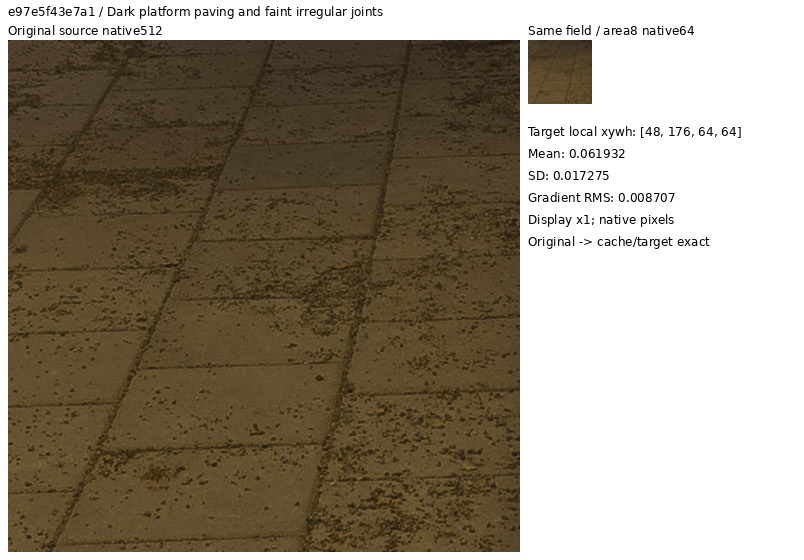
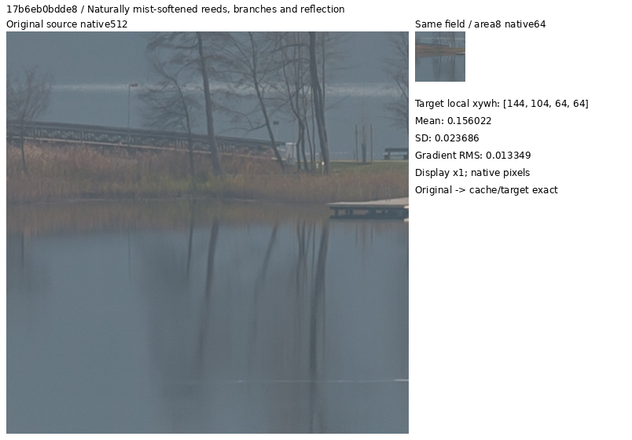
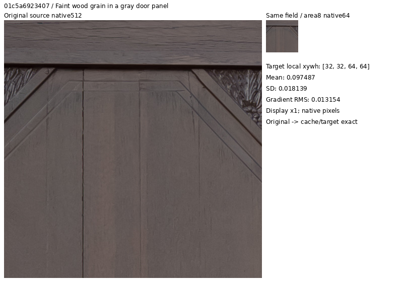
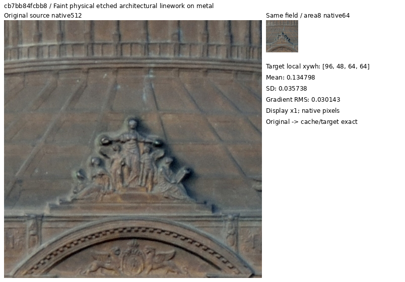
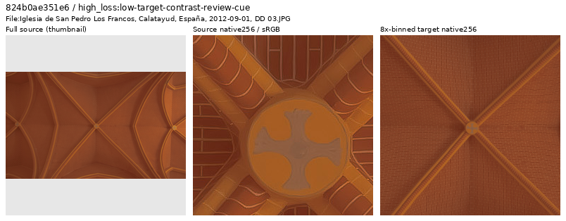
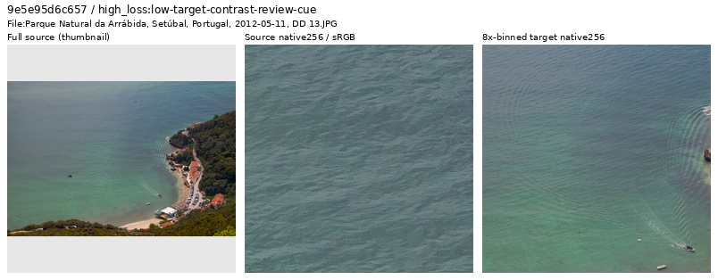
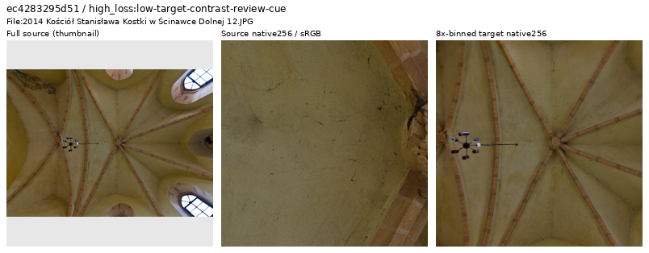

# Weak photographic material targets

The **active14-region catalogue** preserves the original six training regions
and adds eight existing photographs with inspected low-contrast material detail.
It was used by **V121 on90,787 sources** and passes actual reader plus
discarded16-update CPU/CUDA checks. V120/V121 completed20k; their primary
predictions, independent audit, full local statistics and selected native review
are complete. V119/V120 retain six regions,
90,791 sources and the same5% conditional-photo ROI probability.
[Matched training and queued review](paired32-weak-detail-training.md).

The [completed V121 comparison](v120-v121-primary.md) has a+.00149dB photo change
from V120 (paired-source95% interval[−.00080,+.00401]), a tiny weak-detail gain
change and no clear fine-mesh recovery gain. A large ADC outlier remains. This
combined cleanup/fourteen-region intervention has not solved weak-detail loss;
the prepared20-region option below has not been trained.

A [90,786-source snapshot](current-source-loss-review.md) removes one
separately inspected nonphotographic advertisement while preserving all fourteen
region objects, source pixels and target hashes. Its
[rebound catalogue](../configs/low-contrast-training-rois-cleaned90786-v1.json)
passes actual source/crop/target and sampler checks. V121 keeps its original
90,787-source binding. The [V122/V123 architectural trials](learned-raw-frequency-training.md)
now use the90,786-source/fourteen-region binding.

The **20-region bank on90,784 sources** is prepared and queued for the
[V124/V125 trials](conditional-mean-training.md). It preserves all fourteen
example objects and adds six actually inspected
weak material fields. Two separately inspected sources—a painting reproduction
and a thermographic display—are withheld only from that future cohort.
The real reader validates all twenty regions and exercises the six additions.
No active recipe, quota or training input changes; its quality effect is unknown.
[New catalogue](../configs/low-contrast-training-rois-cleaned90784-v1.json) ·
[Actual review, reconstruction and reader evidence](results/thin-photographic-materials-v1.json).
[Preserved verification correction](results/thin-photographic-materials-publication-v1.json).

The [latest V123 source review](current-source-loss-review.md) prepares a separate
**90,783-source binding with the same twenty region objects**, withholding one
additional painting-dominated source. The actual reader reproduces all twenty
region targets and eight ordinary/procedural controls exactly, and exercises the
excluded-source retry. This alternative is untrained; queued V124/V125 inputs
remain unchanged.
[Rebound catalogue](../configs/low-contrast-training-rois-cleaned90783-v1.json) ·
[Source decisions and independent checks](results/v123-source-loss-through5400-review-v1.json).

The optional [shadow-exposure extension](reviewed-shadow-exposure.md) can place
selected reviewed material crops in a darker sensor range without changing
their pixels' geometry or relative color. Actual twenty-region CPU/CUDA checks
pass. It is disabled by default and untrained; the queued source bank and
recipes remain unchanged.

[Catalogue](../configs/low-contrast-training-rois-cleaned90787-v1.json) ·
[Actual visual decisions](results/weak-photographic-targets-review-v1.json) ·
[Preparation and source reconstruction](results/weak-photographic-targets-preparation-v1.json) ·
[Completed actual-reader check](results/weak-photographic-targets-v1.json).

## Prepared20-region material extension

The latest pass first inspected three previously retained thin-structure photos:
bamboo rails, radial metal rods and stone-sculpture folds. Their aligned
contexts and nine local fields are mostly mixed or high contrast. None is added
to the weak-region bank. They remain ordinary eligible photographs.

A historical ADC-only source screen then nominates sixteen new IDs, including
fourteen varied photographic subjects and two checks of target-domain suitability.
Its whole-context mean-RGB statistics are inspection cues, not current-model
losses or an image-quality ranking. All sixteen source thumbnails and32 native256
source/area8-target cells were actually viewed. Six specific physical fields
received additional original512/native64 inspection and are admitted below.

| Added source | Resolved target detail | Bin4 context xywh | Local64 linear-luminance SD |
| --- | --- | --- | ---: |
| `e97e5f43e7a1` | Dark platform paving and faint tile joints | [468,228,512,512] | .01728 |
| `17b6eb0bdde8` | Mist-softened reeds, twigs and reflections | [360,154,512,512] | .02369 |
| `01c5a6923407` | Gray door grain and shallow panel seams | [182,392,512,512] | .01814 |
| `43ebd8b30c9b` | Dark carved stone and small block boundaries | [212,306,512,512] | .03097 |
| `6c58c7d1a935` | Shallow plaster leaf relief and radial ribs | [494,244,512,512] | .02508 |
| `cb7bb84fcbb8` | Faint etched architectural grid on metal | [392,108,512,512] | .03574 |

These local64 annotations identify observed material, without changing trainer
crop geometry or adding a loss mask. Dark exposure, natural haze and occasional
stronger edges remain; low absolute SD does not make every edge weak. Fine
individual reed fibers or all plaque microtexture are not asserted resolved.

The views below place unchanged native512 source pixels beside the native64
area8 target of the **same physical field**, at display exposure ×1. Full-context
strips and source/ROI metadata are linked with each example. These inspect clean
training sources; there is no noisy/restored comparison or model-quality result.

[Whole context](images/weak-photographic-targets-20261026-v1/platform-paving-context.png) ·
[Metadata](images/weak-photographic-targets-20261026-v1/platform-paving-local.json).
Source: [Arild Vågen, Gullmarsplan Metro station](https://commons.wikimedia.org/wiki/File:Gullmarsplan_Metro_station_February_2015.jpg),
[CC BY-SA4.0](https://creativecommons.org/licenses/by-sa/4.0/).

[Whole context](images/weak-photographic-targets-20261026-v1/misty-reeds-context.png) ·
[Metadata](images/weak-photographic-targets-20261026-v1/misty-reeds-local.json).
Source: [Johann Jaritz, Pörtschach bridge](https://commons.wikimedia.org/wiki/File:P%C3%B6rtschach_Blumeninsel_und_Br%C3%BCcke_N-Ansicht_29112020_8502.jpg),
[CC BY-SA4.0](https://creativecommons.org/licenses/by-sa/4.0/).

[Whole context](images/weak-photographic-targets-20261026-v1/gray-wood-grain-context.png) ·
[Metadata](images/weak-photographic-targets-20261026-v1/gray-wood-grain-local.json).
Source: [Ermell, Eggolsheim church door](https://commons.wikimedia.org/wiki/File:Eggolsheim_church_door_030140.jpg),
[CC BY-SA4.0](https://creativecommons.org/licenses/by-sa/4.0/).

[Whole context](images/weak-photographic-targets-20261026-v1/etched-metal-grid-context.png) ·
[Metadata](images/weak-photographic-targets-20261026-v1/etched-metal-grid-local.json).
Source: [P e z i, Rotundenbrücke plaque](https://commons.wikimedia.org/wiki/File:Plaque_Rotundenbruecke_NW_DSC_5297a.jpg),
[CC BY-SA3.0 AT](https://creativecommons.org/licenses/by-sa/3.0/at/deed.en).
Modifications: cropping, binning, source-thumbnail creation where shown,
ICC-to-sRGB and inspection-layout conversion. Native source/target cells never resize.

Independent reconstruction from the six original JPEG fields reproduces294,912
bin4 uint16 and73,728 final FP32 channel values exactly. All fourteen prior
example objects remain identical. Coupled4×/8× manifests omit exactly two
training IDs; every other literal row, including validation/test and order,
is preserved. [Specific source decisions](current-source-loss-review.md).

Using the original frozen V121 clean-reader code, constructor checks validate
all twenty region caches/crops/targets, and the metadata chooser covers all20.
The six additions pass actual geometry-before-area2 and existing contrast
attenuation at native256/FP32. Four ordinary-photo and two procedural outputs
match saved earlier hashes on the changed manifest. All12 outputs/2,359,296
values are finite; global Python/NumPy/Torch RNG stays unchanged. No excluded
or held-out cache opens, neural calls, RAW decodes, noise observations, CUDA
initialization or optimizer updates occur. These are metadata-selected reader
checks, not an executed training schedule or a change to the5% ROI quota.

## Selection and limits

The earlier six-versus32 study had a tiny mixed quality effect, so adding more
regions at the same quota is not an established improvement. This bank prepares
a different set of measured weak targets for a later deliberate experiment.
No new source, sampling quota, loss mask, optical blur or noise policy is applied.

The first twelve material nominees contained useful fine detail, but six local
source/target pairs showed substantial mixed contrast and broad edges. Those
photographs remain eligible under ordinary sampling. A second query uses the
completed historical source screen to find 195 active candidates with mean-RGB
linear SD .015–.05, gradient RMS .0015–.025 and clipped fraction at most .01,
outside the earlier 32-region catalogue. These statistics nominate inspection;
they do not establish photographic quality. They are target statistics, not
current V119 per-source losses.

Sixteen varied physical subjects from that query were actually viewed. Eight
are selected; the other eight retain ordinary membership. Blank sky and smooth
backgrounds can satisfy a low global contrast statistic while offering little
fine detail. Reflective insect edges and dark artifact outlines are useful
photography, but do not automatically qualify as weak material texture.

| New source prefix | Inspected structure | Aligned bin4 context xywh | Local64 luminance SD |
| --- | --- | --- | ---: |
| `cb53d7496cb2` | Dark snowy roofs and thin branches | [744,494,512,512] | .01139 |
| `924e8a6601b5` | Worn plaster and pigment boundaries | [270,622,512,512] | .02557 |
| `1306f44f2652` | Bronze patina and shallow relief | [68,200,512,512] | .01768 |
| `824b0ae351e6` | Fine brick ceiling grid | [410,138,512,512] | .02221 |
| `ec4283295d51` | Faint plaster cracks and mottling | [222,86,512,512] | .02023 |
| `0c95cdbe2430` | Naturally soft wet-mud ridge boundaries | [278,100,512,512] | .01178 |
| `9e5e95d6c657` | Fine sea-surface wavelets | [358,160,512,512] | .02108 |
| `ad7a3b8a9e12` | Faint sand-ripple ridges | [320,176,512,512] | .02727 |

Local SD uses Rec.709 linear luminance in the annotated 64×64 target field;
historical nomination uses whole-context mean-RGB SD. These are different
measurements. Low absolute contrast in a dark exposure does not mean low
relative contrast everywhere. Individual sand grains, mud grains and bronze
microstructure are not asserted resolved merely because the source has them.

## Native examples

The strips show a whole-source thumbnail, native256 source crop and native256
area8 target. Only the thumbnail is resized. The linked local figures show an
unchanged native512 original crop beside the native64 target covering that same
physical field. Sources are ICC-managed to sRGB; targets use linear area2 from
the 4× cache then sRGB display. Exposure is ×1 throughout. These are clean-source
inspection views, without noisy observations or restored model outputs.

[Local source512/target64](images/weak-photographic-targets-v1/brick-grid-local.png) ·
[Source/ROI/display metadata](images/weak-photographic-targets-v1/brick-grid-context.json).
Source: [Diego Delso, Iglesia de San Pedro Los Francos](https://commons.wikimedia.org/wiki/File:Iglesia_de_San_Pedro_Los_Francos,_Calatayud,_Espa%C3%B1a,_2012-09-01,_DD_03.JPG),
[CC BY-SA3.0](https://creativecommons.org/licenses/by-sa/3.0/).

[Local source512/target64](images/weak-photographic-targets-v1/sea-wavelets-local.png) ·
[Source/ROI/display metadata](images/weak-photographic-targets-v1/sea-wavelets-context.json).
Source: [Diego Delso, Parque Natural da Arrábida](https://commons.wikimedia.org/wiki/File:Parque_Natural_da_Arr%C3%A1bida,_Set%C3%BAbal,_Portugal,_2012-05-11,_DD_13.JPG),
[CC BY-SA3.0](https://creativecommons.org/licenses/by-sa/3.0/).

[Local source512/target64](images/weak-photographic-targets-v1/plaster-cracks-local.png) ·
[Source/ROI/display metadata](images/weak-photographic-targets-v1/plaster-cracks-context.json).
Source: [Jacek Halicki, Kościół Stanisława Kostki](https://commons.wikimedia.org/wiki/File:2014_Ko%C5%9Bci%C3%B3%C5%82_Stanis%C5%82awa_Kostki_w_%C5%9Acinawce_Dolnej_12.JPG),
[CC BY-SA3.0 PL](https://creativecommons.org/licenses/by-sa/3.0/pl/deed.en).
Modifications for these examples: cropping, binning, context-thumbnail creation,
ICC/display and inspection-layout conversion. Full original attribution and
licensing for all fourteen sources remain in the catalogue.

## Actual data checks

All 28 unique candidate contexts and 56 native256 source/target cells were
actually viewed, followed by fourteen local source512/target64 pairs. This
counts twelve initial mixed-contrast candidates and sixteen measured candidates;
it is separate from the cumulative corpus-cleanup ledger. No training-source
membership changes result from this ROI review.

Original SHA1 and whole-cache SHA256 checks pass. Independent NumPy reconstruction
from the original eight selected source fields reproduces **393,216 bin4 uint16
values** and **98,304 native8 FP32 target values** exactly. The original six
catalogue objects and target hashes are unchanged; manifest binding is exact.
Local64 annotations describe inspected detail and are ignored by the trainer.

The actual clean-data reader exercises all fourteen regions through geometry
before final area2 and existing contrast attenuation at native256. Four ordinary
and two procedural samples match reused hashes from the preceding frozen-reader
check. All **20 outputs / 3,932,160 FP32 values** are finite. No excluded or
held-out cache opens; Python/NumPy/Torch global RNG remains unchanged and CUDA
stays uninitialized. No neural forward, noise observation, RAW decode or optimizer
update occurs. These are metadata-selected samples, not a training schedule.

The preparation receipt preserves its earlier reader-pending status; the
separate completed reader receipt records the subsequent check. The initial
local-view helper failed at import before pixel work; its source/log remain
preserved, and the corrected helper completed once. Reader success establishes
data readiness, with restoration quality still unmeasured.
