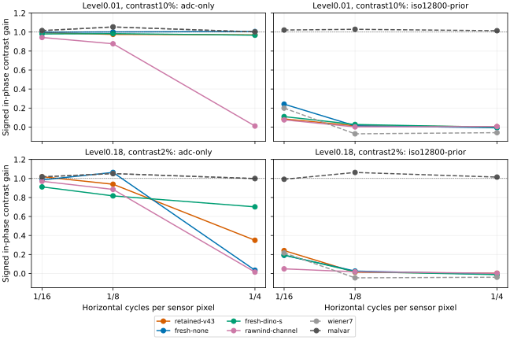
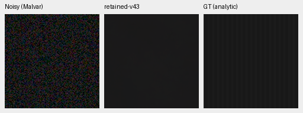
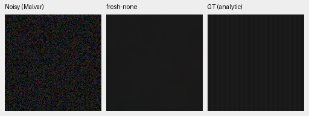
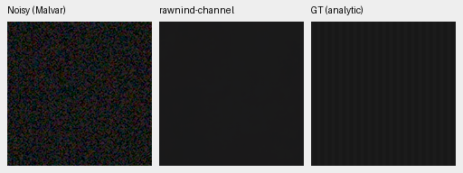
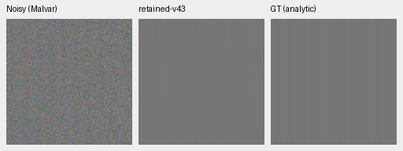
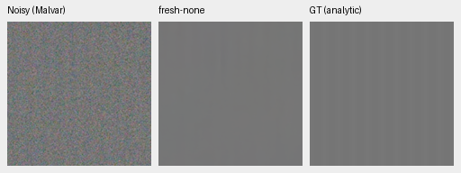
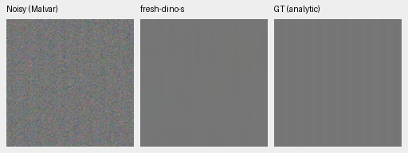
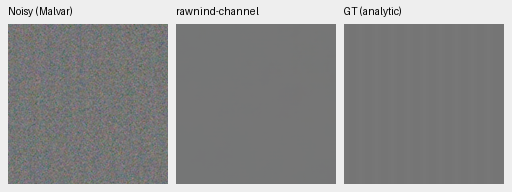

# Exact weak-texture response diagnostic

Several learned models suppress coherent weak carriers that have measurable
RAW evidence under the diagnostic's known-frequency assumptions. Stronger
carriers survive much better. This supports a controlled weak-texture training
candidate; it establishes **no natural-photo quality gain or model promotion**.
[Full metrics, hashes, source snapshots and ten native triplets](results/weak-texture-response.json).

Twelve exact horizontal neutral sinusoids: linear-sRGB backgrounds.01/.18,
relative contrasts2%/10%, periods4/8/16 sensor pixels. Native256px fields,
ROI[48,48,160,160], ADC-only and ISO12800 prior, all four CFAs and four seeded
draws give384 observations/2304 method cases. Models: retained V43 step2000,
matched fresh no-context/DINO-S step3000, channel-calibrated RawNIND, fixed
Wiener7 and noisy Malvar. Genuine frozen DINO weights, CPU FP32; no CUDA.
Only the two fresh models are a matched trained architecture comparison.

We fit DC/cos/sin per RGB channel in **unclipped linear sRGB**. Signed in-phase
gain1 matches true contrast; zero erases it. Quadrature, channel imbalance,
noncarrier RMS and reconstruction error remain separate in the JSON. Noise
power is not counted as recovered contrast. Means average the16 layout/draw
cases, not photographs. ADC-only seeded duplicates are identical inputs within
each CFA; they do not increase independent evidence. The figure shows means,
not uncertainty intervals. A period4 carrier also probes Bayer sampling/color
ambiguity; these results are not a general camera MTF.

| Level | Relative contrast | Period | Retained V43 | Fresh none | Fresh DINO-S | RawNIND channel |
| --- | ---: | ---: | ---: | ---: | ---: | ---: |
| 0.01 | 10% | 4 | 0.0036 | -0.0078 | -0.0021 | 0.0057 |
| 0.01 | 10% | 8 | 0.0130 | 0.0133 | 0.0271 | 0.0017 |
| 0.01 | 10% | 16 | 0.0855 | 0.2411 | 0.1100 | 0.0758 |
| 0.18 | 2% | 4 | 0.0024 | -0.0086 | -0.0117 | 0.0027 |
| 0.18 | 2% | 8 | 0.0133 | 0.0255 | 0.0190 | 0.0178 |
| 0.18 | 2% | 16 | 0.2410 | 0.1916 | 0.1945 | 0.0489 |
| 0.18 | 10% | 4 | 0.8613 | 0.8788 | 0.8082 | 0.0011 |
| 0.18 | 10% | 8 | 0.9738 | 0.9785 | 0.9471 | 0.5388 |
| 0.18 | 10% | 16 | 0.9570 | 0.9009 | 0.9115 | 1.0975 |

At level.18/2% contrast/ISO12800, retained V43 gains are.0024/.0133/.2410 for
periods4/8/16; the no-context and DINO-S models also lose substantial contrast.
At the same level/10% contrast, V43 retains.8613/.9738/.9570. ADC-only outcomes
also vary: at level.18/2%/period4, fresh none retains.0342, DINO-S.7015 and V43
.3498. This is evidence of learned content-dependent behavior under FP32;
it does not identify a loss, architecture or precision fix by itself.

The independent RAW companion fits four phase DC terms plus a common known
cos/sin contrast, using the exact analytic background and supplied noise
second moments. Approximate known-carrier SNRs are2.66/13.30 at level.01 and
2%/10%, and16.31/81.60 at level.18. The384 companion rows replay exactly across
two runs. These oracle assumptions are unavailable to a general denoiser;
SNR is not an information bound or proof of natural-texture recoverability.
Poisson clipping and deterministic ADC quantization further limit the variance
approximation. No fitted coefficient is used for model inference or gain.

## Native analytic comparisons

All panels native160×160, no resizing or independent transforms. Noisy Malvar
→ restored → **exact analytic GT**, fixed ROI[48,48,160,160], RGGB/ISO12800 prior
shot=.00256/read=.0000262144, black.03/ADC16, WB[2,1,1.5], shared protocol matrix,
display×1. Source equations/seed/draw, all checkpoint/reference hashes, noise
and exposure are in each receipt. Low contrast is deliberately faint at this
common display setting. PNGs are8-bit viewing copies; metrics use full precision.

### carrier-l0.01-c0.1-p8-draw0

### carrier-l0.18-c0.02-p16-draw0

All ten PNGs verify hashes, native geometry and identical noisy/GT panels;
both sources across all five restored/prior methods were visually inspected.
The original source snapshots and all2304 finite metric rows verify. The
script wrote its complete artifacts and final completion line, then the
command wrapper reported exit143; its termination cause after publication was
not isolated. This is **not a clean CLI-exit claim**. All results here are
validated saved artifacts; no full neural rerun was performed.

Two metric tests separate known contrast/phase/DC and unrelated frequencies;
two RAW-fit tests check phase nuisances and noise-variance scaling. All pass.
The [optional continuous weak-texture source](weak-texture-source.md) has
additional generation/routing/restart checks. Its prepared trial preserves
photo/flat/paired/native quotas and all inference/loss settings. The standing
GFX pair is not used as exact GT or trained on; existing
[matched real-photo review](paired-expansion-v53-v54-review.md) remains current.
Any weak-texture candidate needs matched training, false-detail checks on flat
regions, full source-balanced metrics and native GFX foliage/fence review.
