# Weak-texture augmentation: V55 first 1,000-step gate

**Stop at this gate; no promotion.** Against matched V54 at 1,000 updates,
V55 loses 0.07101 dB on 427 natural photos and 0.06509 dB on known-camera measured
CFA. Weak-carrier gains are mixed and native crops show no clear improvement.
Flat residual noise is slightly lower, so these results do not show a simple
texture-for-noise tradeoff. Keep the weak source default-off and the V43
step 2,000 README reference. [Complete results, hashes and 46 native triplets](results/weak-texture-v55-review.json).

This is one seed and a first 1,000-step checkpoint on an unchanged planned 4,000-step
schedule, not a convergence result or a universal rejection of weak textures.
No continuation is launched; complete model/EMA/AdamW/RNG state is retained.

The subsequent [unchanged-source control replay](control-replay-v57-review.md)
itself loses0.04346dB on photos relative to the original V54 trajectory. This
reinforces the single-trajectory limitation: source intervals do not measure
training uncertainty. V55 stays unpromoted; these results do not isolate the
entire observed difference as a weak-data effect.

## Matched change and replay

V55 changes only `weak_texture_fraction: 0 → .1`, replacing half of the existing
Commons procedural quota. Expected shares of all patches are 5% weak fields,
5% strong procedural, 5% flat, 35% Commons photos, 25% native and 25% registered
paired. Photo/flat quotas, reviewed 83-ID/71-group paired corpus and both native
and paired observations remain fixed. No model, loss, noise or inference change.
[Generator, routing and engineering validation](weak-texture-source.md).

Both arms start the identical V43 step 2,000 EMA, fresh AdamW/EMA, seed 52,
batch 16, LR 3e-5, 100 warmup updates and 4,000 planned updates, with the original
full-resolution CNN/precision and genuine frozen DINO-S. Commons 40,170/native 128
and 4× → geometry/PSF → final area 2× training stay fixed; validation retains
the original 8× reduction. The control is the immutable **V54 step 1,000**.
The paired corpus remains
opt-in after its [full-schedule review](paired-expansion-v53-v54-4k-review.md).

All 28 logged unchanged observations replay the control input hash exactly;
all 13 logged batches containing replacement samples differ as expected.
Unlogged batches are not independently hashed. Same-process preflight verifies
equal initial tensors/FP16 outputs and frozen genuine DINO. Independent CUDA
training is not bitwise deterministic: the first unchanged batch's losses
differ by about 7e-7. No exact optimizer-trajectory claim is made.

Checkpoint SHA256:

- V54 control: `975d47ffbd0cedc6ba2fa307d96265f1f3406d96bbeed6657bc32b44b37346d1`.
- V55 candidate: `194e5b1ef23bdb893e0fbf6a3c05c29f4861c0e0735129bb1b9eb2a2d27254ea`.
- Shared V43 parent: `0d74cf31fb1c7e3f97fc692c855a2ca0ee3ebf562b454e4f8b135c28fc0aa5c5`.

## Development results

| Panel | Model | Measured-CFA PSNR | AHD RGB PSNR | AHD SSIM |
| --- | --- | ---: | ---: | ---: |
| Known4 | V54 matched control | 54.30450 | 40.09109 | 0.931471 |
| Known4 | V55 weak textures | 54.23940 | 40.03343 | 0.931226 |
| Known4 | RawNIND global CFA-LS | 54.06860 | 39.67805 | 0.928811 |
| Known4 | RawNIND channel CFA-LS | 54.08474 | 39.71710 | 0.928831 |
| Unseen5 | V54 matched control | 53.64388 | 38.30980 | 0.917275 |
| Unseen5 | V55 weak textures | 53.65477 | 38.28968 | 0.917890 |
| Unseen5 | RawNIND global CFA-LS | 53.56220 | 38.14484 | 0.918380 |
| Unseen5 | RawNIND channel CFA-LS | 53.76822 | 38.56191 | 0.922127 |

Known4 comprises 8 pairs/72 crops; unseen5 comprises 10 pairs/90 crops.
Registered low-noise measured CFA is the primary scoring reference; independently
demosaiced AHD RGB is auxiliary, **not exact GT**. RawNIND uses publisher
normalization and observed-CFA global/channel gain matching, without reference
fitting. Protected-final scoring stays closed.

| Model | 427-photo PSNR | SSIM | 16-procedural PSNR | SSIM |
| --- | ---: | ---: | ---: | ---: |
| V54 matched control | 35.050344 | 0.957604 | 33.894886 | 0.967828 |
| V55 weak textures | 34.979331 | 0.957341 | 33.472477 | 0.966884 |
| RawNIND global CFA-LS | 26.695781 | 0.790028 | 24.974265 | 0.720411 |
| RawNIND channel CFA-LS | 26.683573 | 0.789899 | 24.985678 | 0.720500 |

| V55 − matched V54 | dB [95% source-bootstrap interval] |
| --- | ---: |
| Known primary | -0.065092 [-0.092084, -0.038101] |
| Unseen primary | +0.010899 [-0.018183, +0.039893] |
| 427-photo sRGB | -0.071013 [-0.102323, -0.044006] |
| 16-procedural sRGB | -0.422409 [-0.702771, -0.195621] |

Intervals describe source variation, not training-seed uncertainty. All 86,828
synthetic-suite method cases are recomputed. The 62,020 classical/RawNIND cases
and 12,404 V54 neural cases replay their original first-gate metrics exactly.

## Coherent weak response and flat controls

The [frozen evaluator](../scripts/evaluate_texture_candidates.py) uses 384 exact
CPU-seeded carriers and 64 flat observations, both neural checkpoints in GPU
FP16 with physical FP32, plus Malvar: 1,344 method cases. This is a matched new
evaluation, not an exact replay of older CPU-FP32 neural diagnostics. Its signed
in-phase fit separates intended carrier contrast from unrelated residuals.
Full channel variation, quadrature, DC and noncarrier energy are in the receipt.

At linear level 0.18, 2% peak relative contrast and ISO12800 prior, mean signed
gain across 4 CFA layouts × 4 draws (1 is exact recovery):

| Carrier period | V54 | V55 |
| --- | ---: | ---: |
| 4 px | 0.003324 | 0.002660 |
| 8 px | 0.012822 | 0.024182 |
| 16 px | 0.354528 | 0.324158 |

The 8 px gain rises but stays small; 4 px and 16 px gains decline. This does not
establish the intended broad weak-contrast improvement. These fixed synthetic
observations are diagnostics, not an estimate of natural-scene population quality.

High-noise flat controls, same 16 layout/draw observations per row:

| Linear level | Model | Mean abs RGB DC bias | Linear RGB RMSE | Spatial luma RMS | Relative band RMS | Relative peak contrast |
| --- | --- | ---: | ---: | ---: | ---: | ---: |
| 0.01 | V54 matched control | 0.00012555 | 0.00028371 | 0.00015454 | 0.00953414 | 0.00282071 |
| 0.01 | V55 weak textures | 0.00012091 | 0.00027973 | 0.00015044 | 0.00923762 | 0.00269896 |
| 0.18 | V54 matched control | 0.00044541 | 0.00092433 | 0.00052066 | 0.00175626 | 0.00054760 |
| 0.18 | V55 weak textures | 0.00034126 | 0.00085166 | 0.00051102 | 0.00170142 | 0.00056400 |

Spatial/band noise is slightly lower with V55; the 0.18 peak rises slightly.
Band/peak use luma over [1/48, 0.22] cycles/pixel and cannot fully detect purely
chromatic periodic errors. RGB RMSE captures total color error, but these
metrics are not a complete false-detail detector. Lower noise alongside poorer
carrier recovery is compatible with more smoothing, not proof of its mechanism.

## Native crops

Every panel is native 160×160 with no resizing. Synthetic photos and analytic
targets share ROI [48,48,160,160], RGGB/ISO12800 prior shot=0.00256/
read=0.0000262144, WB [2,1,1.5], the recorded fixed matrix and display ×1.
Analytic examples include a 10% carrier at level 0.01/period 8, a 2% carrier at
level 0.18/period 16 and a flat level 0.18 target. Targets are exact clean references.
Metrics use unquantized predictions; these are 8-bit display copies.

GFX DSCF3879 ISO6400 → restored → separate DSCF3880 ISO100 f/5.6, shared +2 EV.
Foliage ROI [8890,5570,160,160]; fence [2240,6000,160,160] (reference x=2241).
Sky/building are also published. Input-only shot=0.0014635775921166604/
read=0.0000010715704128646712. All methods share ROI/noise/rendering metadata
and byte-identical noisy/reference panels. Time, aperture and motion differ;
ISO100 is a qualitative reference, **not GT**, without warping or pixelwise scores.

### Exact synthetic GT: 0014aa4e

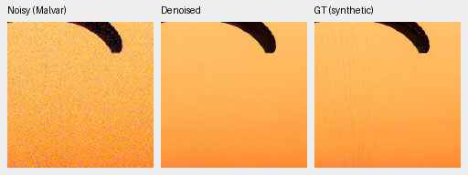

### Exact synthetic GT: 002fc6ee

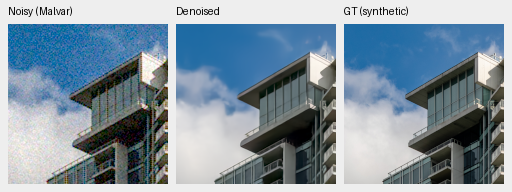

### Separate ISO100 reference: foliage

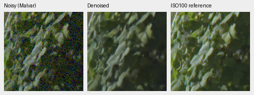

### Separate ISO100 reference: chain-link-fence

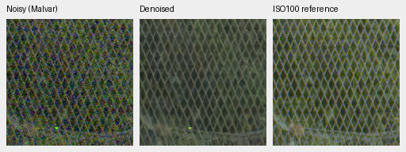

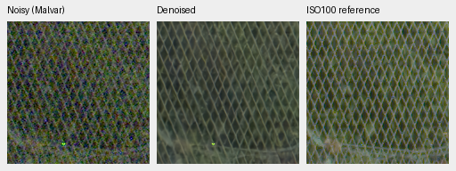

### Exact analytic GT: carrier-l0.01-c0.1-p8-draw0

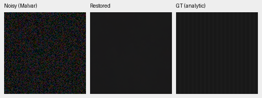

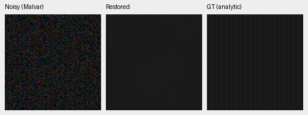

### Exact analytic GT: carrier-l0.18-c0.02-p16-draw0

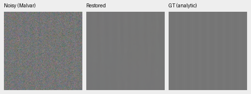

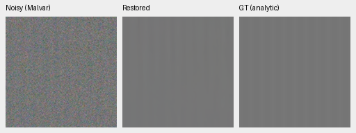

### Exact analytic GT: flat-l0.18-draw0

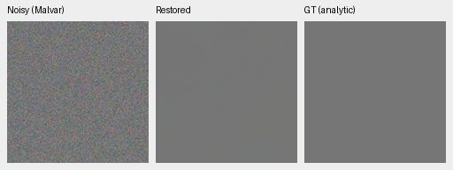

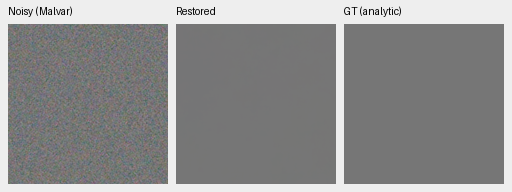

Thirty-six PNGs were visually inspected: both neural arms and channel-RawNIND
across 10 standard subjects, plus all 6 neural analytic crops. Fabric strands
remain lost, leaves waxy, and building detail soft. Neural fence geometry is
more coherent than RawNIND's colored grid, but V55 adds no clear advantage.
Both analytic carrier examples remain attenuated; flats show no obvious new
structure at this fixed 8-bit display. That does not exclude low-amplitude errors.
All 46 PNGs verify hashes/geometry/metadata/shared panels; global-RawNIND variants
were verified without separate visual judgments.

Eight complete 8746×11662×3 RGB16 TIFFs have verified SHA/bytes/dtype/16-bit tags,
>256 sampled codes and sRGB ICC where applicable. Single shared-machine timing
observations: 0:dino-paired-expanded-b16-v54:step-1000: 34.13s; 1:dino-paired-weak-texture-b16-v55:step-1000: 33.26s; RawNIND:CFA-LS: 17.63s; RawNIND:CFA-channel: 17.67s. These are not repeated speed measurements.
The 100 MP/10 s target and requested broad real-photo superiority/SOTA remain unproven.

Sources: [Roy Egloff](https://commons.wikimedia.org/wiki/File:CH.VD.Villeneuve_2007-08-25_Vertigo-Swiss-Riviera_2392_3x2-R_4K.jpg)
and [Dietmar Rabich](https://commons.wikimedia.org/wiki/File:Vancouver_(BC,_Canada),_Coal_Harbour_Seaside_Park,_Blick_in_den_Himmel_--_2022_--_2158.jpg),
[CC BY-SA 4.0](https://creativecommons.org/licenses/by-sa/4.0/); modified by binning,
crop, synthetic noise, restoration and rendering. Paired sources: Benoit Brummer/
Christophe De Vleeschouwer, [RawNIND](https://doi.org/10.14428/DVN/DEQCIM), per-scene
grants in receipts. GFX by the project owner. Analytic targets generated locally.
