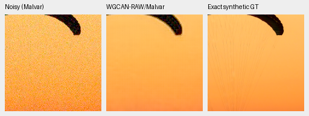
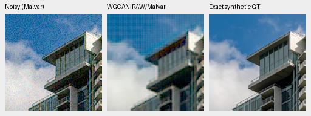
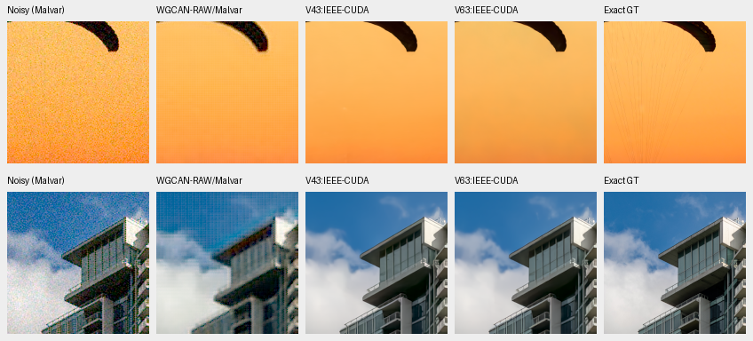
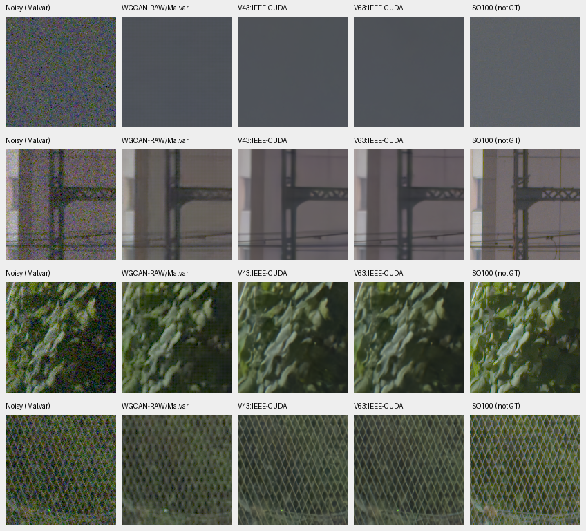

# WGCAN RAW-stage/Malvar transfer pilot

**This fixed RAW-stage/Malvar cascade is not an upgrade.** Both photographic
PSNR/SSIM scores trail retained V43/V63. Native views show periodic grid artifacts
and poor fence reconstruction. This is our composition of a released RAW stage
with an independent demosaicer, **not an evaluation of the full published WGCAN
RGB pipeline**, a paper reproduction or a general architecture ranking.

[Checkpoint, protocol, arrays, corrected native metadata, viewing and audit
receipts](results/WGCAN-RAW-CPU-pilot-v1.json).

The [July 2026 WGCAN paper](https://doi.org/10.1016/j.imavis.2026.106137) and
[authors' implementation](https://github.com/user-hbj/WGCAN/tree/87413dd280af8228f34fe33188136077ad81ca68)
provide wavelet-guided RAW restoration followed by a learned RGB ISP. The
[released preprocessing](https://github.com/user-hbj/WGCAN/blob/87413dd280af8228f34fe33188136077ad81ca68/preprocess_dataset.py)
packs RGGB samples, clips normalized inputs and constructs ISP-rendered RGB
targets. Those targets differ from our linear camera-RGB targets. We therefore
inspect the original RAW readout with the existing Malvar demosaicer; its
learned RGB head is skipped. This transfer choice can itself affect quality.
No root license/COPYING file was found in the inspected tree, and separate
weight terms remain unverified. Publisher source/weights stay in an isolated
research cache; production code, dependencies and training remain unchanged.

## Fixed execution and verification

Original full-model state loads strictly: 294 tensors, 11,681,731 parameters.
Weight SHA256:
`61ca1440ade7e9230af46f4d90644e05255637048aac24152b0ab19fff24ed98`.
Engineering checks pass all four Bayer layouts, exact repeats, unchanged
state/input/RNG and an independent nonconstant dyadic Haar-map/inverse check.
Stopping at the RAW readout matches full-model RAW bit for bit on all four
engineering cases. The initial helper used the wrong `color_indices` call;
that failure is preserved separately and occurred before model inference.
The released test script supplies an extra filename argument, while the actual
model accepts `forward(x)`; we call that unmodified interface.

The six-case plan was frozen before predictions, binding 78 source files and
28 inputs. Execution uses CPU/B1/FP32/two threads; CUDA stays uninitialized.
The blind network receives the original observation clipped to [0,1], with
whole-mosaic reflections to canonical RGGB and inverse reflections after RAW
restoration. Counts of input values affected by clipping are recorded per case.
No white balance, noise parameters, exposure fitting or reference fitting enters
the network. Shot/read values are descriptive. RAW outputs remain unquantized
and unclipped before independent Malvar demosaicing. The noisy panel uses Malvar
on the original, unclipped noisy observation.

Retained controls use their previously saved IEEE-FP32 CUDA predictions from
the exact same observations. They receive their original conditioning without
the candidate's input clamp or reflections. No new control inference or noise
draw occurs. A rendering-loop labeling error attached candidate-specific
metadata to 12 retained-control receipts. A separate derived report corrects
those labels, preserving the original report, arrays, metrics and PNG bytes.

All six outputs repeat exactly with model/input/RNG unchanged. Independent
saved-array checks rebuild all six Malvar outputs from saved RAW, verify input
clipping and CFA transformations, reproduce all 54 triplet panels and 30 board
cells, and check common observations/coordinates/display settings. Twelve
NumPy-FP64/`math.fsum` PSNR replays agree within .000003005 dB. Rendering/Malvar
functions are shared; SSIM is not independently reimplemented. Both boards were
actually viewed at their original resolution before opening numerical results.

## Two fixed photographic crops

Each triplet is noisy / denoised / exact synthetic GT. Every panel retains
160×160 native pixels without resizing, taken at `[48,48,160,160]` from its
native256 RGGB input. Identical display exposure ×1, WB `[2,1,1.5]` and camera
matrix apply across methods. The saved ISO12800-prior observation uses shot
.00256 and read variance .0000262144. Metrics use unquantized predictions with
the existing clipped-linear/rendered-sRGB conventions; PNGs are RGB8 previews.

| Crop | Model | Linear PSNR | sRGB PSNR | sRGB SSIM |
| --- | --- | ---: | ---: | ---: |
| Canopy | WGCAN RAW/Malvar CPU | 36.32710 | 31.31272 | .892561 |
| Canopy | V43 IEEE CUDA | 43.84566 | 40.95311 | .966852 |
| Canopy | V63 IEEE CUDA | 33.45131 | 33.09373 | .965434 |
| Building/cloud | WGCAN RAW/Malvar CPU | 30.38667 | 24.50526 | .734821 |
| Building/cloud | V43 IEEE CUDA | 40.14702 | 34.82487 | .959359 |
| Building/cloud | V63 IEEE CUDA | 40.61390 | 35.38537 | .961910 |

Source-cache ROI `[237,51,160,160]`.
[Roy Egloff, Vertigo Swiss Riviera](https://commons.wikimedia.org/wiki/File:CH.VD.Villeneuve_2007-08-25_Vertigo-Swiss-Riviera_2392_3x2-R_4K.jpg),
[CC BY-SA 4.0](https://creativecommons.org/licenses/by-sa/4.0/). Modified by
8× binning, crop, synthetic sensor noise and restoration.

Source-cache ROI `[243,137,160,160]`.
[Dietmar Rabich, Vancouver Coal Harbour](https://commons.wikimedia.org/wiki/File:Vancouver_(BC,_Canada),_Coal_Harbour_Seaside_Park,_Blick_in_den_Himmel_--_2022_--_2158.jpg),
[CC BY-SA 4.0](https://creativecommons.org/licenses/by-sa/4.0/), modified as above.

The candidate leaves a fine grid on the canopy and a stronger checker pattern
on sky/building detail. All methods miss fine canopy suspension lines. This
selected pair cannot isolate pretraining, architectural or transfer causes.

## Standing GFX3879/3880 comparison

All cells are native160 crops from native512 contexts. Display exposure is
×4 (+2 EV). Common source noise estimates are shot .0014635775921166604/read
variance .0000010715704128646712; these are not passed to WGCAN. Full sensor ROIs,
reference offsets, WB/matrix and checkpoint hashes accompany every crop in the
registry. Individual triplets: [sky](images/WGCAN-RAW-CPU-overcast-sky.png),
[building](images/WGCAN-RAW-CPU-building-detail.png),
[foliage](images/WGCAN-RAW-CPU-foliage.png),
[chain-link fence](images/WGCAN-RAW-CPU-chain-link-fence.png).

The candidate smooths sky noise, softens building detail and leaves grainy,
blocky foliage. Fence wires become a mottled repeating pattern, while retained
controls preserve the diagonal mesh more clearly. DSCF3880 is a separate ISO100
f/5.6 exposure, independently AHD-demosaiced, with different aperture and moving
subjects: a qualitative reference, not exact GT or a pixelwise scoring target.
Only cached observations were read; the scene and siblings remain outside
training.

There is no full-suite, full-frame, speed, trained-upgrade or SOTA claim. No
adaptation or alternate transfer policy follows this result. README stays on
the retained V43 model; the context trial continues independently.
