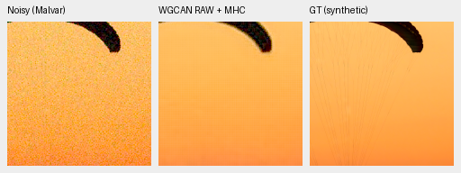
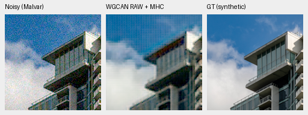
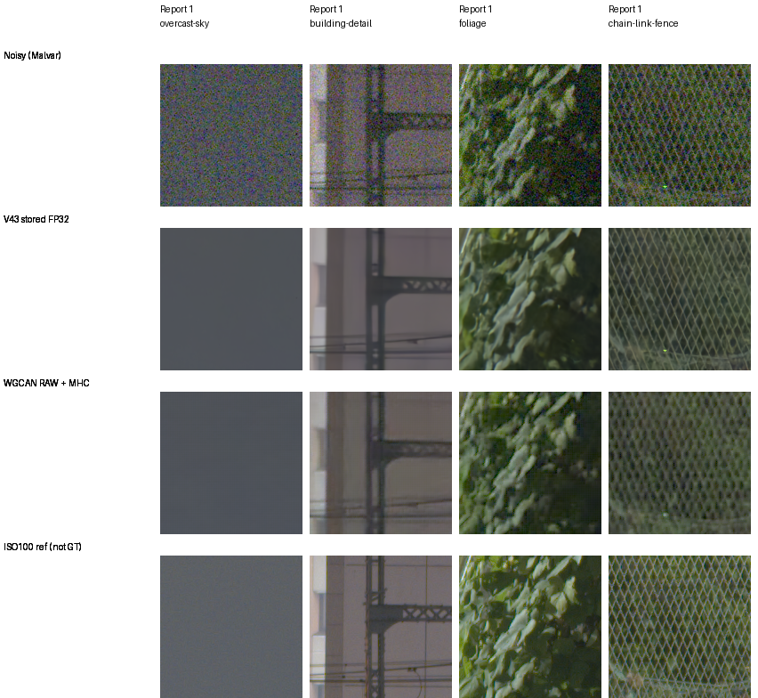

# WGCAN RAW-output transfer: fixed CPU pilot

The released WGCAN RAW branch followed by Malvar does not improve the working
V43 reference on this fixed transfer. Native views show missing canopy cords
and stronger periodic texture on the building/fence. Both selected photographic
PSNR/SSIM pairs are lower. This small off-the-shelf cascade result does not rank
the underlying architecture or reproduce the publisher's joint RGB evaluation.
No full-suite extension, production integration or default change follows.

[Complete source/checkpoint identities, protocol, actual views, arrays and scores](results/wgcan-raw-mhc-CPU-pilot-v1.json).

## Release and protocol check

The [July2026 publisher paper](https://doi.org/10.1016/j.imavis.2026.106137)
describes a wavelet RAW stage and color-guided RGB reconstruction. The
[official release](https://github.com/user-hbj/WGCAN/tree/87413dd280af8228f34fe33188136077ad81ca68)
provides an LRD-trained checkpoint. All29 text files and its46,852,051-byte
checkpoint match the pinned Git blob hashes. All294 state tensors load strictly
into the original11,681,731-parameter model and are finite.

Checkpoint SHA256:
`61ca1440ade7e9230af46f4d90644e05255637048aac24152b0ab19fff24ed98`.

The pinned tree has no repository license file or source license header found
by inspection; the GitHub license field is null. Source/weights remain in the
isolated reference cache, outside production and training. No publisher code,
weights or data are incorporated into our model.

The release's package initializer imports unrelated variants with broken absolute
imports. The CPU wrapper supplies only a package namespace and executes the
original CBAM/common/WCGAN_Two modules without source edits. Its released test
also passes a filename to a one-argument `forward`; the wrapper calls the actual
one-argument model directly. Generated native64×96 compatibility fields give
finite RAW/RGB and exact repeats, with model/input/parameter IDs/RNG unchanged.
This checks the model/weight pairing, not the publisher's full test program.

The release's RGB target comes from LibRaw postprocessing, rather than our
canonical linear camera RGB. The pilot therefore retains its RAW output and
applies our unchanged Malvar interpolation. It executes and saves the original
full RAW/RGB forward, but excludes the learned ISP RGB output from comparisons.
This is a RAW-denoising-plus-classical-demosaicing cascade, not its published
joint RGB predictor.

Inputs are the existing normalized RGGB observations, clipped to0..1 as in
publisher preprocessing. Exposure ratio is fixed at1; output RAW is clipped
to0..1 as in its test before MHC. There is no WB inside that MHC call; common
WB/matrix apply during rendering. WGCAN receives no shot/read coefficients.
No scene gain/noise/color parameter is fit to a target. LRD pretraining,
calibration and output task differ from V43; their effects are not separated.

## Fixed photographic views and descriptive scores

All12 triplets/24 native160 cells were actually viewed before scores. The
photographic views use two original saved CPU-noise observations at native256,
RGGB/ISO12800 prior shot`.00256`, read variance`.0000262144`, WB`[2,1,1.5]`,
the common protocol matrix and display exposure1(0EV). Each PNG below is
noisy MHC → WGCAN RAW+MHC → exact saved synthetic GT, without resizing.

Source-cache ROI`[237,51,160,160]`, native256 ROI`[48,48,160,160]`.

Source-cache ROI`[243,137,160,160]`, native256 ROI`[48,48,160,160]`.

The [complete photographic board](images/wgcan-raw-mhc-CPU-synthetic-native.png)
contains both methods with the same noisy/GT pixels. V43 predictions are the
stored genuine IEEE-FP32 GPU arrays from the earlier precision study; WGCAN
predictions are new CPU FP32/two-thread outputs. No new V43 forward occurs.

Standard border8/native240 field, computed from unquantized arrays:

| Source | V43 PSNR | WGCAN RAW+MHC PSNR | V43 SSIM | WGCAN RAW+MHC SSIM |
| --- | ---: | ---: | ---: | ---: |
| Canopy |40.6908|29.1423|.969061|.886486|
| Building |35.2076|24.3635|.968224|.737269|

The fixed displayed native160 ROI also favors V43: PSNR40.9531→31.3753dB and
SSIM.966852→.892684 for canopy;34.8249→24.5414dB and.959359→.736121 for building.
These are two sources and one noise condition, without a bootstrap, matched
training budget or architecture attribution. Independent NumPy FP64/scalar-fsum
PSNR replay agrees with all eight reported PSNR values within.00000154dB.
No GFX score against ISO100 is computed.

Sources: [Roy Egloff, Swiss Riviera canopy](https://commons.wikimedia.org/wiki/File:CH.VD.Villeneuve_2007-08-25_Vertigo-Swiss-Riviera_2392_3x2-R_4K.jpg)
and [Dietmar Rabich, Vancouver building](https://commons.wikimedia.org/wiki/File:Vancouver_(BC,_Canada),_Coal_Harbour_Seaside_Park,_Blick_in_den_Himmel_--_2022_--_2158.jpg),
[CC BY-SA4.0](https://creativecommons.org/licenses/by-sa/4.0/). Modified by8×
linear binning, crop, sensor-noise simulation, restoration and rendering;
derivative previews retain that license. Photo targets replay from the actual
source caches; they are exact for the synthetic recipe, not measured RAW GT.

## Standing GFX views

All four prescribed512px contexts are restored individually; displayed crops
stay native160 at the original sky/building/foliage/fence coordinates. Both
methods share WB/matrix and exposure4(+2EV). Observed shot/read prior
`.0014635775921166604 / .0000010715704128646712` conditions V43; WGCAN is blind.
Source/ROI and the fence reference's one-pixel offset remain in the registry.

The ISO100 DSCF3880 f/5.6 reference is independently demosaiced, with different
time/aperture/motion; it is not exact GT. Cached DSCF3879/3880 remain read-only
evaluation inputs and excluded from training with their siblings. No source
hard drive was accessed. Both methods clean the flat sky; WGCAN foliage looks
crisper with more patterned residual, and its fence/building acquire conspicuous
repetitive texture. This does not isolate which stage/calibration causes it.

All predicted RAW/ISP/RGB arrays and exact repeats are saved. The independent
NumPy FP64 MHC stencil replay checks all3,538,944 camera-RGB values: maximum
difference1.50e-7, with every measured CFA phase exactly preserved. Model state,
parameters and RNG stay unchanged. CUDA remains hidden/uninitialized. No
training, GPU/full-frame timing, RGB16 export, SOTA or broad real-photo quality
claim follows. The existing V90/V91 DINO quality comparison continues unchanged.
