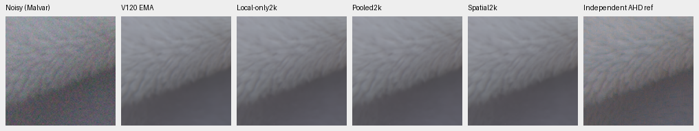
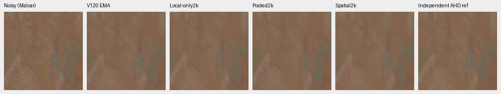
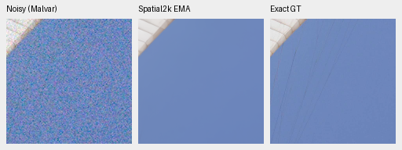
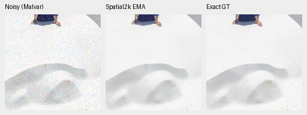

# Whole-scene context: completed known and unseen camera panels

**Both camera panels are numerically complete and their nine fixed native
boards have been viewed.** Spatial context partly repairs the unseen-camera
regression of the matched local-only continuation, while remaining below V120.
Pooled context provides almost the same repair. Fine-detail recovery remains
unestablished. V120 stays the general recommendation; full427 photo collection
continues on CPU.

[Exact cases, scores, sources and native provenance](results/scene-primary-camera-review-v1/publication.json) ·
[Independent audit](results/scene-primary-camera-review-v1/independent-review-v2.json) ·
[Canonical primary admission](whole-scene-context-primary-admission.md) ·
[Completed64-source/intervention study](whole-scene-context-development64.md).

## Endpoints, protocol and complete coverage

These are the same local-only/pooled/spatial2k **EMA** endpoints as the
[first native review](whole-scene-context-native-review.md#completed-endpoints-and-scope).
All initialize from V120 EMA, train on byte-identical observations and complete
2,000 updates/16,000 native256 crops from4,000 scene visits/3,701 source IDs.
Training takes881.607/916.669/899.483 seconds respectively. These scene probes
use simulated-camera Commons scenes; they do not include the native/paired-RAW
mixture retained by the separate [larger-corpus experiment](full-corpus-scaling.md).

| Model | Checkpoint SHA256; evaluated EMA |
| --- | --- |
| V120 | `a9d9b6b4f974e24a6b11e5e740aab32314233a7f53c056cf37c7d2aac1c589fb` |
| Local-only2k | `ceb5ddaf23fce47806a01045bd86d34bb48d1f64031e382b0d5cfbabf0716880` |
| Pooled2k | `d1ab7f10dd0bbea62d59a78d3ff941f8895479a6b0d2029a2e473286ae20dedc` |
| Spatial2k | `97fd551bd0ae0b7aa97c67e1f6e8b513b722f70d5ad8b8814a96586b934eafac` |

Known coverage is4 scenes/8 captures/72 crops/24 batches; unseen is5 scenes/
10 captures/90 crops/30 batches. Every fixed case and all four models are
included:648 crop/model rows. The original five arguments, calibration, noisy
sensor crops and measured-reference masks are unchanged. Inference uses the
same CPU IEEE FP32 contiguous B4/B1 policy for V120 and every candidate.
Checked identical frozen DINO requests are shared; learned trunks/projections
still execute separately. Pooled/spatial context uses only each complete noisy
capture. Independent references never enter the encoder.

The primary score measures valid clean CFA samples, with border32 removed.
Means balance nine crops within capture, two captures within scene, then
scenes. All648 saved per-crop sensor scores/sample counts were independently
recomputed bit-exactly. The original aggregation function is retained. A sorted
versus manifest-order FP64 mean initially failed an unnecessarily exact equality
check; original source/log are preserved. The corrected observer records the
rounding difference and requires it below1e-12 dB; original per-crop scores and
the collector's formulas are unchanged. No learned forward is repeated.

## Measured-CFA PSNR and source variation

| EMA model | Known4-scene mean | Unseen5-scene mean | Unseen − V120 |
| --- | ---: | ---: | ---: |
| V120, matched CPU control | 54.31272 | 54.00872 | — |
| Local-only2k | 54.31771 | 53.93657 | −0.07215 |
| Pooled2k | 54.31308 | 53.95345 | −0.05527 |
| Spatial2k | 54.31755 | 53.95395 | −0.05477 |

Spatial minus local-only is−0.00016 dB known and **+0.01739 dB unseen**.
Pooled gives+0.01688 dB unseen over local-only; spatial adds only+0.00051 dB
beyond pooled. This documents a useful partial repair, with a persistent cost
versus the recommended parent. It does not establish an aligned spatial
detail-recovery advantage.

| Unseen scene | Local-only − V120 | Spatial − V120 | Spatial − local-only |
| --- | ---: | ---: | ---: |
| LucieB_3apples | +0.00294 | −0.00699 | −0.00993 |
| LucieB_Coulicoco | −0.26015 | −0.21472 | +0.04544 |
| LucieB_bedroom_tapestry | −0.05763 | −0.03267 | +0.02496 |
| LucieB_stick_figurine | +0.04614 | +0.03282 | −0.01332 |
| LucieB_top_of_Expedit | −0.09207 | −0.05229 | +0.03978 |

Spatial improves over local-only on3/5 unseen scenes, but remains below V120
on4/5. The small positive known mean is driven by D60-2: spatial gains0.20641 dB
there and loses on the other three scenes. Four/five scenes cannot establish a
general camera advantage. The different adaptation domains are a plausible
reason for camera drift, not an isolated causal finding. Keeping RAW domains in
the larger-corpus continuation directly tests a more relevant training mixture.

## Native160 evidence, actually viewed

Selection is fixed independently of scores: first capture/first native512 crop
of every scene, center160 ROI `[176,176,160,160]`. For these first crops the
absolute native sensor ROI is `[336,336,160,160]`. All methods share coordinates,
WB, matrix, conditioning and display exposure1, with **no resizing**. The
[known manifest](images/scene-primary-camera-review-v1/known/result.json) and
[unseen manifest](images/scene-primary-camera-review-v1/unseen/result.json)
bind source RAW, exact arrays, checkpoint hashes, per-capture shot/read/WB/matrix
and sidecars. Independent aligned AHD references remain noisy/approximate:
they are **not exact RGB GT**. No RGB-reference PSNR is presented as ground truth.

The viewed woven/tapestry-like structures remain softened, and quiet dark/brown
regions stay smooth. No convincing new small crossing or fine-texture recovery
appears; broad color changes are more apparent than added structure. No obvious
new coherent grid or large fringe appears in these fixed centers. This is a
limited inspection, not a general hallucination bound or coverage of every
scored448 region. [Known observations](images/scene-primary-camera-review-v1/known/native-viewing.json) ·
[Unseen observations](images/scene-primary-camera-review-v1/unseen/native-viewing.json).

[Known plates](images/scene-primary-camera-review-v1/known/known-2pilesofplates.png) ·
[Known stone](images/scene-primary-camera-review-v1/known/known-MuseeL-CopteArch-C500D.png) ·
[Known D60](images/scene-primary-camera-review-v1/known/known-D60-2.png) ·
[Unseen lettering](images/scene-primary-camera-review-v1/unseen/unseen-LucieB_3apples.png) ·
[Unseen brown field](images/scene-primary-camera-review-v1/unseen/unseen-LucieB_Coulicoco.png) ·
[Unseen diagonal texture](images/scene-primary-camera-review-v1/unseen/unseen-LucieB_stick_figurine.png) ·
[Unseen dark texture](images/scene-primary-camera-review-v1/unseen/unseen-LucieB_top_of_Expedit.png).

For exact clean GT, these two already-viewed native triplets use the same spatial
EMA above and unchanged pixels from the64-source study. First: source
`d4538e5aa578ec6de5ef2f5d253add05435a7211`, bin4 ROI`[754,268,160,160]`,
shadows shot0.00064/read0.0000016384, source exposure0.125/display8.
Second: source`b44b891912c12a8abcde189cded5daf7d81a1986`, ROI`[444,500,160,160]`,
ISO12800 shot0.00256/read0.0000262144, source/display exposure1. Both use
WB`[2,1,1.5]` and the [recorded evaluation matrix/provenance](images/whole-scene-context-development64-v1/result.json).
They are development examples, not new camera GT or new model inference.

Both protected GFX families already have [actual native review for these exact
endpoints](whole-scene-context-native-review.md#native160-comparisons-actually-viewed),
including foliage, sky, building/coarse fence and both fine-cab ROIs/profiles/JPEGs.
Their missing fine crossings remain unresolved. These original PNGs are reused;
the separate low-ISO references are not pixelwise scoring targets. This camera
panel does not update the Q2/Sony/GFX50R gallery.

## Remaining work

Full427 photo collection is still running. Its complete binned scene context
preserves the original256 crop:420/427 fields have a short side below512, and
the median local crop covers43.3% of field area. This is full photographic FOV
at the benchmark's cache resolution; it is a limited test of distant context
compared with large native RAW fields. The dedicated64-source study and real
GFX reviews provide different context/detail checks.

V120/V131 remain the last completed three-panel primary evaluations. The new
camera results are source-bound here; the PSNR history waits for the missing
full427 component rather than substituting a development/partial-photo score.
The [larger-corpus model](full-corpus-scaling.md) is still training and has no
endpoint quality result yet. Its repaired step7,000 checkpoint is a validated
training/IO milestone, not a model quality promotion.
