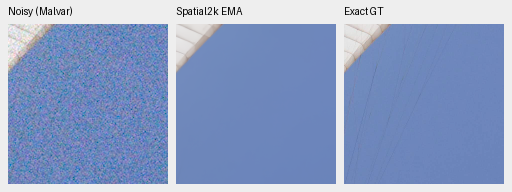
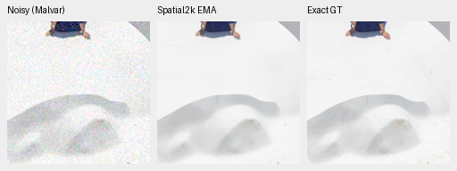

# Whole-scene context: completed 64-source comparison

**Training, numerical analysis and native viewing are complete for this study.**
The spatial branch changes the final image and reduces some quiet-region
coarse error, particularly at ISO12800. It does not yet establish better fine
detail than the matched local-only continuation. Most of the approximately
0.04 dB gain over V120 also occurs without scene conditioning. V120 remains
the general recommendation; [full primary evaluation is running](whole-scene-context-primary-admission.md).

A [follow-up fixed-RAW preview intervention](scene-context-extent.md) separates
near and distant scene contributions. It finds small, measurable distant
effects on real crops and mixed weak-band error on two development sources.

[Exact receipts, executed sources, failures and crop metadata](results/whole-scene-context-development64-v1/publication.json) ·
[Independent saved-output audit](results/whole-scene-context-development64-v1/independent-review.json) ·
[First native review and both protected GFX families](whole-scene-context-native-review.md).

## Matched endpoints and coverage

These are the same three completed 2,000-update EMA endpoints reviewed in the
[first report](whole-scene-context-native-review.md#completed-endpoints-and-scope):
local-only, pooled and spatial. Each uses 4,000 scene visits, 3,701 distinct
training sources and 16,000 native256 crops, with byte-identical observation
logs. Training takes 881.607/916.669/899.483 seconds respectively. Parent is
V120 EMA `a9d9b6b4f974e24a6b11e5e740aab32314233a7f53c056cf37c7d2aac1c589fb`.

| Endpoint | Checkpoint SHA256; evaluated EMA |
| --- | --- |
| Local-only2k | `ceb5ddaf23fce47806a01045bd86d34bb48d1f64031e382b0d5cfbabf0716880` |
| Pooled2k | `d1ab7f10dd0bbea62d59a78d3ff941f8895479a6b0d2029a2e473286ae20dedc` |
| Spatial2k | `97fd551bd0ae0b7aa97c67e1f6e8b513b722f70d5ad8b8814a96586b934eafac` |

All 64 development sources, two positive-noise conditions and four native256
crops per field are included: 128 cases, 512 crops per variant. Six variants
include V120 and spatial with masked or spatially shuffled context. Shuffling
preserves the learned pooled descriptor, including partial/padded cells; an
actual trained-adapter check qualifies this intervention. The context encoder
receives the complete noisy observation, never clean targets. Local input,
target, CFA and calibration remain fixed between variants.

Collection uses CPU IEEE FP32, B4, and takes 5,799.507 seconds excluding model
loading. It makes 752 new restoration and 880 actual DINO calls; 16 correct
existing predictions are reused. The official frozen DINO remains unchanged.
These sources are reserved from these continuations, but belong to the larger
scaling pool: **no parent-lifetime or scaling-independent holdout claim**.
RGGB and two conditions do not replace the full427/all-CFA/camera panels.

## Source-balanced results

Each source contributes its four-crop mean. Intervals below resample paired
sources 2,000 times with seed7417. They are exploratory intervals, without
multiple-comparison correction. Defined diagnostic masks can leave fewer than
64 sources eligible; these diagnostics average defined crops within each source,
and the actual eligible source counts are reported.

| EMA variant | Shadows sRGB PSNR | ISO12800-prior sRGB PSNR |
| --- | ---: | ---: |
| V120 | 42.67652 | 36.22784 |
| Local-only2k | 42.71883 | 36.26835 |
| Pooled2k | 42.71644 | 36.27112 |
| Spatial2k | 42.71562 | 36.27044 |
| Spatial, masked context | 42.71530 | 36.26821 |
| Spatial, shuffled context | 42.71558 | 36.26932 |

Spatial minus local-only is −0.00321 dB in shadows, 95% interval
[−0.00707, −0.00024], and +0.00209 dB at ISO12800, [−0.00189, +0.00777].
Only 22/64 and 29/64 source PSNR means improve respectively. Spatial also has
slightly higher overall gradient and chroma MAE in both conditions. Extra
training helps this panel; the added spatial branch has a mixed operating point.

The diagnostic domain is unclipped, exposure-compensated **linear sRGB** after
WB/matrix. DN16 means 65,535 per scene-linear unit, not raw sensor DN. Quiet
pixels have GT local7×7 RGB standard deviation below32 DN16; weak pixels are
32–256 DN16. Coarse error is the31×31 mean of final RGB error. Detail is RGB
minus its7×7 mean. Float64 filtering/sums avoid cancellation; a metric needs
at least1,024 scalar samples, and projection needs GT detail RMS at least1 DN16.
These target-only masks are diagnostics, never inference inputs or confidence.

| Spatial − local-only; lower error is better | Shadows | ISO12800 |
| --- | ---: | ---: |
| Quiet coarse luma RMS,16 sources | −0.203 DN16 | −1.993 DN16 |
| Quiet coarse chroma RMS,27 sources | −0.517 DN16 | −1.238 DN16 |
| Quiet fine-detail error RMS,27 sources | −0.071 DN16 | −0.128 DN16 |
| Weak-region detail error RMS,59 sources | −0.026 DN16 | +0.074 DN16 |
| Weak GT-projected detail gain,59 sources | −0.000124 | −0.000056 |

The ISO12800 coarse luma/chroma intervals are [−5.351, −0.084] and
[−2.705, −0.090] DN16. Luma is source-dependent: eight improve and eight worsen;
the median is −0.043 DN16. Removing its best source reduces the mean gain to
−0.376 DN16. Chroma improves on17/27 sources, median −0.065 DN16; removing its
best source gives −0.701 DN16. These useful reductions coexist with slightly
higher overall chroma error. Other error/gain rows' intervals span zero. Weak
detail is not demonstrably recovered more faithfully.

The separate quiet fine-error metric penalizes false fine texture that a coarse
average could hide; it compares prediction and GT detail, rather than treating
quiet GT as perfectly flat. Analytic checks distinguish correct, erased,
inverted and orthogonal detail, and penalize a false grid over constant GT.
The first fixture incorrectly assumed exact orthogonality at reflected image
boundaries and failed before analysis. Its source/log remain preserved; v2
checks complete interior sinusoid periods at the original tolerance.

Correct versus masked context gives +0.00223 dB ISO12800, interval
[+0.00017, +0.00531]; correct versus spatially shuffled gives +0.00112 dB,
[−0.00058, +0.00367]. Shadows intervals span zero for both interventions.
There is real final-RGB dependence on scene features, but little evidence here
that their correct spatial arrangement adds useful detail beyond pooled context.
Projection gain alone cannot establish fidelity: unaligned texture still incurs
the detail-error penalty.

## Native160 comparisons, actually viewed

All eight final boards were opened. Two are fixed controls; six are disclosed
best/worst quiet/detail or largest-intervention examples from256 ISO12800
crops. They are not a representative mean-quality sample. Every panel uses the
center160 ROI `[48,48,160,160]`, without resizing; selection metrics score the
trimmed240 crop, so the displayed center need not contain its largest error.

The first spatial-EMA triplet has source
`d4538e5aa578ec6de5ef2f5d253add05435a7211`, absolute bin4-cache ROI
`[754,268,160,160]`, shadows shot0.00064/read0.0000016384,
source exposure0.125/display8. WB is `[2,1,1.5]`; full matrix/source/conditioning
and all checkpoint hashes are in the [native manifest](images/whole-scene-context-development64-v1/result.json).
The reference is exact synthetic clean GT.

The second uses source `b44b891912c12a8abcde189cded5daf7d81a1986`, absolute
ROI `[444,500,160,160]`, ISO12800 shot0.00256/read0.0000262144,
source/display exposure1 and the same WB/matrix/spatial EMA. It is the selected
worst weak-detail crop; all methods retain a smooth shadow but lose granular
snow texture.

Real rigging remains absent in the learned sky outputs, while the fixed quiet
blue sky remains smooth. Branch/bark and brick fine structure remain simplified;
cloud detail is also smoothed even in the selected improving crop. Correct,
masked and shuffled outputs are close at native scale. No obvious new sky grid
or large fringe appears in these few controls; this is not a general bound on
hallucination. [Actual per-board observations](images/whole-scene-context-development64-v1/native-viewing.json).

[Rigging, all variants](images/whole-scene-context-development64-v1/development-0-shadows-crop1.png) ·
[Quiet sky](images/whole-scene-context-development64-v1/development-1-iso12800-prior-crop0.png) ·
[Best quiet luma](images/whole-scene-context-development64-v1/development-32-iso12800-prior-crop1.png) ·
[Worst quiet luma](images/whole-scene-context-development64-v1/development-41-iso12800-prior-crop1.png) ·
[Best weak error](images/whole-scene-context-development64-v1/development-56-iso12800-prior-crop3.png) ·
[Worst weak error](images/whole-scene-context-development64-v1/development-21-iso12800-prior-crop2.png) ·
[Largest masking response](images/whole-scene-context-development64-v1/development-32-iso12800-prior-crop0.png) ·
[Largest shuffling response](images/whole-scene-context-development64-v1/development-59-iso12800-prior-crop2.png).

Both protected GFX families already have [actual native review for these exact
endpoints](whole-scene-context-native-review.md#native160-comparisons-actually-viewed):
sky/building/foliage/coarse fence and both cab ROIs/profiles/JPEGs. Missing mesh
crossings remain unresolved; the independent low-ISO references are not exact
GT. Those original predictions and PNGs are reused, never relabeled as new.

## Next decision

The [known/unseen camera panels](whole-scene-context-camera-review.md) have now
completed numerical/native review: spatial partly repairs local-only's unseen
regression but remains below V120. Finish the full427 photo collection before
judging complete broad performance. V120/V131 remain the latest completed broad
measurements; this scoped study adds no PSNR-history point. Keep the small
quiet-region benefit visible alongside the shadow/color and weak-detail costs.
The [larger-corpus experiment](full-corpus-scaling.md) separately tests source
coverage and training duration. A longer context experiment would need its own
matched local/pooled controls and evidence that correctly placed context helps
measured fine structure, including thin wires in otherwise quiet sky.
