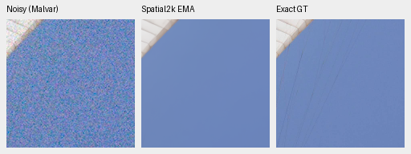
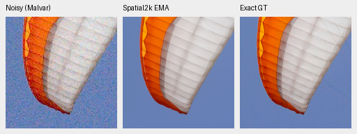
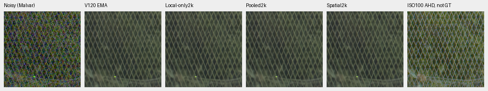
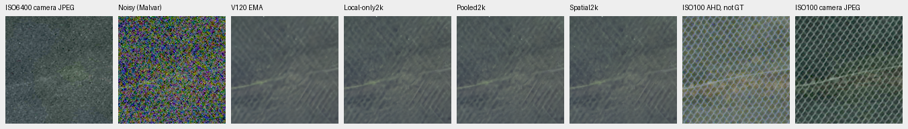

# Whole-scene context: first matched native review

**November17 follow-up:** the [64-source/intervention study](whole-scene-context-development64.md)
has completed numerical analysis and actual native viewing. It finds small
quiet-coarse gains, mixed detail/color costs and no established benefit from
correct spatial placement. [Full primary evaluation is now running on CPU](whole-scene-context-primary-admission.md).
The original cutoff and pending statements below describe this first review;
its receipts, scores and native pixels are unchanged.

**All three2k continuations have finished.** Spatial context makes a small,
mixed change on the first two development sources, with no convincing recovery
of missing fine fence crossings or sky rigging in the viewed crops. V120 stays
the general recommendation. A fixed64-source development/intervention study is
now collecting on CPU; the larger-corpus20k control is training on GPU.

[Exact sources, endpoints, predictions, native pixels and receipts](results/whole-scene-context-native-review-v1/publication.json) ·
[Independent audit](results/whole-scene-context-native-review-v1/independent-review.json) ·
[Architecture/data contract](whole-scene-context-next-test.md) ·
[Larger-corpus training](full-corpus-scaling.md).

## Completed endpoints and scope

All arms initialize from V120 Small EMA
`a9d9b6b4f974e24a6b11e5e740aab32314233a7f53c056cf37c7d2aac1c589fb`.
The frozen DINO identity is
`691963f0f796aac860d818d59d9d14287a4675612829fbe9467c7f5df8ce5b14`.
Every arm completes2000 updates, two noisy scenes/four native256 crops per scene:
4000 scene visits,3701 distinct source IDs and16,000 crop examples. Their entire
source/crop/noise/target observation logs are **byte-identical**. Native bin4
targets, the canonical sensor-valid/auxiliary objective and the2k schedules match.
The original local DINO/trunk remains present in every arm. Pooled/spatial
adapters add whole-image conditioning at eighth resolution.

| Experiment | New training seconds | EMA/raw checkpoint SHA256 |
| --- | ---: | --- |
| scene-none-2000 |881.607|`ceb5ddaf23fce47806a01045bd86d34bb48d1f64031e382b0d5cfbabf0716880`|
| scene-pooled-2000 |916.669|`d1ab7f10dd0bbea62d59a78d3ff941f8895479a6b0d2029a2e473286ae20dedc`|
| scene-spatial-2000 |899.483|`97fd551bd0ae0b7aa97c67e1f6e8b513b722f70d5ad8b8814a96586b934eafac`|

Each checkpoint retains raw/EMA restoration weights, Adam, Python/CPU/CUDA RNG
and scene draw index. **This review evaluates EMA**, CPU IEEE FP32, contiguous,
B4 for development crops and B1 for native512/768 GFX contexts. Scene features
come from the complete noisy observation, once per development field or cached
real capture; references/targets never enter the encoder. Full noisy GFX RAW
measurements, WB and matrices match all six retained native contexts exactly.
Training durations above are separate from collection timings. The receipts
record CPU collection time; this is no end-to-end100MP speed measurement.

The two development sources were fixed before endpoint collection. They are
reserved from these2k continuations, with no parent-lifetime holdout claim, and
belong to the separate90,778-source scaling pool. Their four scene/noise cases
give16 scored crops, dominated by sky. These are **not full427/camera scores**.

| EMA model | Shadows sRGB PSNR | ISO12800-prior sRGB PSNR |
| --- | ---: | ---: |
| V120 |47.99155|41.20822|
| Local-only2k |48.09642|41.27949|
| Pooled2k |48.07297|41.27666|
| Spatial2k |48.09145|41.29035|

Spatial versus matched local-only changes these means by−0.00497/+0.01086dB.
All continuations improve these narrow means versus V120; most of that change
also occurs without the new context branch. It does not establish better fine
detail or justify a general recommendation. The64-source study keeps all
development sources, both conditions and four native crops, and adds masked and
spatially shuffled context. Its shuffle preserves the learned pooled descriptor,
including partially padded cells. Collection, analysis and actual viewing remain
separate; that larger study has no completed result yet.

## Native160 comparisons, actually viewed

All16 final matched boards were opened: eight development, four main GFX and
four cab ROI/profile combinations. Every board pixel is independently checked
against its rendered source crop. The48 per-arm triplets use those same native
pixels, with no resizing. The earlier16 control-only boards remain preserved.

The paraglider source contains real thin rigging **in the sky**. Most cords and
fine wing detail remain missing in all arms. The second source's viewed sky
crops stay smooth. These are useful opposing checks for the proposed semantics:
sky context must not erase measured thin structures. The primary spatial-arm
triplets below use the first source, native256 crop boxes recorded in their
sidecars, ROI`[48,48,160,160]`, WB`[2,1,1.5]` and the fixed evaluation matrix.
Shadows use shot0.00064/read0.0000016384, source exposure0.125/display8;
ISO12800 uses shot0.00256/read0.0000262144, exposure/display1. Checkpoint is the
spatial EMA hash above. Reference panels are exact synthetic clean GT.
[Original source, absolute ROI and full conditioning for every crop](results/whole-scene-context-native-review-v1/native-crop-provenance.json).

[All-model sky-rigging comparison](images/whole-scene-context-native-v1/development-0-iso12800-prior-crop1.png).

The main DSCF3879/3880 sky stays smooth; building/coarse fence are very similar,
and foliage remains soft/waxy. I see no convincing new fine crossing or obvious
new sky grid in these fixed native crops. This limited inspection is not a
general hallucination bound.

[Sky](images/whole-scene-context-native-v1/main-overcast-sky-main-overcast-sky.png) ·
[Building](images/whole-scene-context-native-v1/main-building-detail-main-building-detail.png) ·
[Foliage](images/whole-scene-context-native-v1/main-foliage-main-foliage.png).

For DSCF3842/3835, the nominal prior largely erases the fine mesh. The nearby3879
profile retains faint soft diagonals/grid with changing ripple strength; neither
scene variant demonstrates faithful new crossings. Both left/right ROIs, both
profiles and camera JPEG references were viewed. Display exposure is16 for all
methods in these comparisons; source coordinates/conditioning remain unchanged.
Independent ISO100/AHD/JPEG references differ in aperture, exposure and motion;
they are **not exact GT** and receive no reference PSNR.

[Nearby left](images/whole-scene-context-native-v1/mesh-profile3879-fine-green-mesh-left.png) ·
[Nominal left](images/whole-scene-context-native-v1/mesh-nominal-fine-green-mesh-left.png) ·
[Nominal right](images/whole-scene-context-native-v1/mesh-nominal-fine-green-mesh-right.png).

## Remaining evaluation and implemented inference

Training and the above native review are complete. Full427 and known/unseen
camera evaluations remain **pending**: the admitted GPU allocation is training
the20k scaling control before resuming99k, and whole-scene camera/canonical-input
evaluation still needs admission. V120/V131 remain the latest comparable broad
measurements. No narrow score was inserted into the PSNR registry or history.
The local-only checkpoint has an exact91-tensor inference export for the legacy
panel loader; its original complete optimizer checkpoint remains authoritative.

[scene_inference.py](../src/demosaic/scene_inference.py) loads explicit raw/EMA
scene endpoints and provides a noisy-scene session, native coordinate queries
and overlapping tiled reconstruction. CPU preview reduction precedes a bounded
preview transfer to the encoder device; the full100MP sensor field need not
live on CUDA. This optional API leaves the ordinary inference path unchanged.
It currently requires even full RAW dimensions and in-bounds, phase-preserving
native crops; small images below the chosen tile require a smaller tile.

Forty-seven focused tests pass. Actual CPU model checks reproduce the direct
scene/crop outputs exactly. An all427-source inventory finds every original RGB
crop unchanged;315 have an odd source origin on at least one axis. The new
[benchmark context composer](../src/demosaic/photo_scene.py) shifts the CFA frame
by at most one source pixel, preserves the original packed RAW/variance and
uses a separate noisy surrounding field. Tests cover all CFAs/origin parities,
target-only interventions and RNG independence. Actual CUDA/primary-panel
qualification is still pending; these are plumbing checks, not primary scores.

The first baseline collection's predictions completed, but JSON writing failed
on undefined empty-highlight metrics. Their metadata was recovered from saved
predictions/logs with unavailable values as null; no baseline forward was
repeated and the missing final duration/model-hash receipt is not invented.
Original failure/source bytes remain preserved. A corrected collector finishes
all three endpoint collections. The CPU qualifier's earlier invalid CPU-affinity
admission also stopped before model/data; its original log is retained.
