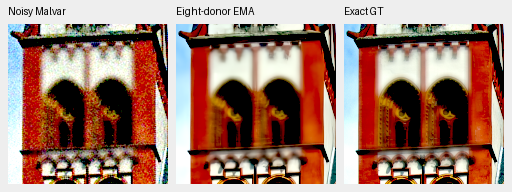
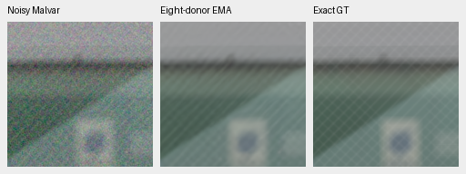

# Wider Bayer neighborhoods for weak-wire phase

Eight disjoint donor windows improve held-out ISO6400 weak-phase
validation from **61.0% to 66.5%** in intact regions. The trained
eight-donor head recovers **0.82 percentage points** more intact wire
response than the previous directional head and lowers intact weak-band
error by **0.85 DN16**. At similar added gap RMS, the response advantage
shrinks to **0.09 points** and absolute gap error rises **0.34 DN16**.
On the real cab, some existing right diagonals strengthen while fine
crossings remain incomplete.
[Machine results](results/wide-bayer-neighborhood-v1/publication.json) ·
[Frozen drivers, weights and receipts](results/wide-bayer-neighborhood-v1/evidence.tar.xz) ·
[Native provenance](images/wide-bayer-neighborhood-v1/manifest.json).

## Wider RAW phase measurement

The nearest control uses four 32-pixel cardinal donor windows.
The eight-donor arm adds four diagonal windows, covering a 96-pixel
neighborhood. An agreeing-diagonal arm uses the diagonals only
where their transported coefficient has a positive dot product with
the cardinal coefficient. The twelve-donor diagnostic also adds
four farther axis-aligned windows, increasing the width to 160 pixels.
The tangent-weighted and rotated controls bias the same eight donor
locations in opposite directions relative to the tested frequency.
The original candidate bank and local edge-projected Bayer test are
shared.

For each donor, the operator uses the true Bayer offsets and the
candidate frequency to transport its phase to the query origin.
All windows are disjoint inside each query. Perturbing every center
RAW sample leaves the exterior phase, frequency and estimated strength
bit for bit across all four Bayer layouts. The cardinal computation
reproduces the previous extractor. On one fixed 256-pixel cab query,
the median CPU extraction takes 29.4 ms nearest, 42.3 ms eight-donor
and 35.7 ms agreeing-diagonal across 18 interleaved warm calls.
These timings cover the witness extractor.

| Held-out ISO6400 detector, 24 sources | Exact phase cosine | Validated intact matches | Validated true-gap matches | Positive in weak-free scored bin |
| --- | ---: | ---: | ---: | ---: |
| Nearest four | 0.703 | 61.00% | 8.35% | 8.54% |
| Eight donors | 0.855 | 66.46% | 8.55% | 14.40% |
| Agreeing diagonals | 0.832 | 65.36% | 7.80% | 13.21% |
| Twelve donors | 0.890 | 66.39% | 12.35% | 11.56% |
| Tangent-weighted | 0.789 | 62.47% | 6.16% | 12.99% |
| Rotated tangent weights | 0.852 | 65.05% | 11.14% | 11.44% |

A validated match has a frequency within 0.015625 cycles per pixel
of the planted weak carrier and a reserved score above 0.55. The
eight-donor intact gain has a 95% paired interval of +2.69 to
+8.41 points. The gap difference spans −4.75 to +4.64 points.
Completely removing the weaker carrier produces more positive scores
in its bin. The exact phase and geometry select measurement bands
only. At the same threshold, scanning all candidates produces a positive
in essentially every exact-flat window. Tuning the threshold separately
on 24 calibration backgrounds to target a 10% all-bin flat rate gives
held-out flat rates of **8.42%, 9.52% and 11.48%** for nearest, eight
and agreeing, respectively. Their intact match rates are **36.17%,
38.72% and 39.19%**. Those gains have paired intervals including zero.
A valid local detector operating point depends on the error being charged.

## Trained reconstruction

The EMA artifact is
`7b854d681083550de869b06b55d56c2f84224ec4a0545419a2cf34682a38ec68`.
It uses the frozen local-only 20k EMA
`b892a08c8ebbccb05c000e4f42d1f86c3a7d1d5870721ccd6e1c8fe9e82c3889`
and Bayer phase EMA
`069de3a3d3f18ab0f32cf9b242daa1fb859d03762086ee27244557aced803e54`.
The nearest control reproduces the preceding directional raw and EMA
weights bit for bit. Each arm trains for 672 updates on the same 448
sources over six epochs, with 2,688 source visits and 8,064 role queries
per arm. It uses the same directional losses and optimizer schedule.
Feature preparation takes **92.36 s**, followed by **34.08 s** of updates
for the three arms together.
[Previous directional recipe](directional-gap-training.md).

| ISO6400 wire reconstructions, 24 sources | Intact response | Intact weak-band RMS, DN16 | Added gap RMS, DN16 | Absolute gap RMS, DN16 |
| --- | ---: | ---: | ---: | ---: |
| V120 | 31.605% | 86.701 | 25.077 | 154.013 |
| Corpus 100k | 33.657% | 84.945 | 16.700 | 152.650 |
| Local-only 20k | 33.413% | 84.771 | 0 | 151.803 |
| Directional | 40.331% | 78.981 | 22.252 | 147.833 |
| Directional, scaled to eight donors | 41.063% | 78.406 | 24.605 | 147.614 |
| Eight donors | 41.153% | 78.132 | 24.295 | 147.958 |
| Directional, scaled to agreeing diagonals | 40.736% | 78.662 | 23.553 | 147.707 |
| Agreeing diagonals | 40.955% | 78.374 | 23.141 | 147.804 |

Replacing the eight-donor EMA's input with the nearest measurements
loses 0.868 response points. Wider input provides the gain over the
previous unscaled head. Against the directional head scaled on separate
calibration gaps, the eight-donor head lowers intact weak-band RMS
by 0.274 DN16 [0.004, 0.571] and adds 0.344 DN16 of absolute gap RMS
[0.100, 0.610]. The agreeing-diagonal head lowers intact weak-band RMS
by 0.288 DN16 [0.018, 0.570] against its scaled control. Its absolute
gap difference spans −0.062 to +0.250 DN16. On the six ISO6400 dip
controls, eight donors recover 0.568 more response points at similar
gap strength [0.029, 1.002]. At ISO400 they lose 0.147 response points
against their strength-matched control and raise absolute gap RMS by
0.215 DN16.

On 48 independent ISO6400 natural photos, the eight-donor head raises
response 0.078 points and exact-flat RMS 0.078 DN16 over the previous
directional head. Against the control scaled on 16 independent
calibration photos, the response difference is −0.016 points
[−0.111, +0.094] and the flat RMS difference is −0.063 DN16
[−0.189, +0.049]. These are scoped crop comparisons. The full 427-photo
and measured-camera panels cover the base checkpoints.
[Comparable model history](performance-history.md).

## Exact native comparisons

Each cell is 160 × 160 native pixels at `[48,48,160,160]` in the
original query. The center uses the eight-donor EMA. Both use ISO6400
shot/read `0.00128/6.5536e-6`, exposure 0.33, 16-bit ADC and black 0.03.

**Limburg Cathedral**, Berthold Werner, public domain. BGGR query
`[22,250,256,256]`, display ×3.0303 and contrast ×2. The arches are clear
and fine molding and bricks stay diffuse.
[Source](https://commons.wikimedia.org/wiki/File:Limburger_Dom_BW_1.jpg) ·
[All methods](images/wide-bayer-neighborhood-v1/exact/001-iso6400-independent-comparison.png) ·
[Exact flat](images/wide-bayer-neighborhood-v1/flat/001-iso6400-independent-flat-comparison.png).

**St Valentin railway**, GT1976, CC BY-SA 4.0. RGGB query
`[128,128,256,256]` inside `[376,16,512,512]`, display ×2.
The fine diagonals outside the planted break remain diffuse.
[Source](https://commons.wikimedia.org/wiki/File:2018-05-04_%28217%29_33_53_9332_586-5_at_Bahnhof_St._Valentin.jpg) ·
[All methods](images/wide-bayer-neighborhood-v1/exact/012-iso6400-comparison.png).

## Standing GFX100S comparisons

At display ×4, the DSCF3879 sky stays smooth and coarse fence crossings
remain coherent. Fine foliage and building wires stay soft. At ×16,
both DSCF3842 cab ROIs show existing diagonal fragments. The right
diagonals strengthen slightly with eight donors, especially under the
transferred profile. The fine intersections remain incomplete and
background mottling persists. Both cab JPEGs and the ISO100 AHD
images were viewed. The independent references differ in aperture,
exposure time and subject motion.

[Sky](images/wide-bayer-neighborhood-v1/standing/main-overcast-sky-main-overcast-sky.png) ·
[Building](images/wide-bayer-neighborhood-v1/standing/main-building-detail-main-building-detail.png) ·
[Foliage](images/wide-bayer-neighborhood-v1/standing/main-foliage-main-foliage.png) ·
[Coarse fence](images/wide-bayer-neighborhood-v1/standing/main-chain-link-fence-main-chain-link-fence.png).

| Cab noise profile | Native crops |
| --- | --- |
| Nominal `0.00128/6.5536e-6` | [Left](images/wide-bayer-neighborhood-v1/standing/mesh-nominal-fine-green-mesh-left.png) · [Right](images/wide-bayer-neighborhood-v1/standing/mesh-nominal-fine-green-mesh-right.png) |
| Transferred `0.0014635775921166604/1.0715704128646712e-6` | [Left](images/wide-bayer-neighborhood-v1/standing/mesh-profile3879-fine-green-mesh-left.png) · [Right](images/wide-bayer-neighborhood-v1/standing/mesh-profile3879-fine-green-mesh-right.png) |
