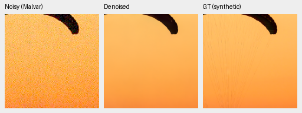
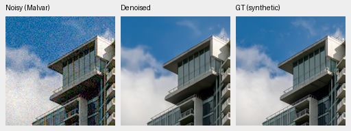
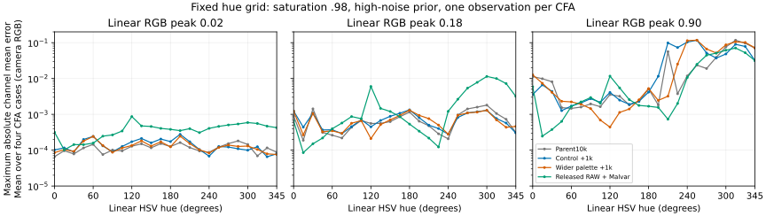
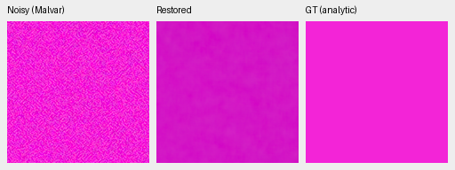
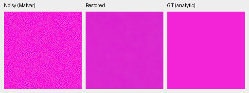
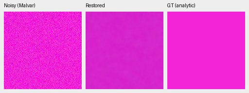
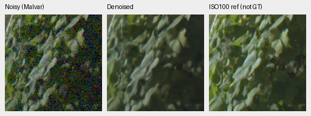
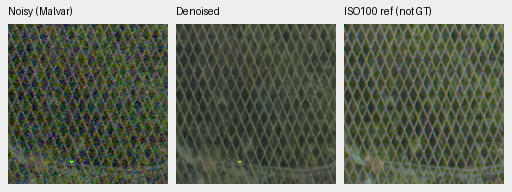

# Wider smooth-color palette: first 1,000 updates

The wider palette has **not established a general color repair**. Photo PSNR
is essentially tied with the matched control; our five held-out development
scenes have a small primary-CFA gain, while known scenes do not. The broader,
prospectively frozen hue test still exposes large bright-field biases. Fine
parachute cords and GFX foliage/fence detail remain deficient. **Retain V43 as
the working model and continue both arms to their originally planned 4,000
updates.** This is an intermediate review, not evidence of convergence.

[Complete scores, provenance, audits and 88 native crop receipts](results/wide-flat-palette-first1k-review.json).
[Palette definition and validation](wide-flat-palette.md).
[Prospective hue-grid definition](prospective-color-grid.md).

## Matched experiment

Both arms start from mature V58 EMA with fresh AdamW/EMA: seed 48, native 256,
batch 16, LR 2e-5, warmup 100, original 4,000-update schedule. Only smooth colored
target chroma span differs (0 versus 8 stops); half of smooth examples remain
neutral. Original Commons 40,170 / native 128 / paired 32 and 50/25/25 domain fractions
remain fixed. No new 66,934-image corpus, output correction or final-set score.
The first 1,000 checkpoints include all model/EMA/AdamW/RNG state. All 41 logged
domain choices/LRs agree; batches outside affected colored smooth targets
hash identically. This does not claim identical CUDA optimization paths.

| Checkpoint | SHA256 |
| --- | --- |
| Parent V58 | `cc1fb5e6d3e0d042c95495dd7bf1bd07c900cb6f7e3b61541f78c9e08098fea3` |
| Control V59 +1k | `c80e956530aa96eacac477f06e3dd2af1ef8d7ed7e4addd96668191d6e46f77c` |
| Wide V60 +1k | `dde398a05fc5df33167d73967d6b5f62ccf3b165f27f8c745b1fdeb45a87f19a` |

## Scores and practical limits

427 photos have exact simulated clean targets; real paired RGB references are
independently demosaiced AHD, **not exact RGB GT**. Measured clean CFA is primary
on known 4 (8 pairs / 72 crops) and our held-out-camera development 5 (10 pairs / 90 crops).
All sources are balanced before reporting means. Neural inference is FP16 with
physical FP32; photo batch 2, real batch 4. RawNIND uses input-only CFA-LS gains.
Saved V43/parent cases are compared without rerunning their networks; matching
observations/metadata and bounded classical-control witnesses are verified.
V43 real batch 2 differs from current/parent batch 4. Training histories differ.

| Model | Photo PSNR / SSIM | Procedural PSNR / SSIM | Known CFA PSNR | Our unseen CFA PSNR |
| --- | --- | --- | ---: | ---: |
| Control +1k | 35.55086 / 0.961325 | 33.86061 / 0.968761 | 54.22470 | 53.74080 |
| Wide +1k | 35.54917 / 0.961343 | 33.96064 / 0.969193 | 54.21420 | 53.79297 |
| RawNIND global CFA-LS | 26.69578 / 0.790028 | 24.97426 / 0.720411 | 54.06860 | 53.56220 |
| RawNIND channel CFA-LS | 26.68357 / 0.789899 | 24.98568 / 0.720500 | 54.08474 | 53.76822 |

| Wide − control | Difference | 95% paired source interval |
| --- | ---: | --- |
| Photo sRGB PSNR, dB | -0.001687 | [-0.010886, +0.006729] |
| Photo linear PSNR, dB | +0.021393 | [+0.007286, +0.035894] |
| Procedural sRGB PSNR, dB | +0.100024 | [+0.024863, +0.181445] |
| Known measured-CFA PSNR, dB | -0.010500 | [-0.031197, +0.001782] |
| Our unseen measured-CFA PSNR, dB | +0.052174 | [+0.021891, +0.080690] |

Intervals use 1,000 paired source resamples, seed 42; they describe this finite
development set, not training-seed uncertainty or correction for selection.
Compared with the parent, both arms tie photographic PSNR but lose procedural
PSNR (control−.29770dB; wide−.19768dB). Our unseen primary change is−.06028dB
for control and−.00811dB for wide. Neither is a clear improvement over the
parent or working V43. All 48 parent/V43 source comparisons remain in the receipt.

## Native exact-GT photographic triplets

Noisy WB-aware Malvar → restored → exact simulated GT. Native 160×160 panels
at the 8×-binned evaluation resolution, **no resized crop pixels**. Shared
ROI [48,48,160,160], RGGB, WB [2,1,1.5], original protocol matrix,
shot=.00256/read variance=.0000262144, ADC 16 / black .03, display exposure×1.
Source/cache identity, checkpoint SHA, noise and display records accompany
every crop in the receipt. The PNGs are 8-bit sRGB previews; evaluation uses
unquantized predictions.

Sources: [Roy Egloff](https://commons.wikimedia.org/wiki/File:CH.VD.Villeneuve_2007-08-25_Vertigo-Swiss-Riviera_2392_3x2-R_4K.jpg)
and [Dietmar Rabich](https://commons.wikimedia.org/wiki/File:Vancouver_(BC,_Canada),_Coal_Harbour_Seaside_Park,_Blick_in_den_Himmel_--_2022_--_2158.jpg),
[CC BY-SA 4.0](https://creativecommons.org/licenses/by-sa/4.0/). Modified by
binning, crop, simulated noise and restoration; previews retain that license.
Paired scenes: Benoit Brummer and Christophe De Vleeschouwer,
[RawNIND](https://doi.org/10.14428/DVN/DEQCIM), individual credits in receipts.

### Parachute fabric and fine cords

Control +1k

Wider palette +1k

RawNIND channel CFA-LS

### Building and sky

Control +1k

Wider palette +1k

RawNIND channel CFA-LS

Both arms erase the fine parachute cords. The tower outline is retained, but fine cloud wisps and building detail soften; no clear native advantage between arms.

## Prospective hue grid: improvement is uneven

Frozen before separate trial outputs: 147 colors/grays × 2 noise conditions × 4
CFAs =1,176 observations, identical across parent/control/wide/released RAW.
Hues are HSV applied to linear RGB, with saturation .50 / .98 and peak .02 / .18 / .90.
Single original WB/matrix; native 256 inputs  / 160 px ROI, display×1. Clean targets
stay below white; noisyADC can clip. Joint models use FP16/physical FP32;
the genuine released RAW cascade uses IEEE FP32/native batch 1 and its validated
contiguous layout. No output fitting. This diagnostic was motivated by prior
failures; it is not a blind natural-image benchmark or proof of a training cause.

The table gives mean /95th-percentile **maximum absolute channel-mean error**
over 96 hue/CFA cases per row, in normalized camera RGB. These are descriptive
quantiles of the fixed grid, not uncertainty intervals.

| Noise | Saturation | Peak | Parent | Control +1k | Wide +1k | Released RAW + Malvar |
| --- | ---: | ---: | --- | --- | --- | --- |
| adc-only | 0.5 | 0.02 | 0.000016 / 0.000038 | 0.000019 / 0.000034 | 0.000015 / 0.000025 | 0.000075 / 0.000122 |
| adc-only | 0.5 | 0.18 | 0.000172 / 0.000347 | 0.000225 / 0.000655 | 0.000109 / 0.000188 | 0.000450 / 0.000794 |
| adc-only | 0.5 | 0.9 | 0.021231 / 0.082762 | 0.021277 / 0.076609 | 0.015454 / 0.061721 | 0.001419 / 0.002227 |
| adc-only | 0.98 | 0.02 | 0.000058 / 0.000134 | 0.000060 / 0.000134 | 0.000042 / 0.000108 | 0.000128 / 0.000276 |
| adc-only | 0.98 | 0.18 | 0.000339 / 0.000645 | 0.000369 / 0.000822 | 0.000276 / 0.000576 | 0.002671 / 0.009181 |
| adc-only | 0.98 | 0.9 | 0.014581 / 0.072255 | 0.014497 / 0.032916 | 0.017242 / 0.054529 | 0.015390 / 0.054239 |
| iso12800-prior | 0.5 | 0.02 | 0.000111 / 0.000187 | 0.000115 / 0.000193 | 0.000117 / 0.000202 | 0.000078 / 0.000154 |
| iso12800-prior | 0.5 | 0.18 | 0.000356 / 0.000799 | 0.000428 / 0.000973 | 0.000422 / 0.000930 | 0.000188 / 0.000304 |
| iso12800-prior | 0.5 | 0.9 | 0.028115 / 0.086721 | 0.037259 / 0.106282 | 0.029993 / 0.096123 | 0.001260 / 0.003650 |
| iso12800-prior | 0.98 | 0.02 | 0.000116 / 0.000212 | 0.000140 / 0.000275 | 0.000131 / 0.000257 | 0.000388 / 0.000608 |
| iso12800-prior | 0.98 | 0.18 | 0.000735 / 0.001617 | 0.000724 / 0.001432 | 0.000707 / 0.001382 | 0.002635 / 0.009995 |
| iso12800-prior | 0.98 | 0.9 | 0.023667 / 0.098846 | 0.032515 / 0.108945 | 0.032886 / 0.114641 | 0.016283 / 0.061519 |

At high noise / peak .90 / saturation .98, wide mean bias .032886 is slightly worse
than control .032515 and parent .023667. Worst bias stays around .121. At moderate
saturation .50, the wide arm helps versus control but remains worse than parent
at that peak. Smaller/darker groups behave differently. The errors move across
hues, so an improvement on a chosen warm field is insufficient.

The three previews (gray, warm30°, magenta315°) were chosen before treatment
scoring. Their common noisy/GT panels rerender exactly at native160px.

Parent10k — fixed magenta preview

Control +1k — fixed magenta preview

Wider palette +1k — fixed magenta preview

Released RAW + Malvar — fixed magenta preview

All four neutral previews are smooth. Warm is fairly close to GT with small variation in all methods. All neural magenta previews remain biased/mottled; the released RAW cascade has a conspicuous repeated grid and hue shift. Exact uniform analytic GT, not a real photograph.

The older, selected 32-case CPU diagnostic independently shows mixed warm and
cyclic-color behavior; its 64 F32 predictions and all six native previews are
audited separately. CPU results and CUDA grid results remain distinct.

## Standing GFX and other real cameras

Cached DSCF3879 ISO6400 → restored → DSCF3880 ISO100 f/5.6, **not GT**.
Full 101.996 MP predictions use native sensor crops, shared WB [1.513245033,1,2.215231788],
input-only shot=.0014635775921166604/read variance=1.0715704128646712e-6,
and display×4 (+2EV). Captures are 3m38s apart with different aperture/exposure
and moving subjects; there is no fitted reference or pixelwise quality score.
Sources/siblings stay outside training; originals remain read-only.

### foliage, sensor ROI [8890,5570,160,160]

Control +1k

Wider palette +1k

RawNIND channel CFA-LS

### chain-link-fence, sensor ROI [2240,6000,160,160]

Control +1k

Wider palette +1k

RawNIND channel CFA-LS

Both smooth the sky, soften fine foliage/building truss and soften the chain-link mesh. They retain more coherent fence structure than the RawNIND controls, but the wider palette gives no compelling detail gain over control. The ISO100 reference differs in aperture/exposure/motion and is not GT.

Q2 dark broad texture is similarly smoothed in both arms and RawNIND. Sony input is already soft and window outlines remain soft. Both arms preserve more GF50R stone variation than RawNIND. No convincing native difference between arms and no exact GT.

All 24 Q2/a7RII/GF50R triplets were actually viewed. Their RawNIND third panels
are comparators, not GT. Capture hashes / 512 px contexts / 160 px ROIs and per-capture
input-only noise/display exposure remain fixed and recorded in the receipt.

## Integrity, speed and continuation

Independent audit: 87,962 case rows  / 252 paired intervals agree to 7.11e-15;
all 62,830 shared RawNIND/classical case rows match the preceding reference run
exactly. Cross-run historical parent/V43 witnesses retain every bounded
difference, under the inherited four-F32-ULP bound. Complete models 91 / EMA 91 / 
AdamW 89 and all logged values are finite. All 70 main PNGs  / 29 F32 contexts  /
8 full RGB16 files pass SHA/dimensions/dtype checks. Common noisy/reference
pixels and transforms match; three-camera restored panels agree between the
two RawNIND comparator triplets.

Actually viewed: 50 new main PNGs, 6 selected CPU color PNGs and 12 prospective
CUDA PNGs. Twenty main control files are SHA-identical to previously viewed
files and reused transparently. No exhaustive full-frame visual claim.
Grid audit: 4,704 F32 predictions  / 28,224 metric fields agree to 4.45e-16;
all 12 triplets rerender exactly; 72 groups / 864 descriptive values independently
agree to 6.94e-18. Full arrays/logs remain on the external SSD.

Single full-frame passes: control 35.41 s, wide 34.93 s, RawNIND global 18.00 s and
channel 18.48 s for 101.996 MP, tile 512 / overlap 64 / batch 4. These are single measured
passes including tile blending, excluding RAW decode/TIFF encoding; not a
repeated speed comparison. The 100 MP / 10 s objective remains unmet.

Immutable copies of both first1k training logs preserve the audited boundaries
before the live run logs are appended during continuation.

Continue both audited whole states to their original 4,000-update schedules
with frozen source/data. The [actual continuation launch](results/wide-flat-palette-full4k-launch.json)
records a finite resumed step 1,001 for control; the wider arm follows serially.
Do not promote either first1k model. Protected-final
16-scene scoring remains closed. One training seed, tiny real panels and
selected qualitative crops cannot establish SOTA or broad real superiority.

## Complete native gallery

Every link is an original 512×192 PNG containing three unresized 160×160 panels.
Full source/ROI/checkpoint/noise/exposure receipts are in the JSON above.

| Panel | Method / source | Native triplet |
| --- | --- | --- |
| known | control / 2pilesofplates | [100% PNG](images/palette-first1k-known-control-2pilesofplates.png) |
| known | wide / 2pilesofplates | [100% PNG](images/palette-first1k-known-wide-2pilesofplates.png) |
| known | raw-global / 2pilesofplates | [100% PNG](images/fresh-dino-10k-raw-global-known-2pilesofplates.png) |
| known | raw-channel / 2pilesofplates | [100% PNG](images/fresh-dino-10k-raw-channel-known-2pilesofplates.png) |
| known | control / 7D-1 | [100% PNG](images/palette-first1k-known-control-7D-1.png) |
| known | wide / 7D-1 | [100% PNG](images/palette-first1k-known-wide-7D-1.png) |
| known | raw-global / 7D-1 | [100% PNG](images/fresh-dino-10k-raw-global-known-7D-1.png) |
| known | raw-channel / 7D-1 | [100% PNG](images/fresh-dino-10k-raw-channel-known-7D-1.png) |
| unseen | control / LucieB_3apples | [100% PNG](images/palette-first1k-unseen-control-LucieB-3apples.png) |
| unseen | wide / LucieB_3apples | [100% PNG](images/palette-first1k-unseen-wide-LucieB-3apples.png) |
| unseen | raw-global / LucieB_3apples | [100% PNG](images/fresh-dino-10k-raw-global-unseen-LucieB_3apples.png) |
| unseen | raw-channel / LucieB_3apples | [100% PNG](images/fresh-dino-10k-raw-channel-unseen-LucieB_3apples.png) |
| unseen | control / LucieB_Coulicoco | [100% PNG](images/palette-first1k-unseen-control-LucieB-Coulicoco.png) |
| unseen | wide / LucieB_Coulicoco | [100% PNG](images/palette-first1k-unseen-wide-LucieB-Coulicoco.png) |
| unseen | raw-global / LucieB_Coulicoco | [100% PNG](images/fresh-dino-10k-raw-global-unseen-LucieB_Coulicoco.png) |
| unseen | raw-channel / LucieB_Coulicoco | [100% PNG](images/fresh-dino-10k-raw-channel-unseen-LucieB_Coulicoco.png) |
| full427 | control / 0014aa4e075b1827f91ef8a02069e1e318f040ba | [100% PNG](images/palette-first1k-full427-control-0014aa4e075b1827f91ef8a02069e1e318f040ba.png) |
| full427 | control / 002fc6eeadf637e81d5a327f117b79abb86becd9 | [100% PNG](images/palette-first1k-full427-control-002fc6eeadf637e81d5a327f117b79abb86becd9.png) |
| full427 | wide / 0014aa4e075b1827f91ef8a02069e1e318f040ba | [100% PNG](images/palette-first1k-full427-wide-0014aa4e075b1827f91ef8a02069e1e318f040ba.png) |
| full427 | wide / 002fc6eeadf637e81d5a327f117b79abb86becd9 | [100% PNG](images/palette-first1k-full427-wide-002fc6eeadf637e81d5a327f117b79abb86becd9.png) |
| full427 | raw-global / 0014aa4e075b1827f91ef8a02069e1e318f040ba | [100% PNG](images/fresh-dino-10k-raw-global-full427-0014aa4e.png) |
| full427 | raw-global / 002fc6eeadf637e81d5a327f117b79abb86becd9 | [100% PNG](images/fresh-dino-10k-raw-global-full427-002fc6ee.png) |
| full427 | raw-channel / 0014aa4e075b1827f91ef8a02069e1e318f040ba | [100% PNG](images/fresh-dino-10k-raw-channel-full427-0014aa4e.png) |
| full427 | raw-channel / 002fc6eeadf637e81d5a327f117b79abb86becd9 | [100% PNG](images/fresh-dino-10k-raw-channel-full427-002fc6ee.png) |
| analytic | control / carrier-l0.01-c0.1-p8-draw0 | [100% PNG](images/palette-first1k-analytic-control-carrier-l0-01-c0-1-p8-draw0.png) |
| analytic | wide / carrier-l0.01-c0.1-p8-draw0 | [100% PNG](images/palette-first1k-analytic-wide-carrier-l0-01-c0-1-p8-draw0.png) |
| analytic | control / carrier-l0.18-c0.02-p16-draw0 | [100% PNG](images/palette-first1k-analytic-control-carrier-l0-18-c0-02-p16-draw0.png) |
| analytic | wide / carrier-l0.18-c0.02-p16-draw0 | [100% PNG](images/palette-first1k-analytic-wide-carrier-l0-18-c0-02-p16-draw0.png) |
| analytic | control / flat-l0.18-draw0 | [100% PNG](images/palette-first1k-analytic-control-flat-l0-18-draw0.png) |
| analytic | wide / flat-l0.18-draw0 | [100% PNG](images/palette-first1k-analytic-wide-flat-l0-18-draw0.png) |
| gfx | control / overcast-sky | [100% PNG](images/palette-first1k-gfx-control-overcast-sky.png) |
| gfx | control / building-detail | [100% PNG](images/palette-first1k-gfx-control-building-detail.png) |
| gfx | control / foliage | [100% PNG](images/palette-first1k-gfx-control-foliage.png) |
| gfx | control / chain-link-fence | [100% PNG](images/palette-first1k-gfx-control-chain-link-fence.png) |
| gfx | wide / overcast-sky | [100% PNG](images/palette-first1k-gfx-wide-overcast-sky.png) |
| gfx | wide / building-detail | [100% PNG](images/palette-first1k-gfx-wide-building-detail.png) |
| gfx | wide / foliage | [100% PNG](images/palette-first1k-gfx-wide-foliage.png) |
| gfx | wide / chain-link-fence | [100% PNG](images/palette-first1k-gfx-wide-chain-link-fence.png) |
| gfx | raw-global / overcast-sky | [100% PNG](images/nonlocal-full-raw-global-gfx-overcast-sky.png) |
| gfx | raw-global / building-detail | [100% PNG](images/nonlocal-full-raw-global-gfx-building-detail.png) |
| gfx | raw-global / foliage | [100% PNG](images/nonlocal-full-raw-global-gfx-foliage.png) |
| gfx | raw-global / chain-link-fence | [100% PNG](images/nonlocal-full-raw-global-gfx-chain-link-fence.png) |
| gfx | raw-channel / overcast-sky | [100% PNG](images/nonlocal-full-raw-channel-gfx-overcast-sky.png) |
| gfx | raw-channel / building-detail | [100% PNG](images/nonlocal-full-raw-channel-gfx-building-detail.png) |
| gfx | raw-channel / foliage | [100% PNG](images/nonlocal-full-raw-channel-gfx-foliage.png) |
| gfx | raw-channel / chain-link-fence | [100% PNG](images/nonlocal-full-raw-channel-gfx-chain-link-fence.png) |
| three-camera | control / LEICA Q2-upper-left-raw-global | [100% PNG](images/palette-first1k-three-camera-control-LEICA-Q2-upper-left-raw-global.png) |
| three-camera | control / LEICA Q2-upper-left-raw-channel | [100% PNG](images/palette-first1k-three-camera-control-LEICA-Q2-upper-left-raw-channel.png) |
| three-camera | wide / LEICA Q2-upper-left-raw-global | [100% PNG](images/palette-first1k-three-camera-wide-LEICA-Q2-upper-left-raw-global.png) |
| three-camera | wide / LEICA Q2-upper-left-raw-channel | [100% PNG](images/palette-first1k-three-camera-wide-LEICA-Q2-upper-left-raw-channel.png) |
| three-camera | control / LEICA Q2-lower-right-raw-global | [100% PNG](images/palette-first1k-three-camera-control-LEICA-Q2-lower-right-raw-global.png) |
| three-camera | control / LEICA Q2-lower-right-raw-channel | [100% PNG](images/palette-first1k-three-camera-control-LEICA-Q2-lower-right-raw-channel.png) |
| three-camera | wide / LEICA Q2-lower-right-raw-global | [100% PNG](images/palette-first1k-three-camera-wide-LEICA-Q2-lower-right-raw-global.png) |
| three-camera | wide / LEICA Q2-lower-right-raw-channel | [100% PNG](images/palette-first1k-three-camera-wide-LEICA-Q2-lower-right-raw-channel.png) |
| three-camera | control / ILCE-7RM2-upper-left-raw-global | [100% PNG](images/palette-first1k-three-camera-control-ILCE-7RM2-upper-left-raw-global.png) |
| three-camera | control / ILCE-7RM2-upper-left-raw-channel | [100% PNG](images/palette-first1k-three-camera-control-ILCE-7RM2-upper-left-raw-channel.png) |
| three-camera | wide / ILCE-7RM2-upper-left-raw-global | [100% PNG](images/palette-first1k-three-camera-wide-ILCE-7RM2-upper-left-raw-global.png) |
| three-camera | wide / ILCE-7RM2-upper-left-raw-channel | [100% PNG](images/palette-first1k-three-camera-wide-ILCE-7RM2-upper-left-raw-channel.png) |
| three-camera | control / ILCE-7RM2-lower-right-raw-global | [100% PNG](images/palette-first1k-three-camera-control-ILCE-7RM2-lower-right-raw-global.png) |
| three-camera | control / ILCE-7RM2-lower-right-raw-channel | [100% PNG](images/palette-first1k-three-camera-control-ILCE-7RM2-lower-right-raw-channel.png) |
| three-camera | wide / ILCE-7RM2-lower-right-raw-global | [100% PNG](images/palette-first1k-three-camera-wide-ILCE-7RM2-lower-right-raw-global.png) |
| three-camera | wide / ILCE-7RM2-lower-right-raw-channel | [100% PNG](images/palette-first1k-three-camera-wide-ILCE-7RM2-lower-right-raw-channel.png) |
| three-camera | control / GFX 50R-upper-left-raw-global | [100% PNG](images/palette-first1k-three-camera-control-GFX-50R-upper-left-raw-global.png) |
| three-camera | control / GFX 50R-upper-left-raw-channel | [100% PNG](images/palette-first1k-three-camera-control-GFX-50R-upper-left-raw-channel.png) |
| three-camera | wide / GFX 50R-upper-left-raw-global | [100% PNG](images/palette-first1k-three-camera-wide-GFX-50R-upper-left-raw-global.png) |
| three-camera | wide / GFX 50R-upper-left-raw-channel | [100% PNG](images/palette-first1k-three-camera-wide-GFX-50R-upper-left-raw-channel.png) |
| three-camera | control / GFX 50R-lower-right-raw-global | [100% PNG](images/palette-first1k-three-camera-control-GFX-50R-lower-right-raw-global.png) |
| three-camera | control / GFX 50R-lower-right-raw-channel | [100% PNG](images/palette-first1k-three-camera-control-GFX-50R-lower-right-raw-channel.png) |
| three-camera | wide / GFX 50R-lower-right-raw-global | [100% PNG](images/palette-first1k-three-camera-wide-GFX-50R-lower-right-raw-global.png) |
| three-camera | wide / GFX 50R-lower-right-raw-channel | [100% PNG](images/palette-first1k-three-camera-wide-GFX-50R-lower-right-raw-channel.png) |
| selected-color-CPU | dino-convnext-palette-control-b16-v59:step1000 / neutral | [100% PNG](images/palette-first1k-selected-color-CPU-00.png) |
| selected-color-CPU | dino-convnext-palette-control-b16-v59:step1000 / fabric-mean | [100% PNG](images/palette-first1k-selected-color-CPU-01.png) |
| selected-color-CPU | dino-convnext-palette-wide-b16-v60:step1000 / neutral | [100% PNG](images/palette-first1k-selected-color-CPU-02.png) |
| selected-color-CPU | dino-convnext-palette-wide-b16-v60:step1000 / fabric-mean | [100% PNG](images/palette-first1k-selected-color-CPU-03.png) |
| selected-color-CPU | dino-convnext-palette-control-b16-v59:step1000 / fabric-cyclic-gbr | [100% PNG](images/palette-first1k-selected-color-CPU-04.png) |
| selected-color-CPU | dino-convnext-palette-wide-b16-v60:step1000 / fabric-cyclic-gbr | [100% PNG](images/palette-first1k-selected-color-CPU-05.png) |
| prospective-grid-CUDA | parent10k / gray-l0.18 | [100% PNG](images/palette-first1k-prospective-grid-CUDA-00.png) |
| prospective-grid-CUDA | parent10k / h030-s0.98-l0.90 | [100% PNG](images/palette-first1k-prospective-grid-CUDA-01.png) |
| prospective-grid-CUDA | parent10k / h315-s0.98-l0.90 | [100% PNG](images/palette-first1k-prospective-grid-CUDA-02.png) |
| prospective-grid-CUDA | control-additional1k / gray-l0.18 | [100% PNG](images/palette-first1k-prospective-grid-CUDA-03.png) |
| prospective-grid-CUDA | control-additional1k / h030-s0.98-l0.90 | [100% PNG](images/palette-first1k-prospective-grid-CUDA-04.png) |
| prospective-grid-CUDA | control-additional1k / h315-s0.98-l0.90 | [100% PNG](images/palette-first1k-prospective-grid-CUDA-05.png) |
| prospective-grid-CUDA | wide-additional1k / gray-l0.18 | [100% PNG](images/palette-first1k-prospective-grid-CUDA-06.png) |
| prospective-grid-CUDA | wide-additional1k / h030-s0.98-l0.90 | [100% PNG](images/palette-first1k-prospective-grid-CUDA-07.png) |
| prospective-grid-CUDA | wide-additional1k / h315-s0.98-l0.90 | [100% PNG](images/palette-first1k-prospective-grid-CUDA-08.png) |
| prospective-grid-CUDA | NonlocalMatchFilter2026+Malvar:authors-RAW / gray-l0.18 | [100% PNG](images/palette-first1k-prospective-grid-CUDA-09.png) |
| prospective-grid-CUDA | NonlocalMatchFilter2026+Malvar:authors-RAW / h030-s0.98-l0.90 | [100% PNG](images/palette-first1k-prospective-grid-CUDA-10.png) |
| prospective-grid-CUDA | NonlocalMatchFilter2026+Malvar:authors-RAW / h315-s0.98-l0.90 | [100% PNG](images/palette-first1k-prospective-grid-CUDA-11.png) |
