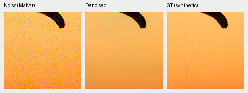
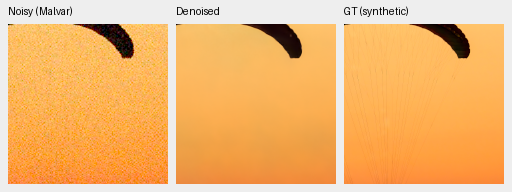
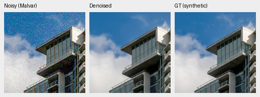
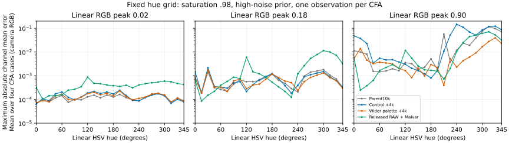
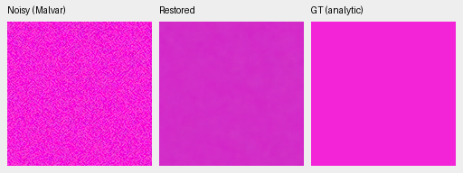
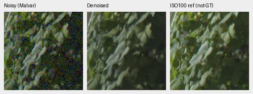
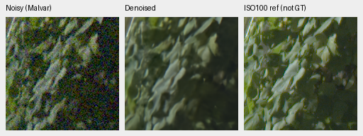
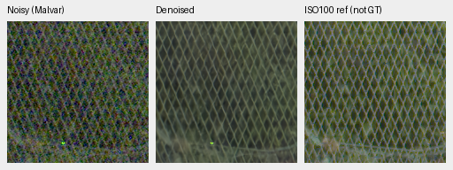

# Wider smooth-color palette: completed 4,000-update comparison

The wider palette improves photographic PSNR and substantially reduces bright,
highly saturated field errors versus its matched control. It does **not** repair
every color: moderately saturated bright fields still shift, and fine cords,
foliage and fence detail remain soft. Known/unseen paired-real changes versus
control are uncertain; both arms trail the older working reference on those
primary means. **Keep V43 as the working reference.** V60 is the stronger next
research candidate; both runs stop at their original 4,000-update boundary.
The [V61 sensor-loss trial](sensor-mean-v61.md) now tests a separate loss change
against the completed V60 control, with the same initializer, data and schedule.

[Complete scores, checkpoint/source hashes, audits and 90 native crop receipts](results/wide-flat-palette-full4k-review.json).
[Matched intervention](wide-flat-palette.md); [intermediate first1k review](wide-flat-palette-first1k-review.md).

Both arms initialize from mature V58 step10000 EMA with fresh AdamW/EMA,
seed 48, batch 16/native 256, LR2e-5/warmup100 and the same planned 4,000 schedule.
The first1k whole states resume without resetting optimizer/EMA/RNG or retiming
the schedule. Only colored smooth-field chroma span differs: 0 versus 8 stops.
Commons 40,170 / native 128 / paired 32, proportions, geometry/PSF, noise/ADC,
original 8× validation, model and precision remain fixed. All 162 logged
domains/LRs agree; unaffected observations hash exactly. No new training corpus,
inference correction, protected-final score or convergence claim.

| Checkpoint | SHA256 |
| --- | --- |
| Parent V58 | `cc1fb5e6d3e0d042c95495dd7bf1bd07c900cb6f7e3b61541f78c9e08098fea3` |
| Control V59 +4k | `a6e494a121b99e311c6be4d24794929f625c3690448588f7d3d1c1af3273dadc` |
| Wide V60 +4k | `1e9812afcfaa5322593c9d2c2314fa0d8ae5458c4e116be0f516c992c880b47e` |

## Scores

427 photos have exact simulated targets; paired RGB is independently AHD
demosaiced and is not exact RGB GT. Known 4 has 8 pairs / 72 crops; our held-out-camera
development 5 has 10 pairs / 90 crops. Means balance sources. Neural FP16 retains
physical FP32; photo batch 2/real batch 4. RawNIND uses input-only CFA-LS gains.

| Model | Photo PSNR / SSIM | Procedural PSNR / SSIM | Known CFA PSNR | Our unseen CFA PSNR |
| --- | --- | --- | ---: | ---: |
| Control +4k | 35.64375 / 0.961952 | 34.21947 / 0.971274 | 54.20653 | 53.75130 |
| Wide +4k | 35.66428 / 0.961908 | 34.33768 / 0.971300 | 54.21125 | 53.76025 |
| RawNIND global CFA-LS | 26.69578 / 0.790028 | 24.97426 / 0.720411 | 54.06860 | 53.56220 |
| RawNIND channel CFA-LS | 26.68357 / 0.789899 | 24.98568 / 0.720500 | 54.08474 | 53.76822 |

| Wide − control | Difference | 95% paired source interval |
| --- | ---: | --- |
| Photo sRGB PSNR, dB | +0.020536 | [+0.007975, +0.037021] |
| Photo linear PSNR, dB | +0.032611 | [+0.014594, +0.055407] |
| Procedural sRGB PSNR, dB | +0.118209 | [+0.023674, +0.223496] |
| Known CFA PSNR, dB | +0.004719 | [-0.000330, +0.012025] |
| Our unseen CFA PSNR, dB | +0.008948 | [-0.026423, +0.049630] |

Saved parent/V43 observations and classical control witnesses are checked without
repeating their networks. Their initialization/training histories differ; V43
real batch 2 also differs. Paired source bootstrap uses 1,000 resamples/seed 42,
not independent training repeats or protection against selection. All 48
comparisons and their witness bounds remain in the receipt.

| Wide +4k − earlier model | Photo sRGB PSNR | Known CFA PSNR | Our unseen CFA PSNR |
| --- | ---: | ---: | ---: |
| parent10k | +0.114749 | -0.013631 | -0.040834 |
| V43 | +0.764941 | -0.022076 | -0.045809 |

## Native exact-GT photographic triplets

Native 160×160 panels at the 8×-binned evaluation resolution, without resizing:
noisy WB-aware Malvar → restored → exact simulated GT. Both methods share
ROI [48,48,160,160], RGGB, WB [2,1,1.5], the recorded protocol matrix,
shot=.00256/read variance=.0000262144, ADC 16 / black .03 and display exposure×1.
PNGs are 8-bit sRGB previews; scores use unquantized predictions. All source,
ROI/checkpoint/noise/exposure records accompany the receipt.

Sources: [Roy Egloff](https://commons.wikimedia.org/wiki/File:CH.VD.Villeneuve_2007-08-25_Vertigo-Swiss-Riviera_2392_3x2-R_4K.jpg)
and [Dietmar Rabich](https://commons.wikimedia.org/wiki/File:Vancouver_(BC,_Canada),_Coal_Harbour_Seaside_Park,_Blick_in_den_Himmel_--_2022_--_2158.jpg),
[CC BY-SA 4.0](https://creativecommons.org/licenses/by-sa/4.0/); modified by
binning, crop, simulated noise and restoration. Paired references are from
[RawNIND](https://doi.org/10.14428/DVN/DEQCIM), with individual credits in receipts.

### Fabric and fine cords

### Building and sky

Both erase the fine parachute cords and soften cloud wisps/building detail. Native selected photo appearance is very similar between arms.

## Prospective hue grid

Frozen before separate first1k outputs:147 colors/grays × 2 conditions × 4 CFAs
=1,176 observations. Single fixed WB/matrix, native 256/ROI160, display×1.
Motivated by earlier failures, not a blind natural-photo benchmark. Only 2,352
new control/wide predictions are inferred; unchanged parent/released-reference
arrays are reused after hash/conditioning/precision checks. Joint models use
FP16/physical FP32; the genuine released RAW cascade uses IEEE FP32/nativeB1.
No output fitting. Each table cell gives mean/p95 maximum absolute channel-mean
bias over 96 fixed hue/CFA cases, not uncertainty intervals.

| Noise | Saturation | Peak | Parent | Control +4k | Wide +4k | Released RAW + Malvar |
| --- | ---: | ---: | --- | --- | --- | --- |
| adc-only | 0.5 | 0.02 | 0.000016 / 0.000038 | 0.000015 / 0.000027 | 0.000013 / 0.000026 | 0.000075 / 0.000122 |
| adc-only | 0.5 | 0.18 | 0.000172 / 0.000347 | 0.000167 / 0.000379 | 0.000086 / 0.000205 | 0.000450 / 0.000794 |
| adc-only | 0.5 | 0.9 | 0.021231 / 0.082762 | 0.015177 / 0.037549 | 0.016456 / 0.078128 | 0.001419 / 0.002227 |
| adc-only | 0.98 | 0.02 | 0.000058 / 0.000134 | 0.000056 / 0.000145 | 0.000047 / 0.000135 | 0.000128 / 0.000276 |
| adc-only | 0.98 | 0.18 | 0.000339 / 0.000645 | 0.000324 / 0.000716 | 0.000304 / 0.000676 | 0.002671 / 0.009181 |
| adc-only | 0.98 | 0.9 | 0.014581 / 0.072255 | 0.015104 / 0.036202 | 0.003927 / 0.011065 | 0.015390 / 0.054239 |
| iso12800-prior | 0.5 | 0.02 | 0.000111 / 0.000187 | 0.000129 / 0.000303 | 0.000133 / 0.000292 | 0.000078 / 0.000154 |
| iso12800-prior | 0.5 | 0.18 | 0.000356 / 0.000799 | 0.000343 / 0.000839 | 0.000350 / 0.000811 | 0.000188 / 0.000304 |
| iso12800-prior | 0.5 | 0.9 | 0.028115 / 0.086721 | 0.032785 / 0.095144 | 0.024435 / 0.090322 | 0.001260 / 0.003650 |
| iso12800-prior | 0.98 | 0.02 | 0.000116 / 0.000212 | 0.000139 / 0.000258 | 0.000133 / 0.000248 | 0.000388 / 0.000608 |
| iso12800-prior | 0.98 | 0.18 | 0.000735 / 0.001617 | 0.000736 / 0.001704 | 0.000649 / 0.001491 | 0.002635 / 0.009995 |
| iso12800-prior | 0.98 | 0.9 | 0.023667 / 0.098846 | 0.041275 / 0.124927 | 0.007657 / 0.027676 | 0.016283 / 0.061519 |

At high noise/peak.90/saturation.98, wider mean bias falls to.007657 versus
control.041275 and parent.023667; its maximum is.050253. At saturation.50,
the wider mean.024435 is smaller than control.032785, but worst error remains
.097048. ADC-only moderate-saturation bright fields also retain large errors.
This is substantial progress on some groups, without a general color guarantee.

Both neutral previews are smooth. Warm30deg stays close with mild broad variation. Wide magenta is visibly closer to GT than control, with remaining broad mottling. Parent/released-reference views reuse identical previously inspected PNGs; the released reference retains its earlier grid/hue artifacts.

The [separate selected32-case CPU diagnosis](wide-flat-palette-full4k-selected-colors.md)
records the older warm/magenta fields and all8 native triplets. CPU and CUDA
observations/results remain distinct.

## Standing GFX and other cameras

Cached DSCF3879 ISO6400 → restored → DSCF3880 ISO100 f/5.6, **not GT**.
Full 101.996 MP crops share WB [1.513245033,1,2.215231788],
input-only shot=.0014635775921166604/read variance=1.0715704128646712e−6,
and display×4(+2EV). Captures are 3m38s apart with different aperture/exposure
and moving subjects; no fitted reference or pixelwise score. Originals and
siblings stay read-only and outside training.

### foliage, sensor ROI [8890,5570,160,160]

### chain-link-fence, sensor ROI [2240,6000,160,160]

Both smooth the sky and soften fine foliage, the building truss and chain-link mesh. The wider palette gives no compelling native detail gain. ISO100 differs in aperture/exposure and motion and is not GT.

Q2 broad dark texture is similarly smoothed in both arms and RawNIND. Sony input is already soft and window outlines remain soft. GF50R stone retains more granular variation in both arms than RawNIND, with residual grain; no clear arm difference or exact GT.

Full 102 MP passes took 33.83s(control),34.31s(wide),17.69/17.60s(RawNIND).
These are single shared-machine observations, not repeated isolated benchmarks.
Eight full RGB16 TIFFs, shape/type/hash/precision and sRGB ICC tags are verified.
The 10-second target remains unmet.

## Integrity, decision and complete native gallery

Both actual producer/review owners exited successfully. Independent arithmetic
checks cover 87,962 cases and 252 bootstrap comparisons, differing by at most
7.11e−15; all62,830 RawNIND/classical control cases replay exactly. All 70 main
PNGs, 29 float contexts and 8 full RGB16 outputs pass integrity/native checks.
The grid independently checks 28,224 fields(4.45e−16 max difference) and 864
group scalars(6.94e−18). Fifty new main, 8 selected CPU and 6 new grid PNGs
were actually viewed; 26 whole-file-identical earlier PNGs reuse prior views.

V60 improves the photo/color research result, while moderate bright colors,
fine-detail loss and real-scene tradeoffs prevent default promotion. Stop both
original schedules at 4,000. Protected-final 16-scene scoring stays closed.
No broad real superiority, SOTA, training-repeat robustness or10-second claim.

Every link below is an original 512×192 PNG with unresized 160×160 panels.

| Panel | Method / source | Native triplet |
| --- | --- | --- |
| known | control / 2pilesofplates | [100% PNG](images/palette-full4k-known-crop-7789f8b328bddf5b.png) |
| known | wide / 2pilesofplates | [100% PNG](images/palette-full4k-known-crop-209e1e7cdc16be1e.png) |
| known | raw-global / 2pilesofplates | [100% PNG](images/fresh-dino-10k-raw-global-known-2pilesofplates.png) |
| known | raw-channel / 2pilesofplates | [100% PNG](images/fresh-dino-10k-raw-channel-known-2pilesofplates.png) |
| known | control / 7D-1 | [100% PNG](images/palette-full4k-known-crop-0f9467b7f0e8c4a2.png) |
| known | wide / 7D-1 | [100% PNG](images/palette-full4k-known-crop-e24767e6d332c161.png) |
| known | raw-global / 7D-1 | [100% PNG](images/fresh-dino-10k-raw-global-known-7D-1.png) |
| known | raw-channel / 7D-1 | [100% PNG](images/fresh-dino-10k-raw-channel-known-7D-1.png) |
| unseen | control / LucieB_3apples | [100% PNG](images/palette-full4k-unseen-crop-079f679da8dd9d0c.png) |
| unseen | wide / LucieB_3apples | [100% PNG](images/palette-full4k-unseen-crop-6482ba4ebd4a05a2.png) |
| unseen | raw-global / LucieB_3apples | [100% PNG](images/fresh-dino-10k-raw-global-unseen-LucieB_3apples.png) |
| unseen | raw-channel / LucieB_3apples | [100% PNG](images/fresh-dino-10k-raw-channel-unseen-LucieB_3apples.png) |
| unseen | control / LucieB_Coulicoco | [100% PNG](images/palette-full4k-unseen-crop-cd344bf03bc32a5f.png) |
| unseen | wide / LucieB_Coulicoco | [100% PNG](images/palette-full4k-unseen-crop-3f8447a55a9ae790.png) |
| unseen | raw-global / LucieB_Coulicoco | [100% PNG](images/fresh-dino-10k-raw-global-unseen-LucieB_Coulicoco.png) |
| unseen | raw-channel / LucieB_Coulicoco | [100% PNG](images/fresh-dino-10k-raw-channel-unseen-LucieB_Coulicoco.png) |
| full427 | control / 0014aa4e075b1827f91ef8a02069e1e318f040ba | [100% PNG](images/palette-full4k-full427-crop-46d9400b7ca75f1d.png) |
| full427 | control / 002fc6eeadf637e81d5a327f117b79abb86becd9 | [100% PNG](images/palette-full4k-full427-crop-e724372068e947ea.png) |
| full427 | wide / 0014aa4e075b1827f91ef8a02069e1e318f040ba | [100% PNG](images/palette-full4k-full427-crop-d8ef5802a7d67973.png) |
| full427 | wide / 002fc6eeadf637e81d5a327f117b79abb86becd9 | [100% PNG](images/palette-full4k-full427-crop-ea6d09fd27b93918.png) |
| full427 | raw-global / 0014aa4e075b1827f91ef8a02069e1e318f040ba | [100% PNG](images/fresh-dino-10k-raw-global-full427-0014aa4e.png) |
| full427 | raw-global / 002fc6eeadf637e81d5a327f117b79abb86becd9 | [100% PNG](images/fresh-dino-10k-raw-global-full427-002fc6ee.png) |
| full427 | raw-channel / 0014aa4e075b1827f91ef8a02069e1e318f040ba | [100% PNG](images/fresh-dino-10k-raw-channel-full427-0014aa4e.png) |
| full427 | raw-channel / 002fc6eeadf637e81d5a327f117b79abb86becd9 | [100% PNG](images/fresh-dino-10k-raw-channel-full427-002fc6ee.png) |
| analytic | control / carrier-l0.01-c0.1-p8-draw0 | [100% PNG](images/palette-full4k-analytic-crop-f4ff1762d86ab889.png) |
| analytic | wide / carrier-l0.01-c0.1-p8-draw0 | [100% PNG](images/palette-full4k-analytic-crop-4a74140c71c08caa.png) |
| analytic | control / carrier-l0.18-c0.02-p16-draw0 | [100% PNG](images/palette-full4k-analytic-crop-26c3c575b4862649.png) |
| analytic | wide / carrier-l0.18-c0.02-p16-draw0 | [100% PNG](images/palette-full4k-analytic-crop-d8fd029b51eb3b84.png) |
| analytic | control / flat-l0.18-draw0 | [100% PNG](images/palette-full4k-analytic-crop-5483434cd374eea8.png) |
| analytic | wide / flat-l0.18-draw0 | [100% PNG](images/palette-full4k-analytic-crop-df59b376a11ef7c0.png) |
| gfx | control / overcast-sky | [100% PNG](images/palette-full4k-gfx-crop-f594cbe277230c04.png) |
| gfx | control / building-detail | [100% PNG](images/palette-full4k-gfx-crop-8c48747b2a3f4e02.png) |
| gfx | control / foliage | [100% PNG](images/palette-full4k-gfx-crop-2c8e2c3b03fbded3.png) |
| gfx | control / chain-link-fence | [100% PNG](images/palette-full4k-gfx-crop-38c6b4b1d682a927.png) |
| gfx | wide / overcast-sky | [100% PNG](images/palette-full4k-gfx-crop-d533f3e80f65a897.png) |
| gfx | wide / building-detail | [100% PNG](images/palette-full4k-gfx-crop-ef4612f472d1b3df.png) |
| gfx | wide / foliage | [100% PNG](images/palette-full4k-gfx-crop-b699d7970581af0a.png) |
| gfx | wide / chain-link-fence | [100% PNG](images/palette-full4k-gfx-crop-5103a0a883287f75.png) |
| gfx | raw-global / overcast-sky | [100% PNG](images/nonlocal-full-raw-global-gfx-overcast-sky.png) |
| gfx | raw-global / building-detail | [100% PNG](images/nonlocal-full-raw-global-gfx-building-detail.png) |
| gfx | raw-global / foliage | [100% PNG](images/nonlocal-full-raw-global-gfx-foliage.png) |
| gfx | raw-global / chain-link-fence | [100% PNG](images/nonlocal-full-raw-global-gfx-chain-link-fence.png) |
| gfx | raw-channel / overcast-sky | [100% PNG](images/nonlocal-full-raw-channel-gfx-overcast-sky.png) |
| gfx | raw-channel / building-detail | [100% PNG](images/nonlocal-full-raw-channel-gfx-building-detail.png) |
| gfx | raw-channel / foliage | [100% PNG](images/nonlocal-full-raw-channel-gfx-foliage.png) |
| gfx | raw-channel / chain-link-fence | [100% PNG](images/nonlocal-full-raw-channel-gfx-chain-link-fence.png) |
| three-camera | control / LEICA Q2-upper-left-raw-global | [100% PNG](images/palette-full4k-three-camera-crop-106da63fb8c90102.png) |
| three-camera | control / LEICA Q2-upper-left-raw-channel | [100% PNG](images/palette-full4k-three-camera-crop-59b8707e9ca57185.png) |
| three-camera | wide / LEICA Q2-upper-left-raw-global | [100% PNG](images/palette-full4k-three-camera-crop-3c2899687387c833.png) |
| three-camera | wide / LEICA Q2-upper-left-raw-channel | [100% PNG](images/palette-full4k-three-camera-crop-1f183f83b4268223.png) |
| three-camera | control / LEICA Q2-lower-right-raw-global | [100% PNG](images/palette-full4k-three-camera-crop-9710cadd77627e06.png) |
| three-camera | control / LEICA Q2-lower-right-raw-channel | [100% PNG](images/palette-full4k-three-camera-crop-b378cc29e2e682e7.png) |
| three-camera | wide / LEICA Q2-lower-right-raw-global | [100% PNG](images/palette-full4k-three-camera-crop-8bccfeb6decf7bdb.png) |
| three-camera | wide / LEICA Q2-lower-right-raw-channel | [100% PNG](images/palette-full4k-three-camera-crop-78bd25ab2712cde6.png) |
| three-camera | control / ILCE-7RM2-upper-left-raw-global | [100% PNG](images/palette-full4k-three-camera-crop-05359473fcfc5b96.png) |
| three-camera | control / ILCE-7RM2-upper-left-raw-channel | [100% PNG](images/palette-full4k-three-camera-crop-c241c80bcdebf1db.png) |
| three-camera | wide / ILCE-7RM2-upper-left-raw-global | [100% PNG](images/palette-full4k-three-camera-crop-eb4cfc0dd9abc3f7.png) |
| three-camera | wide / ILCE-7RM2-upper-left-raw-channel | [100% PNG](images/palette-full4k-three-camera-crop-f6ccdd9478b684e2.png) |
| three-camera | control / ILCE-7RM2-lower-right-raw-global | [100% PNG](images/palette-full4k-three-camera-crop-d874e39ca609f9e6.png) |
| three-camera | control / ILCE-7RM2-lower-right-raw-channel | [100% PNG](images/palette-full4k-three-camera-crop-8b0a566afa496e7b.png) |
| three-camera | wide / ILCE-7RM2-lower-right-raw-global | [100% PNG](images/palette-full4k-three-camera-crop-7495a90be50c7c62.png) |
| three-camera | wide / ILCE-7RM2-lower-right-raw-channel | [100% PNG](images/palette-full4k-three-camera-crop-c97d0024ca603679.png) |
| three-camera | control / GFX 50R-upper-left-raw-global | [100% PNG](images/palette-full4k-three-camera-crop-26c141339343d04b.png) |
| three-camera | control / GFX 50R-upper-left-raw-channel | [100% PNG](images/palette-full4k-three-camera-crop-d7cad82cfd1b6712.png) |
| three-camera | wide / GFX 50R-upper-left-raw-global | [100% PNG](images/palette-full4k-three-camera-crop-60d5ea430eff58dd.png) |
| three-camera | wide / GFX 50R-upper-left-raw-channel | [100% PNG](images/palette-full4k-three-camera-crop-4bbe63a07cbbcc93.png) |
| three-camera | control / GFX 50R-lower-right-raw-global | [100% PNG](images/palette-full4k-three-camera-crop-f33f5f68d157691e.png) |
| three-camera | control / GFX 50R-lower-right-raw-channel | [100% PNG](images/palette-full4k-three-camera-crop-5e208395b24fc41f.png) |
| three-camera | wide / GFX 50R-lower-right-raw-global | [100% PNG](images/palette-full4k-three-camera-crop-fbc0b8510ddae3f0.png) |
| three-camera | wide / GFX 50R-lower-right-raw-channel | [100% PNG](images/palette-full4k-three-camera-crop-1d3344e0f787fb7a.png) |
| selected-color-CPU | dino-convnext-palette-control-b16-v59:step4000 / /mnt/external/demosaic/evaluation/wide-flat-palette-full4k-colored-CPU-v1/crop-4618f5a15157cf9f.png | [100% PNG](images/palette-full4k-selected-CPU-control-neutral.png) |
| selected-color-CPU | dino-convnext-palette-control-b16-v59:step4000 / /mnt/external/demosaic/evaluation/wide-flat-palette-full4k-colored-CPU-v1/crop-004cd41c04770f0a.png | [100% PNG](images/palette-full4k-selected-CPU-control-fabric-mean.png) |
| selected-color-CPU | dino-convnext-palette-wide-b16-v60:step4000 / /mnt/external/demosaic/evaluation/wide-flat-palette-full4k-colored-CPU-v1/crop-0b4330bc0421d781.png | [100% PNG](images/palette-full4k-selected-CPU-wide-neutral.png) |
| selected-color-CPU | dino-convnext-palette-wide-b16-v60:step4000 / /mnt/external/demosaic/evaluation/wide-flat-palette-full4k-colored-CPU-v1/crop-8030263e7c7bb354.png | [100% PNG](images/palette-full4k-selected-CPU-wide-fabric-mean.png) |
| selected-color-CPU | dino-convnext-palette-control-b16-v59:step4000 / /mnt/external/demosaic/evaluation/wide-flat-palette-full4k-selected-color-independent-v3/crop-305a1ff116d96a16.png | [100% PNG](images/palette-full4k-selected-CPU-control-fabric-cyclic-gbr.png) |
| selected-color-CPU | dino-convnext-palette-control-b16-v59:step4000 / /mnt/external/demosaic/evaluation/wide-flat-palette-full4k-selected-color-independent-v3/crop-af9b5948bed1edac.png | [100% PNG](images/palette-full4k-selected-CPU-control-fabric-cyclic-brg.png) |
| selected-color-CPU | dino-convnext-palette-wide-b16-v60:step4000 / /mnt/external/demosaic/evaluation/wide-flat-palette-full4k-selected-color-independent-v3/crop-71bd7071f2ec597f.png | [100% PNG](images/palette-full4k-selected-CPU-wide-fabric-cyclic-gbr.png) |
| selected-color-CPU | dino-convnext-palette-wide-b16-v60:step4000 / /mnt/external/demosaic/evaluation/wide-flat-palette-full4k-selected-color-independent-v3/crop-f445c7e6b8dde4b4.png | [100% PNG](images/palette-full4k-selected-CPU-wide-fabric-cyclic-brg.png) |
| prospective-grid-CUDA | parent10k / gray-l0.18 | [100% PNG](images/palette-first1k-prospective-grid-CUDA-00.png) |
| prospective-grid-CUDA | parent10k / h030-s0.98-l0.90 | [100% PNG](images/palette-first1k-prospective-grid-CUDA-01.png) |
| prospective-grid-CUDA | parent10k / h315-s0.98-l0.90 | [100% PNG](images/palette-first1k-prospective-grid-CUDA-02.png) |
| prospective-grid-CUDA | control-additional4k / gray-l0.18 | [100% PNG](images/palette-full4k-grid-crop-4e50db0cce41f7da.png) |
| prospective-grid-CUDA | control-additional4k / h030-s0.98-l0.90 | [100% PNG](images/palette-full4k-grid-crop-a992b951c8207899.png) |
| prospective-grid-CUDA | control-additional4k / h315-s0.98-l0.90 | [100% PNG](images/palette-full4k-grid-crop-07e9ece30427bbd7.png) |
| prospective-grid-CUDA | wide-additional4k / gray-l0.18 | [100% PNG](images/palette-full4k-grid-crop-df05ad657d7d50ee.png) |
| prospective-grid-CUDA | wide-additional4k / h030-s0.98-l0.90 | [100% PNG](images/palette-full4k-grid-crop-e0359fbad638f788.png) |
| prospective-grid-CUDA | wide-additional4k / h315-s0.98-l0.90 | [100% PNG](images/palette-full4k-grid-crop-1f4b60e7160da010.png) |
| prospective-grid-CUDA | NonlocalMatchFilter2026+Malvar:authors-RAW / gray-l0.18 | [100% PNG](images/palette-first1k-prospective-grid-CUDA-09.png) |
| prospective-grid-CUDA | NonlocalMatchFilter2026+Malvar:authors-RAW / h030-s0.98-l0.90 | [100% PNG](images/palette-first1k-prospective-grid-CUDA-10.png) |
| prospective-grid-CUDA | NonlocalMatchFilter2026+Malvar:authors-RAW / h315-s0.98-l0.90 | [100% PNG](images/palette-first1k-prospective-grid-CUDA-11.png) |
