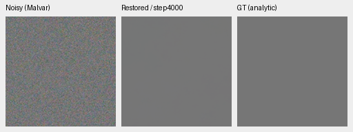
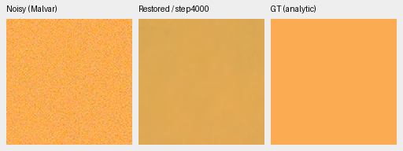
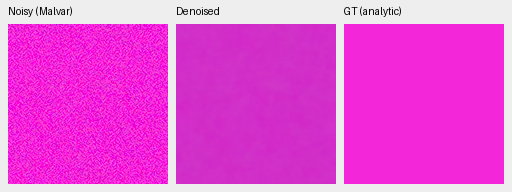
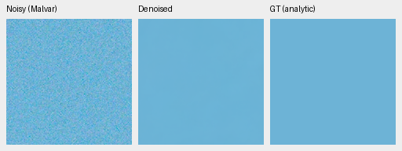
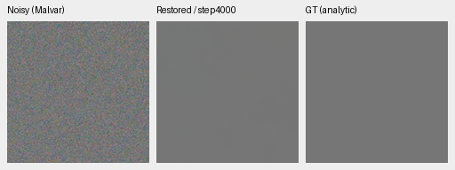
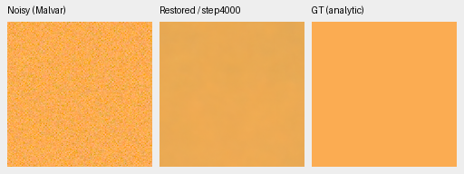
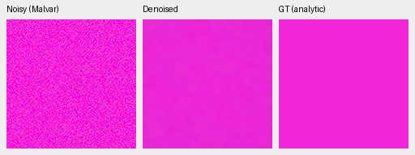
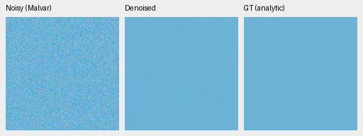

# Final 4,000 updates: selected CPU color diagnosis

The wider palette helps some selected saturated fields versus its matched
control, but **color fidelity is still not generally repaired**. Both variants
have completed their original 4,000-update schedules. Warm high-noise fields
remain too dark and mottled; wider training substantially reduces the selected
magenta bias, with visible residual structure. Neutral gray stays close.
This diagnosis does not promote either model or extend either schedule.
Full photographic, real-camera and prospective hue-grid review remains separate.

[Complete float-array audit, source and native crop receipts](results/wide-flat-palette-full4k-selected-colors.json).
[Matched data intervention](wide-flat-palette.md); [first1k review](wide-flat-palette-first1k-review.md).

The same 32 saved observations cover four selected uniform colors, two noise
conditions and all four CFAs, with one noise draw per case. These colors were
chosen after earlier failures, so this is a post-hoc diagnostic, not an
independent benchmark. The warm vector reuses three means from an earlier fabric
ROI; its spatial target here is an exact analytic constant. CPU FP32 inference
was completed by the original workflow; this review uses only saved arrays.

Each table value is the **largest absolute channel-mean error across all four
CFAs**, in normalized unclipped camera RGB. It is not the mean across CFAs or
an uncertainty interval. All fields use native ROI [48,48,160,160] from 256px
inputs. Older checkpoints are reused from independently audited reports with
identical input cases; V43 has a different initialization and training history.

| Model | Condition | Neutral | Warm | Cyclic GBR (magenta) | Cyclic BRG |
| --- | --- | ---: | ---: | ---: | ---: |
| V43 retained2k | adc-only | 0.000157 | 0.007939 | 0.006116 | 0.001550 |
| V43 retained2k | iso12800-prior | 0.000630 | 0.001537 | 0.002077 | 0.000560 |
| ConvNeXt parent10k | adc-only | 0.000251 | 0.033465 | 0.077301 | 0.001329 |
| ConvNeXt parent10k | iso12800-prior | 0.000714 | 0.092458 | 0.120555 | 0.002396 |
| Control +1k | adc-only | 0.000148 | 0.033866 | 0.025264 | 0.002521 |
| Control +1k | iso12800-prior | 0.000821 | 0.042190 | 0.095674 | 0.007583 |
| Wide +1k | adc-only | 0.000097 | 0.013887 | 0.049290 | 0.000783 |
| Wide +1k | iso12800-prior | 0.000857 | 0.028548 | 0.107937 | 0.001782 |
| Control +4k | adc-only | 0.000170 | 0.037749 | 0.029495 | 0.000786 |
| Control +4k | iso12800-prior | 0.000807 | 0.112837 | 0.118746 | 0.003092 |
| Wide +4k | adc-only | 0.000109 | 0.006591 | 0.012543 | 0.000729 |
| Wide +4k | iso12800-prior | 0.000826 | 0.069662 | 0.030990 | 0.002847 |

The wider arm's magenta maximum error falls from 0.118746 in control to
0.030990. Warm maximum error falls from 0.112837 to 0.069662, but remains worse
than the wider arm's first1k 0.028548 on these same observations. Longer training
therefore moves errors unevenly; selected improvements cannot establish a
training cause or general repair. The prospective 1,176-observation CUDA grid
and full photo/real comparisons are still required.

## Native noisy / denoised / exact-GT triplets

Every panel is 160×160 at one image pixel per PNG pixel, without resizing.
Left: noisy WB-aware Malvar; middle: restored; right: exact analytic GT.
Identical RGGB observations, ROI [48,48,160,160], WB [2,1,1.5], original recorded
camera matrix and display exposure ×1 apply to both variants. High-noise prior:
shot .00256, read variance .0000262144; ADC 16 bits, black .03. ADC-only retains
quantization with shot=read=0. These synthetic protocol conditions are not a
measured real-camera ISO calibration. Scores use unquantized float32 arrays;
PNGs are 8-bit sRGB previews. Every crop receipt records source/target, checkpoint
SHA256, conditioning, ROI and display transform.

| Model | SHA256 |
| --- | --- |
| Control +4k | `a6e494a121b99e311c6be4d24794929f625c3690448588f7d3d1c1af3273dadc` |
| Wide +4k | `1e9812afcfaa5322593c9d2c2314fa0d8ae5458c4e116be0f516c992c880b47e` |

### Control +4k

### Wider palette +4k

## Verification and limits

An independent Torch64 reconstruction of all **384 metric fields** from the
64 saved float32 predictions differs from the saved NumPy64 results by at most
2.22e-16. All eight native PNG triplets were actually viewed; their 24 image
panels reconstruct exactly from the saved inputs/predictions. Common observations
and target transforms match across methods. No new model inference, noise draw,
RAW decode or CUDA context was needed for this review.

An invalid additional-palette argument initially failed after numerical work.
The auditor now rejects that input before array work or output creation; the
actual negative check passes without CUDA. A positive replay retains all 384
field checks and all eight original whole-file PNG hashes. The running queue's
frozen tools remain unchanged.

These are four selected colors, one fixed WB/matrix and a single training seed.
They do not establish photographic quality, real-camera superiority, SOTA,
convergence or 100MP speed. The [full review workflow](palette-final-review-preparation.md)
retains its original inputs and must finish before a broader model decision.
