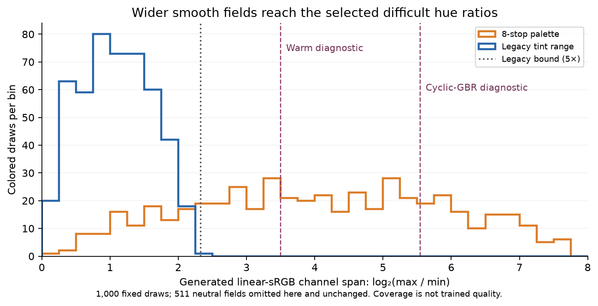

# Wider smooth-color palette: matched trial prepared

The next proposed training comparison targets the saturated flat-field failures
in the [mature model review](mature-color-flat-review.md). The optional
`flat_chroma_stops` data setting is implemented with a default of zero. CPU
engineering passes, including a complete restart from the genuine mature
ConvNeXt parent. **Production training and CUDA numerics have not run for this
option, and no quality improvement is established.**
[Complete CPU receipt, tests, source checks and prepared configurations](results/wide-flat-palette-preparation.json).

The current smooth generator already includes colored fields: half neutral,
half tinted. Its direct linear-sRGB tint ratio is bounded by 5. The selected warm
and cyclic-GBR diagnostic colors have channel ratios 11.32 and 46.71; the neutral
and cyclic-BRG colors are within the original bound. This post-hoc association
motivates a test, without identifying the cause. Photos, synthetic shapes and
native/paired domains can already contain colors outside the smooth branch.



The figure uses 1,000 fixed draws from seed 20261016, omitting 511 neutral fields
that remain exact. Maximum observed channel ratios are 4.78219 and 210.76912.
Coverage of a channel ratio does not imply uniform hue or camera-color coverage.

## Data intervention

For a non-neutral field, reuse the same three original uniforms `t_i` in
[.3,1.5]. For positive span `s`, compute:

```text
q_i = 2 ** (s * ((t_i - .3) / 1.2 - 1))
new_t_i = q_i * sum(t) / sum(q)
```

The pre-clamp channel mean is preserved, and the theoretical maximum/minimum
tint ratio is at most `2**s`. Neutral fields, intensity and ramp distributions,
Python RNG consumption and subsequent geometry/PSF draws remain unchanged.
Zero bypasses the remap entirely, preserving the legacy tensors exactly; it does
not request a uniform tint. Values must be finite and within [0,16].

At bright intensities, a wider individual channel can clip, changing the final
mean. Eleven of the 1,000 widened draws reach clipping. Among unclipped fields,
maximum channel-mean discrepancy is 5.96e-8 in float32. There is no output gain,
camera-feature modification, new loss term or inference correction.

`CleanDataset` routes the option only to smooth samples. Photographs, strong and
weak synthetic textures, native/paired data and validation recipes are unchanged.
The trainer stores the setting and rejects a changed value on resume. Legacy
checkpoints without the field mean zero. Use initialization for a new recipe.

Unchanged Python draws do not promise identical sensor noise inside an affected
batch: Poisson sampling can consume a different number of random values when
its rate changes. Per-step seeding prevents that difference propagating to
other steps. Actual batch hashes must be checked with that scope.

## CPU evidence

The complete CPU suite passes **508 tests with nine CUDA skips in 79.22s**.
Targeted coverage verifies pre-change golden RGB/RNG hashes, neutral/mean/span
properties, full augmentation routing, fixed validation, malformed options,
configuration persistence and resume guards, including legacy missing metadata.

The separate [actual audit driver](../scripts/audit_flat_palette.py) replays the
archived pre-change `data.py` (SHA256
`b3277bca23d8c17b365ee364e175ea8a850d45a79cf02686628db606341e7be3`).
All 1,000 default RGB fields and Python RNG states match exactly. All 511
neutral fields match under the wider setting. On 128 native64 examples using
actual frozen Commons caches and full augmentation, default targets match the
old implementation exactly; widening changes only ten colored smooth targets.
Eight neutral fields, 24 strong synthetic examples and 86 photographs remain
exact. Unit tests additionally cover the weak-texture route.

The genuine-parent CPU audit compares four uninterrupted updates with two
updates plus a whole-state resume. It uses batch1/native64/FP32/workers0 and
forces Commons smooth fraction1 to exercise the new colored path. Native and
paired domains retain the usual 25%/25% schedule. All 91 model tensors, 91 EMA
tensors, 89 AdamW states, model configuration, Python/Torch/CUDA RNG, step and
best-validation state match exactly. All observations and numerical training
logs match, excluding elapsed time. The control/wide batch hashes differ only
on the first colored Commons update; the neutral Commons, native and paired
updates match. These four discarded updates verify engineering, not model
quality or production speed. No CUDA context or cold RAW decode was used.

## Prepared matched fine-tuning comparison

Both arms initialize from mature V58 step10000 EMA, checkpoint SHA256
`cc1fb5e6d3e0d042c95495dd7bf1bd07c900cb6f7e3b61541f78c9e08098fea3`.
This parent ties no-context on the photo mean and retains useful weak-carrier
recovery, but has the selected saturated-flat errors. The experiment tests
whether wider smooth training can reduce those errors without sacrificing
photo/real detail. It does not assume that the DINO context is responsible.

| Setting | Control V59 | Wider palette V60 |
| --- | --- | --- |
| Configuration | [V59](../configs/dino-convnext-palette-control-b16-v59.yaml) | [V60](../configs/dino-convnext-palette-wide-b16-v60.yaml) |
| `flat_chroma_stops` | 0, legacy | 8 |
| Parent, architecture, precision and losses | Shared | Shared |
| Seed / batch / native patch | 48 / 16 / 256 | 48 / 16 / 256 |
| Fresh AdamW / planned additional updates | 4,000 | 4,000 |
| LR / warmup | 2e-5 / 100 | 2e-5 / 100 |
| Commons / native / paired | 40,170 / 128 / 32 | 40,170 / 128 / 32 |

The configuration files differ only in run path and palette setting. Domain
fractions, synthetic/flat fractions, source identities, geometry/PSF, negative
read noise, ADC policy and original8× validation stay fixed. The expanded
66,934-source manifest stays outside this comparison. There is no Gaussian
reinitialization; both use the same preceding JDD EMA with fresh AdamW/EMA state.

The deterministic planned 4,000-step schedule has 1,977 Commons, 1,012 native and
1,011 paired batches. Its Commons patch positions include 1,578 colored smooth
examples (2.47% of all 64,000 patches), 1,650 neutral fields, 6,265 strong
synthetic examples and 22,139 photographs. Wider colors do not increase the
smooth sampling fraction or replace more real photographs.

The [prepared CUDA preflight](../scripts/preflight_flat_palette_cuda.py) requires
the running reference workflow's actual successful exit and completed review.
Its live-owner rejection has been exercised: PID1016386 was confirmed live,
and the attempt stopped before output creation or CUDA work. CUDA tests,
native256/batch16/BF16 actual-trainer updates across all three domains, exact
saved-state restoration and portable EMA FP16 predictions remain to run.

After those checks, evaluate the first1k gate under the original4k schedule,
with full427 photos, known4/unseen5, colored and neutral fields, weak carriers,
full102MP GFX including foliage/fence, and the three cached personal cameras.
Use native exact-GT triplets and accurately labeled real references. Source
bootstrap intervals do not quantify training-repeat uncertainty. Any further
updates retain the planned schedule; no early-gate convergence or SOTA claim.
