# Wider RAW context recovers more measured lattice detail

**The guarded wider-context option raises fresh dark-mesh response 14.4% and
lowers image RMS error 1.2% versus sparse support.** Mean added blank-region RMS
rises 17.3%; its worst case falls 17.4%. All 256 absent neural cases and 5,120 matched/
mismatched flat-control executions retain every parent pixel. Very faint detail
and boundary leakage remain. The new option is explicit: `--phase-harmonic-envelope wide`.

[Implementation](../src/demosaic/phase_context.py) ·
[Variance floor](../src/demosaic/phase_noise_floor.py) ·
[Execution and validation](results/wide-phase-context-publication-v1.json) ·
[Native source/ROI/checkpoint/noise/display manifest](images/wide-phase-context-v1/manifest.json).

## What changes

A faint periodic line can be ambiguous inside a 256-pixel window but measurable
across 512 actual sensor pixels. This option proposes frequencies from that larger
RAW context, then fits their local support with the existing
[connected support/refit](sparse-phase-support.md) method. It also searches a
second band containing measured higher harmonics. The local fit preserves its
original frequencies and inactive gates, adding only separated context proposals.
It does not generate texture from a reference or alter learned weights.

Each actual 512 context uses separate affine detrending and Hann windows on the two
green phases, retaining physical CFA offsets. Search bands are native frequencies
.03–.22 and .22–.34 cycles/pixel, with both components strictly below .25 in
magnitude. Each band selects at most four coherent peaks, suppressing neighbors
within 4/256 cycles/pixel. Coherence must exceed .8 and signed cross power must reach
5 supplied-noise units. The continuous search remains within 1.5 context FFT bins.
Local 256 windows at stride 128 retain the original dictionary and add separated
proposals; the joint fit has at most 12 waves. The support, TV, gates, aprons and
FP32 full-image blend retain their earlier definitions.

Larger context alone failed a flat-control test when the supplied read variance
was too low. The shipped version therefore adds a **nonnegative variance floor**
for correction only. For each green, propagate unit pixel variance through the
same fixed affine/Hann operator. In the positive-fy .1–.34 annulus compute:

```
empirical = median(measured_power / propagated_unit_variance) / ln(2)
declared  = median(supplied_spectral_variance / propagated_unit_variance)
added_variance = max(0, max_over_greens(empirical - declared))
```

Add this scalar to all four phase variances for context selection, local fitting
and regularization. It never lowers the supplied variance or changes neural
conditioning. Broadband texture can raise the proxy and suppress useful detail;
this is **not a calibrated camera read-noise estimate or uncertainty measure**.
Selection, frequency refinement and fitting reuse the same noisy samples.

Contexts follow a 256-pixel grid with offset−64, clamped to actual even-origin
512-pixel windows and cached. No repeated pixels provide enlarged evidence.
Observed-clipped local windows retain the exact earlier fixed-bin TV correction,
ignoring the new floor. Images shorter than 512 in either dimension retain the
exact earlier `sparse` result, including its limitations under a wrong noise prior.

## Fresh procedural and flat controls

The guarded policy was frozen before 64 fresh native 512 mesh/empty recipes,
seeds 2026111900–1963. Four CFAs and presence/absence give 512 actual V143/DINO
forwards and 512 new sensor observations, not 512 independent scene recipes.
Continuous geometry at 1024 pixels precedes twofold area downsampling; scene scale .02, zero optical
blur, original .005–.2 mesh contrast, shot .00128, read 6.5536e−6, ADC16/black .03.
All methods share each actual parent and noisy observation. Exact procedural GT
is used only for scoring and clearly labeled common display controls.

| Present-mesh mean unless specified | V143 parent | Sparse support | Guarded wider context |
| --- | ---: | ---: | ---: |
| Full 512 template response (GT=1) | .019386 | .048479 | **.055448** |
| Full 512 RGB error RMS, DN16 | 9.23196 | 8.78795 | **8.68186** |
| Central 160 spatial error RMS, DN16 | 13.50316 | 12.72427 | **12.51621** |
| Added RMS in exact blank support, DN16 | 0 | **.008341** | .009783 |
| Worst added blank RMS, DN16 | 0 | 1.12543 | **.92940** |
| Changed present observations /256 | 0 | 44 | 47 |

Only 12 of 64 recipe seeds activate the guarded correction; average template
response is still 5.54% of GT. Versus sparse support, 43 present observations gain
response and lower image error, four regress and 209 remain unchanged. Exact-blank
GT error increases in seven and decreases in seven, with 242 unchanged. The mean
blank-GT RMS changes only 5.632537→5.632454 DN16. The smaller worst added-field RMS
does not establish absence of hallucination beside real texture.

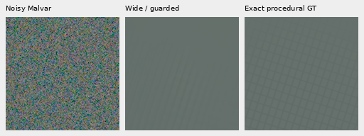

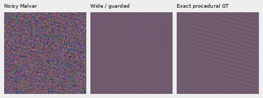

Cross-method views: [recipe 1](images/wide-phase-context-v1/mesh-seed2026111905-present-iso6400-prior-RGGB-comparison.png), [recipe 2](images/wide-phase-context-v1/mesh-seed2026111907-present-iso6400-prior-RGGB-comparison.png). [Inactive example](images/wide-phase-context-v1/mesh-seed2026111900-present-iso6400-prior-RGGB-comparison.png) and [inactive triplet](images/wide-phase-context-v1/mesh-seed2026111900-present-iso6400-prior-RGGB-triplet.png) retain the parent. Selected active crops chiefly recover one line direction; the second remains weak.

All displayed cells are native 160×160 pixels. The procedural comparisons use
fixed central ROI [176,176,160,160], common WB/matrix and +3EV. The first two active
recipe seeds, worst added blank-RMS increase and first inactive example are
selected after evaluation and identified in the manifest. The blank-tail control selects the worst absolute added blank RMS, then
uses the maximum added pixel within exact blank support, with native and shared
40× camera-linear contrast views. No crop is resized.

The first unguarded trial used 1,024 actual parents from 64 other recipes at two
predeclared contrast strengths. After the mismatch failure it became historical/
development evidence for the guard; it is not independent guarded validation.
The 32-recipe development collection adds 256 actual parents. All 1,792 learned
forwards retain model/backbone/input/RNG checks. No training updates, V120 control
forwards or real RAW decodes were added in this study.

The same 4,096 unique pure-flat observations cover four CFAs, four shot priors
(.00002,.00008,.00032,.00128), level 2^uniform(−12,.5), Poisson/read/ADC16 noise and
random R/B tints. All 4,096 complete native 512 guarded outputs equal their ideal
parents. Reanalyzing the 1,024 true nominal-ISO6400 observations with the nearby
Haar prior (shot .0014635775921166604, read 1.0715704128646712e−6) previously selected
137 enlarged-context candidates: unguarded correction changed 124, sparse support
changed 78, and 46 changed only in the unguarded version. After the additive floor,
**all 1,024 complete guarded outputs equal their ideal parents**. No GT value,
true-noise oracle or reference enters that floor.

The flat parents are declared ideal camera-RGB constants, not neural outputs.
The fresh 256 absent neural cases provide a separate model-output check. The
4,096 unique flat observations are deterministically regenerated for subsequent
checks; those repeated generations are not new independent samples. The failed
unguarded version, its false fields and source snapshots remain archived.

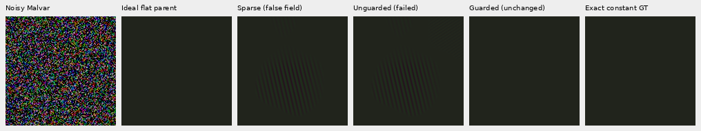

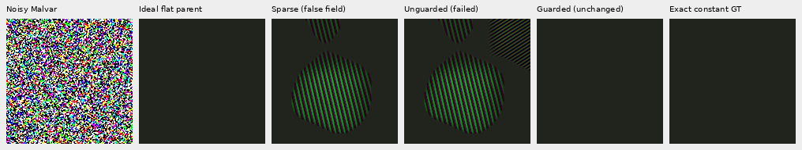

Top: shared +6EV. Bottom: common `flat +40*(value-flat)` before the same display. The ideal parent and exact constant GT coincide. The failure was chosen during guard development; it is not an independent holdout.

## Complete GFX photographs

Three complete 101,995,852-pixel outputs reuse identical cached noisy RAW and V143
parents: DSCF3879 with the fixed historical Haar prior, and DSCF3842 with both the
nominal and nearby-DSCF3879 priors. The source RAFs, siblings and both cameras'
JPEGs remain excluded from training. No source disk was opened.

The standing main crops cover sky, building, foliage and chain-link fence. Fine
mesh crops beside the red cab include both straight-out-of-camera JPEGs, with
common +4EV. DSCF3880/DSCF3835 ISO100 AHD and JPEG comparisons are independent
qualitative references, **not exact GT**: aperture, exposure time, motion and
processing differ. The manifest binds the exact full-sensor ROI, source,
checkpoint, supplied noise, added-floor contexts and display for every panel.

Main scene, common +2EV: noisy → V120 → V143 → sparse → guarded wider context → independent ISO100 reference.

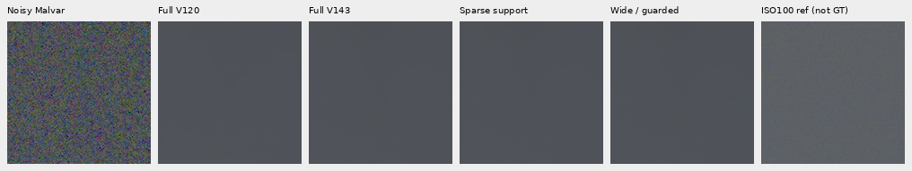

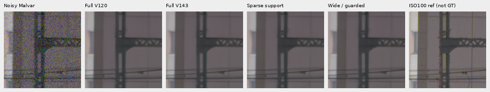

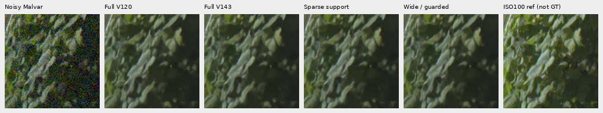

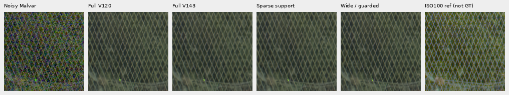

Fine mesh, common +4EV: noisy → V143 → sparse → guarded wider context → ISO6400 camera JPEG → independent ISO100 AHD → ISO100 JPEG. Nominal prior first, nearby prior second.

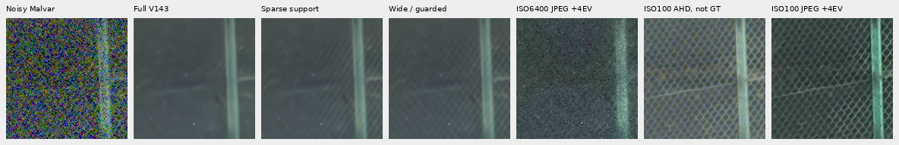

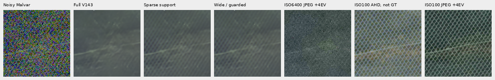

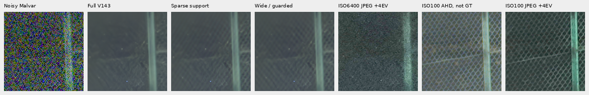

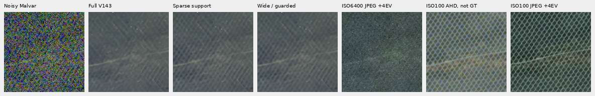

The [nominal left](images/wide-phase-context-v1/mesh-nominal-mesh-nominal-fine-green-mesh-left.png), [nominal right](images/wide-phase-context-v1/mesh-nominal-mesh-nominal-fine-green-mesh-right.png), [nearby left](images/wide-phase-context-v1/mesh-nearby-Haar-mesh-profile3879-fine-green-mesh-left.png) and [nearby right](images/wide-phase-context-v1/mesh-nearby-Haar-mesh-profile3879-fine-green-mesh-right.png) comparisons also omit the JPEG columns for a compact view.

Actual native inspection finds stronger crossing lattice contrast under both
priors, especially the nearby-prior crops. It remains soft and uneven, with a
large gap to the independent ISO100 references. Main foliage remains painterly
and building detail soft. The complete sky box `[5200,200,2400,1200]` retains all
8,640,000 parent channel values exactly, as does sparse support.

The nominal prior is shot .00128/read 6.5536e−6; the nearby and main priors are
shot .0014635775921166604/read 1.0715704128646712e−6. Contexts feeding the nominal
left ROI add variance 0–8.9109e−6; nominal right adds zero. Nearby left adds
1.5715e−6–1.17685e−5 and nearby right 1.5715e−6–3.4577e−6. These ranges describe
overlapping local fits, not a new neural or camera calibration. Every context
and coordinate is recorded in the manifest and execution receipt.

The worst fresh procedural blank control remains a failure: its common 40× view
shows a detached false stripe patch outside the exact mesh, in addition to
boundary leakage. The guard fixes the tested completely flat mismatch controls;
it does not eliminate false structure beside real texture.

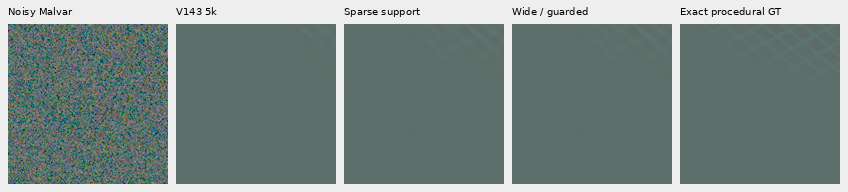

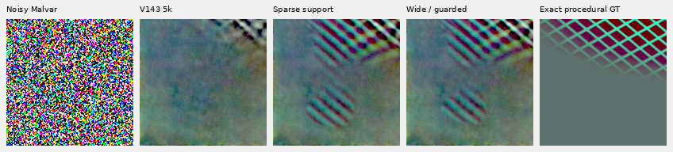

All three [wider-sky crops](images/wide-phase-context-v1/wider-sky-1.png), [second](images/wide-phase-context-v1/wider-sky-2.png) and [third](images/wide-phase-context-v1/wider-sky-3.png) show unchanged values.

Outcome-selected strongest total corrections and strongest changes versus sparse
support are also shown for all three full frames, using a fixed 160-pixel grid
and shared −2EV. Independent ISO100 AHD registration uses input Malvar only and
integer translations within 16 pixels. These are stress views, not scoring GT.

| Full frame | Strongest total correction | Strongest change from sparse |
| --- | --- | --- |
| main-fixed-Haar | [Native view](images/wide-phase-context-v1/main-fixed-Haar-strongest-total.png) | [Native view](images/wide-phase-context-v1/main-fixed-Haar-strongest-delta.png) |
| mesh-nominal | [Native view](images/wide-phase-context-v1/mesh-nominal-strongest-total.png) | [Native view](images/wide-phase-context-v1/mesh-nominal-strongest-delta.png) |
| mesh-nearby-Haar | [Native view](images/wide-phase-context-v1/mesh-nearby-Haar-strongest-total.png) | [Native view](images/wide-phase-context-v1/mesh-nearby-Haar-strongest-delta.png) |

Bright-sign color changes remain unresolved. Maximum added channel values retain
the earlier clipped-window fallback: main 8288.47, nominal 11638.23 and nearby
12083.39 DN16. The independent exposures are unsuitable for pixelwise error claims.

Each full frame uses 6,188 local fits and 1,530 actual contexts. The table reports
correction-only time with three CPU workers sharing CUDA graphs and overlapping
with other audits; these are not isolated speed comparisons or end-to-end times.

| Frame | Seconds | Active local fits | Positive-floor contexts | TV caps/solves | Support caps/solves |
| --- | ---: | ---: | ---: | ---: | ---: |
| Main | 821.72 | 261 | 1515 | 56/469 | 89/93 |
| Mesh nominal | 729.92 | 145 | 623 | 24/358 | 46/72 |
| Mesh nearby | 826.50 | 297 | 1508 | 77/554 | 67/106 |

The largest TV relative gap is 2.95e−4 and support gap 6.36e−4. Capped solves are
approximate; the gap is numerical convergence evidence, not confidence in detail.
The speed target remains far away.

## Use and limits

With the usual `infer` input/output arguments, add:

```bash
--phase-harmonic --phase-harmonic-envelope wide
```

The correction follows the neural device; `--phase-harmonic-device cpu` selects
the reference solver. Metadata records the context bands, floor for every
context, support policy and both solvers' iteration caps. The phase stage remains
explicit; `edge` remains its default. V120 remains the broadly measured general
model. This targeted V143 option does not establish broad camera/photo superiority.
Very faint detail, leakage at texture boundaries, highlight color, uncertainty
calibration and the 100MP/10s speed target remain unresolved.

The checkpoint is V1435k EMA, SHA256
`96d146d017c54196288c585f8b7eddcf030e8a235061049c31e985b9380b7ce4`.
All 79 shipped source modules match the frozen full-frame execution. The public
port matches 201,326,592 development and 402,653,184 fresh RGB values exactly.
Independent ten-column affine/template and direct error checks verify all 1,536
fresh rows; four actual-parent patches cover all CFAs with CPU/CUDA difference
at most 3.47e−18 and unchanged RNG. All 146 distinct targeted tests pass.

All 31 native boards were actually viewed in nine sheets. Independent PNG
copy/matrix/gamma checks verify 12,057,600 channel values. All 917,962,668 linear
RGB16 export channels match clip/round/orientation exactly; all three sRGB16
exports remain within 1 DN of an independent FP64 render, with 16-bit/ICC metadata
checked. Historical receipts and source snapshots remain intact. The publication
receipt links the complete scores, collections, locks, failures and audits.
