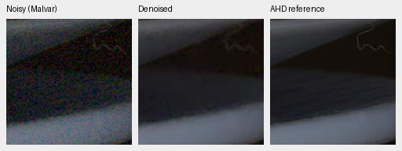
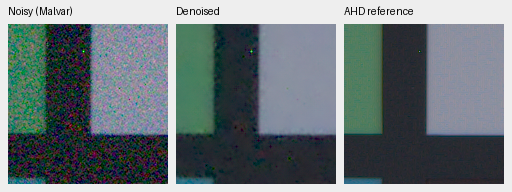

# Larger RGB correction branch: first review

V16 increases the correction branch from width 24/four blocks (27,696 parameters)
to width 48/eight blocks (144,072). Original restoration/DINO weights remain
frozen at the same V11 step5000 initialization. Data proportions, losses and
learning rate match V15; model initialization consumes a different RNG sequence,
so this is a capacity trial rather than a matched data-sequence ablation.

The first 1000 steps improve both real development sets over V15 at step1000:

| Method | Known measured-CFA PSNR | Unseen measured-CFA PSNR | Known AHD SSIM | Unseen AHD SSIM |
| --- | ---: | ---: | ---: | ---: |
| V15 step1000 | 52.5264 | 52.1592 | 0.90558 | 0.87600 |
| V16 step1000 | 52.9210 | 52.6045 | 0.91375 | 0.88986 |

These scores are still below V15's completed step5000 review and RawNIND.
A predeclared 64-photo synthetic screen gives sRGB PSNR/SSIM 31.89746/0.922292,
versus V15 step1000 31.87841/0.921193 on the same inputs. Procedural eight-source
PSNR/SSIM is 29.10436/0.905848 versus 29.07705/0.904316. This screen is not the
complete 427-photo suite. V16 is being extended to step5000, with no promotion
or quality-goal claim from the early results. Protected test targets remain unused.

Fixed 160×160 native crops from the known-camera report, same locations and
display settings as V15. Left: noisy Malvar; middle: V16; right: auxiliary
calibrated low-noise AHD reference, not exact RGB GT. Open the PNGs at 100%.

[Source/checkpoint/manifest hashes, exact crop settings and all aggregate results](results/wide-refiner-v16-1k-review.json).
Noise and missing fine structure remain visible. The [V15 review](photo-refinement-review.md)
contains exact synthetic-GT examples and full-frame GFX comparisons.

Sources: Benoit Brummer and Christophe De Vleeschouwer, *Raw Natural Image Noise
Dataset (2025)*, [dataset](https://doi.org/10.14428/DVN/DEQCIM),
[CC BY-SA 4.0](https://creativecommons.org/licenses/by-sa/4.0/), with additional
scene permissions retained locally (`7D-1`: Peter Wemmert, CC0). Modified by
registration, calibration, demosaicing/restoration, cropping and shared display.
