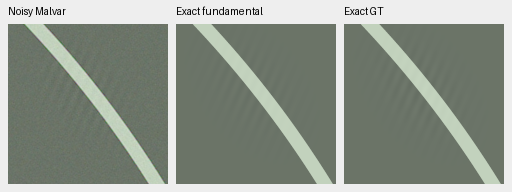
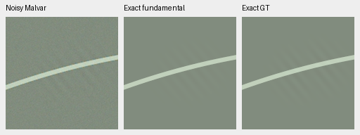

# Finite wire support beside rails

Fitting the wave inside a known footprint recovers substantially more of
the stronger wire. Combining that footprint with a fundamental-frequency
fit also recovers more of the faint wire at ISO400. The faint improvement
depends on shape, noise and the accuracy of the footprint. This is a
synthetic geometry diagnostic above an analytic rail parent.
[Case receipts, sources and native crops](results/wire-envelopes-v1/publication.json).

## Fit and validation

The [cross-color comparison](cross-colour-refit.md) changed only the
validation gate and recovered little extra detail beside rails. Here the
gate stays independent by color, and the columns it validates change.

Every arm uses the same screened curved background fitted on discovery
RAW, exact nominal center frequencies, crossed-fold per-color validation
and all-site weighted delivery. The fit applies the envelope to the
carrier's basis before either fold estimates its coefficients. The
conditional null omits the tested carrier and retains the same nuisance
terms and other carrier. The unchanged validation window includes
background pixels, and the delivered wave is zero outside its envelope.

- **Uniform eight knots** is the screened phase refit. **Taper only**
  attenuates its final correction by the known envelope.
- **Exact, broad and shifted eight knots** fit using the specified
  envelope throughout. Broad increases both radii by 50%. Shifted
  displaces the center by 40 native pixels along the rail normal with
  a predetermined sign.
- **Uniform and exact fundamental** constrain the eight knots to sine and
  cosine modes, with coefficients fit independently for each color.
  Neither arm receives phase or amplitude.

The archived cases reuse the original 16 noisy pairs. Exact support there
uses the true spatial envelope. The fresh 16 pairs use independent rail
geometries, phase and sensor seeds across four CFA patterns. Half have a
quadratic phase change, an interrupted envelope and a signed weak red
component. Their nominal ellipse omits the interruption and their
frequency specifies the center gradient only.

## Weak response and error

The canonical operating points use gate 2 and scale 0.822120 at ISO400,
and gate 1 and scale 0.561062 at ISO6400. Response projects the paired
strong-plus-weak minus strong-only restoration increment onto the exact
weak increment. The two roles have independent noise. Below, each cell
gives weak response and weak-increment RMS in DN16. Each full panel cell
uses eight cases.

| Panel | Uniform eight knots | Taper only | Exact eight knots | Uniform fundamental | Exact fundamental |
| --- | ---: | ---: | ---: | ---: | ---: |
| Archived ISO400 | 0.016% / 7.140 | 0.007% / 6.898 | 0.421% / 8.282 | 0.927% / 7.042 | 7.023% / 6.878 |
| Fresh ISO400 | 0.859% / 6.724 | 0.535% / 6.587 | 4.410% / 7.308 | 2.332% / 6.586 | 13.767% / 5.908 |
| Archived ISO6400 | 0.131% / 6.950 | 0.085% / 6.882 | 0.057% / 8.955 | 0.031% / 7.257 | 3.307% / 8.292 |
| Fresh ISO6400 | −0.013% / 6.699 | −0.003% / 6.636 | 0.792% / 8.219 | −0.106% / 6.791 | 2.999% / 8.214 |

At ISO400 the exact fundamental recovers **20.05%** on the four fresh
planar cases and **7.49%** on the four fresh chirped cases, with lower
increment RMS in both groups. Fresh strong response rises from **10.62%**
to **68.33%**. The shifted eight-knot fit recovers −0.01% on the fresh
ISO400 weak increment, and broad eight knots recovers 4.94% with higher
increment RMS and quiet error than the uniform refit. The larger gains
of the exact eight-knot fit are in the stronger wire. At ISO6400, the
exact fundamental raises aggregate weak projection but also increases
increment error. Fresh chirped response falls to −0.51%.

### Location tolerance and false detail

With the fundamental basis on the same fresh pairs, keeping the correct
center and widening the envelope by 50% retains most of the ISO400
response. Shifting the center by 40 pixels loses nearly all of the gain.
The wider envelope also admits correction outside the true footprint.

| Fresh panel | Exact response / increment RMS | Broad response / increment RMS | Shifted response / increment RMS |
| --- | ---: | ---: | ---: |
| ISO400 | 13.767% / 5.908 | 12.135% / 5.948 | 0.322% / 6.728 |
| ISO6400 | 2.999% / 8.214 | 1.279% / 8.273 | 0.150% / 6.741 |

The 48 earlier flat and rail-only controls replay with deliberately
misleading guide frequencies and a supplied ellipse near the nominal rail.
Cells give aggregate RMS / peak DN16 of the unscaled correction over
the fixed native crop. Exact-size refers to the elliptical support used
in the positive tests. These controls contain zero wires.

| Null class | Uniform eight knots | Local eight knots | Uniform fundamental | Local fundamental | Broad fundamental |
| --- | ---: | ---: | ---: | ---: | ---: |
| Flat, 8 cases | 0.416 / 15.35 | 0.003 / 0.50 | 0.053 / 3.15 | 0.031 / 1.45 | <0.001 / 0.03 |
| Straight edge or rail, 16 cases | 0.447 / 6.34 | 1.421 / 43.31 | 0.100 / 4.06 | 0.524 / 11.63 | 0.693 / 18.62 |
| Complex rail, 24 cases | 1.313 / 20.18 | 3.372 / 77.59 | 0.207 / 4.40 | 0.682 / 21.55 | 0.373 / 8.32 |

The local eight-knot fit increases false rail structure even though it
cannot change pixels outside its ellipse. The broad fundamental fit
improves on the uniform eight-knot baseline for complex rails and raises
straight-rail error. Uniform fundamental rejects more misleading guides
than either centered local fundamental fit. Zero output beyond a
supplied footprint is a containment property. The tests inside the
footprint are still essential.
[Full thresholds, per-profile controls and geometry receipts](results/wire-envelopes-v1/summary.json).

## Native crops

Both triplets show noisy Malvar, the exact-footprint fundamental fit,
and exact constructed GT. Each uses 160×160 original pixels from
`[48,48,160,160]` in its 256×256 query. The display uses exposure ×4,
contrast 1, identity camera-RGB white balance and matrix, and fixed
clipped sRGB. Both use ISO400-prior shot/read `8e-5/2.56e-8`, 16-bit
ADC and black 0.03. The exact rail-only delivery parent uses no checkpoint.

The archived case recovers a substantial part of the strong wire.
The weak crossings remain fainter than in the target.
[All methods](images/wire-envelopes-v1/archived-iso400-case8-comparison.png).

The fresh signed-color case still loses the interrupted wire next to the
bright rail. [All methods](images/wire-envelopes-v1/fresh-iso400-case4-comparison.png) ·
[Crop and noise manifest](images/wire-envelopes-v1/manifest.json).

## Native GFX100S review

The real replay compares uniform bases with the fixed whole-frame and
spectral frequencies, independent color validation restricted to the
same edge side, and threshold 2. The synthetic-envelope gains require
known spatial support. This replay uses uniform support in both arms.
The parent is V120 EMA
`a9d9b6b4f974e24a6b11e5e740aab32314233a7f53c056cf37c7d2aac1c589fb`.

DSCF3879 uses shot/read `.00128/6.5536e-6` at exposure ×4. The sky
matches V120 exactly. The full-frame coarse fence keeps the visible
lattice, with slightly smaller changes from V120 and no new crossings.
Full-frame building and foliage match V120. The spectral building
correction drops from 2.94 to 1.46 DN16 RMS relative to V120 and appears
subtler. Foliage stays soft, and the narrow hardware visible in the
DSCF3880 ISO100 AHD reference remains incomplete.
[Sky](images/wire-envelopes-v1/main-overcast-sky.png) ·
[Building](images/wire-envelopes-v1/main-building-detail.png) ·
[Foliage](images/wire-envelopes-v1/main-foliage.png) ·
[Coarse fence](images/wire-envelopes-v1/main-chain-link-fence.png).

On DSCF3842, both uniform bases reproduce the matching conditioned V120
pixels in the left and right native crops under both profiles and both
guide families. Fine crossings remain incomplete. Display exposure is
×16. DSCF3835 ISO100 AHD and both straight-out-of-camera JPEGs are
qualitative references with aperture, exposure and subject motion
differences.

| Conditioning | Shot/read | Cab comparison |
| --- | --- | --- |
| Nominal | `.00128/6.5536e-6` | [Left](images/wire-envelopes-v1/mesh-nominal-left.png) · [Right](images/wire-envelopes-v1/mesh-nominal-right.png) |
| DSCF3879 profile | `.0014635775921166604/1.0715704128646712e-6` | [Left](images/wire-envelopes-v1/mesh-profile3879-left.png) · [Right](images/wire-envelopes-v1/mesh-profile3879-right.png) |

This CPU replay uses existing weights and contains no new full-model
training or full427 evaluation. V120 remains the general recommendation.
