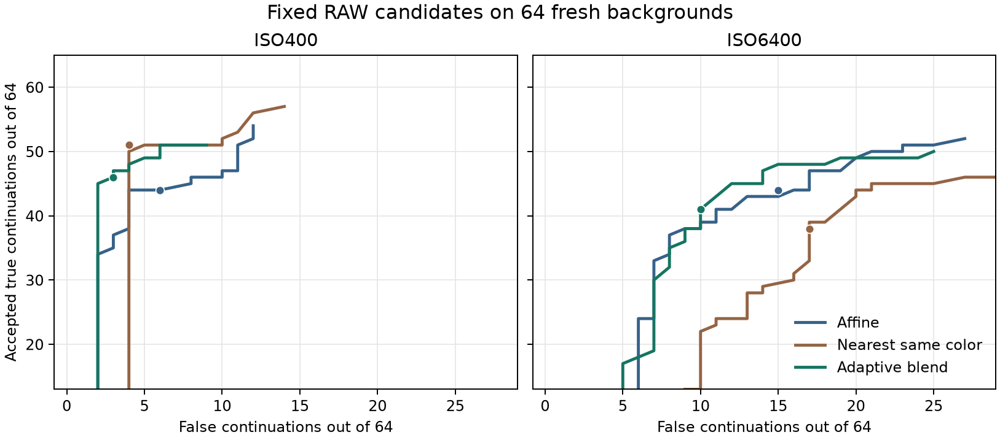
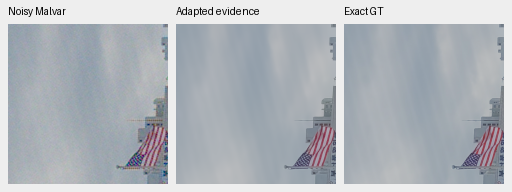
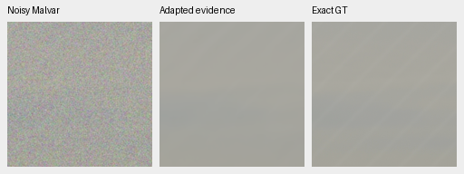

# Verifying a weak wire against nearby Bayer samples

A verifier that adapts to nearby RAW texture lowers false wire
continuations from **15 to 10** on 64 ISO6400 double-gap draws with
supplied nominal frequencies. It accepts 41 of 64 real continuations,
compared with 44 for the affine verifier. A bounded restoration using
the verified waveform raises signed continuation response by **13.53
percentage points** over the frozen parent. Total gap error also falls
slightly, with an uncertain mean and occasional false lines. The right
GFX cab shows clearer crossings in the center of a fixed aperture, with
an overly regular grid and incomplete crossings elsewhere.

[Machine results](results/wire-blind-spot-v1/publication.json) ·
[Sources and execution receipts](results/wire-blind-spot-v1/evidence.tar.xz) ·
[Native boards and provenance](images/wire-blind-spot-v1/manifest.json).

The [frequency-refinement follow-up](wire-frequency-refinement.md) measures
rounded and displaced guides on a fresh panel and tests the prior exterior
donor pair in the two empty left-cab cases. Better exterior frequency
agreement gives small, mixed delivery changes.

## Background prediction from a separate set of samples

Both checkerboard groups contain complete Bayer cells. For one score,
the opposite group supplies the same-color neighbors and the exterior
phase, width, background and noise estimates. The scored site's four
nearest same-color samples are one packed cell away horizontally or
vertically. A second pass swaps the groups, and the reported score
takes their equal-weight average. The average reuses both sets of
samples.

The affine contrast removes a separate plane for each CFA phase. The
neighbor contrast runs the same interpolation on the waveform and on
the background-subtracted RAW, then scales the result by the energy
of the surviving waveform. This makes the coefficient interpretable
when the interpolation removes much of the wire along with the
background. It also raises variance if very little waveform survives.
The adaptive contrast blends these two coefficients. To estimate the
blend weight, it places copies of both contrasts on exterior regions
and minimizes squared null coefficients there. The translated
apertures can overlap. The resulting weight is an empirical estimate of
how much of the surrounding texture can masquerade as the wire.

The detector takes one noisy frame. Given nominal frequencies and an
aperture, it fits both phases and widths from the first two Fourier
harmonics in the exterior RAW, with pose, CFA calibration and noise
held fixed. It requires a noise-scaled exterior score of 3 on each
fold, then checks whether mean interior amplitude exceeds half the
fitted exterior amplitude. The operational rule never reads a clean
background or the clean wire amplitude. Withheld RAW replacement in
eight fold interventions changes the validation statistic and leaves
the corresponding predictions, contrasts, nominal scale and blend
identical. Overwriting the clean labels also leaves the operational
scores identical in the tested cases. [Prior learned gate comparison](local-wire-gate-support.md).

## Fresh continuation and double-gap replay

The fixed protocol uses 64 fresh Commons backgrounds outside the
90,692-photo training manifest, the fixed 427-photo evaluation and the
earlier exact-wire reviews. There are 32 backgrounds per ISO, eight per
CFA in each ISO stratum, with two independent draws per role. Each
source supplies a true continuing wire, a double gap over the same
background, and a separate exact flat. Geometry and source handling
match across methods. Counts below use the measured half-exterior
threshold, with 64 draws per role and ISO. Both score arms use the same
exterior rule. Every fresh flat fails admission under that rule.

| Nominal frequencies, RAW-estimated phase and width | ISO400 true | ISO400 false | ISO6400 true | ISO6400 false |
| --- | ---: | ---: | ---: | ---: |
| Affine | 44 | 6 | 44 | 15 |
| Nearest same color | 51 | 4 | 38 | 17 |
| Equal blend | 47 | 2 | 44 | 15 |
| Exterior-adapted blend | 46 | 3 | 41 | 10 |

The isolated nearest-color predictor gives more true calls at ISO400
with four false calls. It performs worse than the affine score at
ISO6400. A per-image linear predictor selected by exterior pixel error
also has more false calls at ISO6400 than the affine score. Its pixel
prediction objective has limited value for the signed wire decision.

With the exact waveform supplied, the adaptive ISO400 result is
54 true and zero false, versus 51 and 10 for affine. At ISO6400 it
gives 49 true and 12 false, versus 46 and 13. The exact-background
oracle with a supplied waveform detects all 128 true draws across
both ISOs at half the known clean amplitude, with one false
continuation. The operational exterior check rejects a few true
draws even with the exact background. Estimating the phase and width
reduces the useful margin. With the estimated profile, the change in
false-call rate at ISO6400 is −7.81 points with a paired source-bootstrap
interval of −21.88 to +3.13 points.

A signed half-bin radial error gives 43 true and 16 false ISO6400
calls with adaptation, versus affine's 40 and 16 at the same displaced
frequency. For a half-bin perpendicular error the corresponding counts
are 42 and 14 versus 42 and 15. Tolerance to the proposed frequency
remains a constraint at the finer, noisier end. [Original known-shape RAW diagnostic](local-continuing-wire.md#can-the-raw-distinguish-a-continuing-wire-from-a-double-gap).

Each curve sweeps the interior-to-exterior amplitude threshold between
0.15 and 1.55. Dots mark the 0.5 threshold. The figure focuses on the
shown range of operating points. Full counts are in the machine record.
[Vector figure](images/wire-blind-spot-v1/raw-admission.svg).

## Delivering the verified response through the frozen parent

The delivery compares RAW and parent through the same contrast as the
verifier, gated by RAW evidence. It adds a neutral, tapered luminance
correction when the contrast finds a positive deficit, capped at half
the measured exterior amplitude. It averages the waveforms inferred on
the two folds. All variants use the same native geometry, cap, threshold
and frozen aligned-control EMA
`e1e706a7c5a49da96dfb77a7779126504a2aa85d8626567a09d4690b0b30b9ec`.
The general-use V120 EMA is
`a9d9b6b4f974e24a6b11e5e740aab32314233a7f53c056cf37c7d2aac1c589fb`.

| ISO6400, 32 sources with two draws | Signed strong response | Continuing-gap luma RMS | False strong-line RMS | Double-gap luma RMS | Exact-flat luma RMS |
| --- | ---: | ---: | ---: | ---: | ---: |
| V120 EMA | 74.40% | 301.14 | 16.99 | 290.36 | 14.74 |
| Aligned-control EMA | 71.17% | 299.70 | 17.56 | 290.40 | 15.23 |
| Affine verified lift | 81.57% | 297.62 | 19.38 | 290.68 | 15.23 |
| Nearest same-color verified lift | 81.76% | 298.35 | 25.55 | 293.01 | 15.23 |
| Exterior-adapted verified lift | 84.70% | 297.51 | 19.00 | 290.51 | 15.23 |

RMS is in DN16. Relative to the aligned control, ISO6400 adaptation
adds 13.53 signed-response points [6.69, 21.31], lowers continuing-gap
RMS by 2.19 DN16 [−5.09, +0.13] and raises false strong-line RMS by
1.44 DN16 [−0.20, +3.88]. Only six double-gap draws receive a nonzero
adaptive correction versus 14 with affine delivery. Heavy tails still
matter. The worst observed double-gap redraw adds 46.34 DN16 to false
strong-line projection. The worst continuing redraw adds 21.24 DN16 to
total gap RMS.

At ISO400 adaptation raises signed recovery from 93.57% to 99.92%,
with a −0.12 DN16 change in continuing-gap RMS. The affine lift
has lower continuing-gap RMS than the adaptive lift at this ISO
(109.74 versus 110.19 DN16). All ISO400 double-gap and exact-flat
renders have zero delivered adaptive correction, as do ISO6400
exact-flat renders. The fixed detector is useful for response and
admission, with mixed effects on full restoration error.
The frozen FP32 parent and V120 crop replay takes 318.89 s including
archive writes. Scoring the bounded output replay takes a separate
37-second stage. These timings describe the synthetic benchmark.

### Native exact-target crops

Each triplet shows noisy Malvar, the adapted lift on the aligned EMA,
and exact synthetic GT. Every cell is the unchanged native
`(48,48,160,160)` ROI within the listed 256-pixel query, at ×2 display
exposure. Capture exposure is ×0.33, 16-bit ADC and black 0.03.
The parent and field calibration hashes are in the native manifest.

**United Nations Memorial Cemetery 04.jpg** uses query
`(72,20,256,256)` before the recorded D4 transform, ISO400
shot/read `8e-5/2.56e-8`. A faint diagonal becomes clearer against
the sky. The mean continuing-gap RMS for this source falls from
66.22 to 61.50 DN16.

**Krakow 2024 111 Old Town Hall Tower View.jpg** uses query
`(538,30,256,256)` before D4, ISO6400 shot/read `0.00128/6.5536e-6`.
Weak diagonal lines become visible near the center, with finer
crossings in the target. Mean continuing-gap RMS falls from 125.79
to 91.86 DN16 for this source.

[Adverse continuing redraw](images/wire-blind-spot-v1/exact/ISO6400-adverse-11-draw1-role0-comparison.png) ·
[Adverse double gap](images/wire-blind-spot-v1/exact/ISO6400-adverse-55-draw0-role1-comparison.png).

## Standing GFX100S comparisons

A separate camera replay uses the existing noisy-RAW nominations,
a fixed circular aperture of radius 28 native pixels, and estimates
phase and width from the same frame. The competing family is fit as
a nuisance over the real aperture. The earlier nomination process
can share samples with this verifier, so the complete camera pipeline
has empirical support only. The held-out exact results use supplied
geometry and nominal frequencies. [Frozen prior RAW nominations](query-bayer-reserve.md).

The DSCF3879/3880 main sky and foliage receive no inherited proposals
and are pixel-identical to the aligned control. Building and coarse
fence corrections are 3.98 and 6.57 DN16 camera-RGB RMS. Coarse
crossings stay coherent. Thin building structures remain soft and
some horizontal contrast appears inside the building aperture.

- [Overcast sky](images/wire-blind-spot-v1/standing/main-overcast-sky-main-overcast-sky-x4.png)
- [Building detail](images/wire-blind-spot-v1/standing/main-building-detail-main-building-detail-x4.png)
- [Foliage](images/wire-blind-spot-v1/standing/main-foliage-main-foliage-x4.png)
- [Chain-link fence](images/wire-blind-spot-v1/standing/main-chain-link-fence-main-chain-link-fence-x4.png)

In the separate DSCF3842/3835 green cab scene, both directions become
more visible inside the right aperture. The lift makes a locally
regular grid that is too uniform beside the independent ISO100
references. Fine crossings remain incomplete outside the aperture.
The nominal right correction is 7.31 DN16 RMS for both verifiers.
Under the transferred profile, adapting the verifier lowers right
correction RMS from 7.19 to 5.92 DN16. Both left crops receive no
inherited nominees. Both noise profiles, native ROIs, ISO100 AHD and
camera JPEGs were viewed at ×4 and ×16 exposures.

| Display | Nominal noise | Transferred profile |
| --- | --- | --- |
| ×4 configured | [Left](images/wire-blind-spot-v1/standing/mesh-nominal-fine-green-mesh-left-x4.png) · [Right](images/wire-blind-spot-v1/standing/mesh-nominal-fine-green-mesh-right-x4.png) | [Left](images/wire-blind-spot-v1/standing/mesh-profile3879-fine-green-mesh-left-x4.png) · [Right](images/wire-blind-spot-v1/standing/mesh-profile3879-fine-green-mesh-right-x4.png) |
| ×16 brighter | [Left](images/wire-blind-spot-v1/standing/mesh-nominal-fine-green-mesh-left-x16.png) · [Right](images/wire-blind-spot-v1/standing/mesh-nominal-fine-green-mesh-right-x16.png) | [Left](images/wire-blind-spot-v1/standing/mesh-profile3879-fine-green-mesh-left-x16.png) · [Right](images/wire-blind-spot-v1/standing/mesh-profile3879-fine-green-mesh-right-x16.png) |

The ISO100 captures are qualitative references with different capture
settings and movement. The record covers a scoped inference replay and
native viewing, with a separate fixed-photo and measured camera PSNR
history. V120 is the general-use recommendation.
[Main configuration](../configs/gfx-qualitative-20231231.json) ·
[Cab configuration](../configs/gfx-green-mesh-20231231.json) ·
[PSNR history](performance-history.md).
