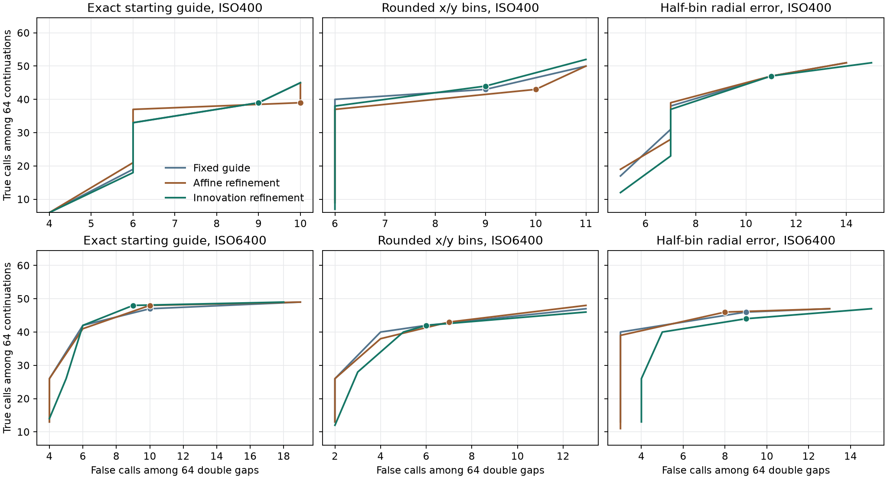
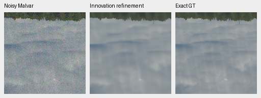
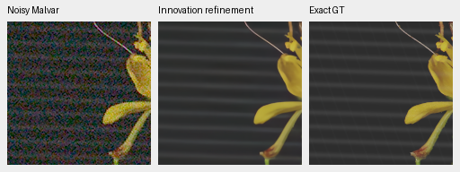

# Confirming a wire-frequency adjustment outside the query

An exterior RAW search moves the stronger rounded guide closer to the
true frequency on 64 fresh photo backgrounds. At ISO6400 the median
error falls from **0.395 to 0.341 DFT bins** with the innovation fit.
The second direction stays around 0.40 bins. The same verifier still
calls **42 true continuations and 6 false continuations** with either
rounded guide policy. Bounded delivery recovers strong-wire contrast
above the aligned EMA, with small and mixed additional gains from
refinement. On the fine GFX cab, local refinement leaves an overly
regular right aperture and incomplete crossings on both sides.

[Machine results](results/wire-guide-refinement-v1/publication.json) ·
[Frozen drivers and receipts](results/wire-guide-refinement-v1/evidence.tar.xz) ·
[Native boards and provenance](images/wire-guide-refinement-v1/manifest.json) ·
[Previous exterior verifier](wire-exterior-verification.md).

[Directional support windows](wire-segment-support.md) test the same
camera nominations on short sections of each wire and add a fresh
partial-break panel. At equal correction RMS the directional and uniform
controls have mixed error and response changes.

## Keeping the fit outside the aperture

Each packed Bayer checkerboard fold nominates two wavevectors from
exterior data. The search tries radial and tangential movements around
the supplied pair and fits a fundamental and second harmonic for each
frequency. It tries 169 pairs, with an explicit cost for moving away
from the supplied guide. The affine version removes one plane per CFA
position. The innovation version subtracts the four diagonal
same-color neighbors from both the observations and the candidate
waveform.

Alternating eight-cell blocks in the discovery parity provide disjoint
nomination and confirmation samples. Each innovation stencil stays
inside its block. The fixed proposed wave must lower the standardized
confirmation error by more than two to replace the nominal pair. This
is an empirical rule. Neighboring contrasts can share exterior
donors. After the decision, the same discovery parity refits phase and
width. The opposite parity supplies the scored samples inside the
aperture. The previous exterior-adapted affine/neighbor blend and
half-amplitude gate/cap are held fixed across the three methods.

In 16 same-fold interventions, replacing the held-out RAW inside the
aperture changes the score while preserving the proposed frequency,
predicted background and score contrasts. Changing the targets also
preserves the operational scores. The final fold average reuses both
parities. The frozen neural image used for delivery sees the entire
RAW.

## Fresh exact-target measurements

The test uses 64 new Commons photo backgrounds, disjoint by source ID
and cache hash from the training manifest, the 427-photo panel and the
previous fresh wire study. Each ISO has 32 sources, eight per Bayer
pattern. Two independent redraws per source cover a true continuation,
a double gap and a separate exact flat. Each method receives the same
samples and aperture. The starting guides are the exact frequency
pair, the same pair rounded to integer native DFT coordinates, or a
signed half-bin radial displacement. These three supplied guides
isolate how the refit handles frequency error.

| ISO6400 starting guide | Fixed true / false | Affine refined true / false | Innovation refined true / false |
| --- | ---: | ---: | ---: |
| Exact | 47 / 10 | 48 / 10 | 48 / 9 |
| Rounded x/y bins | 42 / 6 | 43 / 7 | 42 / 6 |
| Half-bin radial error | 46 / 9 | 46 / 8 | 44 / 9 |

The reported operating point requires exterior standardized strength
of at least three on both folds and interior response above half the
measured exterior amplitude. All 384 flat decisions across the three
guide conditions and two ISOs remain at zero in each method. On
ISO400 rounded guides, innovation changes the true/false counts from
43/9 to 44/9. With a half-bin radial displacement, the median error
stays at about half a bin in both directions at both ISOs. At ISO6400
innovation accepts a move on 16.4% of continuing folds with a rounded
start, 25.8% with a radial displacement and 10.2% with an exact start.

The curves connect the recorded amplitude thresholds from 0.25 to
1.25. Dots mark 0.5. Each ISO contributes 64 true and 64 inner double-gap
observations. No arm improves the operating curve across all thresholds.

## Delivered detail and error

The same bounded neutral lift is applied over the aligned-control EMA
SHA256 `e1e706a7c5a49da96dfb77a7779126504a2aa85d8626567a09d4690b0b30b9ec`.
Its foundation is the Corpus 100k EMA. V120 uses SHA256
`a9d9b6b4f974e24a6b11e5e740aab32314233a7f53c056cf37c7d2aac1c589fb`.
The lift compares RAW and the frozen image through the same contrast,
adds only a positive deficit and caps it at half the fitted exterior
amplitude.

| ISO6400, rounded guides | Signed strong response | Continuing-gap luma RMS | False strong-line RMS | Double-gap luma RMS |
| --- | ---: | ---: | ---: | ---: |
| V120 EMA | 75.79% | 317.69 | 17.01 | 310.02 |
| Aligned EMA | 70.76% | 316.60 | 18.01 | 309.87 |
| Fixed guide lift | 85.79% | 314.18 | 18.24 | 310.42 |
| Affine refined lift | 86.40% | 314.87 | 18.85 | 310.48 |
| Innovation refined lift | 86.21% | 314.54 | 18.12 | 310.36 |

RMS values are in DN16. All lifts retain the aligned control's exact
flat results. On rounded ISO6400 guides, innovation adds 0.42 points
over the fixed lift with a paired source-bootstrap interval of
[−0.12, +1.10]. Continuing-gap RMS changes by +0.37 DN16
[−0.20, +1.32], and false-line RMS by −0.12 [−0.36, +0.00].
With an exact starting guide, innovation shifts false-line RMS by
−0.51 DN16 [−1.42, 0.00] and gains 0.87 response points
[−0.09, +2.17]. Under half-bin radial error, the affine arm has
the better result, with +0.77 response points and −0.81 false-line
DN16 versus fixed. The innovation arm loses 0.19 points and adds
0.43 false-line DN16 in the same comparison. The largest selected
radial double-gap redraw adds 21.33 DN16 of false-line projection.
A separate exact-guide redraw loses 24.50 DN16 of false projection.
[Radial adverse gap](images/wire-guide-refinement-v1/exact/radial-ISO6400-largest-increase-33-draw1-comparison.png) ·
[Exact-guide gap with less false projection](images/wire-guide-refinement-v1/exact/exact-ISO6400-largest-reduction-08-draw1-comparison.png).

The frozen FP32 crop replay took 306.70 s including archive writes.
Raw evaluation took 215–262 s per guide, and the three-guide bounded
delivery pass took 176.22 s. Numerical evaluation and native viewing
are complete. This experiment uses existing weights and supplied
candidate conditions, so its scope is separate from fixed full427 and
known/unseen measured-camera PSNR.

### Native exact-target crops

Each triplet shows noisy Malvar, the rounded innovation lift over the
aligned EMA, and exact synthetic GT. Each panel is 160×160 native
pixels at `[48,48,160,160]` in its native 256-pixel query. Both use
ISO6400 shot/read `0.00128/6.5536e-6`, capture exposure ×0.33, ADC
16-bit with black 0.03 and display ×2. The manifest binds the D4
transform, noise draw and checkpoint to each crop.

**Vyazma River**, Alexxx1979, CC BY-SA 4.0, query
`[154,0,256,256]` before D4. The refined field adds a faint diagonal
over the reflection. Continuing-gap RMS falls 4.08 DN16 versus the
fixed lift on this redraw. The finer crossings remain faint.
[Source](https://commons.wikimedia.org/wiki/File:Vyazma._Vyazma_River_P7170477_2350.jpg) ·
[All methods](images/wire-guide-refinement-v1/exact/rounded-ISO6400-best-56-draw0-comparison.png).

**Chestnut Bob**, Sandipoutsider, CC BY-SA 4.0, query
`[368,38,256,256]` before D4. Refinement increases the strong horizontal
contrast in the middle. The faint diagonal family in the target
remains missing. Continuing-gap RMS rises 24.23 DN16.
[Source](https://commons.wikimedia.org/wiki/File:Close_wing_position_Nectaring_of_Iambrix_salsala_(Moore,_1866)_-_Chestnut_Bob_WLB_IMG_1643a.jpg) ·
[All methods](images/wire-guide-refinement-v1/exact/rounded-ISO6400-worst-09-draw1-comparison.png).

## Standing GFX100S comparisons

The camera replay keeps the earlier noisy-RAW nominations and the
28-pixel-radius circular aperture. Both RAW folds can share observations
with the earlier nomination process. The fixed-guide panels reproduce
the preceding exterior-adapted lift byte for byte at display precision.
The main scene uses DSCF3879/3880 at display ×4. The DSCF3842/3835
cab uses displays ×4 and ×16. The neighboring ISO100 AHD renders and
camera JPEGs are qualitative references with different exposure,
aperture and subject motion.

Sky and foliage receive empty banks and stay identical to the aligned
EMA. Innovation reduces the building correction from 3.98 to 2.01
DN16 RGB RMS versus aligned, leaving the finest cables and bracing
soft. The coarse fence still has coherent diamonds with subtle local
contrast changes. Both right-cab profiles keep the earlier central
grid. Refinement intensifies it slightly with transferred conditioning.
The visible portion is too regular, and fine intersections stay
incomplete outside it.

[Sky](images/wire-guide-refinement-v1/standing/main-overcast-sky-main-overcast-sky-x4.png) ·
[Building](images/wire-guide-refinement-v1/standing/main-building-detail-main-building-detail-x4.png) ·
[Foliage](images/wire-guide-refinement-v1/standing/main-foliage-main-foliage-x4.png) ·
[Coarse fence](images/wire-guide-refinement-v1/standing/main-chain-link-fence-main-chain-link-fence-x4.png).

| Cab conditioning | Left query bank | Right query bank | Left with archived donor pair |
| --- | --- | --- | --- |
| Nominal `0.00128/6.5536e-6` | [×4](images/wire-guide-refinement-v1/standing/mesh-nominal-fine-green-mesh-left-x4.png) · [×16](images/wire-guide-refinement-v1/standing/mesh-nominal-fine-green-mesh-left-x16.png) | [×4](images/wire-guide-refinement-v1/standing/mesh-nominal-fine-green-mesh-right-x4.png) · [×16](images/wire-guide-refinement-v1/standing/mesh-nominal-fine-green-mesh-right-x16.png) | [×4](images/wire-guide-refinement-v1/donors/mesh-nominal-fine-green-mesh-left-donor-x4.png) · [×16](images/wire-guide-refinement-v1/donors/mesh-nominal-fine-green-mesh-left-donor-x16.png) |
| Transferred `0.0014635775921166604/1.0715704128646712e-6` | [×4](images/wire-guide-refinement-v1/standing/mesh-profile3879-fine-green-mesh-left-x4.png) · [×16](images/wire-guide-refinement-v1/standing/mesh-profile3879-fine-green-mesh-left-x16.png) | [×4](images/wire-guide-refinement-v1/standing/mesh-profile3879-fine-green-mesh-right-x4.png) · [×16](images/wire-guide-refinement-v1/standing/mesh-profile3879-fine-green-mesh-right-x16.png) | [×4](images/wire-guide-refinement-v1/donors/mesh-profile3879-fine-green-mesh-left-donor-x4.png) · [×16](images/wire-guide-refinement-v1/donors/mesh-profile3879-fine-green-mesh-left-donor-x16.png) |

Both left query banks are empty. Supplying the older exterior pair
in a separate replay uses the identical RAW crop, aperture and noise.
Both directions exceed the exterior strength requirement under both
profiles. Neither innovation ratio exceeds 0.5 under either profile.
Affine admits one direction per profile, applying 2.42 and 1.69 DN16
of RGB correction versus aligned. Fixed admits one under the
transferred profile. The earlier, wider donor fit over Corpus 100k
shows clearer but overly regular left diamonds. Neither of the local
refits restores connected left crossings. The left case shows that
finding plausible frequencies in the surroundings can still leave
weak local support for the two crossings. [Earlier donor comparison](query-donor-composition.md).
