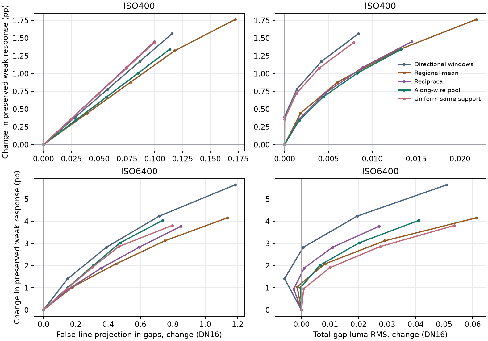
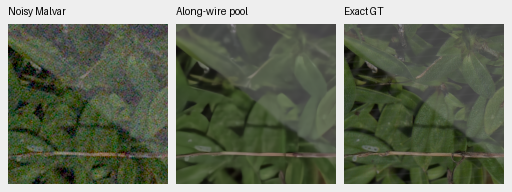
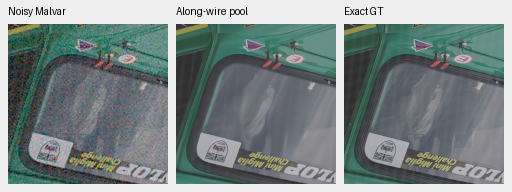

# Estimating missing wire contrast from nearby Bayer samples

On an independent 48-photo panel, along-wire pooling lowers preserved
ISO6400 luma RMS by **0.033 DN16** versus a uniform lift of the same
strength and support. The measured weak-response advantage is **0.23
percentage points**, with an interval spanning zero. The previous
directional lift recovers 1.60 points more at its original strength.
Doubling the cap gains back 0.98 points, with more false projection
in fully absent queries and a stronger regular patch in the real cab.

[Machine results](results/wire-regional-amplitude-v1/publication.json) ·
[Frozen drivers and receipts](results/wire-regional-amplitude-v1/evidence.tar.xz) ·
[Native crops and provenance](images/wire-regional-amplitude-v1/manifest.json).

## Measuring the missing contrast

The [directional support experiment](wire-segment-support.md) used one
measured RAW/parent deficit across the entire aperture. Its exact break
mask recovered just 0.55 more ISO6400 response points at the existing
correction strength. The new variants re-estimate the missing contrast
in each of the 15 directional windows. All variants use the same RAW
samples, carrier phase, taper, clipping rule, exterior strength
requirement and directional support gains.

Each weighted fit projects out a separate plane and the competing
orientation for each Bayer position. The fixed contrast measures the
difference between observed RAW and the frozen parent's value at that
actual sensor site. The **regional mean** averages the two Bayer
checkerboard estimates. **Reciprocal** uses the geometric mean of two
positive deficits, yielding zero when either estimate is nonpositive.
**Along-wire pool** uses the same reciprocal rule with a wider
measurement that averages adjacent windows along the wire before
projection. This pooling never crosses to another across-wire row.
The same-support control uses one uniform amplitude per aperture with
the same correction RMS as the pooled output. All four estimates cap
the local amplitude at half the measured exterior amplitude.

Replacing one fold's interior RAW samples changes that fold's regional
and pooled measurements and preserves the other fold's measurements in
the audited trials. The frozen neural image already sees both folds.
The resulting deficit test is empirical, with noise and prediction
errors shared through that image.

## Independent partial-break panel

The earlier 48-photo segment panel is a development replay. A second
48-photo panel uses separate source IDs, cache hashes and sensor seeds,
with 24 sources per ISO and six per CFA. Each photo has two independent
draws of an intact weak carrier, a partial break, a fully absent weak
carrier within the aperture and an exact flat. The stronger orientation
persists in the three wire roles. The breaks include shared strips and
staggered offsets on neighboring wires. Half the sources have a
competing sharp step, and half have a tinted weak carrier.

Synthetic tests supply the aperture and rounded nominal frequencies.
Phase and width are estimated from the noisy scene. Exact break
coordinates enter scoring. No parameters are fitted to the new panel.
An independent audit checks both 48-source panels against the recorded
training, fixed 427-photo and older photo cohorts. It finds zero ID or
cache-hash overlaps. The older capture driver accidentally used the
photo-count constant to check the hash length. The new driver uses the
full SHA256 length. The original driver and evidence remain in the
earlier archive.

The analytic stage uses existing aligned-control EMA
`e1e706a7c5a49da96dfb77a7779126504a2aa85d8626567a09d4690b0b30b9ec`
over Corpus 100k. The general-use comparison is V120 EMA
`a9d9b6b4f974e24a6b11e5e740aab32314233a7f53c056cf37c7d2aac1c589fb`.
The inference experiment has separate coverage from fixed 427-photo
and known/unseen measured-camera PSNR. The numerical and native
reviews use the same checkpoint and input hashes.

### Response and false continuation

| ISO6400 policy | Preserved weak response | Preserved luma RMS | False-line projection in the break | Total gap luma RMS |
| --- | ---: | ---: | ---: | ---: |
| V120 EMA | 43.206% | 274.441 | 10.145 | 292.311 |
| Aligned EMA | 39.545% | 274.455 | 10.041 | 293.714 |
| Whole-aperture hard | 47.600% | 274.073 | 12.600 | 294.065 |
| Previous directional lift | 45.185% | 274.077 | 11.227 | 293.765 |
| Regional mean | 43.698% | 274.063 | 11.179 | 293.775 |
| Reciprocal | 43.318% | 274.115 | 10.892 | 293.741 |
| Along-wire pool | 43.585% | 274.075 | 10.778 | 293.755 |
| Uniform on the same support | 43.354% | 274.109 | 10.838 | 293.767 |

Errors use DN16. Compared with the matched-strength uniform lift,
along-wire pooling changes ISO6400 response by +0.230 points
[−0.144, +0.656], preserved luma RMS by −0.033 DN16 [−0.070, −0.003],
and false projection by −0.059 DN16 [−0.329, +0.249]. Intervals resample
whole photos. At the lower noise level these differences are −0.096
points, +0.005 DN16 and +0.014 DN16 respectively. The development
panel had a 0.174 DN16 reduction in the ISO400 false projection
which does not repeat.

Above the aligned parent the pooled lift recovers 4.039 ISO6400
response points [2.168, 6.231], with +0.737 DN16 false projection
[−0.111, +1.664]. At full measured strength the previous directional
lift recovers more and has more false projection. Downscaling that
lift on the plotted grid gives a similar tradeoff. All 96 held-out
exact flats reproduce the aligned parent. At ISO6400 the pooled
lift changes 34/48 partially broken draws and 28/48 fully absent
draws, versus 30/48 and 16/48 for the previous directional lift.

The curves show the effect of scaling each fixed correction to
25%, 50%, 75% and 100%. The origin is the aligned EMA. Uniform and
pooled have the same per-crop correction energy at each scale.

### Widening the cap

Allowing one exterior amplitude instead of half adds **0.983 response
points** [0.317, 1.769] at ISO6400 for the pooled method. Preserved
luma RMS falls by 0.081 DN16 [−0.181, −0.013]. Mean false projection
rises by 0.058 DN16 in partial breaks and 0.120 DN16 in fully absent
queries. At the resulting partial-break false projection, linear
interpolation of the previous directional curve estimates 44.01%
response versus 44.57% for the widened pooled lift. This is a local
comparison of the observed tradeoff. V120 retains the lower total
gap error of 292.311 DN16 versus 293.769 with the widened cap.

The frozen FP32 crop replay took 596.95 s. The independent analytic
replay took 417.11 s including waits for parent outputs. Numerical
evaluation and native viewing are complete.

### Native 100% crops

Every cell is 160×160 at `[48,48,160,160]` in a 256-pixel native query.
These ISO6400 examples use shot/read `0.00128/6.5536e-6`, capture
exposure ×0.33, 16-bit ADC with black 0.03, and display ×2. The aligned
checkpoint hash above and the D4 transforms are bound in the manifest.
Each triplet shows noisy Malvar, the marked pooled variant, and exact
synthetic GT.

**Chlorophyllum molybdites**, Ianaré Sévi, CC BY-SA 3.0. The box is
`[224,502,256,256]` before D4, BGGR. The standard cap reduces false
projection from 11.53 to 10.15 DN16 versus uniform. The thin lattice
remains incomplete and the aligned parent has lower false projection.
[Source](https://commons.wikimedia.org/wiki/File:Chlorophyllum_molybdites_younger.JPG) ·
[All methods](images/wire-regional-amplitude-v1/exact/ISO6400-beneficial-02-draw1-comparison.png).

**Castle Combe Circuit**, mattbuck, CC BY-SA 3.0. The box is
`[328,118,256,256]` before D4, RGGB. The standard cap increases
false projection from 29.01 to 33.80 DN16 versus uniform. Major
edges remain sharp and fine texture across the window stays soft.
[Source](https://commons.wikimedia.org/wiki/File:Castle_Combe_Circuit_MMB_H2_Mini_7s_and_Miglia_Championship.jpg) ·
[All methods](images/wire-regional-amplitude-v1/exact/ISO6400-adverse-04-draw0-comparison.png).

**Wider cap examples.** Grube Schloss, A.Savin, CC BY-SA 3.0, uses
`[764,88,256,256]` before D4, RGGB. The response gains 9.93 points
on this redraw and diagonal contrast over the pale area increases
slightly. Rustic, Charles J. Sharp, CC BY-SA 4.0, uses
`[584,272,256,256]` before D4, GBRG. False projection rises by
2.79 DN16 across the break. Both use the same ISO6400 settings.
[Grube Schloss source](https://commons.wikimedia.org/wiki/File:Prignitz_07-13_img08_Grube_Schloss.jpg) ·
[Rustic source](https://commons.wikimedia.org/wiki/File:Rustic_%28Cupha_erymanthis%29_Tad_Thong.jpg).

[Grube Schloss full-cap triplet](images/wire-regional-amplitude-v1/exact/iso6400-cap-response-22-draw1-triplet.png) ·
[Rustic full-cap triplet](images/wire-regional-amplitude-v1/exact/iso6400-cap-false-line-03-draw1-triplet.png).

## Standing GFX100S comparisons

The main scene uses DSCF3879/3880 at display ×4. The fine cab uses
DSCF3842/3835 at ×4 and ×16. Both left ROIs use the archived exterior
donors. The right ROIs use the previous noisy-query nominations.
All cases keep the same 28-pixel aperture. The whole-aperture hard
gate and previous directional outputs reproduce the earlier images
at display precision in all 12 boards. ISO100 AHD and both cab
camera JPEGs are independent qualitative references with differing
aperture, exposure and motion.

The sky and foliage retain their parent values with empty banks.
On the building, the along-wire correction falls from 1.61 to
0.74 DN16 camera-RGB RMS versus the aligned parent. The thin cables
stay soft. The coarse fence keeps its crossing pattern, with
slightly reduced contrast inside the aperture.

Along-wire pooling adds 0.64 and 0.69 DN16 RGB RMS in the two left
crops. Neither crop shows connected new crossings. The right-sided
corrections measure 6.07 and 5.72 DN16 under the two profiles. The
transferred crop still shows the clearest diagonals, with incomplete
fine intersections and an overly regular patch. The pooled and
equal-RMS uniform lifts look similar at native size.

The wider cap changes the nominal right ROI by 5.31 DN16 RGB RMS
relative to the half-cap output. It strengthens the regular patch
without resolving missing crossings. The transferred right changes
by 1.27 DN16 and both left changes stay below 0.44 DN16. The four main
ROIs change by at most 0.004 DN16.
[Nominal cap comparison](images/wire-regional-amplitude-v1/standing-limit/mesh-nominal-fine-green-mesh-right-cap-x16.png) ·
[Transferred cap comparison](images/wire-regional-amplitude-v1/standing-limit/mesh-profile3879-fine-green-mesh-right-cap-x16.png).

[Sky](images/wire-regional-amplitude-v1/standing/main-overcast-sky-main-overcast-sky-x4.png) ·
[Building](images/wire-regional-amplitude-v1/standing/main-building-detail-main-building-detail-x4.png) ·
[Foliage](images/wire-regional-amplitude-v1/standing/main-foliage-main-foliage-x4.png) ·
[Coarse fence](images/wire-regional-amplitude-v1/standing/main-chain-link-fence-main-chain-link-fence-x4.png).

| Cab conditioning, shot/read | Left ROI | Right ROI |
| --- | --- | --- |
| Nominal `0.00128/6.5536e-6` | [×4](images/wire-regional-amplitude-v1/standing/mesh-nominal-fine-green-mesh-left-x4.png) · [×16](images/wire-regional-amplitude-v1/standing/mesh-nominal-fine-green-mesh-left-x16.png) | [×4](images/wire-regional-amplitude-v1/standing/mesh-nominal-fine-green-mesh-right-x4.png) · [×16](images/wire-regional-amplitude-v1/standing/mesh-nominal-fine-green-mesh-right-x16.png) |
| Transferred `0.0014635775921166604/1.0715704128646712e-6` | [×4](images/wire-regional-amplitude-v1/standing/mesh-profile3879-fine-green-mesh-left-x4.png) · [×16](images/wire-regional-amplitude-v1/standing/mesh-profile3879-fine-green-mesh-left-x16.png) | [×4](images/wire-regional-amplitude-v1/standing/mesh-profile3879-fine-green-mesh-right-x4.png) · [×16](images/wire-regional-amplitude-v1/standing/mesh-profile3879-fine-green-mesh-right-x16.png) |
