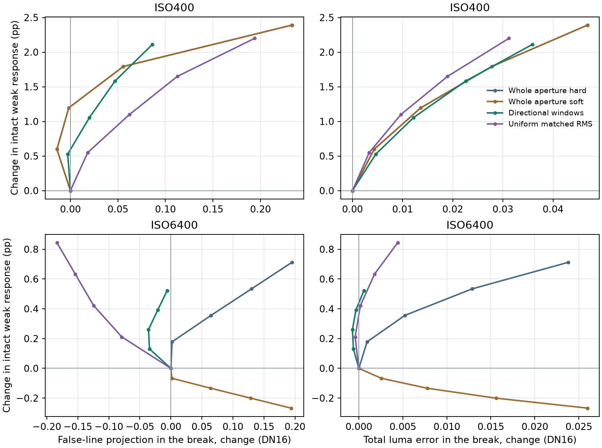
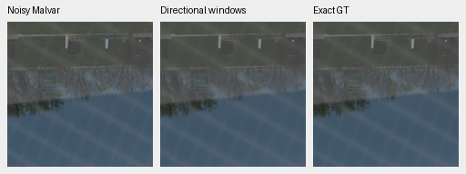
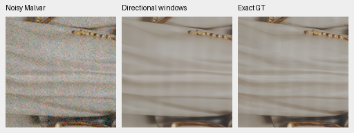

# Local Bayer evidence for interrupted weak wires

On 48 held-out photos, directional support windows give mixed changes
at matched correction strength. At ISO400 they lower mean false-line
projection by 0.108 DN16 versus a uniform lift of the same RMS. At
ISO6400 they raise it by 0.178 DN16 and lose 0.323 points of recovered
weak response. Both left-cab profiles receive a small correction,
with no visible recovery of connected crossings.

[Machine results](results/wire-segment-support-v1/publication.json) ·
[Frozen drivers and receipts](results/wire-segment-support-v1/evidence.tar.xz) ·
[Native crops and provenance](images/wire-segment-support-v1/manifest.json).

## Directional support

The previous [exterior frequency test](wire-frequency-refinement.md)
found that both left-cab frequencies have support outside the query.
The ratio of interior to exterior amplitude often fell just below
the aperture-wide gate. A single coefficient also applies to wire
segments whose underlying contrast can vary within the aperture.

The new fit uses three overlapping windows across the wave normal
and five along the wire direction. For each window, the score projects
out a separate affine plane per Bayer position and a continuing
competing wave with separate per-position amplitude. The two CFA
checkerboards each estimate the carrier phase, width and exterior
strength using their own outer samples. They score the other
checkerboard inside the aperture at fixed coordinates. A smooth
gain requires positive directional contrast in both folds. It rises
from zero to one as the mean local-to-exterior ratio goes from 0.33 to
0.83 and the standardized score goes from 0.75 to 3.25. The score uses
an independent-noise approximation for scaling. Overlapping windows
and RAW texture make the resulting gain empirical.

The same measured RAW/parent deficit, capped at half the exterior
amplitude, sets the maximum correction for every method. The
triangular window weights sum to one at each pixel. Their interpolated
gain modulates the signed tapered carrier. The **uniform matched RMS**
control has the same carrier, phase and per-crop correction RMS as
the directional method. The **whole-aperture soft** control uses the
same smooth gain and the complete aperture as one measurement. The
**whole-aperture hard** control is the preceding half-exterior gate,
including its exterior-adapted contrast. Each policy uses the same
clipping guard.

In eight interventions, replacing a fold's held-out samples inside
the aperture changes the directional measurements and preserves the
prediction, phase, width and contrast scales. Replacing exact targets
preserves the complete operational record. The final comparison
averages the two folds, and the frozen neural parent sees the full RAW.

## Fresh exact-break test

The 48 held-out Commons photos are disjoint by source and cache hash
from the training set, the fixed 427-photo panel and the previous two
wire panels. There are 24 photos per ISO, six per CFA. The four roles
place a faint direction over a stronger continuing wire. The weak
direction can continue, have a partial gap, or be absent throughout
the scoring aperture. The fourth role is an exact flat. Partial
breaks can lie across all wires or alternate position between
adjacent wires. Half the photos have a shared sharp step, and half
have a tinted weak carrier. Two independent redraws per source and
role use matched Bayer/camera transforms. Supplied geometry and rounded
native-DFT guides isolate the local evidence test.

The full path uses the aligned-control EMA
`e1e706a7c5a49da96dfb77a7779126504a2aa85d8626567a09d4690b0b30b9ec`
over Corpus 100k and the V120 EMA comparison
`a9d9b6b4f974e24a6b11e5e740aab32314233a7f53c056cf37c7d2aac1c589fb`.
Weak response projects the difference between partial and fully
absent outputs onto the exact weak increment at preserved sites.
The false-line measurement projects error onto the missing weak
carrier in the actual break. Both are accompanied by total luma
error. This is a scoped inference experiment with existing weights.
Fixed 427-photo and known/unseen camera PSNR remain separate evidence.

### Measured response and false detail

| ISO6400 policy | Preserved weak response | Luma RMS on preserved sites | False-line RMS in the break | Total luma RMS in the break |
| --- | ---: | ---: | ---: | ---: |
| V120 EMA | 64.080% | 260.882 | 9.638 | 251.126 |
| Aligned EMA | 57.583% | 259.635 | 9.038 | 250.546 |
| Whole-aperture hard | 58.295% | 259.555 | 9.233 | 250.570 |
| Whole-aperture soft | 57.316% | 259.562 | 9.231 | 250.572 |
| Directional windows | 58.104% | 259.628 | 9.031 | 250.546 |
| Uniform matched RMS | 58.428% | 259.622 | 8.854 | 250.550 |

RMS values are in DN16. The directional versus uniform change at
ISO6400 is −0.323 response points [−1.233, +0.409] and +0.178 DN16
of false-line projection [−0.006, +0.495]. The staggered-break subset
adds 0.261 DN16 of false projection and the shared-strip subset adds
0.079. At ISO400, the corresponding full-panel changes are −0.088
points [−0.514, +0.336] and −0.108 DN16 [−0.259, +0.009].
Intervals resample whole sources. The mean absolute break error
changes by less than 0.005 DN16 at either ISO. The four policies leave
all exact flats at the aligned result.

At ISO6400 the directional method applies some correction in 16 of
48 partial-break redraws and 12 of 48 fully absent redraws. The
hard gate changes six partial breaks and five fully absent examples.
The extra activations therefore include both retained weak samples and
known blanks. The energy-matched correction is small overall, averaging
0.253 DN16 RMS over the 256-pixel partial-break queries.

An oracle excludes the exact missing pixels from the partial-role
correction and redistributes its energy under the same cap. Even with
the known break it adds just 0.55 response points over directional
delivery at ISO6400 and 0.77 at ISO400. This diagnostic isolates break
placement for the measured lift. A different amplitude or phase
estimator can have different headroom. The parent FP32 crop replay took 581.31 s.
The CPU replay took about 260 s on the concurrently produced inputs,
including the time waiting for the remaining parent crops. Numerical
evaluation and native review are complete.

The curves show the same corrections applied at four strengths between
0.25 and 1.0. The origin is the aligned EMA. Uniform and directional
use the same change energy at each strength. The graph's narrow error
ranges reflect the small absolute effects of these corrections.

### Exact 100% crops

Each panel is 160×160 at native ROI `[48,48,160,160]`. Triplets show
noisy Malvar, the directional-window lift over the aligned EMA, and
exact synthetic GT, with capture exposure ×0.33, display ×2, a 16-bit
ADC and black fraction 0.03.

**Effingham cross**, Daniel Schwen, CC BY-SA 4.0. Source box
`[402,780,256,256]` before D4, GRBG, ISO400 shot/read
`8e-5/2.56e-8`. False-line projection falls from 3.10 to 1.82 DN16
versus the matched uniform lift. Most of the diagonal pattern is
already present in the parent.
[Source](https://commons.wikimedia.org/wiki/File:Effingham_cross.jpg) ·
[All methods](images/wire-segment-support-v1/exact/ISO400-best-03-draw1-comparison.png).

**Buttenheim**, ermell, CC BY-SA 4.0. Source box
`[118,272,256,256]` before D4, GBRG, ISO6400 shot/read
`0.00128/6.5536e-6`. The rendered folds look similar at native
scale. Residual false-line projection in the break is 8.22 DN16
versus 3.15 for uniform and 8.86 for aligned.
[Source](https://commons.wikimedia.org/wiki/File:Buttenheim-P1245661hdrPS.jpg) ·
[All methods](images/wire-segment-support-v1/exact/ISO6400-adverse-33-draw0-comparison.png).

[Other ISO400 tail](images/wire-segment-support-v1/exact/ISO400-adverse-46-draw1-comparison.png) ·
[Other ISO6400 tail](images/wire-segment-support-v1/exact/ISO6400-best-30-draw1-comparison.png).

## Standing GFX100S comparisons

The standing camera replay uses the earlier query nominations and
the archived left-cab exterior pair. The 28-pixel aperture and native
Bayer inputs stay fixed. The hard control matches the preceding fixed
guide at display precision in all 12 comparisons. Independent ISO100
AHD and camera JPEGs provide qualitative references with different
exposure, aperture and motion.

Sky and foliage retain the aligned result. The directional correction
on the building falls from 3.98 to 1.61 DN16 RGB RMS relative to aligned.
The narrow building wires remain soft. Coarse fence crossings stay
coherent, with almost the same correction strength as the hard gate.
The fine mesh receives 0.68 and 0.72 DN16 of directional RGB correction
on the two left profiles. Connected left crossings remain missing.
The right aperture is less strongly modulated, with incomplete fine
intersections and a regular patch that remains visible under ×16.
Directional and matched-strength uniform results differ by
0.53–1.22 DN16 RGB RMS in the four cab ROIs. At native scale they
show similar contrast around the remaining crossings.

[Sky](images/wire-segment-support-v1/standing/main-overcast-sky-main-overcast-sky-x4.png) ·
[Building](images/wire-segment-support-v1/standing/main-building-detail-main-building-detail-x4.png) ·
[Foliage](images/wire-segment-support-v1/standing/main-foliage-main-foliage-x4.png) ·
[Coarse fence](images/wire-segment-support-v1/standing/main-chain-link-fence-main-chain-link-fence-x4.png).

| Cab conditioning, shot/read | Left ROI | Right ROI |
| --- | --- | --- |
| Nominal `0.00128/6.5536e-6` | [×4](images/wire-segment-support-v1/standing/mesh-nominal-fine-green-mesh-left-x4.png) · [×16](images/wire-segment-support-v1/standing/mesh-nominal-fine-green-mesh-left-x16.png) | [×4](images/wire-segment-support-v1/standing/mesh-nominal-fine-green-mesh-right-x4.png) · [×16](images/wire-segment-support-v1/standing/mesh-nominal-fine-green-mesh-right-x16.png) |
| Transferred `0.0014635775921166604/1.0715704128646712e-6` | [×4](images/wire-segment-support-v1/standing/mesh-profile3879-fine-green-mesh-left-x4.png) · [×16](images/wire-segment-support-v1/standing/mesh-profile3879-fine-green-mesh-left-x16.png) | [×4](images/wire-segment-support-v1/standing/mesh-profile3879-fine-green-mesh-right-x4.png) · [×16](images/wire-segment-support-v1/standing/mesh-profile3879-fine-green-mesh-right-x16.png) |
