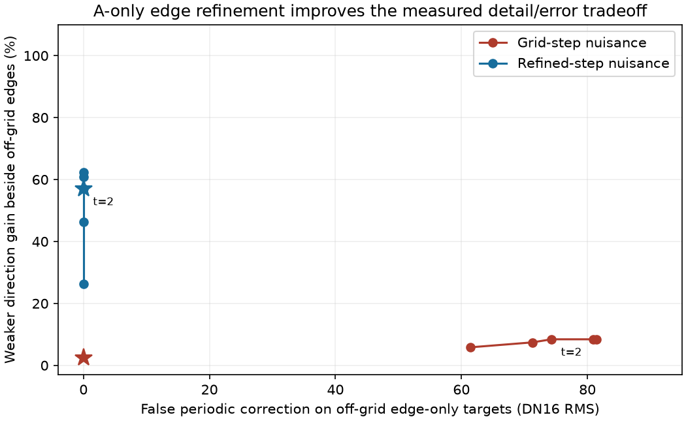
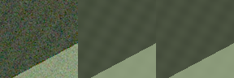
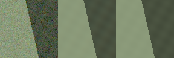

# Finer discovery-only edge geometry preserves more weak structure

Refining edge angle and position on the discovery subset improves the
[analytic CFA diagnostic](withheld-cfa-evidence.md). At thresholds chosen only
from separate calibration null scenes, both methods have **zero observed false
activations on all 384 test null patches**, while weaker-direction gain beside
off-grid edges rises from **2.39% to 56.99%**. Exact periodic-increment error falls
from **65.01 to 27.71 DN16 RMS**. These are restricted procedural results, not
an improved neural demosaicing checkpoint or validated camera confidence.

The shared-edge neural trial separately completed **900 updates/100 ADC skips**.
Both endpoints are slightly quieter but attenuate mesh more than matching V200
states; native color/detail failures persist. [Full neural comparison](shared-edge-comparison.md).

## Controlled comparison

The intervention adds three fixed 9×9 angle/offset searches around the best
coarse edge. Search radii shrink by four at each level. Every choice still uses
only the discovery samples; the fixed prediction is then assessed on the
disjoint validation subset. Background coefficients, frequencies, phases and
noise estimates also exclude validation samples. The unchanged default retains
the original grid search and reproduces archived affine/step predictions,
variances, selected frequencies and scores exactly on the checked replay.

Both arms use identical procedural scene/noise generators and seeds. All
**1,792 unchanged affine-control rows reproduce exactly**. The expanded panel
has seven families, 64 scene identities × two independent noise draws per family
in each of calibration/test, with both affine/step nuisance models: **7,168
fit records across the two arms**. The added family places the same two unequal
waves beside an off-grid edge; no known edge or wave geometry enters discovery.

| Test metric | Original grid step | Refined step |
| --- | ---: | ---: |
| Fixed threshold 2: off-grid edge-only false activations | 113/128 | 0/128 |
| Fixed threshold 2: off-grid false periodic correction | 74.28 DN16 | 0 DN16 |
| Fixed threshold 2: weak-direction gain beside off-grid edge | 8.41% | 56.99% |
| Fixed threshold 2: exact increment error beside off-grid edge | 91.52 DN16 | 27.71 DN16 |
| Calibration-selected threshold | 9.055919065 | 2 |
| Calibration-selected: flat/grid-edge/off-grid-edge false activations | 0/384 | 0/384 |
| Calibration-selected: weak-direction gain beside off-grid edge | 2.39% | 56.99% |
| Calibration-selected: exact increment error beside off-grid edge | 65.01 DN16 | 27.71 DN16 |

The threshold rule is fixed before evaluating test metrics:
`max(2, next_float_above(maximum calibration-null minimum A/B score))`.
Calibration nulls comprise flats and represented/off-grid edge-only scenes.
Present-detail scenes and all test scores are excluded from threshold selection;
a focused test checks this exclusion. This matches **observed** false-detail
error on these controls, without establishing a population risk guarantee.

With calibration-selected thresholds, the paired source-cluster bootstrap
interval for weaker-direction improvement is **+45.29 to+63.63 percentage
points**, and for increment-error change **−41.76 to−32.76 DN16**. Each source
averages its two noise repeats before 5,000 paired resamples. These are
exploratory percentile intervals; zero observed null events and degenerate
bootstrap intervals do not prove zero population error.



Circles use fixed thresholds 0–4; stars use the calibration-only rule. The two
axes score different present/absent families. Increment error compares the
delivered periodic correction with the exact periodic increment, including
off-target energy and gating; it is not total RGB reconstruction error. The
error reduction is independently checked against direct pixel differences.

Refinement is not a universal gain. At threshold 2, weak-direction gain beside
an already represented edge changes from 52.15% to 51.74%, while its increment
error rises from 28.46 to 28.81 DN16. Without an edge, weaker-direction gain is
95.00% versus 94.95%. This intervention addresses the tested geometry mismatch;
it does not remove all attenuation or strengthen every detail estimate.

## Native synthetic views

Noisy Malvar → **refined analytic predictor** → exact procedural RGB GT. Each
cell retains 96×96 pixels from 128×128 context, ROI `[16,16,96,96]`, RGGB, shot
0.00128/read 6.5536e−6, display exposure 4/contrast 1, WB 1/matrix I and clipped sRGB.
The noise draws here omit ADC rounding/clipping. Both triplets use the first two
test source identities of the off-grid-wave family, repeat 0, without selecting
by outcome. Analytic fits predict RGB at unmeasured sites using the same A-only
per-color coefficients; every measured-site prediction is checked against the
diagnostic's CFA prediction before rendering. GT enters display/scoring only.





The corresponding four-column boards retain noisy/grid/refined/GT:
[first](images/withheld-cfa-edge-refinement-v1/comparison-0.png),
[second](images/withheld-cfa-edge-refinement-v1/comparison-1.png).
The refined views retain faint modulation that is missing from the thresholded
grid baseline; the exact GT still has stronger modulation. Both boards were
actually inspected at native pixel size.

There is no trained checkpoint for this analytic prototype. Its
[configuration identity](results/withheld-cfa-edge-refinement-v1/analytic-model.json)
has SHA256 `8c34165893f2186c82f64f53ad1eeebf130b61e425d5ece99151d28d80fef47d`.
The [native provenance](results/withheld-cfa-edge-refinement-v1/native-publication.json)
binds the actual configuration digest, code, source/noise seeds, input/GT value
hashes, ROI and transforms. This identity describes an analytic configuration;
it is not a neural-weight hash.

## Limits and next test

This remains native 128 RGGB with two grid sines, a sharp straight step and
independent Poisson/Gaussian noise. The first off-grid failure motivated this
follow-up, so it is development evidence. Curved/multiple edges, finite wires,
nonperiodic textures, other CFAs and correlated noise remain open. Finer edge
search can also absorb actual weak structure. The predictor is not yet a
safe replacement for the real-camera detail head.

The next useful diagnostic should add finite/local support and richer competing
edges while retaining these absent controls and separate weaker-direction
error. The completed neural comparison establishes no decisive weak-detail gain;
the [three-prior fresh-noise panel](edge-snr-ladder.md) is now reviewed. The new
[local conditional-wave component](local-validated-waves.md) extends A/B evidence
to finite-window parent replacement, with a completed pilot and full-panel
evaluation running. Its real crossings remain unresolved. Protected GFX images,
originals and existing receipts are intact.

[Comparison and paired intervals](results/withheld-cfa-edge-refinement-v1/comparison.json) ·
[Exact compressed fit records/code archives](results/withheld-cfa-edge-refinement-v1/publication.json).

```bash
source scripts/env.sh
OPENBLAS_NUM_THREADS=1 uv run python scripts/diagnose_withheld_cfa.py \
  .cache/experiments/edge-grid-new --scenes 64 --include-offgrid-waves
OPENBLAS_NUM_THREADS=1 uv run python scripts/diagnose_withheld_cfa.py \
  .cache/experiments/edge-refined-new --scenes 64 --edge-refinements 3 --include-offgrid-waves
OPENBLAS_NUM_THREADS=1 PYTHONPATH=.:src:scripts uv run python scripts/compare_withheld_cfa.py \
  .cache/experiments/edge-grid-new/result.json \
  .cache/experiments/edge-refined-new/result.json .cache/experiments/edge-compare-new
```
